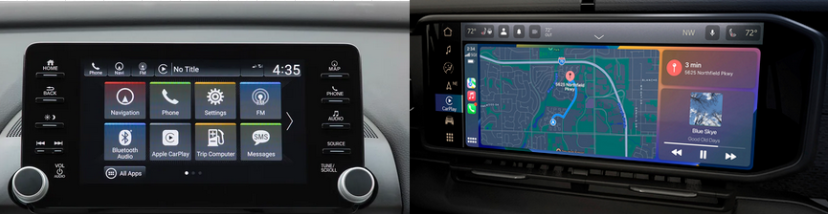
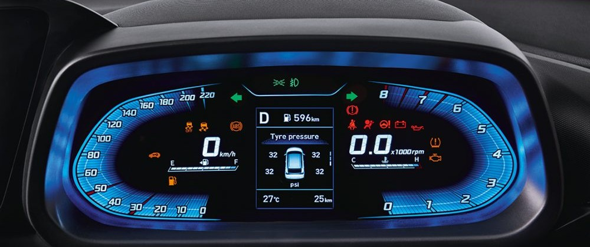
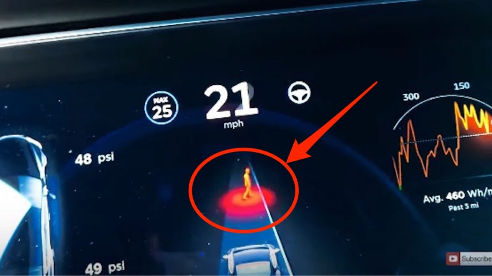
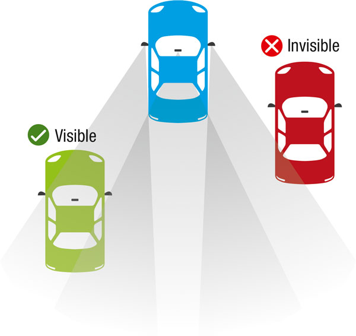
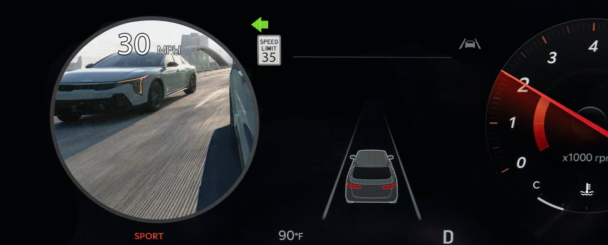
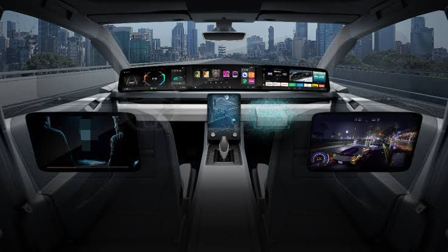
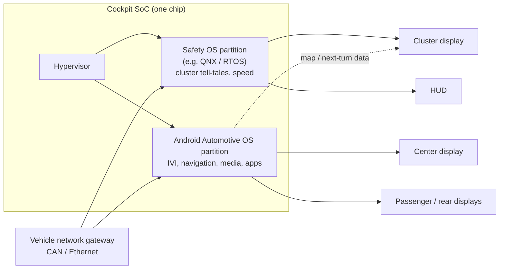

# Digital Cockpits in Vehicles

> **Evidence:** this is a **domain introduction**. Most content is **General concept** (automotive
> industry knowledge). Where AAOS implements a concept, the AOSP 17 source location is given and
> marked **Verified in source**.

**Prerequisites:** none. This is the first chapter.
**Next:** [Linux vs Android](../01.%20LinuxVsAndroid/README.md).

**After this chapter you should be able to:**

1. Define IVI, digital cluster, HUD and digital cockpit, and say who each one serves.
2. Explain why the cluster is treated differently from infotainment (safety).
3. Point to where AAOS represents these displays in its source.

---

## Table of Contents

- [1. In-Vehicle Infotainment (IVI) system](#1-in-vehicle-infotainment-ivi-system)
- [2. Digital instrument cluster](#2-digital-instrument-cluster)
- [3. Head-Up Display (HUD)](#3-head-up-display-hud)
- [4. Digital cockpit](#4-digital-cockpit)
- [5. Comparison](#5-comparison)
- [6. Why cars use these systems](#6-why-cars-use-these-systems)
- [7. How this maps to Android Automotive OS](#7-how-this-maps-to-android-automotive-os)
- [8. Common misconceptions](#8-common-misconceptions)
- [9. Summary and knowledge check](#9-summary-and-knowledge-check)

---

## 1. In-Vehicle Infotainment (IVI) system

**Purpose:** provide **information and entertainment** to the driver and passengers: media,
navigation, phone calls, apps and connected services.

Further reading: [IVI overview (MPS)](https://www.monolithicpower.com/en/learning/mpscholar/automotive-electronics/in-vehicle-infotainment-and-connectivity/overview-of-ivi-systems)
and [detailed article (eInfochips)](https://www.einfochips.com/blog/everything-you-need-to-know-about-in-vehicle-infotainment-system/).

### 1.1 Tasks / features

1. **Multimedia playback:** audio, video (usually only when parked) and streaming services.
2. **Smartphone integration:** **Apple CarPlay** and **Android Auto** projection
   ([chapter 03](../03.AndroidAuto/README.md)), and Bluetooth calls and music.
3. **Navigation and traffic:** real-time route guidance with live traffic.
4. **Apps:** third-party apps such as Spotify and YouTube (video while parked). On AAOS they come from
   Google Play if the car has GAS, or from the OEM's own store ([chapter 04](../04.AndroidAutomotiveOS/README.md)).
5. **Vehicle settings and comfort:** on many modern cars the IVI screen also hosts climate,
   seat and vehicle settings. On AAOS these go through the Vehicle HAL
   ([AAOS Architecture](../06.AndroidAutomotiveArchitecture/README.md)).

### 1.2 Benefits

- **Enhanced user experience: seamless entertainment and connectivity**
  > **What it means:** one easy-to-use platform that combines entertainment (music, video, games)
  > with connectivity (internet, phone integration, live information).
  >
  > **How it works:** Bluetooth pairing, Apple CarPlay and Android Auto sync the user's phone, a
  > cellular modem (often a separate telematics unit) provides internet, and the touch/voice UI makes
  > features easy to reach.
  >
  > **Example:** streaming a Spotify playlist while the same screen shows real-time traffic.

- **Safety: hands-free control reduces driver distraction**
  > **What it means:** the driver can operate the system without taking hands off the wheel or eyes
  > off the road.
  >
  > **How it works:** voice recognition, steering-wheel controls and simplified driving UIs. AAOS
  > enforces **UX restrictions** while the car is moving (`CarUxRestrictionsManagerService`, Verified in
  > source, `packages/services/Car/service/src/com/android/car/CarUxRestrictionsManagerService.java`).
  >
  > **Example:** instead of looking at the phone, the driver says "Answer call".

- **Revenue opportunities: subscriptions and app purchases**
  > **What it means:** OEMs and developers earn money from services in the IVI.
  >
  > **How it works:** paid subscriptions (premium navigation, connectivity packages, feature
  > unlocks), and app stores.
  >
  > **Example:** a monthly fee for live traffic, or buying a weather app.

- **Cloud connectivity: always up to date**
  > **What it means:** the system downloads updates from the internet.
  >
  > **How it works:** the OEM pushes **over-the-air (OTA)** updates. On AAOS these are A/B system
  > updates via `update_engine` (Verified in source: `system/update_engine/`).
  >
  > **Example:** a new UI design or a new streaming service arrives in an overnight update.

---

## 2. Digital instrument cluster

**Purpose:** show the **driver** the information needed to drive safely. It replaces analog gauges
(speedometer, tachometer, fuel gauge) with a screen.

### 2.1 Tasks / features

1. **Critical driving data:** speed, RPM (or power for EVs), fuel/charge, gear, range, odometer.
2. **Tell-tales and warnings:** legally required indicators such as brake failure, airbag, ABS,
   turn signals and seat-belt reminders.
3. **ADAS information:**
   > **Lane assist:** if the car drifts out of its lane, the cluster shows a warning (e.g. a yellow
   > or red lane marking) and the steering wheel may vibrate.
   >
   > .jpg)
   >
   > **Collision warning:** if the car ahead brakes suddenly, the cluster shows a visual alert (e.g. a
   > red car icon) and may sound an alarm.
   >
   > 
   >
   > **Other alerts:** blind-spot detection, pedestrians, following distance.
   >
   > 
   >
   > 
4. **Navigation turn-by-turn:** a map or next-turn arrow mirrored from the IVI navigation app.
5. **Customization:** themes and layouts, such as Eco/Sport modes.

### 2.2 Why the cluster is special: functional safety (General concept)

The cluster shows **safety-relevant** information. If the speed or a brake warning were wrong or
missing, people could be hurt. So:

- The tell-tales and speed display are often subject to **ISO 26262** (automotive functional safety)
  requirements.
- They are therefore commonly rendered by **safety-certified software**, such as a real-time OS
  (e.g. **QNX**) or a dedicated MCU. This is either a **separate ECU** or a **separate partition
  under a hypervisor** on the same SoC as the IVI.
- A rich OS such as Android may render **non-critical** cluster content (maps, media), while the
  safety-relevant layer is drawn by the certified system.

### 2.3 Benefits

- **Safety:** clear, real-time warnings.
- **Customization:** personalized layouts improve usability.
- **Integration:** works with ADAS and other vehicle systems.

---

## 3. Head-Up Display (HUD)

**Purpose:** project key information (speed, navigation arrows, warnings) onto the **windshield** or
a small combiner glass, in the driver's line of sight, so the driver does not look down.

**Tasks:** show speed, the next turn, ADAS alerts and incoming-call notices. **Augmented-reality
HUDs** overlay arrows and lane markers onto the real road.

AAOS can describe a HUD as a display type (see [§7](#7-how-this-maps-to-android-automotive-os)).

---

## 4. Digital cockpit

**Definition:** the **overall system** that integrates all digital interfaces in the car (instrument
cluster, IVI, HUD, passenger and rear-seat screens) into one coordinated experience for driver and
passengers.

### 4.1 Features

1. **Unified integration:** IVI, cluster, HUD and passenger screens share content. For example, the
   navigation route appears on the IVI, the next turn on the cluster and HUD, and the media cover on a
   passenger screen.
2. **Cloud connectivity:** OTA updates and connected services.
3. **Advanced controls:** voice, touch, rotary controllers and gestures.
4. **ADAS integration:** consistent warnings across displays.

### 4.2 Typical architecture (General concept)

Older and lower-cost designs use **separate ECUs** for the cluster and the IVI. Newer
**cockpit-domain controllers** consolidate them on one powerful SoC with a hypervisor. That is
cheaper and allows richer cross-display experiences, while the hypervisor keeps the safety partition
isolated.

### 4.3 Benefits

- **Seamless interaction:** one coordinated system instead of separate boxes.
- **Brand and premium appeal:** large, attractive screens increase perceived vehicle value.
- **Safety:** centralized, consistent access to safety and navigation data.
- **Future-ready:** a platform for new features via OTA, including higher automation levels.

---

## 5. Comparison

| Feature | IVI system | Digital cluster | HUD | Digital cockpit |
|---|---|---|---|---|
| **Scope** | Entertainment, connectivity, comfort settings | Driver's critical information | Key info in line of sight | Unified integration of all displays |
| **Primary user** | Driver and passengers | Driver | Driver | Driver and passengers |
| **Functionality** | Media, navigation, apps, phone | Speed, tell-tales, ADAS warnings | Speed, turn arrows, alerts | Coordination across systems |
| **Safety relevance** | Low/medium (distraction rules) | **High** (functional safety) | Medium/high | Mixed: needs isolation |
| **Typical OS** | Android/AAOS, Linux, QNX | RTOS/QNX, or AAOS for non-critical parts | RTOS/QNX | Hypervisor + several OSes |
| **Customization** | High (apps, themes) | Moderate (themes, layouts) | Low | High overall |
| **Connectivity** | Cloud, apps, OTA | Limited (vehicle data) | Vehicle data | Cloud + vehicle + ADAS |

---

## 6. Why cars use these systems

1. **Integration:** modern vehicles need their many electronic systems to work together.
2. **Safety:** good displays and warnings reduce distraction and improve situational awareness.
3. **User experience:** personalization, accessibility, and phone-like ease of use.
4. **Technology adoption:** a foundation for EVs (charging, range), ADAS and future automation.
5. **Revenue:** subscriptions, app sales and services over the vehicle's life.

---

## 7. How this maps to Android Automotive OS

AAOS has explicit concepts for cockpit displays (Verified in source):

| Cockpit concept | AAOS implementation |
|---|---|
| Display roles | `CarOccupantZoneManager` display types: `DISPLAY_TYPE_MAIN = 1`, `DISPLAY_TYPE_INSTRUMENT_CLUSTER = 2`, `DISPLAY_TYPE_HUD = 3` (`packages/services/Car/car-lib/src/android/car/CarOccupantZoneManager.java`, lines 74–80) |
| Driver vs passengers | **Occupant zones** (driver, front passenger, rear) with their own displays and possibly their own users: `CarOccupantZoneService` |
| Cluster integration | `ClusterHomeService`, `InstrumentClusterService`, `ClusterNavigationService` (`packages/services/Car/service/src/com/android/car/cluster/`), plus `ClusterHalService` for cluster ↔ VHAL messages |
| Cluster sample apps | `packages/apps/Car/Cluster/`: `ClusterHomeSample`, `DirectRenderingCluster`, and `ClusterOsDouble`. Its class comment says it is "the Activity which plays the role of ClusterOs for the testing" (`ClusterOsDoubleActivity.java`, line 68). It exchanges `CLUSTER_*` vehicle properties (e.g. `CLUSTER_REPORT_STATE`) with Android, simulating the separate cluster OS of [§4.2](#42-typical-architecture-general-concept) |
| Driver-distraction rules | `CarUxRestrictionsManagerService` + `CarDrivingStateService` |
| Rear-view camera | **EVS** (`packages/services/Car/cpp/evs/`), started early in boot ([Boot §7](../07.AndroidBootingSequence/README.md#7-aaos-specific-how-carservice-is-started)) |

---

## 8. Common misconceptions

| Misconception | Correct interpretation |
|---|---|
| "The digital cockpit is one screen." | It is the **system** coordinating all displays: IVI, cluster, HUD, passenger screens. |
| "Android draws the whole cluster." | Safety-relevant cluster content is usually drawn by **certified** software (RTOS/QNX/MCU). Android may draw maps and media. |
| "IVI = Android Auto." | Android Auto is one **feature** (projection) that an IVI may support ([chapter 03](../03.AndroidAuto/README.md)). |

---

## 9. Summary and knowledge check

**Key takeaways:** IVI serves everyone (entertainment, connectivity, comfort). The cluster serves the
driver and is safety-relevant. The HUD keeps the driver's eyes on the road. The digital cockpit
integrates them all, often with a hypervisor that isolates a safety OS from Android.

**Questions**

1. Why is a brake-failure tell-tale usually not rendered by Android?
2. What is a cockpit-domain controller, and why do OEMs move to it?
3. Name the three AAOS display types defined in `CarOccupantZoneManager` and their numeric values.

**Investigation task:** open `packages/apps/Car/Cluster/ClusterOsDouble/src/com/android/car/cluster/osdouble/ClusterOsDoubleActivity.java` and
list the `CLUSTER_*` vehicle properties it uses. What real-world component is it simulating, and why do those messages go through the VHAL?
