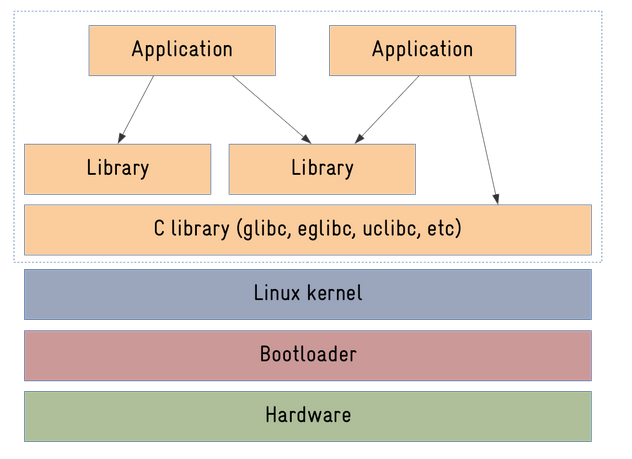
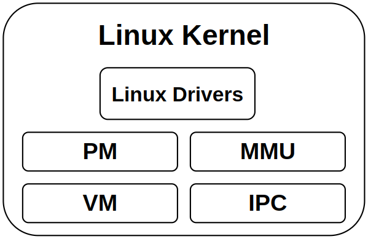
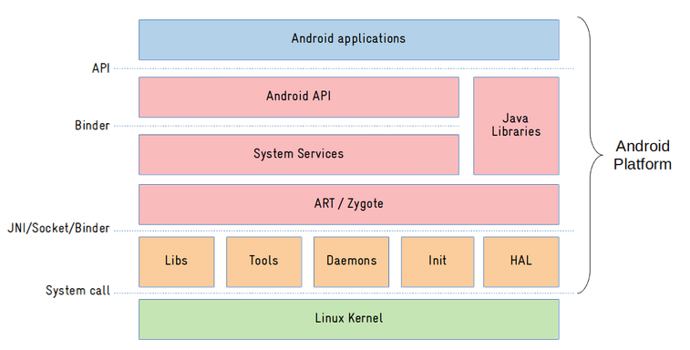
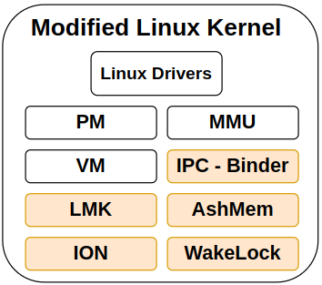

# Linux vs Android — What Android Takes from Linux, and What It Changes

> **Source baseline:** Android-side claims were checked against **AOSP `android-17.0.0_r1`** (your
> Cuttlefish tree). Your trees contain only **prebuilt** kernels, so kernel-internal behaviour is
> labelled **General concept** and was checked against kernel/official documentation.

| Label | Meaning |
|---|---|
| **Verified in source** | Read in the AOSP 17 tree |
| **Official documentation** | source.android.com / developer.android.com / kernel.org |
| **General concept** | Standard Linux/OS knowledge |
| **Version-dependent** | Changed across Android or kernel versions |

**Prerequisites:** none. This is a foundations chapter.
**Next:** [Android History](../02.AndroidHistory/README.md) → … → [Android Architecture](../05.AndroidArchitecture/README.md).

**After this chapter you should be able to:**

1. Explain the difference between **the Linux kernel** and **a Linux distribution**, and why Android
   is "Linux" in one sense but not the other.
2. Describe every layer of an embedded Linux system (hardware → bootloader → kernel → syscalls → C
   library → libraries → rootfs → apps).
3. Compare Linux and Android in kernel, C library, init, IPC, memory, power, scheduling, logging and
   security, **with the current (not historical) mechanisms**.
4. Explain why AAOS uses Android for infotainment, and why safety-critical functions stay elsewhere.

---

## Table of Contents

- [1. The most important distinction: kernel vs distribution](#1-the-most-important-distinction-kernel-vs-distribution)
- [2. Embedded Linux architecture, layer by layer](#2-embedded-linux-architecture-layer-by-layer)
- [3. Android architecture in one picture](#3-android-architecture-in-one-picture)
- [4. Differences, topic by topic](#4-differences-topic-by-topic)
  - [4.1 Kernel](#41-kernel)
  - [4.2 C library](#42-c-library)
  - [4.3 init and user space](#43-init-and-user-space)
  - [4.4 Scheduling](#44-scheduling)
  - [4.5 IPC](#45-ipc)
  - [4.6 Hardware access](#46-hardware-access)
  - [4.7 Memory management and low-memory handling](#47-memory-management-and-low-memory-handling)
  - [4.8 Power management and wakelocks](#48-power-management-and-wakelocks)
  - [4.9 Security](#49-security)
  - [4.10 Logging](#410-logging)
  - [4.11 Packaging, UI and target use](#411-packaging-ui-and-target-use)
- [5. Summary comparison table](#5-summary-comparison-table)
- [6. Why Android (AAOS) for automotive infotainment — and its limits](#6-why-android-aaos-for-automotive-infotainment--and-its-limits)
- [7. Common misconceptions](#7-common-misconceptions)
- [8. Summary and knowledge check](#8-summary-and-knowledge-check)

---

## 1. The most important distinction: kernel vs distribution

- **Linux (strictly)** is only the **kernel**: the program that manages CPU, memory, devices and
  processes.
- A **Linux distribution** (Ubuntu, Debian, Yocto-built images…) is that kernel **plus** a user
space. That user space is usually GNU: glibc, coreutils, bash, systemd, X11/Wayland, package
managers.

**Android uses the Linux kernel, but almost none of the GNU user space.** Android has:

| Desktop/embedded Linux distribution | Android (Verified in source where noted) |
|---|---|
| glibc / musl / uClibc | **bionic** (`bionic/`) |
| systemd / SysV init / BusyBox init | Android **`init`** (`system/core/init/`) |
| bash, GNU coreutils / BusyBox | **mksh** shell (`external/mksh/`) + **toybox** utilities (`external/toybox/`) |
| D-Bus | **Binder** (+ Unix sockets) |
| journald / syslog | **logd** (`system/logging/logd/`) |
| X11 / Wayland compositor | **SurfaceFlinger** (`frameworks/native/services/surfaceflinger/`) |
| apt / rpm packages | **APK** (apps) and **APEX** (updatable system modules) |
| Applications in C/C++/Python… | Apps in **Kotlin/Java** on **ART**, plus native code via the NDK |

So the honest answer to "Is Android Linux?" is: **Android runs on the Linux kernel, but it is not a
GNU/Linux distribution.**

---

## 2. Embedded Linux architecture, layer by layer

### 2.1 Hardware

**Purpose:** the physical platform: CPU/SoC, RAM, storage (eMMC/UFS/NVMe), buses, peripherals.

The bootloader and kernel configure and control it. Software only reaches it through the kernel's
drivers.

### 2.2 Bootloader

**Purpose:** the first software that runs after power-on. It prepares the hardware and starts the
kernel.

**Tasks:**

1. **Initialize the hardware:** CPU clocks, the DRAM controller, basic peripherals.
2. **Load the kernel** (and optionally an initramfs and a Device Tree Blob) into RAM.
3. **Pass parameters:** the kernel command line and the DTB describing the board.
4. **Jump to the kernel.**

Examples: **U-Boot** (most common in embedded), **GRUB** (PCs), **Barebox**. On Android devices it is
usually a vendor bootloader that implements Android Verified Boot and fastboot. Details in
[Boot Sequence §2](../07.AndroidBootingSequence/README.md#2-bootloader).

### 2.3 Linux kernel

**Purpose:** the core of the OS. It manages all resources and enforces isolation between programs.

**Responsibilities:**

1. **Device drivers:** let software use hardware (USB, storage, network, display, CAN…).
2. **Process management:** create and terminate processes, schedule them on CPUs, handle signals and
   threads.
3. **File system management:** the **VFS** (Virtual File System) gives one API (`open`/`read`/`write`)
   over many filesystems: ext4, f2fs, EROFS, FAT, NTFS, Btrfs, XFS.
4. **Networking:** the TCP/IP stack, sockets, routing, netfilter, SocketCAN.
5. **IPC:** pipes, signals, System V/POSIX IPC, Unix sockets (and Binder, on Android kernels).
6. **Power management (PM):** suspend/resume, CPU frequency and idle states.
7. **Virtual memory (VM):** virtual address spaces, paging, swapping, page cache.

> **Virtual memory, explained**
>
> Every process gets its **own virtual address space**. It sees addresses such as `0x0010` that
> the kernel maps to real **physical** RAM pages.
>
> - **Isolation:** process A's `0x0010` and process B's `0x0010` map to different physical pages,
>   so one process cannot read or corrupt another's memory.
> - **Efficiency:** pages can be shared (shared libraries, copy-on-write after `fork()`), loaded only
>   when touched (demand paging), and moved out of RAM under pressure: to disk swap on desktops, or
>   to **zram** (compressed RAM swap) on Android. Your Cuttlefish fstab has
>   `/dev/block/zram0 none swap defaults zramsize=75%` (Verified:
>   `device/google/cuttlefish/shared/config/fstab.in`, line 30).
> - **Convenience:** each program sees a large, contiguous address space even though physical
>   pages are scattered.

> **MMU (Memory Management Unit), explained**
>
> The MMU is a **hardware unit inside the CPU** that translates virtual addresses to physical
> addresses on every memory access:
>
> 1. On each access, the MMU first checks its cache of recent translations, the **TLB**
>    (Translation Lookaside Buffer).
> 2. On a TLB miss, it walks the **page tables** that the kernel built for that process.
> 3. It produces the physical address, or raises a **page fault** if the page is not mapped or not
>    allowed. The kernel then loads the page, kills the process (segmentation fault), or performs
>    copy-on-write.
>
> The kernel **manages** the page tables, and the MMU **uses** them at hardware speed.

The kernel is **modular** and **configurable**. Embedded builds enable only the drivers and features
they need.

### 2.4 System call interface

**Purpose:** the controlled boundary between **user space** (applications, libraries) and **kernel
space**.

User programs cannot call kernel functions directly. They execute a special CPU instruction (`svc`
on ARM64, `syscall` on x86-64) with a **system call number**, such as `openat`, `read`, `write`,
`mmap`, `ioctl` or `clone`. The CPU switches to kernel mode, the kernel validates the arguments and
permissions, does the work, and returns.

### 2.5 C library

**Purpose:** the standard interface between programs and the kernel.

**Tasks:**

1. Provide the **C standard library**: `printf`, `malloc`, `strlen`…
2. Wrap **system calls** in normal C functions (`open()`, `read()`, `write()`, `pthread_create()`).
3. Provide the **dynamic linker** that loads shared libraries at program start.

Common C libraries:

| Library | Typical use |
|---|---|
| **glibc** (GNU) | Most desktop/server distributions |
| **musl** | Small, modern, static-friendly (Alpine, many embedded builds) |
| **uClibc / uClibc-ng** | Older small embedded systems |
| **eglibc** | Historical embedded variant of glibc; merged back into glibc, no longer developed |
| **bionic** | **Android** (see [§4.2](#42-c-library)) |

### 2.6 Libraries

**Purpose:** reusable code so applications do not reimplement common functions.

Examples: graphics (**OpenGL ES**, **Vulkan**), networking (**libcurl**), databases (**SQLite**),
crypto (**OpenSSL**, or **BoringSSL** on Android), media (**FFmpeg**, **GStreamer**).

### 2.7 Root filesystem (rootfs)

**Purpose:** everything the running system needs except the kernel.

**Contents:**

- **binaries** (`/bin`, `/sbin`, `/usr/bin`);
- **libraries** (`/lib`, `/usr/lib`);
- **configuration** (`/etc`);
- **data, logs and temporary files** (`/var`, `/tmp`).

> **Android is different:** Android does not use a single rootfs. Its user space is split across
> partitions: `system`, `system_ext`, `product`, `vendor`, `odm`, and `data`. Each is mounted
> separately, mostly read-only and integrity-verified, as described in
> [Boot §4.2](../07.AndroidBootingSequence/README.md#42-first-stage--firststagemain).

### 2.8 Applications

**Purpose:** the programs that deliver the product's function.

**Embedded automotive examples (General concept):**

- **IVI (infotainment) application:** media, navigation, phone.
- **Diagnostics tool:** reads fault codes and engine/transmission data.
- **ADAS software:** lane keeping, emergency braking, adaptive cruise control. This usually runs on
  **dedicated ECUs with real-time/safety-certified OSes**, not on the infotainment Linux/Android
  system ([§6](#6-why-android-aaos-for-automotive-infotainment--and-its-limits)).

---

## 3. Android architecture in one picture

Android keeps the **Linux kernel** at the bottom and replaces everything above it:

**HAL → native daemons and libraries (bionic) → ART → Java framework and system services → apps.**

The full layer-by-layer explanation is in [Android Architecture](../05.AndroidArchitecture/README.md).
The rest of this chapter compares the two systems **topic by topic**.

---

## 4. Differences, topic by topic

### 4.1 Kernel

- **Linux:** a monolithic kernel, used everywhere from servers to microcontrollers-with-MMU. Highly
  configurable.
- **Android:** **the same monolithic Linux kernel**. Android devices use the **Android Common Kernel
  (ACK)**: mainline Linux plus a moderate set of Android patches. Since Android 12 (kernel 5.10+),
  devices ship Google's **Generic Kernel Image (GKI)**, with vendor hardware support as **loadable
  modules** (Official documentation). AOSP tree contain prebuilt GKI kernels for 6.1, 6.6, 6.12 and
  6.18 (`kernel/prebuilts/`).

**What is genuinely Android-specific in the kernel today?** Mainly the **Binder** driver, which is
now in mainline Linux under `drivers/android/` and mounted as **binderfs** (Verified: `init.rc`
lines 231–245). Most other historical "Android kernel features" were upstreamed or moved to user
space. They are covered in the sections below and in
[Android Architecture §2](../05.AndroidArchitecture/README.md#2-linux-kernel-layer).

### 4.2 C library

- **Linux:** **glibc** (feature-rich, LGPL) or **musl**.
- **Android:** **bionic** (`bionic/`, BSD-licensed).

**Why Android wrote its own:**

1. **License:** BSD allows linking into proprietary vendor code without LGPL obligations.
2. **Size and speed:** a smaller footprint for mobile/embedded devices.
3. **Android features:** system properties (`__system_property_get`), Android-specific security
   hardening, and **linker namespaces** that keep vendor and system libraries apart (Treble).

Trade-off: bionic intentionally does not implement every glibc/GNU extension, so some Linux
software must be patched to build for Android.

### 4.3 init and user space

| | Linux | Android |
|---|---|---|
| PID 1 | `systemd` (most distributions), SysV init, BusyBox init | Android `init` (`system/core/init/`) |
| Config | systemd unit files | `.rc` scripts in the Android Init Language |
| Extra duties | — | Property service, SELinux policy load, `ueventd` |

Android's `init` is covered in depth in [Boot Sequence §4](../07.AndroidBootingSequence/README.md#4-init--the-first-user-space-process).

### 4.4 Scheduling

**Linux (General concept, kernel documentation):**

- For years the default scheduler for normal tasks was **CFS** (Completely Fair Scheduler).
  CFS splits CPU time fairly according to each task's weight (its nice value).
  
- Its successor, **EEVDF** (Earliest Eligible Virtual Deadline First), was merged in Linux 6.6 and
  completed in the 6.12 cycle. EEVDF keeps fairness but makes latency-sensitive tasks able to run
  sooner.
  
- Real-time scheduling classes (`SCHED_FIFO`, `SCHED_RR`, `SCHED_DEADLINE`) exist in **every**
  Linux kernel. **PREEMPT_RT** (full real-time preemption) was merged into mainline in **Linux
  6.12** (2024).
  
  > Both Linux and Android use the **same kernel scheduler**. Neither standard desktop Linux nor Android is a **hard real-time OS**.

**What Android adds is policy in user space, not a different scheduler (Verified in source):**

1. **The framework classifies processes.** `ActivityManagerService` tracks each process's state
   (top app, foreground service, visible, cached…).
2. **It places processes into cgroups/cpusets** created by `init`: `/dev/cpuset/top-app`,
   `foreground`, `background`, `system-background`, `restricted` (`init.rc` lines 328–352). For
   example, the visible app can use the big CPU cores, while background work is restricted to the
   little cores.
3. **Task profiles** (`system/core/libprocessgroup/profiles/task_profiles.json`) bundle cgroup,
   cpuset and uclamp settings into named profiles such as `MaxPerformance`, `HighEnergySaving` and
   `ProcessCapacityHigh`. `init` and services apply them; the zygote service uses
   `task_profiles ProcessCapacityHigh MaxPerformance`.
4. **Energy Aware Scheduling (EAS)** and **uclamp** (upstream kernel features) let the scheduler pick
   CPUs and frequencies by energy cost, with boosts for UI threads.

**Example:** a sync service runs in the background while the user taps the screen. The
kernel does not "know" which one is the UI. Android's ActivityManager puts the touched app in the
**top-app** group with performance hints, and puts the sync service in **background** with lower
CPU capacity. The scheduler then naturally favours the UI thread, so the touch is handled quickly.

### 4.5 IPC

**Linux IPC mechanisms (General concept), all of which also exist on Android kernels:**

1. **Pipes and FIFOs:** a one-way byte stream (a POSIX/UNIX mechanism, not System V).
2. **System V IPC:** message queues (a queue identified by a key), semaphores, shared memory segments.
3. **POSIX IPC:** POSIX message queues, `shm_open` shared memory, named semaphores.
4. **Sockets:** network sockets, and **Unix domain sockets** for processes on the same machine.
5. **Signals.**
6. **D-Bus:** a **user-space** message bus daemon built on Unix sockets. It is common on desktop
   Linux, **not** a kernel IPC mechanism.

**Shared memory example:** process A writes into a POSIX shared memory region, and process B reads
it. No copy through the kernel is needed for the data itself, but the programmer must synchronize,
for example with a semaphore, to avoid races.

**Android IPC:**

- **Binder** is Android's main IPC for **method calls between processes on the same device**.
  It provides object references, caller identity (UID/PID), death notifications and thread pools
  ([Android Architecture §7](../05.AndroidArchitecture/README.md#7-binder-ipc-and-servicemanager)).
- **Unix domain sockets are still used a lot** (Verified in source):
  - Zygote's command socket (`socket zygote stream 660 root system`);
  - the property service socket (`/dev/socket/property_service`);
  - logd's `logd`, `logdr` and `logdw` sockets;
  - sensor event channels (`BitTube` = `socketpair(AF_UNIX, SOCK_SEQPACKET)`).
- **Shared memory** (memfd, DMA-BUF) is used for large data such as graphics buffers and audio. The
  file descriptors are usually **passed through Binder**.

> **Notes:**
>
> - "On Android, traditional IPC mechanisms are not used" is **wrong**. Sockets, pipes and shared
>   memory are used alongside Binder. The one exception is **System V IPC**: bionic declares
>   `shmget()`/`msgget()` (API 26+), but its own header says they are "Not useful on Android;
>   disallowed by SELinux" (Verified: `bionic/libc/include/sys/shm.h`, around line 66).
> - "Binder enables communication … between different devices" is **wrong**. Binder is
>   **local-only** (same kernel). Cross-device communication uses networking, for example gRPC as in
>   the Cuttlefish VHAL ([AAOS §6](../06.AndroidAutomotiveArchitecture/README.md#6-your-two-builds-cuttlefish-vs-raspberry-pi-5)).

### 4.6 Hardware access

- **Linux:** user programs access devices through the kernel: `/dev` nodes with `read`/`write`/`ioctl`,
  `sysfs`, netlink, sockets. Libraries such as ALSA's libasound and libdrm wrap these.
- **Android:** apps never open device nodes. **HALs** (Hardware Abstraction Layers) define standard
  interfaces that vendors implement. **System services** call the HALs, and apps call the system
  services ([Android Architecture §3](../05.AndroidArchitecture/README.md#3-hardware-abstraction-layer-hal)).
  This keeps apps portable across hardware and keeps the vendor/system boundary stable (Treble).

### 4.7 Memory management and low-memory handling

**Linux:** virtual memory, the page cache, swap, and the **OOM killer**. The OOM killer is a
**last resort**: when an allocation cannot be satisfied even after reclaim, the kernel picks a victim
by its `oom_score` (memory use adjusted by `oom_score_adj`) and kills it.

**Android:** the same kernel mechanisms, **plus** proactive killing **before** the system runs out:

| | Historical Android | Current Android (Verified in source / Official documentation) |
|---|---|---|
| Who kills | In-kernel **lowmemorykiller** driver with fixed free-memory thresholds | **`lmkd`**, a **user-space daemon** (`system/memory/lmkd/`) |
| Pressure signal | Free memory below thresholds | **PSI** (Pressure Stall Information): how long tasks are *stalled* waiting for memory (Android 10+ default) |
| Status | Removed from mainline Linux in **4.12** | Current |

**How it decides who dies (Verified in source):**

1. `ActivityManagerService`'s OOM adjuster assigns every app process an **`oom_score_adj`** based on
   its importance. The constants are in
   `frameworks/base/services/core/java/com/android/server/am/psc/Constants.java`:

   | Constant | Value | Meaning |
   |---|---|---|
   | `NATIVE_ADJ` | -1000 | Native daemons: never killed this way |
   | `SYSTEM_ADJ` | -900 | `system_server` |
   | `PERSISTENT_PROC_ADJ` | -800 | Persistent system apps (e.g. CarService) |
   | `FOREGROUND_APP_ADJ` | 0 | The app the user is using |
   | `PERCEPTIBLE_APP_ADJ` | 200 | E.g. music playing in the background |
   | `HOME_APP_ADJ` | 600 | The launcher |
   | `CACHED_APP_MIN_ADJ` … `CACHED_APP_MAX_ADJ` | 900 … 999 | Cached background apps: killed first |

   > **Version-dependent:** in your **Android 15** tree these constants are in
   > `services/core/java/com/android/server/am/ProcessList.java` (e.g. line 273). AOSP 17 moved them to
   > `am/psc/Constants.java`.
2. AMS sends these values to `lmkd` over a socket (`LMK_PROCPRIO` messages, `ProcessList.java`
   line 298).
3. When PSI reports memory pressure, `lmkd` kills processes **from the highest `oom_score_adj`
   downwards**: cached apps first, and the foreground app only in extreme cases.

**Why this matters:** on a phone or car, keeping recently used apps **cached** in RAM makes switching
fast. When memory is needed, killing a cached app is far better than letting the whole system slow
down or the kernel OOM killer kill something important.

**Other Android memory features:**

- **zram** (compressed swap in RAM; on Cuttlefish `zramsize=75%`).
- **memfd** (shared memory, replacing ashmem).
- **DMA-BUF heaps** (graphics/camera buffers, replacing ION).

See [Android Architecture §2](../05.AndroidArchitecture/README.md#2-linux-kernel-layer).

### 4.8 Power management and wakelocks

**Linux:** suspend-to-RAM/disk, CPU frequency and idle governors, runtime PM for devices. On
laptops, the system suspends when the user closes the lid or after idle time.

**Android:** the design goal is the opposite of a laptop. **Suspend as soon as possible**, and
stay awake only while someone explicitly needs it. That "someone needs it" is a **wakelock**.

**What a wakelock is.** A wakelock is a request that says "do not let the CPU suspend (or do not
turn the screen off) until I release this".

**Two levels (Verified in AOSP source + Official documentation):**

1. **Kernel level:** Android's original out-of-tree wakelock patches were replaced by upstream
   **wakeup sources** and the `/sys/power/wake_lock` interface. In user space, the **SystemSuspend**
   service owns that interface
   (`system/hardware/interfaces/suspend/aidl/default/SystemSuspend.cpp`, line 75:
   `kSysPowerWakeLock = "/sys/power/wake_lock"`). When no wakelock is held, it writes `"mem"`
   (`kSleepState`, line 72) to `/sys/power/state` to suspend the system.
2. **Framework level:** apps use **`PowerManager.WakeLock`**, with levels defined in
   `frameworks/base/core/java/android/os/PowerManager.java`:

   | Level | Effect | Status |
   |---|---|---|
   | `PARTIAL_WAKE_LOCK` (line 91) | CPU stays on; screen and keyboard may turn off | **Current**: the main one |
   | `SCREEN_DIM_WAKE_LOCK` (line 108) | CPU on + screen dim | **Deprecated** |
   | `SCREEN_BRIGHT_WAKE_LOCK` | CPU on + screen bright | **Deprecated** |
   | `FULL_WAKE_LOCK` (line 143) | CPU on + screen and keyboard bright | **Deprecated** |

   For keeping the **screen** on, apps should use the window flag `FLAG_KEEP_SCREEN_ON` instead of
   screen wakelocks.

> **Correction:** the previous version listed "Full / Partial / Screen" and separately "CPU / Display"
> wakelocks as if they were different kernel mechanisms. They are **framework levels** of one API.
> Only partial wakelocks are still recommended.

**Example:** a download app acquires a `PARTIAL_WAKE_LOCK` so the CPU keeps running with the screen
off, and **releases it** when the download finishes. Forgetting to release it is a classic
battery-drain bug.

**Doze and App Standby** (Android 6.0+, Official documentation): when the device is unused, Android
defers background jobs, network access and alarms into maintenance windows. Apps should use
`WorkManager`/`JobScheduler` instead of holding wakelocks.

**In a car (General concept):** the vehicle decides power states. The ignition and the vehicle's power
manager tell AAOS when to shut down, suspend to RAM or hibernate. AAOS's **CarPowerManagementService**
and **`carpowerpolicyd`** ([AAOS §2.5](../06.AndroidAutomotiveArchitecture/README.md#25-native-automotive-daemons))
apply power policies driven by VHAL power-state properties.

### 4.9 Security

**Linux:** discretionary access control (users, groups, file permissions), capabilities, namespaces,
seccomp, and optional **LSMs** (SELinux, AppArmor). On desktops these are configured by
administrators and are often permissive.

**Android:** it uses the same kernel mechanisms in a much stricter, application-centred way:

| Mechanism | Android usage |
|---|---|
| **UID per app** | Each app gets its own Linux UID (`AID_APP_START = 10000`, Verified). The kernel isolates app files and processes |
| **SELinux enforcing everywhere** | Partially enforced in 4.4, **fully enforced since Android 5.0** for all domains (Official documentation) |
| **seccomp** | Filters which syscalls app processes may make |
| **Permissions** | Install-time and **runtime** (user-granted, since 6.0) permissions, checked by system services |
| **Verified Boot (AVB) + dm-verity** | System partitions are cryptographically verified ([Boot §2.3](../07.AndroidBootingSequence/README.md#23-android-verified-boot-avb--explained-from-zero)) |
| **Encryption** | File-based encryption (FBE) of `/data` |
| **Crypto** | BoringSSL / Conscrypt |

> **Correction:** **Google Play Protect** is part of Google Mobile Services, **not** AOSP. A vehicle
> without GAS does not have it.

### 4.10 Logging

| | Linux | Android |
|---|---|---|
| Kernel log | `dmesg` (kernel ring buffer) | `dmesg` (same) |
| User-space logging | **journald** (systemd) or syslog | **`logd`** daemon, read with **`logcat`** |
| Storage | journald can be persistent on disk | logd keeps **in-RAM ring buffers**: `main`, `radio`, `events`, `system`, `crash`, `stats`, `security`, `kernel` (Verified: `LOG_ID_*` in `system/logging/liblog/include/android/log.h`). Persistent logging is optional (`logpersist`, `system/logging/logcat/logpersist`) |
| Filtering | `journalctl -u <unit> -p <prio>` | `logcat` **tags** and **priorities** (V/D/I/W/E/F), `-b <buffer>` |
| History | — | Before Android 5.0 a kernel "logger" driver stored logs. Since 5.0, user-space `logd` with sockets `logd`/`logdr`/`logdw` (Verified: `system/logging/logd/logd.rc`) |

### 4.11 Packaging, UI and target use

| | Linux | Android |
|---|---|---|
| UI | CLI, plus X11/Wayland desktops (GNOME, KDE) | Touch-first UI composited by **SurfaceFlinger**, with phone, tablet, TV, watch and **car** variants |
| Software delivery | Distribution packages | **APKs** (apps) and **APEX** modules (updatable system parts such as ART and Conscrypt) |
| Target | Servers, desktops, embedded, supercomputers | Phones, tablets, TVs, wearables, **cars (AAOS)** |

---

## 5. Summary comparison table

| Feature | Linux (typical distribution) | Android |
|---|---|---|
| Kernel | Mainline Linux | Android Common Kernel / **GKI** (Linux + few patches + vendor modules) |
| Real-time | Not hard real-time by default. PREEMPT_RT in mainline since 6.12 | Not hard real-time. Same scheduler, plus **user-space policy** (cgroups, uclamp, task profiles) |
| C library | glibc / musl | **bionic** |
| PID 1 | systemd | Android `init` |
| Shell/tools | bash + coreutils | mksh + toybox |
| IPC | Pipes, System V/POSIX IPC, sockets, D-Bus | **Binder** + Unix sockets + memfd/DMA-BUF |
| Hardware access | Device nodes via libraries | **HALs** called by system services |
| Low memory | Kernel OOM killer (last resort) | **lmkd** (user space, PSI, `oom_score_adj` from AMS) + OOM killer as backstop |
| Shared memory / buffers | POSIX shm, DMA-BUF | memfd (was ashmem), DMA-BUF heaps (was ION) |
| Power | Suspend on idle/lid | Aggressive suspend + **wakelocks** (SystemSuspend), Doze |
| Logging | journald/syslog | **logd** + logcat |
| Security | DAC + optional LSM | UID-per-app sandbox + **enforcing SELinux** + seccomp + AVB + FBE |
| Build | Make/CMake/Yocto | Platform: **Soong (Android.bp) + Make**. Apps: **Gradle** |
| Apps | Native binaries | Kotlin/Java on **ART**, plus NDK native code |

---

## 6. Why Android (AAOS) for automotive infotainment — and its limits

**Reasons OEMs choose Android/AAOS for the infotainment domain:**

1. **Touch UI and UX toolkit.** Android is built for touch, multi-window and multi-display. AAOS
   adds car UI components and multi-display/occupant zones.
2. **App ecosystem.** With **Google Automotive Services** licensed, the Play Store offers car-optimized
   apps. Without GAS, OEMs ship their own store. *(The Play Store is not part of AOSP.)*
3. **Developers and tools.** A huge pool of Android developers, Android Studio and the Car App
   Library for app development. For **platform** development, AOSP brings Soong, CTS/VTS and
   Cuttlefish.
4. **Services.** Optional GAS gives Google Maps and Google Assistant. Alternatives include HERE,
   TomTom, Cerence, Alexa ([AAOS](../04.AndroidAutomotiveOS/README.md)).
5. **Automotive platform pieces.** The VHAL, CarService, EVS, car audio and power management give a
   standard architecture across OEMs ([AAOS Architecture](../06.AndroidAutomotiveArchitecture/README.md)).

**Limits, and how cars handle them (General concept):**

- **Android is not a hard real-time or safety-certified OS.** Functions with ISO 26262 safety
  requirements, such as braking, steering, airbags and many cluster tell-tales, run on **separate
  ECUs or MCUs**, often with AUTOSAR or a real-time OS.
- When one SoC runs both domains, a **hypervisor** isolates AAOS from a safety OS such as **QNX**.
  QNX often renders the safety-relevant parts of the instrument cluster, and AAOS runs infotainment.
- **Fast boot requirements** (for example, the rear-view camera must show quickly) are handled with
  early HALs (EVS in `early_hal`), suspend-to-RAM, or a separate camera path
  ([Boot §9](../07.AndroidBootingSequence/README.md#9-practical-automotive-scenario)).

>  Android optimizes **responsiveness** (UI latency), which is not the same as **deterministic real-time**. Vehicle control stays outside Android, and Android only**requests** actions through the VHAL, which a vehicle gateway can still reject.

---

## 7. Common misconceptions

| Misconception | Correct interpretation |
|---|---|
| "Android is a Linux distribution." | Android uses the Linux **kernel** but its own non-GNU user space (bionic, init, toybox, Binder, ART). |
| "The Android kernel is a different kernel." | It is mainline Linux (ACK/GKI) with relatively few patches. Most old Android-only drivers are gone. |
| "Android has a real-time scheduler." | Same Linux scheduler. Android adds user-space **policy** (cgroups/cpusets, uclamp, task profiles). |
| "Android doesn't use traditional IPC." | It uses Unix sockets, pipes and shared memory alongside Binder. |
| "Binder can connect two devices." | Binder is local to one kernel. Cross-device needs networking. |
| "The low memory killer is in the kernel." | Removed in 4.12. `lmkd` in user space decides, using PSI and `oom_score_adj` from AMS. |
| "Wakelocks are a kernel feature with full/partial/screen types." | Kernel side: upstream wakeup sources. Levels such as PARTIAL/FULL are **PowerManager API** levels, and most screen levels are deprecated. |
| "Play Protect is Android security." | It is a GMS service, not AOSP. |
| "Android in a car controls the brakes." | Safety functions stay on dedicated ECUs or a safety OS. AAOS requests actions via the VHA |

**Further reading:** [Android SELinux](https://source.android.com/docs/security/selinux),
[lmkd](https://source.android.com/docs/core/perf/lmkd),
[GKI](https://source.android.com/docs/core/architecture/kernel/generic-kernel-image),
[Linux 6.12 real-time (heise)](https://heise.de/-10061458).
