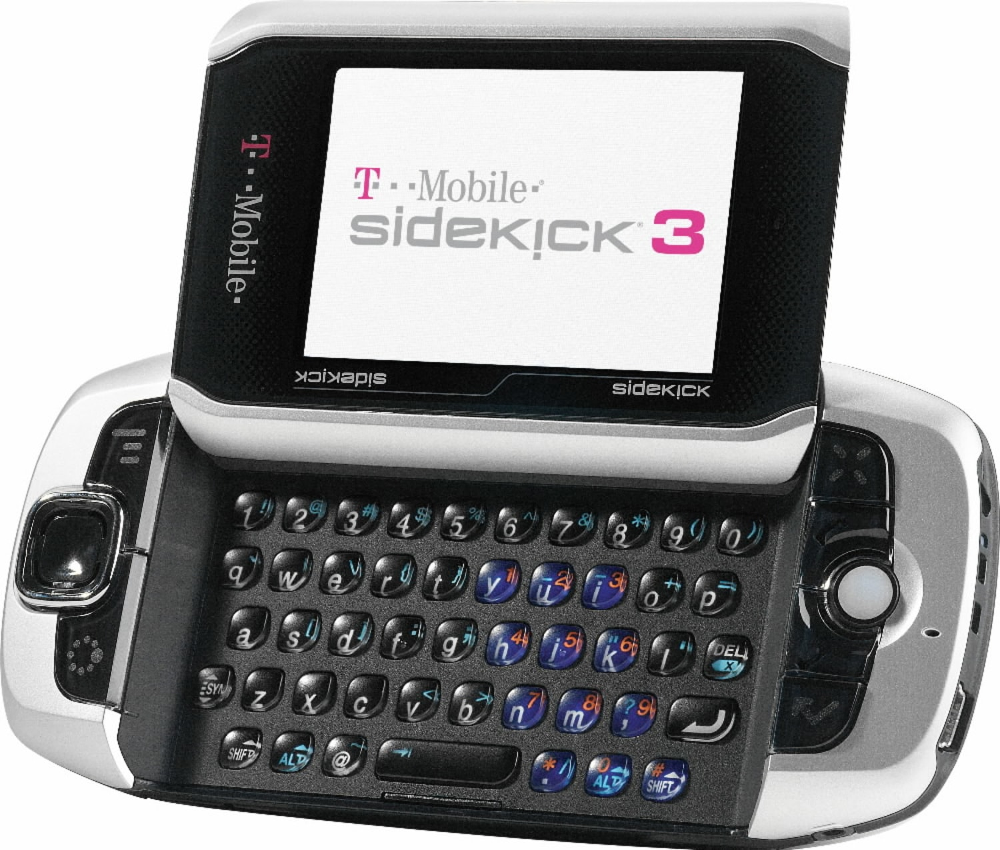
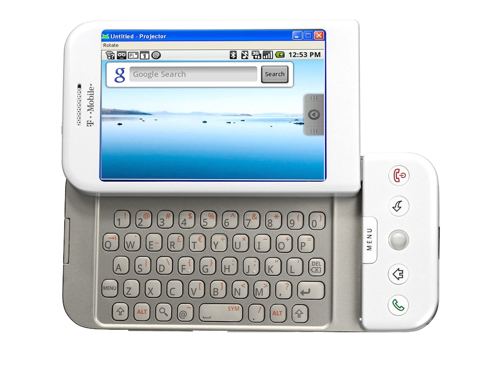
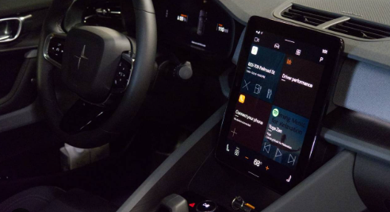

# The Android Operating System — Overview and History

> **Evidence:** this chapter is **historical**. It cannot be verified in source code, so dates were
> checked against public sources in November 2026 (listed at the end). The **API level** of your
> AOSP 17 tree (**37**) is **Verified in source**, from the build output's`ro.build.version.sdk=37`.

**Prerequisites:** [Linux vs Android](../01.LinuxVsAndroid/README.md).

---

## Table of Contents

- [1. What is Android?](#1-what-is-android)
- [2. Early history](#2-early-history)
- [3. Growth and new device types](#3-growth-and-new-device-types)
- [4. Android enters the car](#4-android-enters-the-car)
- [5. Android releases](#5-android-releases)
- [6. Release milestones that matter for platform/AAOS engineers](#6-release-milestones-that-matter-for-platformaaos-engineers)
- [7. Knowledge check](#7-knowledge-check)
- [8. Sources](#8-sources)

---

## 1. What is Android?

**Android** is an open-source operating system led by Google. It was designed for smartphones and
tablets and has expanded to TVs (Android TV / Google TV), wearables (Wear OS) and **cars**
(Android Auto projection and **Android Automotive OS**). Its flexibility, scalability and open source
code make it popular in embedded and automotive products.

**Android is built on the Linux kernel.** The kernel provides the low-level foundation: process
management, memory management, device drivers, networking and security. Everything above the
kernel was designed specifically for Android:

- the C library (bionic) and `init`;
- the runtime (ART);
- the framework and system services;
- the app model.

That upper layer provides the rich APIs and tools for app development. The details are in [Linux vs Android](../01.LinuxVsAndroid/README.md) and[Android Architecture](../05.AndroidArchitecture/README.md).

> **Precision:** the kernel does *not* do "hardware abstraction" in Android's sense. Android's **HAL** is a separate user-space layer above the kernel drivers ([Android Architecture §3](../05.AndroidArchitecture/README.md#3-hardware-abstraction-layer-hal)).

---

## 2. Early history

- **2002:** before Android existed, Andy Rubin co-founded **Danger Inc.**, maker of the **Hiptop**,
  sold as the **T-Mobile Sidekick**. Google's founders are widely reported to have been impressed by it
  (it shipped with Google as the default search engine).

  

- **2003:** **Android Inc.** was founded in Palo Alto by Andy Rubin, Rich Miner, Nick Sears and Chris
  White. It first targeted digital cameras, then pivoted to an open mobile phone OS.
- **2005:** **Google acquired Android Inc.**
- **November 2007:** the **Open Handset Alliance** (OHA) was announced, a consortium of handset makers,
  carriers and chip companies, together with the Android platform and its first SDK preview.
- **September 23, 2008:** **Android 1.0** was released. The first phone, the **HTC Dream** (T-Mobile
  G1), launched in **October 2008** in the US.

  

---

## 3. Growth and new device types

**Rapid evolution (2008–2013):** Cupcake (1.5) brought the on-screen keyboard and video recording,
Donut (1.6) wider screen support, Eclair (2.0) multiple accounts and an improved UI, and Froyo (2.2)
JIT compilation in Dalvik and tethering. Android became the dominant mobile OS with a strong
developer community.

**New device types:**

- **Tablets:** **Honeycomb** (3.0, 2011) was the tablet-only release. **Ice Cream Sandwich** (4.0)
  unified phones and tablets.
- **Wearables:** **Android Wear** (2014), renamed **Wear OS** in 2018.
- **TVs:** **Android TV** (2014), later with the **Google TV** experience on top.

---

## 4. Android enters the car

| Year | Milestone |
|---|---|
| **Jan 2014** | Google and automakers (Audi, GM, Honda, Hyundai) plus NVIDIA form the **Open Automotive Alliance** (CES) |
| **June 25, 2014** | **Android Auto** revealed at Google I/O: projection from the phone to the car |
| **2015** | First Android Auto-compatible cars and the Android Auto phone app reach users |
| **2017** | Google first announces **Android Automotive OS**, Android running natively in the car |
| **2018** | Renault–Nissan–Mitsubishi Alliance announces it will embed Android Automotive |
| **2020** | First production cars with **AAOS + Google built-in (GAS)**: **Polestar 2**, then **Volvo XC40 Recharge** |
| **2022 →** | GM (MY2022+), Renault (Mégane E-Tech…), Honda, Ford/Lincoln and others ship or announce Google built-in. BMW announces **OS 9 based on AOSP without Google services** |
| **2026** | Android 17 (API 37). Your AOSP trees are `android-17.0.0_r1`. Google Assistant in cars is moving to Gemini (External) |

AAOS continues to evolve with more third-party app categories, Google services for OEMs that license
GAS, and deeper vehicle integration through the Vehicle HAL.

---

## 5. Android releases

**API level** is the integer that apps target (`minSdkVersion`, `targetSdkVersion`). It is often more
useful to engineers than the marketing version. On a device: `adb shell getprop ro.build.version.sdk`.

| Version | Codename | API level | Release date |
|---|---|---|---|
| 1.0 | — | 1 | September 23, 2008 |
| 1.1 | (internal: Petit Four) | 2 | February 9, 2009 |
| 1.5 | Cupcake | 3 | April 27, 2009 |
| 1.6 | Donut | 4 | September 15, 2009 |
| 2.0 – 2.1 | Eclair | 5 – 7 | October 26, 2009 |
| 2.2 – 2.2.3 | Froyo | 8 | May 20, 2010 |
| 2.3 – 2.3.7 | Gingerbread | 9 – 10 | December 6, 2010 |
| 3.0 – 3.2.6 | Honeycomb | 11 – 13 | February 22, 2011 |
| 4.0 – 4.0.4 | Ice Cream Sandwich | 14 – 15 | October 18, 2011 |
| 4.1 – 4.3.1 | Jelly Bean | 16 – 18 | July 9, 2012 |
| 4.4 – 4.4.4 | KitKat | 19 – 20 | October 31, 2013 |
| 5.0 – 5.1.1 | Lollipop | 21 – 22 | November 12, 2014 |
| 6.0 – 6.0.1 | Marshmallow | 23 | October 5, 2015 |
| 7.0 – 7.1.2 | Nougat | 24 – 25 | August 22, 2016 |
| 8.0 – 8.1 | Oreo | 26 – 27 | August 21, 2017 |
| 9 | Pie | 28 | August 6, 2018 |
| 10 | (dessert names dropped publicly; internal: Quince Tart) | 29 | September 3, 2019 |
| 11 | (internal: Red Velvet Cake) | 30 | September 8, 2020 |
| 12 / 12L | (internal: Snow Cone / Snow Cone v2) | 31 / 32 | October 4, 2021 / March 2022 |
| 13 | (internal: Tiramisu) | 33 | August 15, 2022 |
| 14 | (internal: Upside Down Cake) | 34 | October 4, 2023 |
| 15 | (internal: Vanilla Ice Cream) | 35 | October 15, 2024 (Pixel rollout; AOSP source in September 2024) |
| 16 | (internal: Baklava) | 36 | **June 10, 2025** (moved to a Q2 major release) |
| **17** | — | **37**    | **June 16, 2026** (Pixel stable + AOSP source) |

> **Why the schedule changed:** starting with Android 16, Google releases the **major SDK version in
> Q2**, followed by minor/QPR releases, instead of in the autumn. Google also announced that AOSP
> source is published on a **Q2/Q4** rhythm.

---

## 6. Release milestones that matter for platform/AAOS engineers

These milestones are referenced throughout this repository:

| Release | Platform change | Where it is explained |
|---|---|---|
| 2.2 | Dalvik gains a JIT | [Arch §5.7](../05.AndroidArchitecture/README.md#57-dalvik-vs-art) |
| 4.4 | ART preview. SELinux partially enforcing | [Arch §5.7](../05.AndroidArchitecture/README.md#57-dalvik-vs-art), [Linux vs Android §4.9](../01.LinuxVsAndroid/README.md#49-security) |
| 5.0 | **ART default** (full AOT). **SELinux fully enforcing**. `logd` replaces the kernel logger | [Arch §5](../05.AndroidArchitecture/README.md#5-android-runtime-art) |
| 6.0 | Runtime permissions. Doze | [Linux vs Android §4.8](../01.LinuxVsAndroid/README.md#48-power-management-and-wakelocks) |
| 7.0 | JIT + profile-guided compilation | [Arch §5.4](../05.AndroidArchitecture/README.md#54-profile-guided-compilation-the-real-lifecycle) |
| 8.0 | **Project Treble**: HIDL HALs, vendor/system split | [Arch §3](../05.AndroidArchitecture/README.md#3-hardware-abstraction-layer-hal) |
| 10 | `lmkd` PSI mode. ActivityTaskManagerService split from AMS | [Linux vs Android §4.7](../01.LinuxVsAndroid/README.md#47-memory-management-and-low-memory-handling) |
| 11 | **Stable AIDL HALs** possible | [Arch §3](../05.AndroidArchitecture/README.md#3-hardware-abstraction-layer-hal) |
| 12 | **GKI 2.0** (kernel 5.10+). ION → DMA-BUF heaps | [Arch §2](../05.AndroidArchitecture/README.md#2-linux-kernel-layer) |
| 13 | **AIDL Vehicle HAL** (HIDL deprecated for new HALs). `init_boot` partition for GKI devices | [AAOS Arch §2.6](../06.AndroidAutomotiveArchitecture/README.md#26-vehicle-hal-vhal), [Boot §2](../07.AndroidBootingSequence/README.md#2-bootloader) |
| 15 | VHAL reference impl V3 (your A15 tree) | [AAOS Arch §2.6](../06.AndroidAutomotiveArchitecture/README.md#26-vehicle-hal-vhal) |
| 17 | VHAL **V4** (supported-values APIs). `fs_mgr` moved to `system/fs/` (your A17 tree) | [AAOS Arch §2.6](../06.AndroidAutomotiveArchitecture/README.md#26-vehicle-hal-vhal), [Secure Boot and AVB §6](../07.AndroidBootingSequence/SECURE_BOOT_AVB.md#6-hash-vs-hash-tree-and-what-dm-verity-does) |

---

## 7. Knowledge check

1. Which Android version made ART the default runtime, and which made SELinux fully enforcing?
2. What is the API level of your AOSP 17 build, and how do you read it on a running device?
3. Why is "Volvo first implemented AAOS in 2019" inaccurate?
4. What changed about Android's release schedule starting with Android 16?

---

## 8. Sources

- [Android version history (Wikipedia)](https://en.wikipedia.org/wiki/Android_version_history)
- [Android 17 release timeline (Android Authority)](https://androidauthority.com/android-17-release-date-3639790)
- [Android 17 stable rollout (Gizchina)](https://www.gizchina.com/android-devices/android-17-stable-is-here-rolls-out-to-pixel-6-and-later)
- [Android 2026 release cycle (Android Authority)](https://www.androidauthority.com/android-2026-update-release-cycle-3637263)
- [Open Automotive Alliance (Wikipedia)](https://en.wikipedia.org/wiki/Open_Automotive_Alliance)
- [Android Auto (Wikipedia)](https://en.wikipedia.org/wiki/Android_Auto)
- [Android Automotive (Wikipedia)](https://en.wikipedia.org/wiki/Android_Automotive)
- [Cars with Google built-in (Android Headlines)](https://www.androidheadlines.com/android-automotive)

---

**Previous:** [Linux vs Android](../01.LinuxVsAndroid/README.md) ·
**Next:** [Android Auto](../03.AndroidAuto/README.md)
