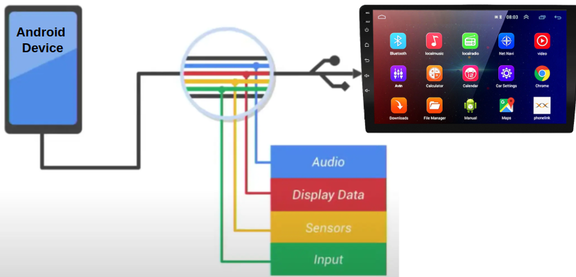
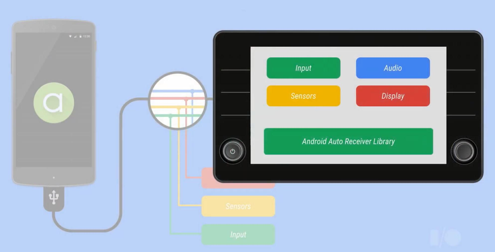
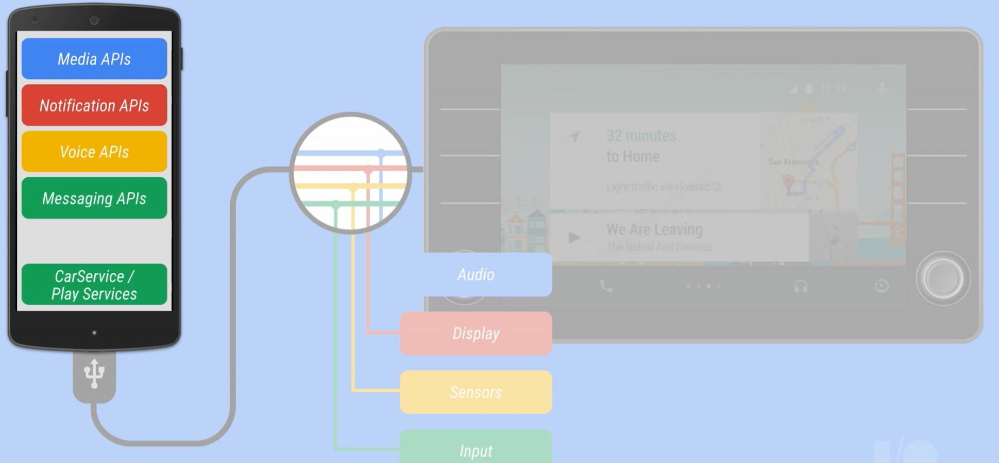

# Android Auto (Smartphone Projection)

> **Evidence:** Android Auto is a **proprietary Google product**. Its phone app and the head-unit
> receiver SDK are **not in AOSP**. This chapter therefore marks each claim:
>
> | Label | Meaning |
> |---|---|
> | **Verified in source** | The AOSP 17 tree contains the code (e.g. the USB accessory handshake) |
> | **Official documentation** | developer.android.com / support.google.com |
> | **External** | Reliable press or industry reporting, checked November 2026 |
> | **Simplified model** | A teaching description of a proprietary protocol. Real details are not public |

**Prerequisites:** [Digital Cockpits](../00.DigitalCockpits/README.md).
**Next:** [Android Automotive OS](../04.AndroidAutomotiveOS/README.md). Read it right after this
chapter, because AAOS is defined largely in contrast to Android Auto.

**After this chapter you should be able to:**

1. Explain what projection is and where the apps actually run.
2. Explain how a phone and a head unit connect over USB (with the real AOA handshake from AOSP) and
   over wireless.
3. Name the app categories and the APIs apps use to appear in Android Auto.
4. List Android Auto's limitations, which motivated AAOS.

---

## Table of Contents

- [1. What is Android Auto?](#1-what-is-android-auto)
- [2. Android Auto app categories](#2-android-auto-app-categories)
- [3. How Android Auto works](#3-how-android-auto-works)
- [4. Drawbacks of Android Auto](#4-drawbacks-of-android-auto)
- [5. Common misconceptions](#5-common-misconceptions)
- [6. Summary and knowledge check](#6-summary-and-knowledge-check)
- [7. References](#7-references)

---

## 1. What is Android Auto?

**Android Auto** connects an Android **phone** to a car's **head unit** (the IVI system) and shows a
driver-optimized interface for navigation, media, messaging and other apps on the car's screen. The
user interacts through the car's touchscreen, knobs, steering-wheel buttons or voice.

**The key idea: projection.** The apps run **on the phone**. The phone **renders** the UI and
**streams** it to the car. The car mainly **displays** the video and **sends back** input. The car
does not run the apps.

**Requirements (External, November 2026):**

- Google raised the minimum to **Android 11** for **both wired and wireless** Android Auto. Before
  that, wired worked from Android 9 and wireless needed Android 11.
- Phones on Android 9/10 are no longer officially supported.
- Since **Android 10**, Android Auto is built into the phone OS rather than installed as a separate
  launcher app.
- The car (or an aftermarket head unit) must support Android Auto. For wireless, both car and phone
  need **5 GHz Wi-Fi** support.

**What Android Auto provides:**

- **A simplified UI** with large targets, limited text and lists, designed to minimize distraction.
- **Voice interaction** through Google Assistant (Gemini in newer versions, External) for navigation,
  messages and calls.
- **App access** to supported categories of phone apps ([§2](#2-android-auto-app-categories)).
- **Cross-device support**: many car brands and phone models.

**An "Android Auto app" is not a separate app.** It is a **regular phone app** that also implements
car-specific APIs: a media service, messaging notifications, or Car App Library screens. For example,
**Spotify** is one phone app. When connected to Android Auto, the Android Auto host shows Spotify's
media library and playback controls in the car-optimized UI.

---

## 2. Android Auto app categories

Apps cannot draw arbitrary UI in Android Auto. They must belong to a supported **category**, and the
**host** (Android Auto) renders their content using approved templates. This is how Google enforces
driver-distraction rules.

**How apps integrate (Official documentation, developer.android.com/training/cars):**

| Category | How the app integrates | Example apps (External) |
|---|---|---|
| **Media** (music, podcasts, audiobooks) | Exposes a **media browse tree** and a **media session** (`MediaBrowserService` / Media3 `MediaLibraryService` + `MediaSession`). The host builds the UI | Spotify, YouTube Music, Audible |
| **Messaging / communication** | Posts **`MessagingStyle` notifications** with **Reply** and **Mark-as-read** actions. The host reads them aloud and takes voice replies | WhatsApp, Google Messages |
| **Navigation** | **Car App Library** templates (`NavigationTemplate`) + a map surface | Google Maps, Waze |
| **Point of Interest (POI)** | Car App Library (place lists/maps) | Parking, EV charging (e.g. ChargePoint), fuel prices |
| **Internet of Things (IoT)** | Car App Library | Garage doors, smart-home controls |
| **Weather** | Car App Library | Weather apps |
| **Video, games, browsers** | **Only while parked** (and only where the category is enabled) | Video streaming while charging an EV |

The **Android for Cars App Library** (androidx, not AOSP) lets one app support **both** Android Auto
and Android Automotive OS with the same template-based code. The set of approved categories has
grown over time, so check the "Supported app categories" table on developer.android.com for the
current list and the parked/driving status of each.

**Design rules for all Android Auto apps (Official documentation, summarized):**

- **Safety first:** limited items per list, limited text, no free-form UI while driving.
- **Voice first:** messaging and navigation are designed for hands-free use.
- **Templates:** a consistent look across apps, rendered by the host, not the app.

---

## 3. How Android Auto works

### 3.1 The two sides



| Side | Software | What it does |
|---|---|---|
| **Phone** | The **Android Auto** app/component (Google, proprietary) + Google Play services + your apps | Runs the apps, renders the car UI, encodes **video**, mixes **audio**, handles voice, manages the session |
| **Head unit** | An **Android Auto receiver** stack (Google provides a receiver library/SDK to licensed OEMs and suppliers). It runs on the head unit's OS: Linux, QNX, or Android/AAOS | Decodes and shows video, plays audio, sends **touch/knob/button** input, provides **microphone** and **vehicle sensor data**, manages the connection |

**Transport-agnostic protocol (Simplified model):** both sides speak the **Android Auto Protocol**
(AAP). Its messages are serialized with **Protocol Buffers**. The same protocol runs over **USB** or
**Wi-Fi**.

> **Protocol Buffers (protobuf)** is Google's language- and platform-neutral format for serializing
> structured data. It is compact (binary), fast to parse, and supports schema evolution. Those
> properties suit a link where many small control messages and large media streams share bandwidth.

### 3.2 Logical channels (Simplified model)

AAP multiplexes several **logical channels** over one connection. Teaching material, including the
diagram above, often shows four main ones:

| Channel | Direction | Carries |
|---|---|---|
| **Video / display** | Phone → car | The rendered UI as an **encoded video stream** (H.264 is commonly cited, External) |
| **Audio** | Both directions | Media, navigation guidance and system sounds to the car. **Microphone** audio from the car to the phone for calls and voice commands |
| **Input** | Car → phone | Touch coordinates, rotary knob, steering-wheel keys |
| **Sensor / vehicle data** | Car → phone | Night mode, driving status (parked or moving), GPS from the car, speed, gear… whatever the OEM provides |

Real implementations have **more** channels, for example control/session, media playback status,
navigation status (turn-by-turn data for the cluster), Bluetooth pairing and phone status. The
four-channel picture is a **simplification**.

### 3.3 Connecting over USB: the Android Open Accessory (AOA) handshake (Verified in AOSP source)

The **USB** link starts with the **Android Open Accessory** protocol. The car is the **USB host**,
the phone is the **USB device**, and the car switches the phone into "accessory mode". AOSP contains
the host-side code an AAOS head unit uses for this, in
`packages/services/Car/car-usb-handler/src/android/car/usb/handler/AoapInterface.java`:

```java
private static final int USB_ACCESSORY_VENDOR_ID = 0x18D1;        // Google's USB vendor ID (line 38)
USB_ACCESSORY_MODE_PRODUCT_ID.add(0x2D00); ... add(0x2D05);        // accessory-mode product IDs (44–47)
public static final int ACCESSORY_GET_PROTOCOL = 51;                // line 71
public static final int ACCESSORY_SEND_STRING  = 52;                // line 85
public static final int ACCESSORY_START        = 53;                // line 97
```

**Step by step:**

1. The phone is plugged in and enumerates as a normal USB device (MTP, charging…).
2. **`ACCESSORY_GET_PROTOCOL` (51):** the head unit sends a USB control request asking the phone
   which AOA protocol version it supports (`AoapInterface.getProtocol(...)`, line 130).
3. **`ACCESSORY_SEND_STRING` (52):** the head unit sends identification strings, such as
   manufacturer, model and version, which the phone uses to pick the app that handles this accessory.
4. **`ACCESSORY_START` (53):** the head unit tells the phone to switch to accessory mode.
5. The phone **re-enumerates** with Google's vendor ID **`0x18D1`** and an accessory product ID
   **`0x2D00`–`0x2D05`**. The two sides now have bulk endpoints for a raw data stream.
6. On the phone, Android's `UsbDeviceManager` sees the accessory start
   (`frameworks/base/services/usb/java/com/android/server/usb/UsbDeviceManager.java`,
   `ACCESSORY_START_MATCH`, line 160) and hands the accessory to the matching app, Android Auto.
7. **Android Auto Protocol** messages (version negotiation, TLS-based authentication, service
   discovery, then the channels) flow over that stream (Simplified model).

### 3.4 Connecting wirelessly (External)

1. **Bluetooth** is used first: pairing, the initial handshake, and exchanging Wi-Fi credentials. It
   also stays connected for hands-free calling.
2. The phone then joins a **5 GHz Wi-Fi** (peer-to-peer / Wi-Fi Direct style) link to the head unit.
3. **Video, audio and input** travel over Wi-Fi, because Bluetooth does not have enough bandwidth for
   continuous video.
4. Both radios must stay on. Turning off either breaks the session.

### 3.5 What happens when the user uses it

**Step 1: Connection and session start.** USB (AOA) or wireless setup completes. Phone and car
authenticate and negotiate capabilities: screen size, resolution, which channels exist, sensor
support. A **projection session** starts.

**Step 2: Home screen.** The phone renders the Android Auto home screen at the car's resolution and
streams it over the **video channel**.

**Step 3: The user taps an app** (e.g. Spotify):

- **Input channel:** the touch (x, y) goes from car to phone.
- **Phone:** the Android Auto host on the phone handles the tap, binds to Spotify's media service,
  and builds the media UI from Spotify's browse tree.
- **Video channel:** the updated screen is streamed back.

**Step 4: Playing a song:**

- **Input channel:** the touch on a song goes to the phone.
- **Phone:** Spotify streams or decodes the audio, and the media session updates metadata (title, art,
  state).
- **Video channel:** the "Now Playing" screen is streamed.
- **Audio channel:** the audio goes to the car's speakers. When navigation speaks, guidance audio is
  mixed or ducked appropriately.

### 3.6 Head-unit side in more detail



The head unit **does not run** the projected apps. It runs a **receiver stack** that the OEM or
supplier integrates and that must pass **Google certification**. It provides interfaces for:

- **touch and input:** forwarding the screen, knob and steering-wheel events;
- **audio routing:** connecting projected audio streams to the car's audio system (focus, ducking,
  amplifier);
- **display rendering:** decoding and scaling the video for the car's display and aspect ratio;
- **sensors and vehicle data:** GPS, speed, night mode, driving state, if the OEM provides them.

**On an AAOS head unit**, AOSP provides some of the plumbing: the AOA host handshake above
(`car-usb-handler`) and `CarProjectionService`
(`packages/services/Car/service/src/com/android/car/CarProjectionService.java`). The Android Auto
receiver app itself is Google's.

### 3.7 Phone side in more detail



On the phone, the **Android Auto** component is the **host**. It talks to the head unit and renders
apps' content. Apps integrate through **standard Android APIs** (Official documentation):

**3.7.1 Media**
- **Purpose:** a consistent interface for media apps.
- **How it works:** the app exposes a browsable media tree and a **media session**. The host shows
  the library and playback controls. Commands such as play, pause and skip go to the app's media
  session.
- **Example:** Spotify publishes the current track's metadata and art. Android Auto displays it on the
  car screen.

**3.7.2 Notifications**
- **Purpose:** show relevant alerts (calls, messages) safely.
- **How it works:** apps post normal notifications. The host filters them, shows them as large
  heads-up cards, and offers read-aloud.

**3.7.3 Voice**
- **Purpose:** hands-free control.
- **How it works:** the steering-wheel voice button or the hotword triggers **Google Assistant**
  (Gemini in newer versions) on the phone, using the car's microphone over the audio channel. Example:
  "Navigate to the nearest gas station".

**3.7.4 Messaging**
- **Purpose:** safe reading and replying.
- **How it works:** apps use `MessagingStyle` notifications with **Reply** (with `RemoteInput`) and
  **Mark as read** actions. The host reads messages aloud and dictates replies.
- **Example:** a WhatsApp message arrives. Android Auto announces it, and the driver replies by voice.

**3.7.5 Android Auto app and Google Play services (renamed from "CarService")**
- **Purpose:** manage the session and protocol with the head unit, and keep compatibility up to date.
- **How it works:** the Android Auto component (Google, proprietary) handles connection, protocol,
  authentication and rendering. Google Play services provide shared infrastructure and updates.

> On the phone, use the name **"Android Auto (host)"**.

---

## 4. Drawbacks of Android Auto

1. **Dependency on the smartphone**
   - **Issue:** without a connected, compatible phone, nothing works. A dead battery, forgetting the
     phone, or a bad cable ends the session.
   - **Impact:** a less seamless experience than a native in-car system.
2. **Limited access to vehicle features**
   - **Issue:** projection runs on the phone. It **cannot control** climate, seats or vehicle
     settings, and it receives only the vehicle data the head unit chooses to share.
   - **Impact:** drivers switch between Android Auto and the car's native UI.
3. **Performance depends on the phone**
   - **Issue:** rendering and encoding happen on the phone, so older phones and thermal throttling
     can cause lag.
   - **Impact:** an inconsistent experience during navigation and media.
4. **Connectivity issues**
   - **Issue:** USB cable quality, wireless interference, 5 GHz support and Bluetooth + Wi-Fi both
     being needed.
   - **Impact:** dropped sessions, especially on long trips.
5. **Limited OEM customization**
   - **Issue:** Google defines the UI and templates.
   - **Impact:** brand differentiation is limited, and every car looks the same in Android Auto.
6. **App restrictions**
   - **Issue:** only approved **categories** using host-rendered templates are allowed, and video or
     games only while parked ([§2](#2-android-auto-app-categories)).
   - **Impact:** a smaller app ecosystem than on the phone. This is deliberate, for safety.
7. **Compatibility**
   - **Issue:** older cars or head units lack support. Phones below the current minimum OS (Android 11
     as of November 2026, External) lose support.
   - **Impact:** users may need an aftermarket head unit or a newer phone.

These limitations are exactly what [Android Automotive OS](../04.AndroidAutomotiveOS/README.md#2-why-aaos-was-created)
addresses by running Android **natively** in the car.

---

## 5. Common misconceptions

| Misconception | Correct interpretation |
|---|---|
| "Android Auto runs on the car." | It runs on the **phone**. The car displays a video stream and sends input. |
| "Android Auto = Android Automotive OS." | Projection vs a native car OS ([chapter 04](../04.AndroidAutomotiveOS/README.md)). |
| "Android Auto is part of AOSP." | Proprietary Google software. AOSP only has generic pieces, such as the AOA USB handshake. |
| "Apps draw their own UI in the car." | The **host** renders templates from the app's data, for safety and consistency. |
| "Android Auto can change the cabin temperature." | No. Vehicle controls stay in the car's own system. |
| "The phone-side component is called CarService." | No. That name belongs to AAOS's in-car `com.android.car` service. |

---

## 6. Summary and knowledge check

**Key takeaways**

- Android Auto = **projection**. The phone runs the apps and renders, and the car displays and sends
  input.
- USB sessions start with the **AOA** handshake (verified in AOSP's car USB handler). Wireless sessions
  use **Bluetooth for setup** and **5 GHz Wi-Fi for data**.
- Apps join through **categories** and standard APIs (media sessions, messaging notifications, the
  Car App Library), and the host renders their content.
- Its limits (phone dependence, no vehicle control, little OEM customization) motivated AAOS.

**Questions**

1. Where is the Spotify UI *rendered* when it is shown in Android Auto, and how does it get to the
   car?
2. List the three AOA control requests (numbers and names) and what the phone does after
   `ACCESSORY_START`.
3. Why does wireless Android Auto need both Bluetooth and Wi-Fi?
4. Why does Android Auto use host-rendered templates instead of letting apps draw their own UI?
5. Why is naming the phone-side component "CarService" misleading?

**Investigation task (AOSP 17):** read
`packages/services/Car/car-usb-handler/src/android/car/usb/handler/AoapInterface.java` and
`AoapServiceManager.java`. Find where the head unit decides that a connected device supports AOA,
and where it switches the device into accessory mode.

---

## 7. References

- [Google I/O 2014: Android Auto introduction (video)](https://www.youtube.com/watch?v=9vjntxXCUNA)
- [Android for Cars: overview and app categories (developer.android.com)](https://developer.android.com/training/cars)
- [Use the Android for Cars App Library](https://developer.android.com/training/cars/apps)
- [Android Auto now requires Android 11 (9to5Google, Nov 2026)](https://9to5google.com/2026/11/09/android-auto-minimum-requirements-android-11/)
- [Why wireless Android Auto uses both Bluetooth and Wi-Fi (Engadget)](https://engadget.com/2210415/why-wireless-android-auto-uses-both-bluetooth-wifi)
- [Android Open Accessory overview, AOAv1/AOAv2 (source.android.com)](https://source.android.com/docs/core/interaction/accessories/protocol). The request numbers and IDs in §3.3 come from the AOSP source, not from this page.
- Original article kept from the earlier version: https://rajasoftwarelabs.com/blog/developing-apps-for-android-auto
