# Android Platform Architecture (AOSP) — Layer by Layer

> **Source baseline:** paths, classes, methods and line numbers were checked against **AOSP`android-17.0.0_r1`** .

| Label | Meaning |
|---|---|
| **Verified in source** | Read in the AOSP 17 tree or build output |
| **Official documentation** | source.android.com / developer.android.com |
| **General concept** | Standard Linux / computing knowledge, not AOSP-specific code |
| **Version-dependent** | Changed between Android releases |
| **Illustrative** | Teaching example, not real AOSP code |

**Prerequisites:** [Linux vs Android](../01.LinuxVsAndroid/README.md).

**After this chapter you should be able to:**

1. Name the layers of the Android stack **and** say which **process** each part runs in. Layers and
   processes are different things.
2. Explain which "Android kernel features" still exist, which were replaced, and by what.
3. Explain the three generations of HALs (legacy, HIDL, AIDL) and how VINTF declares them.
4. Explain how ART runs apps: DEX, `dex2oat`, compiler filters, profiles, JIT, GC.
5. Explain Manager vs Service: how `getSystemService()` reaches a service in `system_server`.
6. Explain Binder end to end: driver, ServiceManager, AIDL Proxy/Stub (with real generated code),
   death notifications.
7. Trace a real hardware access from an app to a HAL: the accelerometer.

---

## Table of Contents

- [0. What is AOSP?](#0-what-is-aosp)
- [1. The stack: layers vs processes](#1-the-stack-layers-vs-processes)
- [2. Linux kernel layer](#2-linux-kernel-layer)
- [3. Hardware Abstraction Layer (HAL)](#3-hardware-abstraction-layer-hal)
- [4. Native layer: libraries and daemons](#4-native-layer-libraries-and-daemons)
- [5. Android Runtime (ART)](#5-android-runtime-art)
- [6. Java API Framework and System Services](#6-java-api-framework-and-system-services)
- [7. Binder IPC and ServiceManager](#7-binder-ipc-and-servicemanager)
- [8. Application layer and the app sandbox](#8-application-layer-and-the-app-sandbox)
- [9. End-to-end real example: an app reads the accelerometer](#9-end-to-end-real-example-an-app-reads-the-accelerometer)
- [10. How AAOS maps onto these layers](#10-how-aaos-maps-onto-these-layers)
- [11. Common misconceptions](#11-common-misconceptions)
- [12. Source map](#12-source-map)

---

## 0. What is AOSP?

The **Android Open Source Project (AOSP)** is the open-source code base of Android, led by Google.
It contains everything needed to build a working Android system image:

- the user-space platform: `init`, native daemons, ART, the Java framework, system services;
- the HAL interface definitions and reference implementations;
- core system apps;
- the build system (Soong/Blueprint + Make);
- the tests (CTS/VTS).

It does **not** contain:

- **Google Mobile Services / Google Automotive Services** (Play Store, Google Maps, Play Services),
  which are proprietary and licensed separately;
- most **vendor code**: SoC drivers, proprietary HAL implementations, bootloaders;
- **kernel source**. Kernels live in separate repositories, and your trees only include
  `kernel/prebuilts/`.

Device makers (Samsung, Xiaomi, car OEMs…) take AOSP, add their hardware support and customizations,
and ship their own Android builds.

> **Official documentation note:** Google announced that from 2026 AOSP source is published twice a
> year (Q2 and Q4), with `android-latest-release` as the recommended branch. Your trees are tagged
> `android-17.0.0_r1` (A17) and an Android 15 `ap3a` release.

---

## 1. The stack: layers vs processes

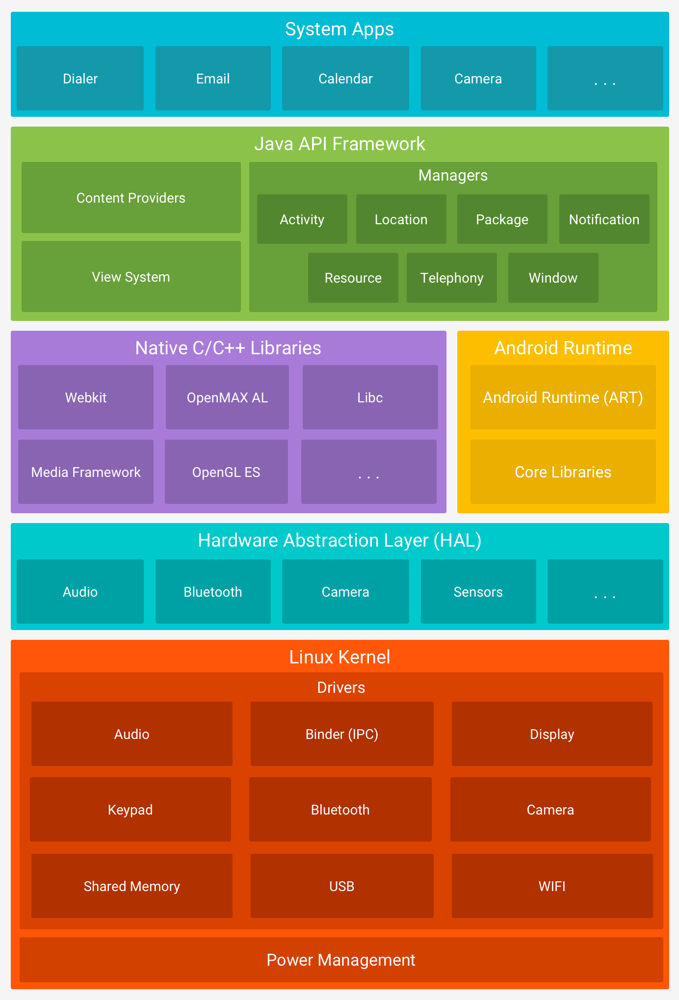

The classic picture shows **layers**: kernel → HAL → native libraries + ART → Java framework → apps.
That picture describes **code dependencies**. It does **not** tell you which process code runs in,
and confusing the two is the most common architecture mistake. The process view is:

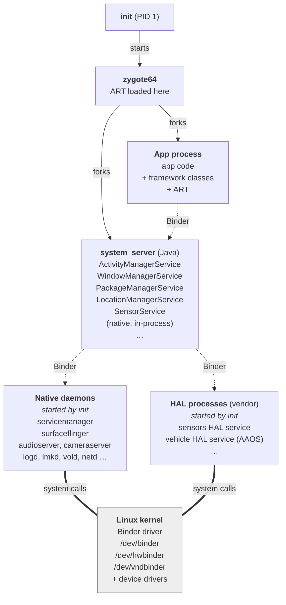

Solid arrows show who starts or forks a process; dashed arrows are Binder calls, and every one of them
passes through the kernel's Binder driver (an `ioctl` on `/dev/binder`). The thick "system calls" lines
are drawn only from the bottom row to keep the picture readable; in reality **every** process above,
including `init`, `zygote64`, apps and `system_server`, calls into the kernel the same way. Process names in the HAL box are shortened: the real binaries
are named like `android.hardware.sensors-service…` and `android.hardware.automotive.vehicle@V…-service`.

**Key observations (Verified in source):**

- **"Framework" code runs in two places.** Classes such as `LocationManager` run **inside the app
  process**. The matching service, `LocationManagerService`, runs **inside `system_server`**
  ([§6](#6-java-api-framework-and-system-services)).
- **Native libraries** such as libc, libbinder and Skia are loaded **into** many processes. **Native
  daemons** such as `surfaceflinger` and `servicemanager` are their **own** processes, started by
  `init` (for example `frameworks/native/services/surfaceflinger/surfaceflinger.rc`: `service
  surfaceflinger /system/bin/surfaceflinger`, `user system`).
- **ART** is not a process. It is the runtime library loaded into Zygote and inherited by every
  Java process ([Boot §5](../07.AndroidBootingSequence/README.md#5-zygote)).
- **HAL implementations** are usually separate **vendor processes**, reached through Binder
  ([§3](#3-hardware-abstraction-layer-hal)).

### Typical components in each layer

A common way to teach the stack is to fill each layer with real components:

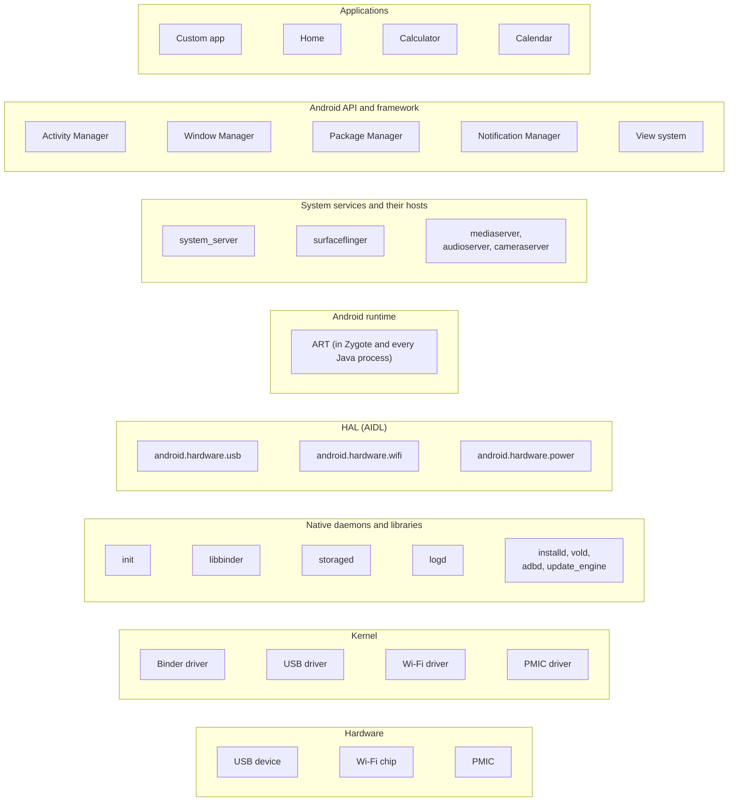

Notes on the usual version of this picture:

- **HAL names:**  HIDL names such as `android.hardware.usb@1.0`. Current HALs are
  **AIDL** (`android.hardware.usb`, `android.hardware.power`…), without `@` versions
  ([§3](#3-hardware-abstraction-layer-hal)).
- **Zygote** is often drawn inside "system services". It is the parent process of `system_server`
  and of every app, not a service ([Boot §5](../07.AndroidBootingSequence/README.md#5-zygote)).
- **`bluetoothd`** is sometimes drawn among the native daemons. Android has no such daemon: the
  Bluetooth stack runs in the `com.android.bluetooth` app process.
- `installd`, `vold`, `adbd` and `update_engine` (the A/B **OTA** updater) are native daemons, one
  per privileged job ([Linux vs Android §4.3](../01.LinuxVsAndroid/README.md#43-init-and-user-space)).

**Is every system service inside `system_server`?** No. Most Java services are
(ActivityManagerService, PackageManagerService, WindowManagerService, PowerManagerService,
InputManagerService…), but hardware-facing services were moved into their own processes for security
and stability: `cameraserver` (CameraService), `audioserver` (AudioFlinger, AudioPolicyService),
`media.extractor`, `media.swcodec`, `keystore2`, `surfaceflinger`. If one of them crashes, it does
not take down `system_server`.

---

## 2. Linux kernel layer

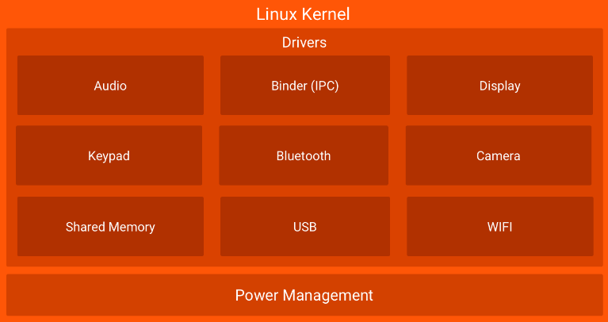

**Purpose:** the core of the OS. It owns the hardware and arbitrates all resources (CPU, memory,
devices), and it enforces isolation between processes.

**Tasks:**

1. **Process and thread management:** scheduling, creation, signals.
2. **Memory management:** virtual memory, page tables (MMU), page cache, reclaim.
3. **Device drivers:** display, input, storage, audio (ALSA), camera (V4L2), network, CAN (SocketCAN),
   and more.
4. **Filesystems:** ext4, f2fs, EROFS (your Cuttlefish fstab mounts `system` as `erofs`, see
   [Boot §4.2](../07.AndroidBootingSequence/README.md#42-first-stage--firststagemain)), plus
   virtual filesystems.
5. **Security:** UID/GID permissions, capabilities, **SELinux** (mandatory access control),
   seccomp.
6. **IPC primitives**, including the **Binder** driver, Android's main IPC.
7. **Power management:** suspend/resume, wakeup sources, CPU frequency/idle.

### Why Android uses the Linux kernel

| Reason | Why it matters |
|---|---|
| Mature memory and process management | Isolation between apps (separate address spaces), efficient reclaim |
| UID-based permission model | Android gives **each app its own Linux UID**, and the kernel enforces file and process boundaries ([§8](#8-application-layer-and-the-app-sandbox)) |
| Shared libraries + copy-on-write `fork()` | Makes Zygote's preloading cheap |
| Huge driver ecosystem, open source | SoC vendors already support Linux |
| Security modules (SELinux) | Mandatory access control on top of UIDs |

### "Android kernel features": what is true today

The previous version of this chapter listed several Android kernel drivers that **no longer exist**.
This table gives the current state.

| Feature | Old mechanism (historical) | Current mechanism | Evidence |
|---|---|---|---|
| **IPC** | Binder (staging driver) | **Binder** in mainline Linux (`drivers/android/`), mounted as **binderfs**. Three device nodes: `/dev/binder` (framework/apps), `/dev/hwbinder` (HIDL HALs), `/dev/vndbinder` (vendor↔vendor) | Verified in source: `init.rc` lines 231–245: `mount binder binder /dev/binderfs`, `symlink /dev/binderfs/binder /dev/binder`, etc. |
| **Shared memory** | `ashmem` driver (`/dev/ashmem`) | **`memfd`** (upstream `memfd_create`), used by `libcutils` when supported | Verified in source: `system/core/libcutils/ashmem-dev.cpp` line 218: `syscall(__NR_memfd_create, name, MFD_CLOEXEC \| MFD_ALLOW_SEALING)` |
| **Buffer sharing (GPU/camera/display)** | **ION** allocator | **DMA-BUF heaps** (`/dev/dma_heap/<name>`). ION was disabled in Android 12 / GKI 2.0 kernels | Official documentation: "Transition from ION to DMA-BUF heaps". Verified library: `system/memory/libdmabufheap/` |
| **Low memory killing** | In-kernel **lowmemorykiller** driver (removed upstream in kernel 4.12) | **`lmkd`**, a **user-space** daemon using **PSI** (Pressure Stall Information) | Official documentation (source.android.com lmkd). Verified: `system/memory/lmkd/lmkd.cpp` includes `<psi/psi.h>`, and `init.rc` `start lmkd` (line 461) |
| **Logging** | Kernel "logger" driver (`/dev/log/*`) | **`logd`**, a **user-space** daemon with sockets `logd`, `logdr`, `logdw` (since Android 5.0) | Verified: `system/logging/logd/logd.rc` lines 2–4 |
| **Alarms / wake from suspend** | Android "alarm driver" (`/dev/alarm`) | Upstream **`timerfd`** with `CLOCK_BOOTTIME_ALARM` / `CLOCK_REALTIME_ALARM` | Verified: `frameworks/base/apex/jobscheduler/service/jni/com_android_server_alarm_AlarmManagerService.cpp` lines 66–68 |
| **Wakelocks** | Android wakelock patches | Upstream **wakeup sources** + `/sys/power/wake_lock`, managed by the **SystemSuspend** service | Verified: `system/hardware/interfaces/suspend/aidl/default/SystemSuspend.cpp` line 75 (`kSysPowerWakeLock = "/sys/power/wake_lock"`) |
| **Scheduling for UI responsiveness** | Out-of-tree "interactive" tweaks | Upstream scheduler (EEVDF/CFS) + **Energy Aware Scheduling**, **uclamp**, **cgroups/cpusets**, driven from user space by **task profiles** | Verified: `system/core/libprocessgroup/profiles/task_profiles.json` (profiles such as `MaxPerformance`, `HighEnergySaving`, `ProcessCapacityHigh`). The zygote `.rc` uses `task_profiles ProcessCapacityHigh MaxPerformance` |
| **Kernel source model** | Each vendor forked the kernel | **GKI**: one Google-built Generic Kernel Image + **vendor modules** (Android 12+, kernel 5.10+) | Official documentation. `external/avb/README.md`: "Starting from Android 12, devices launching with kernel version 5.10 or higher must ship with the GKI kernel" |

> **Lesson:** most "Android kernel" differences have been **upstreamed or moved to user space**.
> Today the Android kernel is mainline Linux (Android Common Kernel) plus a relatively small set of
> patches, with vendor drivers as loadable modules.

> **Note on the Rust Binder driver (General concept, external news):** the upstream kernel has been
> moving to a Rust implementation of Binder. Public reports describe the Rust driver being merged in
> Linux 6.18 and the C driver being removed later. Your trees only contain prebuilt kernels, so this
> cannot be verified here.

### Debugging tools 

- **Kernel debugging:** `dmesg` / the kernel log, `ftrace`/`perfetto`, KGDB on development boards.
- **`adb` is not a kernel debugger.** It is a user-space client/daemon (`adbd`) protocol for shell,
  file transfer, logcat and install.

### Kernel in AAOS (General concept + Verified examples)

- Vehicle **cameras** are typically V4L2 devices. AAOS's EVS has a V4L2-based HAL:
  `packages/services/Car/cpp/evs/v4l2_hal/`.
- **CAN** controllers appear as SocketCAN network interfaces. AOSP includes a CAN HAL at
  `hardware/interfaces/automotive/can/`.
- **Audio** goes through ALSA drivers and the audio HAL. Power management must handle the car's
  **suspend-to-RAM / hibernation** (see `init.car.rc` hibernation triggers in
  [Boot §9](../07.AndroidBootingSequence/README.md#9-practical-automotive-scenario)).

---

## 3. Hardware Abstraction Layer (HAL)


### What is it?

A **HAL** is a **standard interface** between the Android framework and device-specific
hardware code. Google defines the interface, for example "a sensors HAL must provide
`getSensorsList()`, `activate()`, …", and the device vendor writes the **implementation** for their
chip.

### Why do we need it?

Without a HAL, framework code such as `SensorService` would need driver-specific code for every chip
from every vendor. With a HAL:

- the framework is written **once** against the interface;
- each vendor implements the interface **once** for their hardware;
- since **Project Treble** (Android 8.0), the interface is a **versioned, stable contract** between
  the `system` partition (Google/AOSP) and the `vendor` partition (SoC/OEM). The framework can be
  updated without rewriting vendor code;
- vendors can keep their hardware code **closed**. The Linux kernel is **GPLv2**: whoever ships a
  modified kernel, or a driver derived from it, must provide that source to the people who receive the
  device. The kernel's license states that programs using it only through **normal system calls** are
  not derived works (`LICENSES/exceptions/Linux-syscall-note`), and AOSP user space is **Apache 2.0**,
  which has no source-sharing obligation. So vendors keep the kernel driver thin (and publish it) and
  put the valuable logic, such as GPU drivers, camera image tuning and modem control, in a user-space
  HAL. This is not the reason Google's HAL documentation gives (that is the abstraction above), but it
  is a major reason the design suits vendors.
- > **Apps and ART do not call HAL services.** A HAL's clients are platform processes, of three kinds:
  >
  > | Client kind | Example | HAL it calls |
  > |---|---|---|
  > | **Native daemon** (its own process, started by `init` from an `.rc` file) | `audioserver`, `cameraserver` (`frameworks/av/.../audioserver.rc`, `cameraserver.rc`) | Audio HAL, Camera HAL |
  > | **`system_server`** (Java services, some with native code loaded through JNI) | `SensorService`, started in `SystemServer.java`, runs its native part `libsensorservice` inside `system_server` | Sensors HAL |
  > | **Other privileged platform app** | CarService (`com.android.car`, its own process) | Vehicle HAL |
  >
  > An app calls a framework API. That API sends the request over Binder to one of these clients, and the client calls the HAL ([§9](#9-end-to-end-real-example-an-app-reads-the-accelerometer)). The one exception is **same-process HALs** (GPU driver, graphics mapper). These are libraries loaded into the app's own process, so the app calls them directly ([Before and after Treble](#before-and-after-treble)). *(Verified in source: `SystemServer.java:1459`, `services/core/jni/Android.bp:151`)*

### Three generations of HALs

| Generation | Introduced | How it works | Service registry | Evidence |
|---|---|---|---|---|
| **Legacy (libhardware)** | Early Android | A C struct `hw_module_t` in a shared library loaded **into the caller's process** with `hw_get_module()` from `/system`, `/vendor`, `/odm` `…/lib(64)/hw/` | none (`dlopen`) | Verified: `hardware/libhardware/hardware.c` line 275 `hw_get_module()`. Paths `HAL_LIBRARY_PATH1..3` (lines 48–50) |
| **HIDL** | Android 8.0 (Treble) | Interfaces in the `.hal` language, usually **binderized** (separate process) over **`/dev/hwbinder`** | **`hwservicemanager`** | Verified: `system/libhidl/`, `system/tools/hidl/`, `system/hwservicemanager/` |
| **AIDL HAL (stable AIDL)** | Android 11 (HIDL deprecated for new HALs from Android 13, Official documentation) | Same AIDL as framework services, `@VintfStability`, over **`/dev/binder`** | **`servicemanager`** | Verified: e.g. `hardware/interfaces/automotive/vehicle/aidl/`, `hardware/interfaces/sensors/aidl/` |

**Version-dependent (A15 and A17, Verified):** `hwservicemanager` is installed as
`/system/system_ext/bin/hwservicemanager` and declared `disabled`
(`system/hwservicemanager/hwservicemanager.rc`). It is still explicitly started by `init.rc`
(`start hwservicemanager`, line 465), and a device can stop it with `hwservicemanager.disabled=true`
when it has no HIDL HALs left.

### VINTF: declaring which HALs a device has

**VINTF** (Vendor Interface Object, `system/libvintf/`) is how the system knows which HALs exist and
whether system and vendor are compatible:

- the **device manifest** (fragments on `/vendor/etc/vintf/`) says "this device **provides**
  `android.hardware.automotive.vehicle.IVehicle/default` version 4";
- the **framework compatibility matrix** (`hardware/interfaces/compatibility_matrices/compatibility_matrix.202604.xml`,
  …) says which HALs and versions the framework **requires** or supports.

Real fragment from the reference VHAL (`hardware/interfaces/automotive/vehicle/aidl/impl/current/vhal/vhal-default-service.xml`):

```xml
<manifest version="1.0" type="device">
    <hal format="aidl">
        <name>android.hardware.automotive.vehicle</name>
        <version>4</version>
        <fqname>IVehicle/default</fqname>
    </hal>
</manifest>
```

Clients use this declaration. For example, `SensorService` first asks
`AServiceManager_isDeclared("android.hardware.sensors.ISensors/default")` and only then
`AServiceManager_waitForService(...)`
(`frameworks/native/services/sensorservice/AidlSensorHalWrapper.cpp`, lines 109–117). That way it
waits only for HALs the device actually declares.

**There are four VINTF files, not two** (Official documentation): each side publishes a **manifest**
("what I provide") and a **compatibility matrix** ("what I need from the other side").

| File | Owner | Says |
|---|---|---|
| Device manifest | vendor | HALs the device provides |
| Framework compatibility matrix (FCM) | system | HALs (and versions) the framework can use |
| Framework manifest | system | Services the framework provides to vendor code |
| Device compatibility matrix | vendor | What the vendor needs from the framework (e.g. kernel config, VNDK version) |

**When is compatibility checked?** Not by `init` at every boot. It is checked:

1. at **build time** (`check_vintf`), so an incompatible image fails to build;
2. before an **OTA** is applied, so an update that would break the device is rejected;
3. by **VTS** tests;
4. and at **run time for each service**: `servicemanager` refuses `addService()` for a
   VINTF-stable Binder whose name is **not declared** in the manifest (Verified:
   `frameworks/native/cmds/servicemanager/ServiceManager.cpp`, `meetsDeclarationRequirements()`,
   called at line 537).

### Project Treble: partitions and their owners

Treble (Android 8.0) split Android's storage into partitions with **different owners**, so each
party can update its part without rebuilding the others:

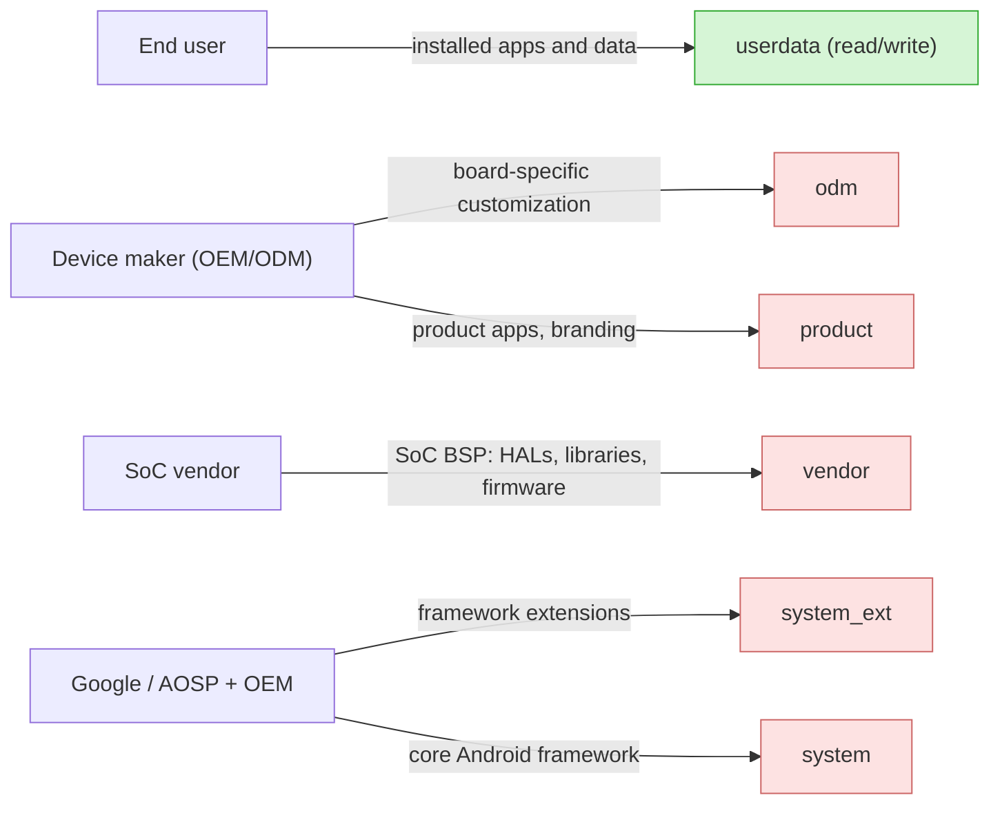

| Partition | Primary owner | Typical contents |
|---|---|---|
| `system` | Google (AOSP) | Core framework, `system_server`, core native services |
| `system_ext` | Google or the OEM | Framework extensions that are not part of the generic system image |
| `product` | OEM | Product apps, branding, regional customization |
| `vendor` | SoC vendor (shipped by the OEM) | SoC-specific HAL implementations, libraries, firmware |
| `odm` | ODM / OEM | Board-specific customization of the SoC BSP: camera tuning, display panel, touch, extra sensors |
| `userdata` | End user | Installed apps and their data; the only big **read/write** partition |

Everything except `userdata` (and small partitions such as `metadata`) is mounted **read-only** and
verified by AVB ([Secure Boot and AVB](../07.AndroidBootingSequence/SECURE_BOOT_AVB.md)).

**Two independent upgrade units** sit on either side of a stable interface:

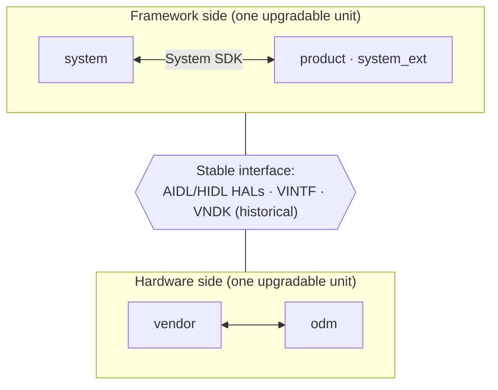

What each split allows (General concept):

| Change | Partition rebuilt |
|---|---|
| New launcher, wallpapers, themes | `product` |
| Better GPU driver from the SoC vendor | `vendor` |
| New camera calibration for one board | `odm` |
| New Android framework release | `system` (vendor can stay, within the vendor-freeze rules) |

> **Real example from your build (Verified):** the A17 Cuttlefish output installs CarService in
> `system/priv-app/CarService`, and some car apps in `system_ext/priv-app/`
> ([AAOS §2.1](../06.AndroidAutomotiveArchitecture/README.md#21-applications)). Which partition a
> module goes to is set in its build file (`system_ext_specific: true`, `product_specific: true`,
> `vendor: true`…) ([Build System](../08.AndroidBuildSystem/README.md)).

### Before and after Treble

**Before Android 8**, there was no enforced boundary. Legacy HAL libraries (`.so`) were loaded
**into framework processes** with `hw_get_module()`, sharing their process, address space and C++ ABI:

```text
Camera app → CameraService (framework process) → libcamera HAL .so (same process) → kernel driver
```

If Google changed what CameraService expected (say, a new function), the old vendor `.so` no longer
matched. The SoC vendor had to rebuild its HAL, then the OEM had to rebuild the product. Every
Android update needed new code from everyone, which made updates slow and expensive.

> **Terminology:** this pre-Treble in-process HAL is a **legacy (conventional) HAL**. "**Passthrough**"
> is a later HIDL mode that wraps such a legacy library behind a HIDL interface.

**After Treble**, most HALs run as **separate vendor processes**, and the framework talks to them
only through **versioned, stable interfaces** over Binder:

```text
App → CameraManager (app process)
  ── Binder (AIDL) ──► CameraService (cameraserver, /system)
  ══ stable AIDL HAL over Binder ══► camera provider HAL (vendor process, /vendor)
  ── ioctl / system calls ──► camera driver (kernel) ──► sensor / ISP
```

| Component | Partition | Process |
|---|---|---|
| Camera app, `CameraManager` | app package, framework library | App process |
| CameraService | `/system` | `cameraserver` |
| Camera HAL (`android.hardware.camera.provider`) | `/vendor` | Vendor HAL process |
| Camera driver | kernel / vendor modules | Kernel |

> **Not every HAL became a process.** A few performance-critical **same-process HALs** are still
> loaded into the caller, for example GPU (OpenGL ES / Vulkan) drivers and the graphics buffer
> mapper. They are restricted to approved libraries instead of a Binder boundary.

**"Stable" means the contract does not change** (it does not mean "does not crash"). A frozen
interface version keeps working in later Android releases, even when the implementation behind it
changes. That is what lets `/system` and `/vendor` be updated independently.

### VNDK: native libraries across the boundary (historical)

Binder interfaces cover **calls between processes**. Vendor binaries also **link** against native
libraries, and before Treble they could link against any framework-internal library, so a
`/system` update could break `/vendor` binaries at the **ABI** level.

> **API vs ABI:** the **API** is the source-level contract (function declarations you compile
> against). The **ABI** is the binary contract: symbol names, calling conventions, struct layouts.
> A change can keep the API but break the ABI, and then already-compiled vendor code fails.

Treble introduced the **VNDK** (Vendor Native Development Kit): a curated set of system libraries
with a stable ABI that vendor code was allowed to use, enforced by **linker namespaces**.

> **Version-dependent (Official documentation):** VNDK is **deprecated from Android 15**. Vendor
> code is expected to rely on stable AIDL interfaces and on libraries shipped inside `/vendor` or in
> APEXes instead.

### HAL in AAOS

The **Vehicle HAL** is the most important automotive HAL. Others include **EVS** (cameras),
**AudioControl**, **CAN**, **Occupant Awareness** and **Remote Access** (`ls
hardware/interfaces/automotive/`: `audiocontrol can evs ivn_android_device occupant_awareness
remoteaccess vehicle`). Details in [AAOS Architecture §2.6](../06.AndroidAutomotiveArchitecture/README.md#26-vehicle-hal-vhal).

---

## 4. Native layer: libraries and daemons

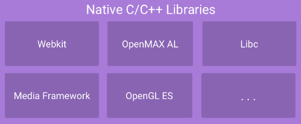

The native (C/C++/Rust) layer contains **two different kinds of things**. Keep them separate:

| Kind | What it is | Examples (Verified paths) |
|---|---|---|
| **Native libraries** | `.so` files **loaded into** other processes | `bionic/` (libc, libm, libdl, linker), `frameworks/native/libs/binder/` (libbinder), `external/skia/` (2D graphics), `external/boringssl/` (crypto/TLS), `external/sqlite/`, `external/freetype/`, `frameworks/native/opengl/` + `frameworks/native/vulkan/` (GPU API loaders), `frameworks/av/media/codec2/` (codecs), `frameworks/av/media/libaaudio/` |
| **Native daemons / services** | **Separate processes** started by `init` | `servicemanager`, `surfaceflinger`, `logd`, `lmkd`, `vold`, `netd`, `audioserver`, `cameraserver`, `mediaserver`… |

### 4.1 Bionic: Android's C library

**What:** Android's own libc, libm and dynamic linker (`bionic/`).

**Why not glibc?**

- **License:** BSD-licensed, so it can be linked into proprietary vendor code without LGPL
  obligations.
- **Size:** smaller, designed for Android.
- **Android integration:** the system property API (`__system_property_get`, see
  [Boot §4.5](../07.AndroidBootingSequence/README.md#45-system-properties)), Android-specific
  security hardening, and the linker namespaces used by Treble.

### 4.2 Graphics: OpenGL ES, Vulkan, Skia, SurfaceFlinger

- **OpenGL ES** (Khronos) is the embedded subset of OpenGL for GPU-accelerated 2D/3D rendering.
  **Vulkan** is the modern, lower-overhead GPU API. AOSP provides the **loaders**
  (`frameworks/native/opengl/`, `frameworks/native/vulkan/`), and the GPU vendor provides the drivers.
- **Skia** (`external/skia/`) is the 2D graphics library behind Android's UI rendering (HWUI).
- **SurfaceFlinger** (a native daemon) **composites** the buffers of all windows into the final frame
  for each display.

**How graphics is used in IVI and digital cockpits** (General concept, kept from the previous version):

- **Gauges and clusters:** speedometer, RPM and warning indicators need smooth real-time rendering.
- **Maps:** 3D navigation with zoom, rotate and terrain.
- **Multiple displays:** driver cluster, center display and rear-seat screens rendered from the same
  GPU. AAOS supports multi-display through display/occupant-zone configuration.
- **Themes and day/night modes.**

### 4.3 Web content: WebView 

The previous version listed **WebKit** as an Android native library. That is **outdated**. Android
renders web content with **Android System WebView**, a **Chromium**-based component shipped as an
**APK**. In AOSP it is a prebuilt in `external/chromium-webview/`. Zygote prepares it with
`WebViewFactory.prepareWebViewInZygote()` ([Boot §5.3](../07.AndroidBootingSequence/README.md#53-what-zygoteinitmain-really-does)).
Blink, Chromium's engine, is a fork of WebKit, and Chrome itself is not WebKit-based.

### 4.4 Media and audio (corrected)

| Component | What it is | Status |
|---|---|---|
| **Media framework** (`MediaCodec`, `MediaPlayer`, `ExoPlayer`/Media3 in apps) | Java/NDK APIs for decoding, encoding and playback | Current |
| **Codec 2.0** (`frameworks/av/media/codec2/`) | The codec HAL/framework that replaced OMX IL for vendor codecs | Current |
| **OpenMAX IL** | Older codec component interface | Legacy, replaced by Codec 2.0 |
| **AAudio** (`frameworks/av/media/libaaudio/`, `libaaudio.so`) | NDK **low-latency audio** API (API 26+) | **Recommended** native audio API (Official documentation) |
| **OpenSL ES** (`frameworks/wilhelm/`, `libOpenSLES.so`) | Older Khronos native audio API | **Deprecated**. Use AAudio or the Oboe library (Official documentation) |
| **OpenMAX AL** (`frameworks/wilhelm/include/OMXAL/`, `libOpenMAXAL.so`) | Khronos multimedia **application-level** API in the NDK (API 14+), with a limited Android implementation | Still shipped (Verified in build). **Not** the general low-latency path |

### 4.5 Security: BoringSSL and Conscrypt 

Android uses **BoringSSL** (`external/boringssl/`), Google's fork of OpenSSL. **OpenSSL itself is not
in the platform** (there is no `external/openssl` in your tree). Java apps reach TLS through
**Conscrypt** (`external/conscrypt/`), a Java security provider built on BoringSSL. They provide:

- **Encryption** (AES, ChaCha20), **integrity** (SHA-256, HMAC), and **authentication**
  (certificates, signatures);
- **TLS 1.2/1.3** for HTTPS;
- **Certificate validation** against the system trust store (`/system/etc/security/cacerts`, updatable
  through the Conscrypt APEX in modern releases).

Use cases: HTTPS from apps, OTA download verification, and secure car-to-cloud connections in
connected-vehicle services.

### 4.6 FreeType and text

**FreeType** (`external/freetype/`) rasterizes font glyphs (TrueType/OpenType) into pixels.
**HarfBuzz** shapes complex scripts such as Arabic and Indic scripts. Together with Minikin (Android's
text layout library) they render every piece of text on screen.

### 4.7 The NDK (for app developers)

The **Android Native Development Kit** lets **apps** include C/C++ code. The code is compiled into
`.so` files packaged in the APK and called from Kotlin/Java through **JNI**.

- Apps may only use the **stable NDK APIs** (libc, libm, liblog, libandroid, AAudio, OpenGL ES,
  Vulkan, Camera NDK, …). **Private platform libraries** (libbinder's C++ API, libutils…) are
  **blocked** by linker namespaces since Android 7.0.
- Typical use: performance-critical code (codecs, physics, signal processing) and reuse of existing
  C/C++ libraries.

**Illustrative AAOS scenario (corrected):** an app that computes average fuel efficiency could do the
math in C++ via JNI. It would still **get the vehicle data from the Car API**
(`CarPropertyManager`), because there is no NDK API for vehicle properties and apps cannot open the
VHAL ([AAOS §7](../06.AndroidAutomotiveArchitecture/README.md#7-security-permissions-and-selinux)).

---

## 5. Android Runtime (ART)

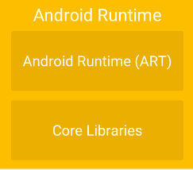

### 5.1 What is ART and why does Android need a runtime?

Android apps are written in **Kotlin/Java**. They are compiled to **DEX bytecode** (Dalvik
Executable), not to machine code. A **runtime** is needed to:

1. **execute** DEX, by interpreting it or compiling it to native code;
2. manage memory automatically (**garbage collection**);
3. provide the core Java libraries (`java.lang`, `java.util`, …);
4. bridge to native code (**JNI**);
5. support debugging and profiling.

**ART** (`art/` in AOSP, shipped as the updatable **ART APEX** `com.android.art`) is that runtime.
It replaced **Dalvik**.

**Why DEX and not plain Java `.class` files?** DEX merges all classes into one file with shared
constant pools and uses a **register-based** instruction set. That makes it smaller and better
suited to devices with limited RAM and flash.

### 5.2 From source code to running code

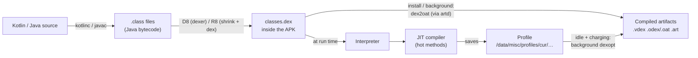

- **D8** converts `.class` to `.dex`. **R8** additionally shrinks and obfuscates code. Both replaced
  the old DX tool.
- **`dex2oat`** (`art/dex2oat/`) compiles DEX into native code ahead of time. It is invoked by the
  **ART Service** (`art/libartservice/`, e.g. `ArtManagerLocal.java`) through the **`artd`** daemon
  (`art/artd/`).
- Output artifacts for an installed app go into the app's own **`oat/<isa>/`** directory next to its
  APK (`/data/app/<random>/<package>-<random>/oat/arm64/base.odex`, `.vdex`, `.art`). They do **not**
  go into `/data/dalvik-cache`, which holds only boot-classpath and system artifacts. Verified in
  `art/artd/artd.cc` (line 320 checks the `oat` directory name) and `art/artd/path_utils.cc` (vdex
  path built from the oat path, line 208).

### 5.3 Compiler filters: how much to compile

`art/libartbase/base/compiler_filter.h` (lines 36–42) defines the levels:

| Filter | Meaning |
|---|---|
| `verify` | Only verify the DEX; everything runs interpreted/JIT at first |
| `speed-profile` | AOT-compile **only the methods in the profile** (hot code) |
| `speed` | AOT-compile everything it can for maximum speed |
| `everything` | Compile everything, including code that is rarely worth it |

**When dexopt happens, and with which filter** (Verified in source,
`build/make/target/product/runtime_libart.mk`, lines 117–130):

```make
pm.dexopt.first-boot?=verify
pm.dexopt.boot-after-ota?=verify
pm.dexopt.install?=speed-profile
pm.dexopt.install-fast?=skip
pm.dexopt.bg-dexopt?=speed-profile
pm.dexopt.inactive?=verify
pm.dexopt.cmdline?=verify
```

**Why not compile everything at install, like Android 5.0 did?** Full AOT meant **slow installs**,
**long post-OTA boots**, and large files on flash for code that is mostly never run. The modern
design compiles **only what is actually used**.

### 5.4 Profile-guided compilation: the real lifecycle

1. **First run:** code is **interpreted**. Hot methods are **JIT-compiled** in memory (the JIT is
   part of ART since Android 7.0).
2. **Profile collection:** ART records which methods and classes are hot in a profile file,
   `/data/misc/profiles/cur/<userId>/<package>/primary.prof`. A **reference profile** is merged into
   `/data/misc/profiles/ref/<package>/`. Verified: path builders in `art/artd/path_utils.cc` (lines
   224 and 241).
3. **Background dexopt:** when the device is **idle and charging**, ART Service re-compiles the
   app with **`speed-profile`** (`pm.dexopt.bg-dexopt`). Hot methods become AOT code, and cold code
   stays interpreted/JIT.
4. **Next launches** run the AOT-compiled hot code immediately, giving faster start and less JIT work.
5. **Baseline/cloud profiles** (Official documentation): apps can ship a *baseline profile*, and Play
   can deliver *cloud profiles*, so step 3's benefit is available right after install.

**Illustrative AAOS example:** a navigation app's map-rendering and route-search code becomes hot
in the first drives. While the car is parked and charging (EV) or the system is idle, background
dexopt compiles those methods, and later drives start faster. *(This is the general mechanism. A car
may never be "idle + charging" like a phone, so OEMs tune these policies.)*

### 5.5 Garbage collection

**What:** automatic reclamation of objects that are no longer reachable.

**Why it matters for UI:** a long "stop-the-world" pause freezes rendering and causes dropped frames.

**ART today (Verified in source):**

- The build default collector is **CMC**, a *concurrent mark-compact* collector
  (`art/build/art.go` line 50: `GetenvWithDefault("ART_DEFAULT_GC_TYPE", "CMC")`).
- At run time, ART uses CMC only if the system property allows it **and** the kernel supports
  **userfaultfd**. Otherwise it uses **CC** (*concurrent copying*, read-barrier based)
  (`art/runtime/gc/collector/mark_compact.cc`, `ShouldUseUserfaultfd()`, lines 310–327).
- Both are **concurrent**: most of the work happens while app threads keep running, with very short
  pauses. Both **compact** the heap, which reduces fragmentation.

### 5.6 Supported CPU architectures (correction)

ART's architecture directories in AOSP 17 are **`arm`, `arm64`, `riscv64`, `x86`, `x86_64`**
(`art/runtime/arch/`). **MIPS support was removed** years ago. The old table that listed MIPS was
outdated.

### 5.7 Dalvik vs ART

| | Dalvik | ART |
|---|---|---|
| Era | Android 1.0 – 4.4 | Optional preview in 4.4. **Default since 5.0** |
| Execution | Interpreter + trace **JIT** (since 2.2). JIT code not persisted | Interpreter + method **JIT** + **AOT** (`dex2oat`) |
| 5.0 – 6.0 | — | Full AOT at install: fast runtime, slow installs |
| 7.0+ | — | **Hybrid**: install fast (`verify`/`speed-profile`), JIT + profiles, background AOT of hot code |
| GC | Mostly stop-the-world mark-sweep | Concurrent (CMS → CC → CMC) |
| Same idea in both | One VM instance **per app process**, each process forked from **Zygote** | |

### 5.8 Core libraries

The Java core libraries (`libcore/`) are based on **OpenJDK** class libraries, adapted for Android.
Main packages: `java.lang`, `java.util`, `java.util.concurrent`, `java.io`, `java.nio`, `java.net`,
`java.security`, `javax.crypto`, `org.json`. Android adds its own packages, such as `android.os`
(`Handler`, `Looper`, `Binder`), `android.util` (`Log`, `SparseArray`) and `android.text`.

Modern Java language features (lambdas, streams, `java.time`) are available directly on newer API
levels, or through D8/R8 **desugaring** for older devices.

---

## 6. Java API Framework and System Services

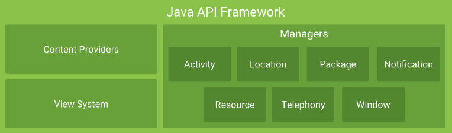

### 6.1 What is it?

The **Android framework** is the Java/Kotlin API surface apps program against (`android.*`), plus
the **system services** that implement most of it. It is mostly in `frameworks/base/`.

### 6.2 The most important idea: Manager (client) vs Service (server)

| | **Manager** (e.g. `LocationManager`) | **Service** (e.g. `LocationManagerService`) |
|---|---|---|
| Runs in | **the app's process** | **`system_server`** (or another system process) |
| Created by | `context.getSystemService(...)` | `SystemServer` at boot |
| Holds | a **Binder proxy** to the service | the real state and the hardware/HAL connections |
| Trust | none: it runs app code | checks the **caller's UID and permissions** on every call |

**Why split?** The service must be **shared** (one GPS, one window list for all apps) and
**protected** (an app must not be able to grant itself permissions). Putting it in a separate,
privileged process and talking over Binder solves both problems.

**Verified in source, how `getSystemService(LOCATION_SERVICE)` works**
(`frameworks/base/core/java/android/app/SystemServiceRegistry.java`, lines 697–702):

```java
registerService(Context.LOCATION_SERVICE, LocationManager.class,
        new CachedServiceFetcher<LocationManager>() {
    @Override
    public LocationManager createService(ContextImpl ctx) throws ServiceNotFoundException {
        IBinder b = ServiceManager.getServiceOrThrow(Context.LOCATION_SERVICE);    // 1. look up Binder
        return new LocationManager(ctx, ILocationManager.Stub.asInterface(b));    // 2. wrap in proxy
    }});
```

1. `ServiceManager.getService*` asks the **servicemanager** process for the Binder named `"location"`
   ([§7](#7-binder-ipc-and-servicemanager)).
2. `ILocationManager.Stub.asInterface(b)` wraps it in the AIDL-generated **Proxy**.
3. `LocationManager` (the public API) calls that proxy. Each call is a Binder transaction into
   `system_server`.

### 6.3 Key managers and services (corrected)

| Manager (app side) | Service (server side) | Role |
|---|---|---|
| `ActivityManager` | `ActivityManagerService` (`extends IActivityManager.Stub`, `am/ActivityManagerService.java:602`) | Processes, app lifecycle, broadcasts, services |
| (activities, tasks) | `ActivityTaskManagerService` (`extends IActivityTaskManager.Stub`, `wm/ActivityTaskManagerService.java:339`) | **Activities, tasks, back stack**: split out of AMS in Android 10 (Version-dependent) |
| `PackageManager` | `PackageManagerService` | Installed packages, permissions, components |
| `WindowManager` | `WindowManagerService` | Window placement, focus, transitions. It hands buffers to **SurfaceFlinger** (separate native process) for composition |
| Resources (`Resources`, `AssetManager`) | — (in-process) | Strings, layouts, drawables, per-language/per-screen alternatives |
| `LocationManager` | `LocationManagerService` | GPS/network location, `requestLocationUpdates()`, `getLastKnownLocation()`, geofences (`addProximityAlert()`) |
| `NotificationManager` | `NotificationManagerService` | `notify()`, `cancel()`, **channels** (`createNotificationChannel()`, required since Android 8.0) |
| `TelephonyManager` | Telephony services (`com.android.phone`) | Network/SIM/call state. Sensitive identifiers such as `getSimSerialNumber()` now require `READ_PRIVILEGED_PHONE_STATE` and throw `SecurityException` for normal apps on modern targets (Verified: `TelephonyManager.java` ≈ lines 4120–4127) |
| `SensorManager` | `SensorService` (native, inside `system_server`) | Sensors ([§9](#9-end-to-end-real-example-an-app-reads-the-accelerometer)) |
| `ContentResolver` → **Content Providers** | Provider in the owning app's process | Structured data sharing between apps (e.g. Contacts) |
| View system (`View`, `ViewGroup`, `TextView`, `Button`, `RecyclerView`) | — (in-process, rendered by HWUI) | UI widgets |

**API notes:**

- `AsyncTask` is **deprecated** (Verified: `@Deprecated` at `frameworks/base/core/java/android/os/AsyncTask.java`
  line 199). Use `java.util.concurrent`, Kotlin coroutines or `WorkManager` (androidx).
- `Fragment`, `RecyclerView`, `Room` and `WorkManager` are **androidx libraries** shipped inside
  apps, not part of the platform framework.

### 6.4 Three everyday flows

Every Android feature follows the same pattern:

```text
App → Manager (API, app process) → [Binder/AIDL] → system service → [Binder, stable AIDL HAL] → HAL → system calls → driver → hardware
```

Permissions and SELinux are checked **on the way down**; every hop can refuse.

#### Flow A: taking a photo

| Layer | Component | Role |
|---|---|---|
| App | Camera app | The user taps the shutter |
| API | `CameraManager`, `CameraDevice` | Public SDK |
| System service | `cameraserver` (`ICameraService.connectDevice()`, Verified: `frameworks/av/camera/aidl/android/hardware/ICameraService.aidl`) | Shares the camera between apps, checks the `CAMERA` permission |
| HAL | Camera provider AIDL HAL (`hardware/interfaces/camera/provider/aidl/`) | Vendor code for this sensor and ISP |
| Kernel | Camera driver (often V4L2) | Talks to the hardware |
| Hardware | Image sensor + ISP | Captures the image |

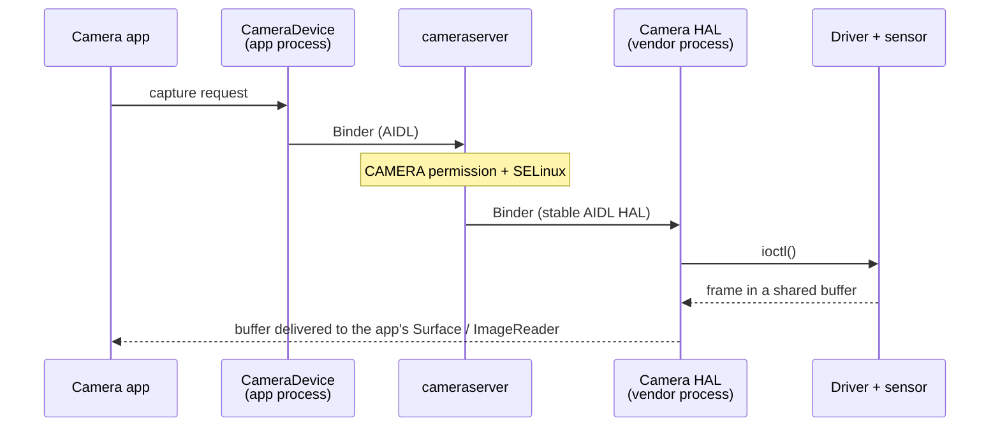

> **Image data does not travel inside Binder parcels.** Binder carries the **control** messages
> (requests, results, metadata). The pixels are written into **shared graphics buffers**
> (BufferQueue, DMA-BUF) that the app reads through a `Surface` or `ImageReader`. The 1 MB Binder
> buffer ([§7.3](#73-the-pieces-verified-in-source)) could not carry them anyway.

#### Flow B: getting the location (the permission wall)

| Layer | Component | Role |
|---|---|---|
| App | A navigation app | Calls `requestLocationUpdates()` |
| API | `LocationManager` | Public location API |
| System service | `LocationManagerService` (in `system_server`) | Checks `ACCESS_FINE_LOCATION`, combines providers |
| HAL | GNSS AIDL HAL (`hardware/interfaces/gnss/aidl/`) | Vendor abstraction of the GPS chip |
| Kernel / hardware | GNSS driver and receiver | Satellite fix |

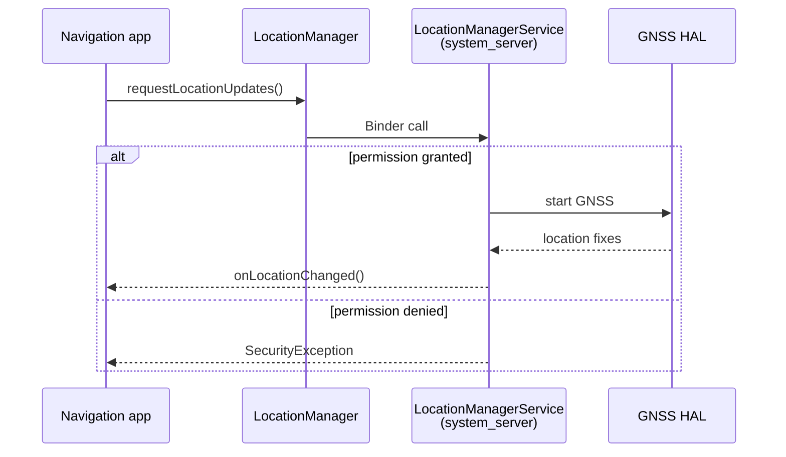

If the user never granted location (or SELinux forbids the caller), the request is rejected **in the
service**, and the HAL never sees it. Many real apps use Google's Fused Location Provider (part of
Google Play services, not AOSP), but the platform path is the one above.

#### Flow C: launching an app (why Zygote exists)

| Step | Who | What |
|---|---|---|
| 1 | Launcher | The user taps an icon → `startActivity()` (Binder) |
| 2 | ActivityTaskManagerService / ActivityManagerService (`system_server`) | Decide that a new process is needed |
| 3 | Zygote | AMS asks Zygote over its **socket** to fork; the child already has ART and the preloaded classes |
| 4 | New app process | `ActivityThread.main()` calls `attachApplication()` back to AMS (Verified: `IActivityManager.aidl` line 209); AMS answers with `bindApplication`, then the activity is created |
| 5 | SurfaceFlinger | Composites the app's first frame |

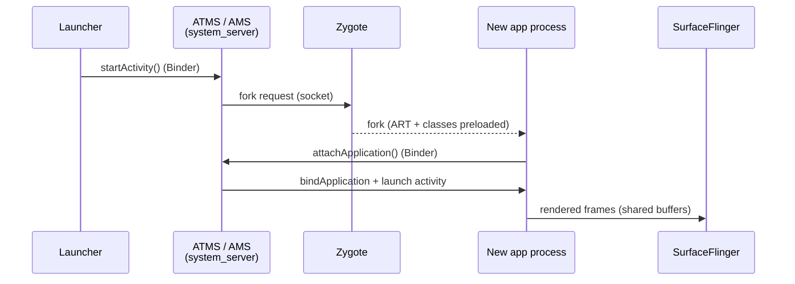

The exact fork path is traced in [Boot §5.5](../07.AndroidBootingSequence/README.md#55-forking-an-app-process-the-real-path).

**Takeaway:** every feature is **mediated**. The app codes against a Manager, Binder carries the
request to a system service that owns the resource and enforces permissions and SELinux, the HAL hides
vendor differences, and only then does a driver touch the hardware.

---

## 7. Binder IPC and ServiceManager

### 7.1 Why IPC, and why separate processes?

Android deliberately splits the system into many processes: each app, `system_server`,
`surfaceflinger`, HALs… This gives:

- **isolation**: a crash or exploit in one process cannot directly corrupt another's memory;
- **least privilege**: each process runs with its own UID and SELinux domain;
- **stability**: a crashing app does not take down the system.

The price is that processes **cannot call each other's functions directly**. Their address spaces
are separate. They need **IPC** (Inter-Process Communication).

**What "separate address spaces" means in practice.** Each process has its own virtual memory
([Linux vs Android §2.3](../01.LinuxVsAndroid/README.md#23-linux-kernel)). The same virtual address
can point to completely different data in two processes:

```text
App process                       cameraserver process
0x1000 → CameraManager object     0x1000 → CameraService object
0x2000 → String "0"               0x2000 → something else entirely
```

So when an app calls `openCamera("0")` on a service in another process, it cannot just pass a
pointer to `"0"`: that address means nothing on the other side. The data has to be **copied** into a
message, carried across by the kernel, and **rebuilt** in the receiver. Binder and `Parcel` do exactly
that ([§7.5](#75-aidl-proxy-and-stub-real-generated-code)).

### 7.2 Why Binder instead of sockets, pipes or System V IPC?

Android still uses Unix sockets in places (zygote, property service, logd, sensor event channels),
but **Binder** is the main IPC because it provides, in one mechanism:

| Need | What Binder provides |
|---|---|
| Remote **method calls** with arguments and return values | Transactions with a code + Parcel |
| **Caller identity** that cannot be forged | The kernel attaches the caller's **PID/UID** (and SELinux context) to each transaction (`Binder.getCallingUid()`) |
| **Object references** across processes | A Binder object passed in a Parcel becomes a **handle** in the receiver. Callbacks are just Binder objects |
| **Lifetime tracking** | Reference counting + **death notifications** (`linkToDeath`) |
| **Efficiency** | Data copied **once** (sender → kernel → receiver's mmapped buffer) |
| **Thread management** | Each process has a Binder thread pool, and the driver dispatches incoming calls to it |

### 7.3 The pieces (Verified in source)

| Piece | Where | Role |
|---|---|---|
| **Binder driver** | Kernel `drivers/android/`, nodes under `/dev/binderfs/` | Moves transactions between processes, translates object references, tracks death |
| **libbinder** (C++) / `android.os.Binder` (Java) / NDK `AIBinder` | `frameworks/native/libs/binder/` | User-space library: `ProcessState` (opens and mmaps the driver), `IPCThreadState` (sends/receives), `Parcel` |
| **AIDL compiler** | `system/tools/aidl/` | Generates **Proxy** (client) and **Stub** (server) code from `.aidl` files |
| **servicemanager** | `frameworks/native/cmds/servicemanager/` | The **name registry**: "car_service" → Binder |

Two concrete numbers from `frameworks/native/libs/binder/ProcessState.cpp`:

```cpp
#define BINDER_VM_SIZE ((1 * 1024 * 1024) - sysconf(_SC_PAGE_SIZE) * 2)   // line 48
#define DEFAULT_MAX_BINDER_THREADS 15                                    // line 49
...
mVMStart = mmap(nullptr, BINDER_VM_SIZE, PROT_READ, MAP_PRIVATE | MAP_NORESERVE, ...); // line 625
```

- Each process maps a **receive buffer of 1 MB minus 2 pages**. All in-flight incoming transactions
  of that process share it. This is why sending large data (big bitmaps) over Binder fails with
  `TransactionTooLargeException`. Large data should use shared memory (memfd/`SharedMemory`,
  DMA-BUF) instead.
- The default Binder thread pool is **15** threads. `system_server` and CarService raise it to 31
  ([AAOS §2.4](../06.AndroidAutomotiveArchitecture/README.md#24-carservice-comandroidcar)).

### 7.4 ServiceManager: the name registry

**What it is:** a native daemon (`frameworks/native/cmds/servicemanager/`) that maps **names** to
**Binder objects**. It is the "phone book" of Binder services.

**How clients find ServiceManager itself:** it registers as the Binder **context manager**. The
driver gives it the special **handle 0**, which every process already knows.
`servicemanager/main.cpp` line 174 calls `ps->becomeContextManager()`, which issues
`ioctl(..., BINDER_SET_CONTEXT_MGR_EXT, ...)` (`ProcessState.cpp` line 242). In Java,
`ServiceManager.getIServiceManager()` wraps `BinderInternal.getContextObject()`, which is handle 0
(`frameworks/base/core/java/android/os/ServiceManager.java`, around line 137).

**Interface** (`frameworks/native/libs/binder/aidl/android/os/IServiceManager.aidl`): `getService`,
`checkService`, `addService`, `listServices`, `registerForNotifications`, `isDeclared`, …

**Security (Verified in source):** every `addService` and `getService` is checked against SELinux.
`Access.cpp` calls `selinux_check_access(..., "add")` / `"find"` / `"list"` (lines 131–152) against
`service_contexts` labels. A random app therefore cannot register a fake `"car_service"`, and cannot
look up services it is not allowed to use.

**Three service managers, three Binder domains:**

| Device node | Service manager | Used by |
|---|---|---|
| `/dev/binder` | `servicemanager` | Framework, apps, **AIDL HALs** |
| `/dev/hwbinder` | `hwservicemanager` | **HIDL** HALs |
| `/dev/vndbinder` | `vndservicemanager` | Vendor processes talking to each other |

All three are started in `init.rc` `on init` (lines 464–466). The real `servicemanager.rc`:

```bash
service servicemanager /system/bin/servicemanager
    class core animation
    user system
    group system readproc
    critical
    ...
    onrestart class_restart --only-enabled main
```

It is `critical` (repeated crashes reboot the device), and its restart forces `main`-class services
to restart. Every Binder name they held must be registered again.

### 7.5 AIDL: Proxy and Stub (real generated code)

#### Why an interface definition language?

For one remote call, someone must: serialize the arguments, send them to the Binder driver, wake the
remote process, deserialize the arguments, call the real function, serialize the result, and send it
back. Writing that by hand for every method would be slow and error-prone.

An **IDL** (Interface Definition Language) describes the methods once, and a compiler **generates**
all of that code. Android has two:

- **AIDL**: used for apps, framework services and, since Android 11, HALs (stable AIDL);
- **HIDL**: introduced with Treble for HALs, now deprecated for new HALs ([§3](#three-generations-of-hals)).

From one `.aidl` file the AIDL compiler generates three things:

| Generated piece | Runs in | Job |
|---|---|---|
| The interface (`ICarProperty`) | both sides | The method list both sides agree on |
| **Proxy** (`ICarProperty.Stub.Proxy`) | client | Looks like a normal object. Each method packs the arguments, calls the driver, waits, unpacks the result |
| **Stub** (`ICarProperty.Stub`) | server | Receives the transaction, unpacks the arguments, calls the real method, packs the result |

```text
App process                                  Service process
───────────                                  ───────────────
CarPropertyManager                           CarPropertyService
      │                                             ▲
ICarProperty.Stub.Proxy                     ICarProperty.Stub
      │                                             │
      └──────────── Binder driver (kernel) ─────────┘
```

#### What is a `Parcel`?

A **`Parcel`** is the container Binder carries: a compact binary buffer into which the Proxy
**writes** (marshals) the method's arguments, and from which the Stub **reads** (unmarshals) them.
The reply travels back in a second Parcel. Conceptually:

```text
Parcel (_data)                           Parcel (_reply)
───────────────────────────             ───────────────────────────
interface token: "…ICarProperty"         "no exception" marker
transaction code: getProperty            CarPropertyValue fields
prop = 0x11600207, area = 0
```

A Parcel can hold:

- primitives (`int`, `long`, `boolean`, `float`, `double`…), strings and byte arrays;
- **`Parcelable`** objects (custom types that know how to write and read themselves);
- **Binder object references** (`IBinder`): this is how callbacks are passed, and the receiver gets
  a handle it can call back on;
- **file descriptors**: how large data (shared memory, graphics buffers) is shared without copying
  it through Binder;
- lists, arrays, maps and `Bundle`s of supported types.

**`Parcelable` vs Java `Serializable`.** A `Parcelable` class writes its fields explicitly in
`writeToParcel()` and rebuilds itself through a `CREATOR`, in the **same order**. Java
`Serializable` uses reflection and is much slower. That is why Android uses Parcelable for IPC.

> **A Parcel is for short-lived IPC only.** Its format is not stable across releases. Do not write
> Parcels to disk or send them over the network (Official documentation, `android.os.Parcel`).

The excerpts below show this generated code for real. To write and run your own AIDL interfaces (an
app service, a native C++ service and a VINTF HAL), see
[Binder IPC and AIDL, Part 2](../10.AIDLHandsOn/README.md#part-2--hands-on-examples).

You write an interface, `car-lib/src/android/car/hardware/property/ICarProperty.aidl`. At build time
the AIDL compiler generates `ICarProperty.java` inside
`out/soong/.intermediates/packages/services/Car/car-lib-module/android.car-module.impl/android_common/gen/aidl/*.srcjar`.
The excerpts below are from that generated file.

**1. `asInterface()`: decide between a local object and a remote proxy**

```java
public static android.car.hardware.property.ICarProperty asInterface(android.os.IBinder obj) {
    if ((obj==null)) { return null; }
    android.os.IInterface iin = obj.queryLocalInterface(DESCRIPTOR);
    if (((iin!=null)&&(iin instanceof android.car.hardware.property.ICarProperty))) {
        return ((android.car.hardware.property.ICarProperty)iin);       // same process: direct call
    }
    return new android.car.hardware.property.ICarProperty.Stub.Proxy(obj); // other process: proxy
}
```

**2. Proxy (client side): marshal the arguments and call `transact()`**

```java
@Override public android.car.hardware.CarPropertyValue getProperty(int prop, int zone) throws android.os.RemoteException {
    android.os.Parcel _data = android.os.Parcel.obtain(asBinder());
    android.os.Parcel _reply = android.os.Parcel.obtain();
    android.car.hardware.CarPropertyValue _result;
    try {
        _data.writeInterfaceToken(DESCRIPTOR);   // "android.car.hardware.property.ICarProperty"
        _data.writeInt(prop);
        _data.writeInt(zone);
        boolean _status = mRemote.transact(Stub.TRANSACTION_getProperty, _data, _reply, 0); // blocks
        _reply.readException();                  // re-throws server-side exceptions (e.g. SecurityException)
        _result = _reply.readTypedObject(android.car.hardware.CarPropertyValue.CREATOR);
    } finally {
        _reply.recycle();
        _data.recycle();
    }
    return _result;
}
```

**3. Stub (server side): unmarshal and call the real implementation**

```java
case TRANSACTION_getProperty:          // = IBinder.FIRST_CALL_TRANSACTION + 3
{
    int _arg0; _arg0 = data.readInt();
    int _arg1; _arg1 = data.readInt();
    data.enforceNoDataAvail();
    android.car.hardware.CarPropertyValue _result = this.getProperty(_arg0, _arg1); // → CarPropertyService
    reply.writeNoException();
    reply.writeTypedObject(_result, android.os.Parcelable.PARCELABLE_WRITE_RETURN_VALUE);
    break;
}
```

`CarPropertyService extends ICarProperty.Stub`, so `this.getProperty(...)` is the real CarService
implementation ([AAOS §4.1](../06.AndroidAutomotiveArchitecture/README.md#41-reading-a-property-get)).

### 7.6 One call, step by step

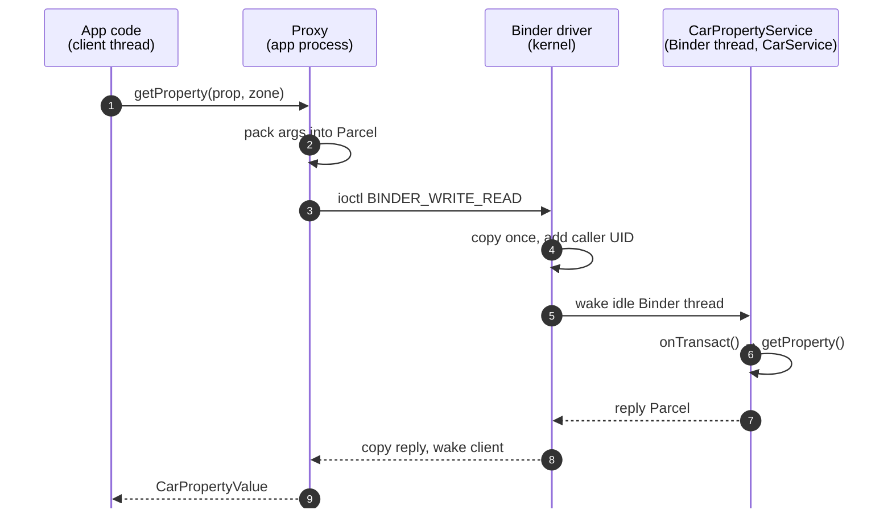

1. The app calls `getProperty(prop, zone)` on what looks like a local object. It is actually the
   generated proxy, `ICarProperty.Stub.Proxy`.
2. The proxy writes the interface token and the arguments into a `Parcel` (`_data`).
3. `transact(TRANSACTION_getProperty, …)` ends in an `ioctl(BINDER_WRITE_READ)` on `/dev/binder`.
   The client thread now blocks.
4. The driver copies `_data` **once**, straight into CarService's mmapped receive buffer, and attaches
   the caller's PID and UID.
5. The driver wakes an idle Binder thread in the CarService process.
6. On that thread, `Stub.onTransact(code, data, reply)` unpacks the arguments and calls
   `CarPropertyService.getProperty(...)`, which can check the caller with `Binder.getCallingUid()`.
7. The result is written into the `reply` Parcel and sent back through the driver.
8. The driver copies the reply into the client's buffer and wakes the client thread.
9. The proxy unpacks the `CarPropertyValue`, or re-throws the server's exception, and returns it.

- The client thread **blocks** until the reply arrives, unless the method is declared **`oneway`**
  (fire-and-forget). Callbacks such as `IVehicleCallback.onPropertyEvent` are `oneway`, so a slow
  client cannot block the sender.
- The server method runs on a **Binder thread**, not the main thread. Implementations must be
  thread-safe.

> **Deeper:** [Binder IPC in depth](../10.AIDLHandsOn/README.md#part-1--binder-ipc-in-depth) follows this
> same call through every layer (JNI, libbinder, the driver's `BC_`/`BR_` commands, the server's Binder
> thread), shows the Parcel byte by byte, and covers callbacks, `oneway`, caller identity and errors.

### 7.7 When the remote process dies

1. A client calls `binder.linkToDeath(recipient, 0)` on the remote Binder.
2. If the server process dies, the driver notices that the process's Binder node is gone and
   delivers **`binderDied()`** to every registered recipient.
3. Calls on a dead Binder throw **`DeadObjectException`** (a `RemoteException`).

**Real example:** CarService links to the VHAL's death in `CarServiceImpl.onCreate()`
(`mVehicle.linkToDeath(mVehicleDeathRecipient)`), and `servicemanager.rc`'s `onrestart` lines show
the system-level recovery strategy.

---

## 8. Application layer and the app sandbox


Apps (Launcher, Settings, Contacts, third-party apps) sit at the top and use the framework APIs.
In AAOS these include CarLauncher, CarSettings, CarSystemUI and media/navigation apps.

### The sandbox: how isolation really works (Verified in source + Official documentation)

1. **One Linux UID per app.** At install, each app gets an app ID in the range
   `AID_APP_START = 10000` … `AID_APP_END = 19999`
   (`system/core/libcutils/include/private/android_filesystem_config.h`, lines 216–217). On
   multi-user devices the actual UID is `userId × 100000 + appId` (`AID_USER_OFFSET 100000`, same
   file, line 256). For example, the same app is UID 10057 for user 0 and 1010057 for user 10. Each app runs
   in **its own process** with that UID, so the kernel's normal UID checks keep apps out of each
   other's files.
2. **Private data directories:** `/data/user/<userId>/<package>` (credential-encrypted storage) and
   `/data/user_de/<userId>/<package>` (device-encrypted, available before unlock). For user 0,
   `/data/data/<package>` is the same storage. Other apps cannot read these directories.
3. **SELinux:** third-party apps run in the `untrusted_app*` domains, and system apps in
   `system_app`, `platform_app` or `priv_app`. This limits what an app can do **even if it has the
   right UID**. For example, it cannot talk to a HAL
   ([AAOS §7](../06.AndroidAutomotiveArchitecture/README.md#7-security-permissions-and-selinux)).
4. **Permissions:**
   - Apps declare permissions in `AndroidManifest.xml`.
   - *Normal* permissions are granted at install.
   - *Dangerous* (runtime) permissions such as location, camera and `CAR_SPEED` must be **granted by
     the user** (since Android 6.0).
   - *Signature/privileged* permissions are only for platform-signed or privileged system apps.
5. **Each call is checked by the service.** System services call
   `checkCallingOrSelfPermission(...)` / `Binder.getCallingUid()` on every Binder call. The check
   happens **in the service process**, which the app cannot modify.

---

## 9. End-to-end real example: an app reads the accelerometer

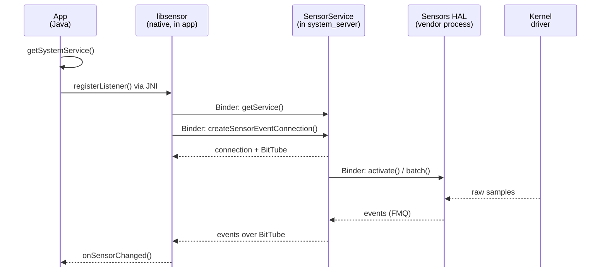

**Step by step:**

1. **Manager.** `context.getSystemService(Context.SENSOR_SERVICE)` returns a
   `SystemSensorManager` (`SystemServiceRegistry.java`, lines 794–798). Unlike `LocationManager`, it
   is backed by **native** code through JNI (`frameworks/base/core/jni/android_hardware_SensorManager.cpp`).
2. **Service lookup.** Native `SensorManager` (`frameworks/native/libs/sensor/SensorManager.cpp`) looks
   up the Binder service named **`"sensorservice"`** (line 180). That name is `SensorService::getServiceName()`
   (`frameworks/native/services/sensorservice/SensorService.h`, line 179).
3. **Where SensorService lives.** `SystemServer` starts the Java `com.android.server.sensors.SensorService`
   (`SystemServer.java`, lines 1458–1459). It calls `startSensorServiceNative(...)`
   (`services/core/java/com/android/server/sensors/SensorService.java`, line 54), so the **native**
   SensorService runs **inside the `system_server` process**. It is not a separate daemon.
4. **Event connection.** `createSensorEventConnection(...)` (`SensorManager.cpp`, line 383) returns a
   connection whose data channel is a **`BitTube`**. A BitTube is a Unix **`socketpair(AF_UNIX,
   SOCK_SEQPACKET)`** (`frameworks/native/libs/sensor/BitTube.cpp`, line 70). High-rate sensor events
   flow over this socket, not as one Binder call per event. **Control** uses Binder, and **data**
   uses a cheaper channel.
5. **HAL.** `SensorService`'s `SensorDevice` talks to the vendor's **Sensors AIDL HAL**. It checks
   `AServiceManager_isDeclared("android.hardware.sensors.ISensors/default")` and waits for it
   (`AidlSensorHalWrapper.cpp`, lines 109–117). There is a HIDL fallback (`HidlSensorHalWrapper.cpp`).
6. **Hardware.** The vendor's HAL implementation reads the kernel driver. How it does that is
   vendor-specific.
7. **Delivery.** `SensorEventConnection::sendEvents()`
   (`frameworks/native/services/sensorservice/SensorEventConnection.cpp`, line 316) calls
   `SensorEventQueue::write()` (`frameworks/native/libs/sensor/SensorEventQueue.cpp`, line 65), which
   writes the events into the BitTube. In the app, the JNI `Receiver` adds the BitTube's file
   descriptor to the app's **`Looper`** (`android_hardware_SensorManager.cpp`, line 393). When events
   arrive, it calls Java `dispatchSensorEvent()`, which calls your listener's **`onSensorChanged()`**
   (`SystemSensorManager.java`, line 1101).

**Design lessons:** the app never touches the HAL, the service is shared and permission-checked,
control uses Binder, and bulk data uses a dedicated channel.

> **Illustrative: adding a custom sensor.** If an OEM adds a custom cabin temperature sensor:
> 
>- **Phone-style option:** expose it through the Sensors HAL as a vendor sensor type. Apps use`SensorManager`.
> - **AAOS option (preferred for vehicle signals):** expose it as a **VENDOR vehicle property** in the VHAL, and apps use `CarPropertyManager` ([AAOS §3](../06.AndroidAutomotiveArchitecture/README.md#3-vehicle-properties-in-depth)).
> 
> In both cases the flow is App → Manager → Binder → system service → Binder → HAL → driver.
> ServiceManager is only used to **look up** the Binder; it is not on the data path.

---

## 10. How AAOS maps onto these layers

| Layer | Generic Android | AAOS additions |
|---|---|---|
| Apps | Launcher3, SystemUI, Settings | CarLauncher, CarSystemUI, CarSettings, OEM vehicle apps |
| Framework (client libs) | `android.*` managers | `android.car.*` managers (`CarPropertyManager`…) in `android.car.jar` |
| System services | `system_server` | + **CarServiceHelperService** (in `system_server`), + **CarService** process (`com.android.car`) |
| Native daemons | surfaceflinger, audioserver… | + `carpowerpolicyd`, `carwatchdogd`, `evsmanagerd`… |
| HAL | sensors, audio, camera… | + **VHAL**, EVS, AudioControl, CAN… |
| Kernel | Android Common Kernel | Same, plus vehicle-relevant drivers (CAN, V4L2 cameras, hibernation) |

Full details: [AAOS Architecture](../06.AndroidAutomotiveArchitecture/README.md).

### 10.1 Case study: a request to put the car to sleep

A popular teaching slide follows one request ("suspend the system") down every layer of an
automotive device. Its chain is:

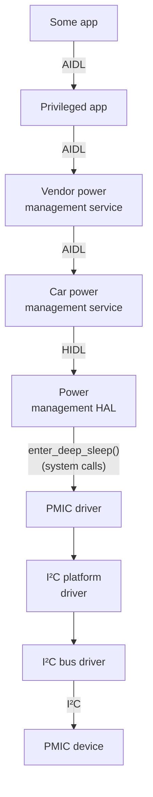

The lesson is right: a request passes through several processes, each with its own permissions,
and only the bottom layer touches hardware. The concrete path in **AOSP 17 AAOS** is different
(Verified in source):

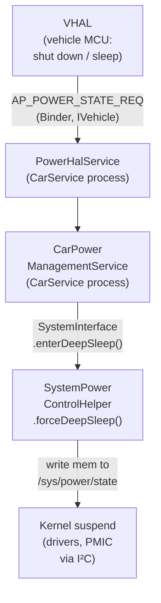

- **Who decides:** in a car, the **vehicle** decides when to sleep (ignition off). The VHAL delivers
  `AP_POWER_STATE_REQ` (`service/src/com/android/car/hal/PowerHalService.java`, line 88), and
  `CarPowerManagementService` runs the shutdown-prepare sequence.
- **How it sleeps:** `SystemInterface.enterDeepSleep()` →
  `SystemPowerControlHelper.forceDeepSleep()`, which writes `"mem"` (`SUSPEND_TYPE_MEM`, line 43) to
  `/sys/power/state` (line 47) (`packages/services/Car/service/src/com/android/car/systeminterface/`).
  There is no separate "power management HAL" on this path.
- **Interfaces:** the slide's "HIDL" step is outdated; current automotive HALs are AIDL.
- **Below the kernel line:** the kernel's suspend code calls the drivers' suspend hooks, and the PMIC
  driver talks to the PMIC chip over I²C (General concept, vendor-specific).

### 10.2 What restricts you: SELinux `neverallow` rules and the CDD

Two things limit which arrows in such a chain you are **allowed** to draw, even if the code could
make the call:

- **SELinux.** Every hop above (app → service, service → HAL, process → device file) is checked
  against the SELinux policy. **`neverallow`** rules in `system/sepolicy` forbid whole classes of
  access, such as untrusted apps calling HALs. The build fails if a device's policy violates them,
  and CTS checks them on the device ([AAOS §7](../06.AndroidAutomotiveArchitecture/README.md#7-security-permissions-and-selinux)).
- **The CDD** (Compatibility Definition Document) lists what a device must do to be "Android
  compatible". It is checked by **CTS** (and VTS for vendor interfaces). A device that breaks it
  cannot ship Google's services.

---

## 11. Common misconceptions

| Misconception | Correct interpretation |
|---|---|
| "Each layer is a process." | Layers are code dependencies. Framework code runs both in apps (managers) and in `system_server` (services). ART runs inside each Java process. |
| "The Android kernel has an alarm driver, a logger driver and the low memory killer." | Those were replaced: timerfd alarms, user-space `logd`, user-space `lmkd` with PSI ([§2](#2-linux-kernel-layer)). |
| "Android uses ION and ashmem." | Modern kernels use DMA-BUF heaps and memfd. |
| "Android doesn't use traditional IPC." | Binder is the main IPC, but Unix sockets are used heavily (zygote, property service, logd, sensor BitTube). |
| "Apps or ART talk to the HAL." | System services and native daemons talk to HALs. Apps use framework APIs. |
| "ART compiles every app fully at install." | Only Android 5–6 did. Today: `speed-profile` at install, JIT + profiles, background dexopt of hot code. |
| "Compiled app code lives in `/data/dalvik-cache` / in the APK." | App artifacts are in the app's `oat/<isa>/` directory. dalvik-cache is for the boot classpath/system. |
| "Android uses OpenSSL / WebKit." | BoringSSL + Conscrypt. WebView is Chromium-based (Blink). |
| "The native build system is ndk-build and Gradle." | **Platform** builds use **Soong (Android.bp) + Make**. **App** builds use Gradle (and ndk-build/CMake for app native code). |
| "ServiceManager forwards every call." | ServiceManager only **registers and looks up** names. After lookup, calls go directly client ↔ server through the driver. |
| "VINTF compatibility is checked by `init` at every boot." | It is checked at build time, before OTA, and by VTS. At run time `servicemanager` rejects undeclared VINTF services ([§3](#3-hardware-abstraction-layer-hal)). |
| "After Treble every HAL is a separate process." | Most are, but same-process HALs (GPU drivers, graphics mapper) are still loaded into the caller. |
| "Camera frames / big data travel through Binder." | Binder carries control messages and file descriptors. Pixels and audio use shared buffers. |

**Further reading (official):** [Android architecture](https://source.android.com/docs/core/architecture),
[HIDL/AIDL HALs](https://source.android.com/docs/core/architecture/aidl/aidl-hals),
[lmkd](https://source.android.com/docs/core/perf/lmkd),
[DMA-BUF heaps](https://source.android.com/docs/core/architecture/kernel/dma-buf-heaps),
[ART](https://source.android.com/docs/core/runtime),
[OpenSL ES deprecation / AAudio](https://developer.android.com/ndk/guides/audio/opensl/opensl-for-android).

**Previous:** [Android Automotive OS](../04.AndroidAutomotiveOS/README.md) ·
**Next:** [AAOS Architecture](../06.AndroidAutomotiveArchitecture/README.md)

---

## 12. Source map

| Topic | Path (AOSP 17) | Key symbols (line) |
|---|---|---|
| binderfs mount | `system/core/rootdir/init.rc` | lines 231–245 |
| memfd | `system/core/libcutils/ashmem-dev.cpp` | `__memfd_create_region` (215) |
| DMA-BUF heaps lib | `system/memory/libdmabufheap/` | — |
| lmkd | `system/memory/lmkd/lmkd.cpp` | PSI monitors |
| logd | `system/logging/logd/logd.rc` | sockets (2–4) |
| Alarms | `frameworks/base/apex/jobscheduler/service/jni/com_android_server_alarm_AlarmManagerService.cpp` | `CLOCK_BOOTTIME_ALARM` (68) |
| Suspend | `system/hardware/interfaces/suspend/aidl/default/SystemSuspend.cpp` | `kSysPowerWakeLock` (75) |
| Task profiles | `system/core/libprocessgroup/profiles/task_profiles.json` | — |
| Legacy HAL | `hardware/libhardware/hardware.c` | `hw_get_module` (275) |
| HIDL infra | `system/libhidl/`, `system/hwservicemanager/` | `hwservicemanager.rc` |
| VINTF | `system/libvintf/`, `hardware/interfaces/compatibility_matrices/` | — |
| Bionic | `bionic/` | — |
| WebView | `external/chromium-webview/` | — |
| TLS | `external/boringssl/`, `external/conscrypt/` | — |
| Native audio | `frameworks/av/media/libaaudio/`, `frameworks/wilhelm/` | — |
| ART | `art/dex2oat/`, `art/artd/`, `art/libartservice/` | `artd.cc` (320), `path_utils.cc` (208, 224, 241) |
| Compiler filters | `art/libartbase/base/compiler_filter.h` | (36–42) |
| dexopt defaults | `build/make/target/product/runtime_libart.mk` | (117–130) |
| GC | `art/build/art.go`, `art/runtime/gc/collector/mark_compact.cc` | (50), `ShouldUseUserfaultfd` (310) |
| Service registry (app side) | `frameworks/base/core/java/android/app/SystemServiceRegistry.java` | location (697), sensor (794) |
| Java ServiceManager | `frameworks/base/core/java/android/os/ServiceManager.java` | `getService` (150) |
| servicemanager | `frameworks/native/cmds/servicemanager/{main.cpp,ServiceManager.cpp,Access.cpp,servicemanager.rc}` | `becomeContextManager` (174), `addService` (512), `getService` (395) |
| libbinder | `frameworks/native/libs/binder/ProcessState.cpp` | `BINDER_VM_SIZE` (48), threads (49) |
| IServiceManager | `frameworks/native/libs/binder/aidl/android/os/IServiceManager.aidl` | — |
| Sensors | `frameworks/native/libs/sensor/{SensorManager.cpp,BitTube.cpp,SensorEventQueue.cpp}`, `frameworks/native/services/sensorservice/` | (180, 383), `socketpair` (70) |
| App UIDs | `system/core/libcutils/include/private/android_filesystem_config.h` | `AID_APP_START` (216) |
| AMS / ATMS | `frameworks/base/services/core/java/com/android/server/{am/ActivityManagerService.java,wm/ActivityTaskManagerService.java}` | (602), (339) |
