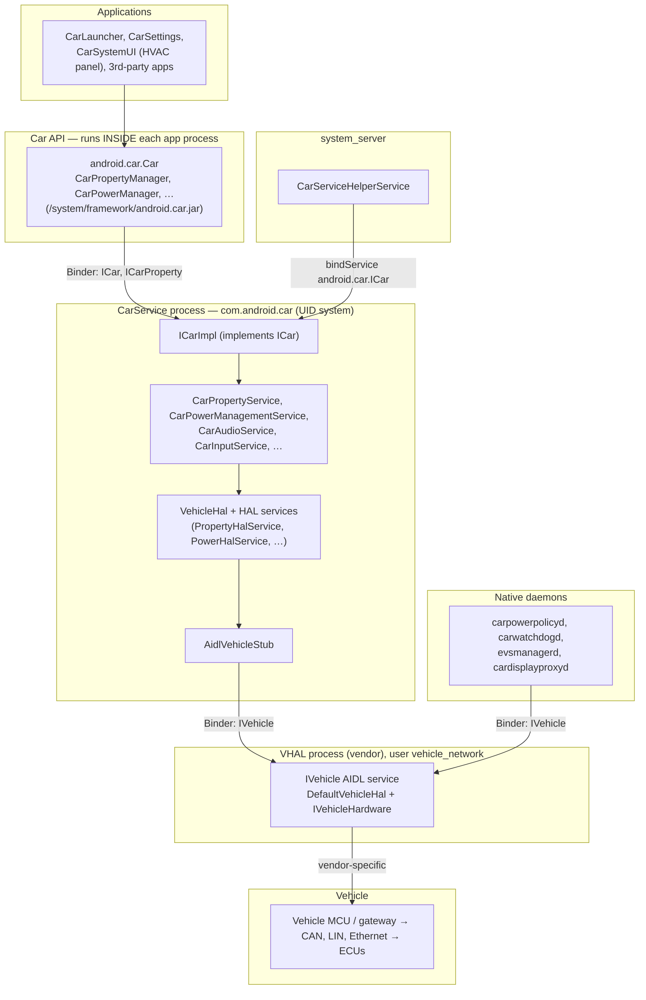
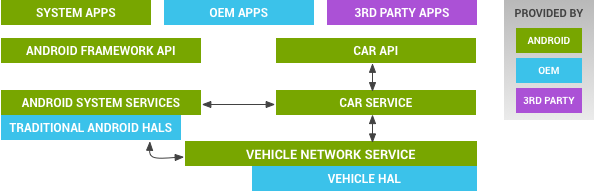
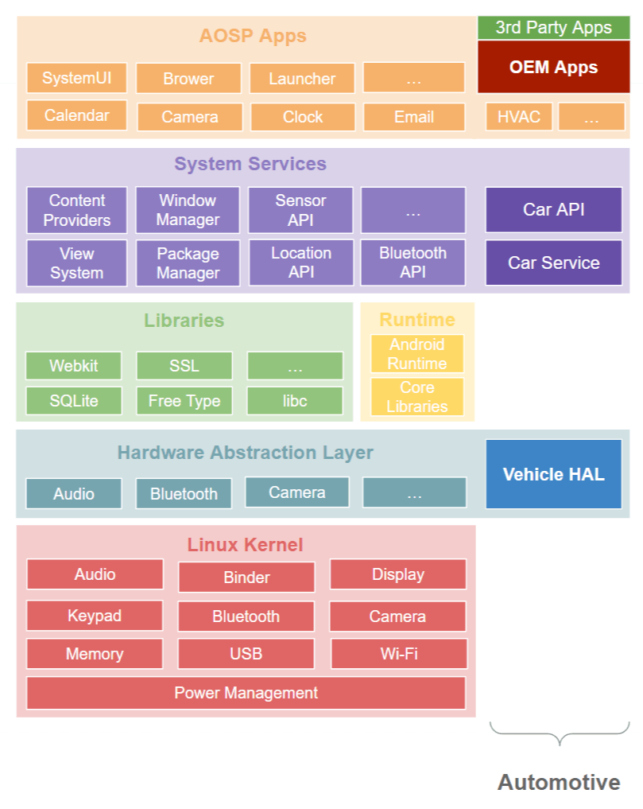
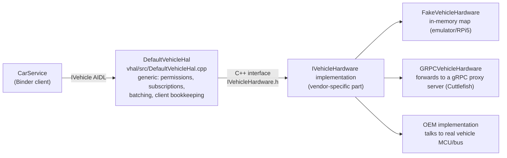
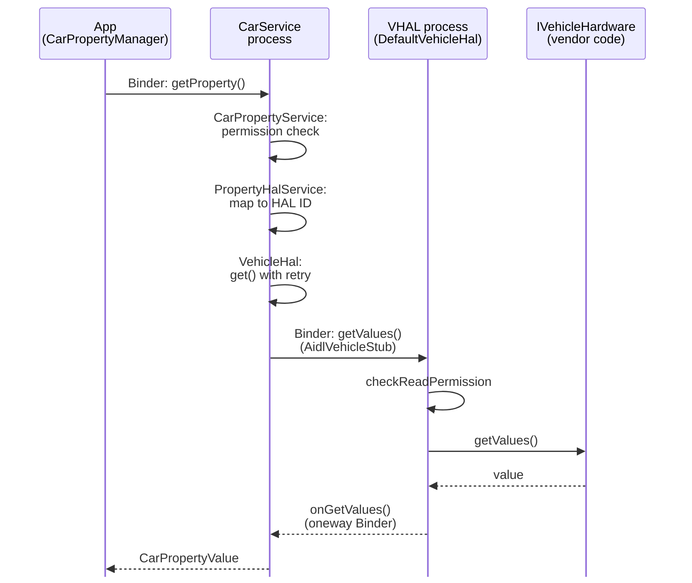
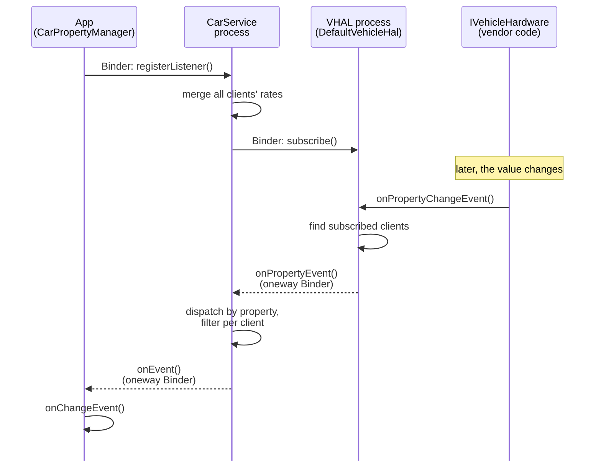
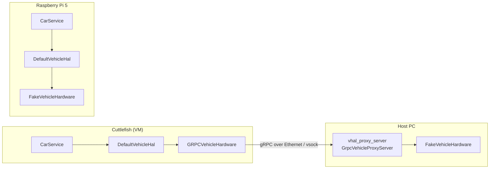

# Android Automotive OS (AAOS) Architecture — How Android Talks to the Vehicle

> **Source baseline:** every path, class, method and line number in this chapter was checked against
> **AOSP `android-17.0.0_r1`** (Cuttlefish `aosp_cf_x86_64_auto-userdebug`, whose system image is `car_generic`, plus your Raspberry Pi 5
> `aosp_rpi5_car-userdebug` build for comparison). Android 15 differences are marked
> **Version-dependent**. Use method names as stable anchors; line numbers drift between releases.

**Evidence labels**

| Label | Meaning |
|---|---|
| **Verified in source** | Read directly in the AOSP 17 tree or the build output |
| **Official documentation** | From source.android.com / developer.android.com |
| **General concept** | Automotive industry knowledge that is not in AOSP (ECUs, CAN, …) |
| **Version-dependent** | Differs between Android releases |
| **Illustrative** | A teaching scenario, not a claim about real code |

**Prerequisites:** [Android Architecture](../05.AndroidArchitecture/README.md) (processes, Binder,
ServiceManager, HAL), [AAOS concepts](../04.AndroidAutomotiveOS/README.md),
[Boot Sequence §7](../07.AndroidBootingSequence/README.md#7-aaos-specific-how-carservice-is-started)
(how CarService is started).

**After this chapter you should be able to:**

1. Draw the AAOS stack and say **which process** each component runs in.
2. Explain what a **vehicle property** is and decode a property ID such as `0x11600207` by hand.
3. Explain `VehiclePropConfig` and `VehiclePropValue` field by field.
4. Trace a **get**, a **set** and a **subscription** from an app down to the VHAL and back, naming
   the real classes and methods.
5. Explain how the reference VHAL is structured (`DefaultVehicleHal` + `IVehicleHardware`) and how
   Cuttlefish and RPi5 differ.
6. Explain the permission and SELinux checks that stop an app from controlling the car directly.

---

## Table of Contents

- [0. The big picture](#0-the-big-picture)
- [1. Why AAOS needs this architecture](#1-why-aaos-needs-this-architecture)
- [2. The layers, one by one](#2-the-layers-one-by-one)
  - [2.1 Applications](#21-applications)
  - [2.2 Car API (`android.car` library)](#22-car-api-androidcar-library)
  - [2.3 CarServiceHelperService (inside `system_server`)](#23-carservicehelperservice-inside-system_server)
  - [2.4 CarService (`com.android.car`)](#24-carservice-comandroidcar)
  - [2.5 Native automotive daemons](#25-native-automotive-daemons)
  - [2.6 Vehicle HAL (VHAL)](#26-vehicle-hal-vhal)
  - [2.7 Below the VHAL: ECUs and the vehicle network](#27-below-the-vhal-ecus-and-the-vehicle-network)
- [3. Vehicle properties in depth](#3-vehicle-properties-in-depth)
- [4. End-to-end flows (traced in source)](#4-end-to-end-flows-traced-in-source)
- [5. How CarService finds and watches the VHAL](#5-how-carservice-finds-and-watches-the-vhal)
- [6. My two builds: Cuttlefish vs Raspberry Pi 5](#6-my-two-builds-cuttlefish-vs-raspberry-pi-5)
- [7. Security: permissions and SELinux](#7-security-permissions-and-selinux)
- [8. Practical automotive scenario](#8-practical-automotive-scenario)
- [9. Comparison with phone Android](#9-comparison-with-phone-android)
- [10. Common misconceptions](#10-common-misconceptions)
- [11. Source map](#11-source-map)

---

## 0. The big picture

### What is AAOS architecturally?

Android Automotive OS is **regular Android** (same kernel model, `init`, Binder, ART, `system_server`)
**plus** a set of automotive components:

- a client **library** apps use (`android.car`, the "Car API");
- a privileged **service process** (`CarService`, package `com.android.car`) that implements those
  APIs;
- a **Vehicle HAL** (VHAL) that represents the car as a list of *properties*;
- several **native daemons** (power policy, watchdog, EVS cameras…);
- automotive versions of system apps (CarLauncher, CarSystemUI, CarSettings).

### Layer diagram (Verified in AOSP source)



**How to read it:** each box with a title is a **separate process**, except "Car API", which is a
library loaded **inside** each app's own process. Every arrow that crosses a process boundary is a
**Binder IPC** call. The only exception is the bottom arrow, where the vendor decides (SPI, UART,
Ethernet, SocketCAN, gRPC…).

<details>
<summary>External diagrams kept from the earlier version (third-party; not verified line by line)</summary>





</details>

---

## 1. Why AAOS needs this architecture

**The problem (General concept).** A modern car has dozens of **ECUs** (Electronic Control Units):
engine, brakes, body (doors, lights), HVAC, seats, battery management… They talk to each other
over in-vehicle networks such as CAN. Every OEM, and often every car model, uses different ECUs,
different message IDs and different signal encodings.

If an Android app had to talk to this directly:

- each app would need OEM-specific code for every car model, so there would be no ecosystem;
- any app could send a CAN frame to unlock doors or change gears, a **safety and security disaster**;
- the same physical value (for example vehicle speed) would be read by many apps independently,
  overloading the bus.

**The AAOS answer is a chain of abstractions, each with one job:**

| Layer | Problem it solves |
|---|---|
| **VHAL** | Hides the OEM-specific network. It presents the car as a **standard list of properties** (`PERF_VEHICLE_SPEED`, `HVAC_TEMPERATURE_SET`, …) with fixed IDs, types and units |
| **CarService** | Single owner of the VHAL connection. It enforces **permissions**, multiplexes many apps onto one subscription, adds policies (driving state, UX restrictions, power) |
| **Car API** | Stable Java API for apps, independent of VHAL versions |
| **SELinux + permissions** | Only approved processes may talk to the VHAL, and only apps holding the right permission may read or write a property |

---

## 2. The layers, one by one

### 2.1 Applications

**Purpose:** provide the user-visible car experience.

**Tasks:**

1. **System apps** built by Google or the OEM:
   - `CarLauncher` (home screen), in `packages/apps/Car/Launcher/`;
   - `CarSystemUI` (status bar, HVAC panel, notifications), in `packages/apps/Car/SystemUI/`;
   - `CarSettings`, in `packages/apps/Car/Settings/`.

   Your Cuttlefish build ships these in `system/priv-app/` and `system_ext/priv-app/`.
2. **Third-party apps** such as media, navigation, messaging, or apps built with the Car App
   Library (androidx, outside AOSP).
3. **Use the Car API** for vehicle data. For example, CarSystemUI's HVAC controller
   (`packages/apps/Car/SystemUI/pods/hvac/controller/src/com/android/systemui/car/hvac/HvacController.java`)
   gets a `CarPropertyManager` with `car.getCarManager(Car.PROPERTY_SERVICE)` (line 152). It calls
   `setFloatProperty(...)` (line 247) to change the temperature and `registerCallback(...)`
   (line 537) to follow changes.

### 2.2 Car API (`android.car` library)

**Purpose:** give apps a stable, permission-checked Java API for vehicle features.

**Where:** source in `packages/services/Car/car-lib/` (`java_sdk_library` named `android.car`,
`car-lib/Android.bp` line 101). On the device it is `/system/framework/android.car.jar`, verified
in your build output.

**Tasks:**

1. **Connect to CarService.** `Car.createCar(context)` (`car-lib/src/android/car/Car.java`,
   line 2132) looks up the Binder named **`"car_service"`** (`CAR_SERVICE_BINDER_SERVICE_NAME`, line
   207) in ServiceManager (line 2355). It wraps it with `ICar.Stub.asInterface(service)` (line 2392).
2. **Hand out managers.** `car.getCarManager(Car.PROPERTY_SERVICE)` (line 2859; `PROPERTY_SERVICE
   = "property"`, line 377) returns a `CarPropertyManager`. Internally it asks CarService for the
   sub-service Binder with `ICar.getCarService("property")`. That method is a small **factory**: a
   name goes in, a Binder comes out, and several names share one service (Verified:
   `ICarImpl.getCarService()`):

   | Names (`Car.*_SERVICE`) | Binder returned |
   |---|---|
   | `PROPERTY_SERVICE`, `HVAC_SERVICE`, `CABIN_SERVICE`, `INFO_SERVICE`, `SENSOR_SERVICE`, `VENDOR_EXTENSION_SERVICE` | **`CarPropertyService`** (all of them) |
   | `AUDIO_SERVICE` | `CarAudioService` |
   | `POWER_SERVICE` | `CarPowerManagementService` |
   | `PROJECTION_SERVICE` | `CarProjectionService` |
   | `VEHICLE_MAP_SERVICE`, `VMS_SUBSCRIBER_SERVICE` | `VmsBrokerService` |

   So the domain managers (`CarHvacManager`, `CarSensorManager`…) were only thin, typed wrappers over
   the one property service. They are now **deprecated** in favour of `CarPropertyManager`
   (Verified: `@Deprecated` on both classes in A17).
3. **Translate calls to Binder.** For example, `CarPropertyManager.getProperty(propertyId, areaId)`
   (`car-lib/src/android/car/hardware/property/CarPropertyManager.java`, line 2879) calls
   `mService.getProperty(propertyId, areaId)` (line 2901) on the **`ICarProperty`** AIDL interface
   (`car-lib/src/android/car/hardware/property/ICarProperty.aidl`).
4. **Deliver events.** The library registers a Binder callback object,
   `CarPropertyEventListenerToService extends ICarPropertyEventListener.Stub` (line 1730). CarService
   calls its `onEvent(...)` (line 1738), and the library forwards each event to the app's
   `CarPropertyEventCallback.onChangeEvent(...)`.

> **Important distinction:** the Car API is **not** a service. It is a library that runs **inside
> the app's process** and makes Binder calls to CarService.

### 2.3 CarServiceHelperService (inside `system_server`)

**Purpose:** bootstrap and support CarService from inside `system_server`, which owns many things
CarService cannot do itself (user lifecycle, activity launch policy).

**Tasks (Verified in source; details in
[Boot §7](../07.AndroidBootingSequence/README.md#7-aaos-specific-how-carservice-is-started)):**

1. Started by `SystemServer` only when the device has `android.hardware.type.automotive`.
2. **Binds** to CarService (`Intent("android.car.ICar")`, package `com.android.car`,
   `BIND_AUTO_CREATE`). That bind makes AMS start the CarService process.
3. Forwards **user lifecycle events** (user starting, switching, unlocking, stopping) to CarService.
4. If CarService does not connect in time, dumps stacks and **rebinds**.

### 2.4 CarService (`com.android.car`)

**Purpose:** the central automotive service process. It implements all Car APIs, owns the single
connection to the VHAL, and enforces permissions and automotive policies.

**Process facts (Verified in source):**

| Fact | Evidence |
|---|---|
| Package `com.android.car`, `android:sharedUserId="android.uid.system"`, `android:persistent="true"` | `packages/services/Car/service-builtin/AndroidManifest.xml` lines 19–21, 101 |
| Exported `<service android:name=".CarService">` with action `android.car.ICar` | same file, lines 104–108 |
| SELinux domain `carservice_app` | `packages/services/Car/car_product/sepolicy/private/seapp_contexts` |
| Up to 31 Binder threads (same as `system_server`) | `service-builtin/src/com/android/car/CarService.java` (`MAX_BINDER_THREADS = 31`) |

**Builtin vs updatable split (Verified in source).** The `CarService` class in the APK is only a
thin proxy:

```java
// packages/services/Car/service-builtin/src/com/android/car/CarService.java
public class CarService extends ServiceProxy {
    private static final int MAX_BINDER_THREADS = 31;
    public CarService() {
        super(UpdatablePackageDependency.CAR_SERVICE_IMPL_CLASS);  // "com.android.car.CarServiceImpl"
        BinderInternal.setMaxThreads(MAX_BINDER_THREADS);
    }
}
```

`ServiceProxy` (`service-builtin/src/com/android/car/ServiceProxy.java`, lines 86–87) loads the
real class **`com.android.car.CarServiceImpl`** with the class loader of the **updatable** package
(`packages/services/Car/service/`, package `com.android.car.updatable`). It then forwards
`onCreate()` and the other lifecycle calls to it. This lets most car-service logic be updated
separately from the platform-signed builtin APK.

**Tasks of `CarServiceImpl.onCreate()`** (`packages/services/Car/service/src/com/android/car/CarServiceImpl.java`,
line 54). Real code, condensed:

```java
public void onCreate() {
    mVehicle = VehicleStub.newVehicleStub();                 // 1. connect to the VHAL (line 60)
    mVehicleInterfaceName = mVehicle.getInterfaceDescriptor();
    mICarImpl = new ICarImpl.Builder()                        // 2. build the service container
            .setServiceContext(this)
            .setVehicle(mVehicle)
            ...
            .build();
    mICarImpl.init();                                         // 3. init all car services (line 78)
    mVehicle.linkToDeath(mVehicleDeathRecipient);             // 4. watch the VHAL process
    ServiceManagerHelper.addService("car_service", mICarImpl);// 5. publish for apps (line 82)
    SystemPropertiesHelper.set("boot.car_service_created", "1");
}
```

1. **Connect to the VHAL** through `VehicleStub` ([§5](#5-how-carservice-finds-and-watches-the-vhal)).
2. **Create `ICarImpl`**, the object that implements the `ICar` AIDL interface:
   `public class ICarImpl extends ICar.Stub` (`service/src/com/android/car/ICarImpl.java`, line 115).
   The AIDL interface itself is `car-lib/src/android/car/ICar.aidl`.
3. **`ICarImpl` creates the car services.** Examples in `ICarImpl.java`: `VehicleHal` (line 302),
   `CarPropertyService` (311), `CarDrivingStateService` (317), `CarOccupantZoneService` (320),
   `CarUxRestrictionsManagerService` (323), `CarPowerManagementService` (358), `CarInputService`
   (382), `CarAudioService` (397).
4. **`VehicleHal` creates the HAL-side services**, one per VHAL feature area
   (`service/src/com/android/car/hal/VehicleHal.java`, lines 354–364): `PowerHalService`,
   `PropertyHalService`, `InputHalService`, `VmsHalService`, `UserHalService`,
   `DiagnosticHalService`, `ClusterHalService`, `EvsHalService`, `TimeHalService`.
5. **Publish** `ICarImpl` in ServiceManager as `"car_service"`, which is the name the Car API looks
   up.
6. **Route requests for sub-services.** `ICarImpl.getCarService(String serviceName)` (line 656) returns
   the right Binder. For `Car.PROPERTY_SERVICE` it returns `CarPropertyService` (line 692).

**Two "service" layers inside CarService.** This pattern is easy to miss:

| Layer | Example | Talks to | Speaks |
|---|---|---|---|
| **Car service** (`com.android.car.*Service`) | `CarPropertyService` | Apps (Binder `ICarProperty`) | Car API types: `CarPropertyValue`, manager property IDs |
| **HAL service** (`com.android.car.hal.*HalService`) | `PropertyHalService` | `VehicleHal` | VHAL types: `HalPropValue`, HAL property IDs |

`VehicleHal` is the **single** owner of the VHAL connection. It dispatches each incoming VHAL
event to the HAL service that registered for that property ID.

### 2.5 Native automotive daemons

**Purpose:** automotive functions that must run outside Java, start early, or be very robust.

**Verified in source:** these binaries exist in your build (`out/.../system/bin/`), with sources under
`packages/services/Car/cpp/`:

| Daemon | Source | Role (from its source/README) |
|---|---|---|
| `carpowerpolicyd` | `cpp/power/` | Applies **power policies** (which components are on/off in each power state). A VHAL client |
| `carwatchdogd` | `cpp/watchdog/` | Monitors process health and **I/O overuse** (`server/src/IoOveruseMonitor.cpp`). A VHAL client |
| `evsmanagerd` | `cpp/evs/manager/` | **Exterior View System** camera manager (rear-view camera). Started in `early_hal` |
| `cardisplayproxyd` | `cpp/displayproxy/` | Display proxy for EVS rendering |
| `carbugreportd` | `cpp/bugreport/` | "Takes bugreport, appends car specific files" (its README) |

The SELinux policy confirms which of them may call the VHAL ([§7](#7-security-permissions-and-selinux)).

### 2.6 Vehicle HAL (VHAL)

**What is it?** The VHAL is the HAL that represents the vehicle. It is defined by the **AIDL**
interface `android.hardware.automotive.vehicle.IVehicle`
(`hardware/interfaces/automotive/vehicle/aidl/android/hardware/automotive/vehicle/IVehicle.aidl`).
A vendor process implements it.

**Purpose:** be the **only** boundary between Android and the OEM's vehicle network, expressed as
standard properties.

**The interface (Verified in source, `IVehicle.aidl`, AIDL V4):**

| Method (line) | What it does |
|---|---|
| `getAllPropConfigs()` (45) | Return the config of every supported property |
| `getPropConfigs(int[] props)` (60) | Configs for selected properties |
| `getValues(IVehicleCallback, GetValueRequests)` (112) | **Asynchronous** read. Results come back via `callback.onGetValues(...)` |
| `setValues(IVehicleCallback, SetValueRequests)` (158) | **Asynchronous** write. Results come back via `callback.onSetValues(...)` |
| `subscribe(IVehicleCallback, SubscribeOptions[], int maxSharedMemoryFileCount)` (230) | Start receiving `onPropertyEvent(...)` |
| `unsubscribe(IVehicleCallback, int[] propIds)` (249) | Stop |
| `returnSharedMemory(...)` (267) | Give back a shared-memory buffer used for large results |
| `getSupportedValuesLists(...)`, `getMinMaxSupportedValue(...)`, `(un)registerSupportedValueChangeCallback(...)` (307–380) | **New in V4**: dynamic supported values |

Callback interface `IVehicleCallback.aidl`: `oneway void onGetValues(...)` (47), `onSetValues`
(62), `onPropertyEvent(VehiclePropValues, int sharedMemoryFileCount)` (92), `onPropertySetError`
(104), `onSupportedValueChange` (116). They are **`oneway`**, meaning the VHAL never blocks waiting for
CarService.

> **Version-dependent:**
> - Android 12 and earlier used **HIDL** `IVehicle.hal` (version 2.0, still in the tree at
>   `hardware/interfaces/automotive/vehicle/2.0/`). Android 13+ uses **AIDL**, and new
>   implementations must use AIDL (Official documentation, source.android.com/docs/automotive/vhal).
> - Your **A15** tree's reference VHAL is `android.hardware.automotive.vehicle@V3-default-service`,
>   and its `IVehicle.aidl` has no `getSupportedValuesLists`. **A17** is **V4**.

**Reference implementation structure (Verified in source,
`hardware/interfaces/automotive/vehicle/aidl/impl/current/README.md`):**



- **`DefaultVehicleHal`** implements `IVehicle` and contains the logic every VHAL needs. Examples
  are the read/write permission checks (`checkReadPermission` / `checkWritePermission`, called at
  lines 547 and 635), the `SubscriptionManager`, and per-client callbacks.
- **`IVehicleHardware`** (`impl/current/hardware/include/IVehicleHardware.h`) is the part a vendor
  writes: `getAllPropertyConfigs()` (81), `getValues(...)` (116), `setValues(...)` (109),
  `registerOnPropertyChangeEvent(...)` (129), `subscribe(...)` (218), `checkHealth()` (125)…
- The README is explicit that **`FakeVehicleHardware` "simulates the vehicle bus interaction by
  using an in-memory map"** and "Vendor must not directly use the reference implementation for a
  real vehicle".

**The service binary** (`impl/current/vhal/src/VehicleService.cpp`, `main()`):

```cpp
int main(int, char*[]) {
    ABinderProcess_setThreadPoolMaxThreadCount(4);
    ABinderProcess_startThreadPool();
    std::unique_ptr<FakeVehicleHardware> hardware = std::make_unique<FakeVehicleHardware>();
    std::shared_ptr<DefaultVehicleHal> vhal =
            ::ndk::SharedRefBase::make<DefaultVehicleHal>(std::move(hardware));
    binder_exception_t err = AServiceManager_addService(
            vhal->asBinder().get(), "android.hardware.automotive.vehicle.IVehicle/default");
    ...
    ABinderProcess_joinThreadPool();
}
```

**Its `init` and VINTF declarations:**

```bash
# impl/current/vhal/vhal-default-service.rc
service vendor.vehicle-hal-default /vendor/bin/hw/android.hardware.automotive.vehicle@V4-default-service
    class early_hal
    user vehicle_network
    group system inet
```

```xml
<!-- impl/current/vhal/vhal-default-service.xml : VINTF manifest fragment -->
<hal format="aidl">
    <name>android.hardware.automotive.vehicle</name>
    <version>4</version>
    <fqname>IVehicle/default</fqname>
</hal>
```

Why these matter:

- **`class early_hal`**: the VHAL starts in `late-fs`, **before Zygote**
  ([Boot §4.6](../07.AndroidBootingSequence/README.md#46-the-android-init-language-and-the-trigger-timeline)).
  Native daemons and EVS may need vehicle state long before the Java framework is up.
- **`user vehicle_network`**: it runs as a dedicated, unprivileged UID, not root.
- **VINTF `<hal>` entry**: declares that the device provides `IVehicle/default` version 4. This
  is what lets `AServiceManager_waitForService` / `waitForDeclaredService` know the service **should**
  exist and wait for it.

### 2.7 Below the VHAL: ECUs and the vehicle network

**Evidence:** General concept. This part is OEM-specific and not in AOSP.

**What is an ECU?** An embedded computer that controls one function, such as the engine, brakes,
doors, climate or battery. It reads sensors, drives actuators, and exchanges signals with other
ECUs.

**Common in-vehicle networks:**

| Network | Typical use | Key numbers |
|---|---|---|
| **Classical CAN** | Body, powertrain, most control signals | Up to **1 Mbit/s**, **8-byte** payload per frame |
| **CAN FD** | Same domains, more data | Up to **64-byte** payload, faster data phase (commonly 2–5 Mbit/s) |
| **LIN** | Cheap sub-networks: window motors, seat switches | Up to about **20 kbit/s**, single wire |
| **FlexRay** | Deterministic, safety-oriented systems (older chassis designs) | 10 Mbit/s, time-triggered |
| **Automotive Ethernet** (e.g. 100BASE-T1) | Cameras, high-bandwidth, backbone, SOME/IP services | 100 Mbit/s and up, around 1,500-byte frames |

**How an infotainment SoC usually reaches them (General concept):** the Android SoC is often **not**
directly on the safety-critical CAN buses. A common design is:

```text
Android SoC: VHAL (IVehicleHardware impl)
        │  SPI / UART / Ethernet (SOME/IP) / shared memory to a hypervisor
        ▼
Vehicle MCU or central gateway (often AUTOSAR, sometimes QNX/RTOS)
        │  CAN / CAN FD / LIN / Ethernet
        ▼
ECUs (HVAC, body, powertrain, BMS …)
```

The gateway filters what the infotainment side may send. That is a second safety layer in
addition to Android's permission checks. AOSP also contains a **CAN bus HAL**
(`hardware/interfaces/automotive/can/`), which a VHAL implementation *may* use to access SocketCAN
interfaces. Using it is a vendor design choice.

**Your Cuttlefish example (Verified in source)** replaces the vehicle with a **gRPC server on the host
PC** ([§6](#6-my-two-builds-cuttlefish-vs-raspberry-pi-5)). It is the same "VHAL talks to
something outside Android" pattern.

---

## 3. Vehicle properties in depth

### 3.1 What is a vehicle property?

A **vehicle property** is one vehicle function or signal, identified by a 32-bit integer ID. Each
property has:

- a fixed **data type** (float, int32, string…);
- an **area** (the whole car, or per seat / door / window / mirror / wheel);
- an **access** mode (read, write, read-write);
- a **change mode** (static, on-change, continuous);
- a **unit** (m/s, °C, km…).

Everything the car exposes to Android is a property: speed, gear, HVAC temperature, door locks,
VIN, ignition state, EV charge level, ADAS states, and even user-management messages.

### 3.2 How a property ID is built (Verified in source)

The ID is the **sum of four bit-fields**. The enums are in
`hardware/interfaces/automotive/vehicle/aidl_property/android/hardware/automotive/vehicle/`:

| Field | Bits (mask) | Values |
|---|---|---|
| **Group** (`VehiclePropertyGroup.aidl`) | `0xf0000000` | `SYSTEM = 0x10000000` (defined by Android), `VENDOR = 0x20000000` (OEM-defined), `BACKPORTED = 0x30000000` |
| **Area type** (`VehicleArea.aidl`) | `0x0f000000` | `GLOBAL = 0x01000000`, `WINDOW = 0x03000000`, `MIRROR = 0x04000000`, `SEAT = 0x05000000`, `DOOR = 0x06000000`, `WHEEL = 0x07000000`, `VENDOR = 0x08000000` |
| **Data type** (`VehiclePropertyType.aidl`) | `0x00ff0000` | `STRING = 0x00100000`, `BOOLEAN = 0x00200000`, `INT32 = 0x00400000`, `INT32_VEC = 0x00410000`, `INT64 = 0x00500000`, `INT64_VEC = 0x00510000`, `FLOAT = 0x00600000`, `FLOAT_VEC = 0x00610000`, `BYTES = 0x00700000`, `MIXED = 0x00e00000` |
| **Unique ID** | `0x0000ffff` | e.g. `0x0207` for vehicle speed |

**Worked example 1: `PERF_VEHICLE_SPEED`** (`VehicleProperty.aidl`, line 343):

```text
PERF_VEHICLE_SPEED = 0x0207 + 0x10000000 + 0x01000000 + 0x00600000
                   =  id    +  SYSTEM    +  GLOBAL    +  FLOAT
                   = 0x11600207 = 291504647 (decimal)
```

The Java constant `VehiclePropertyIds.PERF_VEHICLE_SPEED = 291504647`
(`car-lib/src/android/car/VehiclePropertyIds.java`, line 514) is the same number. It is
annotated `@RequiresPermission(Car.PERMISSION_SPEED)`. Its documentation in `VehicleProperty.aidl`:
`@change_mode CONTINUOUS`, `@access READ`, `@unit METER_PER_SEC`. The value is "positive when the
vehicle is moving forward and negative when … moving backward".

**Worked example 2: `HVAC_TEMPERATURE_SET`** (line 1425):

```text
HVAC_TEMPERATURE_SET = 0x0503 + SYSTEM + SEAT + FLOAT = 0x15600503
```

Its area type is **SEAT**, so every read and write must also say **which seat zone**, using an
**area ID** built from `VehicleAreaSeat` bits (`ROW_1_LEFT = 0x0001`, `ROW_1_CENTER = 0x0002`,
`ROW_1_RIGHT = 0x0004`, `ROW_2_LEFT = 0x0010`, …). A dual-zone car might expose two area IDs:
`ROW_1_LEFT|ROW_2_LEFT` (driver side) and `ROW_1_RIGHT|ROW_2_RIGHT` (passenger side). Area
groupings like that are an OEM configuration choice (Illustrative), declared in `areaConfigs`.

**Why the bit-field design?** Code can learn the type and area of *any* property, even an unknown
vendor property, just by masking the ID. For example, `(prop & 0x00ff0000) == FLOAT` tells it the
value lives in `floatValues`. Vendors can add `VENDOR`-group properties without colliding with
Android's.

### 3.3 `VehiclePropConfig`: the "description" of a property (Verified in source)

`aidl/android/hardware/automotive/vehicle/VehiclePropConfig.aidl`:

```java
parcelable VehiclePropConfig {
    int prop;                                   // property ID, e.g. 0x11600207
    VehiclePropertyAccess access = NONE;        // NONE=0, READ=1, WRITE=2, READ_WRITE=3
    VehiclePropertyChangeMode changeMode = STATIC; // STATIC=0, ON_CHANGE=1, CONTINUOUS=2
    VehicleAreaConfig[] areaConfigs;            // one entry per supported area ID
    int[] configArray;                          // property-specific extra config
    @utf8InCpp String configString;             // property-specific extra config
    float minSampleRate;                        // for CONTINUOUS properties (Hz)
    float maxSampleRate;
}
```

| Field | Meaning and why it exists |
|---|---|
| `access` | Lets CarService reject a write to a read-only property before it reaches the VHAL |
| `changeMode` | **STATIC**: never changes (VIN). **ON_CHANGE**: an event only when the value changes (gear, door). **CONTINUOUS**: sampled at a rate you choose (speed) |
| `areaConfigs` | Per area: `areaId`, min/max values (int32/int64/float), `supportedEnumValues`, per-area `access`, `supportVariableUpdateRate` (`VehicleAreaConfig.aidl`) |
| `min/maxSampleRate` | Allowed subscription rates for CONTINUOUS properties |

CarService reads all configs once at start (`getAllPropConfigs()`). That is how it knows which
properties **this car** supports. Apps can ask with `CarPropertyManager.getCarPropertyConfig(id)`,
as `HvacController` does at line 186.

### 3.4 `VehiclePropValue`: the "value" of a property (Verified in source)

```java
parcelable VehiclePropValue {
    long timestamp;              // "elapsed nanoseconds since boot" (AIDL comment)
    int areaId;                  // which seat/door/... (0 for GLOBAL)
    int prop;                    // property ID
    VehiclePropertyStatus status = AVAILABLE;
    RawPropValues value;
}
parcelable RawPropValues {
    int[] int32Values = {};      // used by INT32, INT32_VEC, BOOLEAN
    float[] floatValues;         // FLOAT, FLOAT_VEC
    long[] int64Values;          // INT64, INT64_VEC
    byte[] byteValues;           // BYTES
    @utf8InCpp String stringValue; // STRING
}
```

**Why one generic container instead of a typed class per property?** Hundreds of properties exist,
and vendors add more. A generic `RawPropValues` lets one AIDL interface carry any property without
changing the interface. The **type bits in the ID** say which array to read. For
`PERF_VEHICLE_SPEED` (FLOAT), the speed is `value.floatValues[0]`. **MIXED** properties use several
arrays at once.

**`status`** (`VehiclePropertyStatus.aidl`): `AVAILABLE = 0x00`, `UNAVAILABLE` /
`NOT_AVAILABLE_GENERAL = 0x01`, `ERROR = 0x02`, plus detailed reasons such as
`NOT_AVAILABLE_SPEED_HIGH`, `NOT_AVAILABLE_SAFETY` and `NOT_AVAILABLE_SUBSYSTEM_NOT_CONNECTED`.
This lets the car say *why* a feature is unavailable, for example a function that is disabled
above a certain speed.

### 3.5 Property metadata used by CarService (Verified in source)

CarService loads a generated JSON description of every system property,
`car-lib/generated-prop-config/CarSvcProps.json` (loaded by
`service/src/com/android/car/hal/property/PropertyHalServiceConfigs.java`, line 93). Real entry:

```json
{
 "propertyName": "PERF_VEHICLE_SPEED",
 "propertyId": 291504647,
 "description": "Speed of the vehicle in meters per second.",
 "propertyType": "Float",
 "areaType": "GLOBAL",
 "changeMode": "CONTINUOUS",
 "allowedAccessModes": ["READ"],
 "readPermission": { "type": "single", "value": "android.car.permission.CAR_SPEED" }
}
```

---

## 4. End-to-end flows (traced in source)

All paths below are under `packages/services/Car/` unless stated otherwise. Line numbers are from
AOSP 17.

### 4.1 Reading a property (get)



Only two arrows cross a process boundary: app → CarService and CarService → VHAL, both over Binder.
`CarPropertyService`, `PropertyHalService`, `VehicleHal` and `AidlVehicleStub` are classes in the same
CarService process, so calls between them are ordinary method calls.

**Step by step:**

1. **App → Car API.** `carPropertyManager.getProperty(PERF_VEHICLE_SPEED, 0)` in
   `CarPropertyManager.getProperty(int, int)` (line 2879) calls `mService.getProperty(...)` (line
   2901). `mService` is an **`ICarProperty` Binder proxy**. The call is serialized into a Parcel and
   sent through the Binder driver to the CarService process.
2. **CarService: permission and validation.** `CarPropertyService extends ICarProperty.Stub`
   (`service/src/com/android/car/CarPropertyService.java`, line 109). Its `getProperty(...)` (line
   913) runs on a CarService Binder thread. It checks that the property exists and that the caller
   is allowed. `mPropertyHalService.isReadable(mContext, propertyId)` (line 1254) leads to
   `PropertyHalServiceConfigs.isReadable(...)` (line 344) and then
   `context.checkCallingOrSelfPermission(permission)` (`PropertyPermissionInfo.java`, line 325).
   Without `CAR_SPEED`, the app gets a `SecurityException`.
3. **CarPropertyService → PropertyHalService.** `mPropertyHalService.getProperty(propertyId, areaId)`
   (line 925). `PropertyHalService.getProperty(...)` (`service/src/com/android/car/hal/PropertyHalService.java`,
   line 1206) converts the manager property ID to the HAL property ID. For most system properties
   they are identical. It then calls `mVehicleHal.get(halPropId, areaId)` (line 1226).
4. **VehicleHal → VehicleStub.** `VehicleHal.get(...)` (line 1151) goes through
   `getValueWithRetry(...)` (line 514) to `mVehicleStub.get().get(requestValue)` (line 525). The
   retry exists because a VHAL can answer `TRY_AGAIN` while the vehicle bus is not ready.
5. **Synchronous wrapper over an asynchronous AIDL.** `AidlVehicleStub.get(...)`
   (`service/src/com/android/car/AidlVehicleStub.java`, line 335) calls `getOrSetSync(...)`. That
   sends `iVehicle.getValues(callbackForVhal, largeParcelableRequest)` (line 1034) and **waits** for
   the matching `onGetValues` callback, up to `DEFAULT_TIMEOUT_MS = 10_000` (line 97). The VHAL AIDL is
   asynchronous, so one slow property cannot block the VHAL's Binder threads, while the old
   `CarPropertyManager.getProperty` API stays synchronous for apps.
6. **VHAL.** `DefaultVehicleHal::getValues(...)` (`hardware/interfaces/automotive/vehicle/aidl/impl/current/vhal/src/DefaultVehicleHal.cpp`,
   line 520) checks each request against the config with `checkReadPermission` (line 547). It forwards
   to `mVehicleHardware->getValues(client->getResultCallback(), hardwareRequests)` (line 594). The
   vendor `IVehicleHardware` produces the value (from an in-memory map, over gRPC to the host on
   Cuttlefish, or from the real vehicle bus, see [§6](#6-my-two-builds-cuttlefish-vs-raspberry-pi-5))
   and calls the result callback, which sends `onGetValues` to CarService as a `oneway` Binder call.
   That callback unblocks the CarService thread waiting in step 5.
7. **Return path.** `HalPropValue` is converted to `CarPropertyValue` and returned through Binder to
   the app.

### 4.2 Writing a property (set): HVAC temperature from CarSystemUI

1. `HvacController.setHvacProperty(...)` calls
   `mCarPropertyManager.setFloatProperty(propertyId, areaId, val)`
   (`packages/apps/Car/SystemUI/pods/hvac/controller/src/com/android/systemui/car/hvac/HvacController.java`,
   line 247).
2. `CarPropertyManager.setProperty(...)` (line 3033) calls
   `mService.setProperty(new CarPropertyValue<>(propertyId, areaId, val), ...)` (line 3048).
3. `CarPropertyService.setProperty(...)` (line 988) checks the **write** permission. For
   `HVAC_TEMPERATURE_SET` that is `android.car.permission.CONTROL_CAR_CLIMATE`, which is
   `signature|privileged` (`service/AndroidManifest.xml`, lines 101–102), so only system apps can change
   the climate. It then calls `mPropertyHalService.setProperty(...)` (line 998).
4. `PropertyHalService.setProperty(...)` (line 1300) calls `mVehicleHal.set(valueToSet)` (line 1308).
   `VehicleHal.set(...)` (line 1278) calls `mVehicleStub.get().set(requestValue)` (line 545).
5. `AidlVehicleStub.set(...)` sends `iVehicle.setValues(...)` (line 1082).
6. `DefaultVehicleHal::setValues(...)` (line 607) runs `checkWritePermission` (line 635) and then
   `mVehicleHardware->setValues(...)` (line 690). The vendor code sends the command toward the HVAC
   ECU.
7. **Important:** a successful `setValues` only means *the request was accepted*. The real
   confirmation that the cabin set-point changed comes later as a **property change event**, once
   the ECU reports its new state (see 4.3). That is why HvacController also subscribes to the same
   property.

### 4.3 Subscribing to changes (events)



**Step by step:**

1. **App registers.** `CarPropertyManager` calls
   `mService.registerListener(options, mCarPropertyEventToService)`
   (`car-lib/src/android/car/hardware/property/CarPropertyManager.java`, line 1884), a Binder call into
   CarService.
2. **CarService merges subscriptions.** `CarPropertyService` passes the filtered subscriptions to
   `mPropertyHalService.subscribeProperty(...)` (`CarPropertyService.java`, line 629).
   `PropertyHalService.updateSubscriptionRateLocked()` (line 1969) merges the rates of all clients.
3. **Subscribe to the VHAL.** Only the difference is sent down:
   `mVehicleHal.subscribeProperty(this, toHalSubscribeOptions(diffSubscribeOptions))`
   (`PropertyHalService.java`, line 1979). `AidlVehicleStub` then calls
   `mAidlVehicle.subscribe(this, options, /* maxSharedMemoryFileCount= */ 2)` (line 778) over Binder.
4. **The value changes.** At startup `DefaultVehicleHal` registered for hardware events with
   `mVehicleHardware->registerOnPropertyChangeEvent(...)` (`DefaultVehicleHal.cpp`, line 146). When a
   value changes, it finds the subscribed clients with `getSubscribedClients(...)` (line 235).
5. **Event to CarService.** The VHAL calls `IVehicleCallback.onPropertyEvent(...)`, a `oneway` Binder
   call received in `AidlVehicleStub.java` (line 751). `VehicleHal.onPropertyEvent(...)`
   (`service/src/com/android/car/hal/VehicleHal.java`, line 1355) passes it to
   `handleOnPropertyEvent(...)` (line 473), which dispatches by property ID to the HAL service that
   owns it.
6. **Up to CarPropertyService.** `PropertyHalService.onHalEvents(...)` (line 2012) converts the events
   and calls `propertyHalListener.onPropertyChange(...)` (line 2069).
7. **Event to the app.** `CarPropertyService` sends each client only its own events with
   `client.onEvent(...)` (`CarPropertyService.java`, line 1118), a `oneway` Binder call. In the app,
   `CarPropertyEventListenerToService.onEvent(...)` (`CarPropertyManager.java`, line 1738) calls your
   callback's `onChangeEvent(value)`.

**Key design points (Verified in source):**

- **Rate merging.** If app A wants speed at 1 Hz and app B at 10 Hz, CarService does **not** subscribe
  twice. `PropertyHalService.updateSubscriptionRateLocked()` (line 1969) computes the combined
  required rate and only sends the **difference** to the VHAL (`diffSubscribeOptions`, line 1979).
  CarService then filters events per client. One subscription toward the vehicle, many apps.
- **One VHAL callback for all.** `VehicleHal` uses one `SubscriptionClient` (`AidlSubscriptionClient
  extends IVehicleCallback.Stub`, `AidlVehicleStub.java` line 717). It dispatches by property ID to
  the HAL service that owns it (`dispatchPropertyEvents`).
- **Shared memory for bursts.** `subscribe(..., maxSharedMemoryFileCount = 2)` lets the VHAL send
  large batches of events through shared memory instead of oversized Binder parcels.
  `returnSharedMemory` gives the buffers back.
- **`ON_CHANGE` vs `CONTINUOUS`.** For `ON_CHANGE` properties, events are generated when the value
  changes. For `CONTINUOUS` properties, `SubscribeOptions.sampleRate` **must** be provided and be
  within `minSampleRate..maxSampleRate` (`SubscribeOptions.aidl`). Per `IVehicle.aidl`, a rate below
  the minimum is treated as `minSampleRate` and a rate above the maximum as `maxSampleRate`.

### 4.4 The app side: using the Car API in code

The flows above start with one line of app code. This is what an app writes (Kotlin, A17 APIs,
Verified signatures in `CarPropertyManager.java`).

**Build setup:** the Car API is a platform library, so the app links it instead of bundling it
(Gradle: `android { useLibrary("android.car") }`), and declares the permissions it needs:

```xml
<uses-permission android:name="android.car.permission.CAR_POWERTRAIN"/> <!-- normal: CURRENT_GEAR -->
<uses-permission android:name="android.car.permission.CAR_SPEED"/>      <!-- dangerous: ask the user -->
<uses-permission android:name="android.car.permission.CAR_INFO"/>       <!-- normal: INFO_MAKE -->
```

**Read, subscribe and clean up:**

```kotlin
class DashboardActivity : AppCompatActivity() {
    private lateinit var car: Car
    private lateinit var propertyManager: CarPropertyManager

    private val callback = object : CarPropertyManager.CarPropertyEventCallback {
        override fun onChangeEvent(value: CarPropertyValue<*>) {
            when (value.propertyId) {
                VehiclePropertyIds.CURRENT_GEAR ->
                    gearText.text = "Gear: ${value.value}"                   // VehicleGear bit flag
                VehiclePropertyIds.PERF_VEHICLE_SPEED ->
                    speedText.text = "%.1f km/h".format((value.value as Float) * 3.6f) // m/s → km/h
            }
        }
        override fun onErrorEvent(propertyId: Int, areaId: Int) { /* show "unavailable" */ }
    }

    override fun onCreate(savedInstanceState: Bundle?) {
        super.onCreate(savedInstanceState)
        car = Car.createCar(this)                                            // connect to CarService
        propertyManager = car.getCarManager(Car.PROPERTY_SERVICE) as CarPropertyManager

        // One-shot read of a STATIC property (GLOBAL area = 0).
        val make = propertyManager.getProperty<String>(VehiclePropertyIds.INFO_MAKE, 0).value

        // ON_CHANGE property: events only when the gear changes.
        propertyManager.subscribePropertyEvents(VehiclePropertyIds.CURRENT_GEAR, callback)

        // CONTINUOUS property: choose a rate (here 5 Hz). Needs the user-granted CAR_SPEED.
        propertyManager.subscribePropertyEvents(
            VehiclePropertyIds.PERF_VEHICLE_SPEED, CarPropertyManager.SENSOR_RATE_UI, callback)
    }

    override fun onDestroy() {
        propertyManager.unsubscribePropertyEvents(callback)
        car.disconnect()
        super.onDestroy()
    }
}
```

**Write a zoned property** (system app only, because `CONTROL_CAR_CLIMATE` is
`signature|privileged`):

```kotlin
val config = propertyManager.getCarPropertyConfig(VehiclePropertyIds.HVAC_TEMPERATURE_SET)
val driverZone = config!!.areaIds.first()          // HVAC is per seat zone, not GLOBAL
propertyManager.setFloatProperty(VehiclePropertyIds.HVAC_TEMPERATURE_SET, driverZone, 21.0f)
```

| Rate constant | Hz |
|---|---|
| `SENSOR_RATE_ONCHANGE` | 0 |
| `SENSOR_RATE_NORMAL` | 1 |
| `SENSOR_RATE_UI` | 5 |
| `SENSOR_RATE_FAST` | 10 |
| `SENSOR_RATE_FASTEST` | 100 |

> **Version-dependent:** older examples use `registerCallback(callback, propertyId, rate)`,
> `CarHvacManager` and `CarSensorManager`. All three are **deprecated** in A17. Use
> `subscribePropertyEvents(...)` / `unsubscribePropertyEvents(...)` on `CarPropertyManager`.

**The recipe for any Car manager:** connect (`Car.createCar`), get the manager
(`getCarManager`), declare permissions (and check their protection level, [§7](#7-security-permissions-and-selinux)),
use it, then unsubscribe and `car.disconnect()`.

### 4.5 Design choice: a vehicle property or a dedicated Car service?

When you add a feature to a car, this is the central decision. First, "AIDL" means two different
things in this stack:

| AIDL | Where | Written by | Used by apps? |
|---|---|---|---|
| **VHAL AIDL**: `IVehicle.aidl` | `hardware/interfaces/automotive/vehicle/aidl/` | HAL implementers | No. Only CarService and a few native daemons ([§7](#7-security-permissions-and-selinux)) |
| **Car service AIDLs**: `ICarProperty.aidl`, `ICarMedia.aidl`, `ICarUserService.aidl`… | `packages/services/Car/car-lib/` | Car framework developers | Indirectly, through the manager classes |

**Use a vehicle property** when the feature is **vehicle data**:

- it is a value you **read, set or watch** (speed, gear, fuel, HVAC temperature, door lock, window
  position…), optionally per zone;
- it maps to get / set / subscribe of one typed value;
- it comes from, or goes to, an **ECU on the vehicle network**, which is what the VHAL abstracts.

Adding one: Google adds **SYSTEM** properties to `VehicleProperty.aidl`. An OEM adds a **VENDOR**
property (group `0x20000000`, [§3.2](#32-how-a-property-id-is-built-verified-in-source)) to its VHAL.
Apps reach it at once through the existing `CarPropertyManager`, with no new Binder interface and no
new manager. Vendor properties are protected by `CAR_VENDOR_EXTENSION` by default, unless the VHAL
maps them to other permissions (Verified: `PropertyHalServiceConfigs.getVendorReadPermission()`,
lines 281–288, and `customizeVendorPermission()`, line 383).

**Use a dedicated Car service with its own AIDL** when the feature is **behaviour or logic**:

- it is an **operation or workflow**, not a single value: switching the media source or the Android
  user, audio focus and zones, projection, cluster navigation;
- it needs **structured requests and results**, several related methods, or sessions;
- its data is **Android state**, not a signal on the vehicle bus.

Adding one: write `ICarXxx.aidl`, a `CarXxxService` created in `ICarImpl`, a `CarXxxManager` in
`car-lib`, and a new name in `getCarService()` ([§2.2](#22-car-api-androidcar-library)).

| Feature | Model as | Reached via |
|---|---|---|
| Speed, gear, RPM, fuel | Property | `CarPropertyManager` |
| HVAC temperature, fan | Property (zoned) | `CarPropertyManager` |
| Door lock, window, seat | Property (zoned) | `CarPropertyManager` |
| OEM-specific signal | **VENDOR** property | `CarPropertyManager` (raw ID) |
| Active media source | Dedicated AIDL (`ICarMedia`) | `CarMediaManager.setMediaSource(ComponentName, mode)` (`@SystemApi`) |
| Switch user | Dedicated AIDL (`ICarUserService`) | `CarUserManager.switchUser(UserSwitchRequest, Executor, ResultCallback)` (`@SystemApi`) |
| Audio focus and zones | Dedicated service (`CarAudioService`) | `CarAudioManager` |
| Projection session | Dedicated service | `CarProjectionManager` |

> **Rule of thumb:** is it a number the car senses or actuates? Use a **vehicle property**. Is it an
> action with logic and structured results? Use a **dedicated service**.
>
> **Audio is a good example of the second kind.** `CarAudioService` coordinates focus and zones with
> vehicle state (a navigation prompt ducks the radio, a chime may come from the vehicle itself),
> which a single property could not express. Car audio will get its own chapter.

### 4.6 Inspecting properties from the shell

CarService exposes a shell command for reading and writing properties without writing an app
(`service/src/com/android/car/CarShellCommand.java`):

```bash
adb shell dumpsys car_service -h                                   # list all commands
adb shell dumpsys car_service get-property-value DOOR_LOCK 1       # by name, area 1
adb shell dumpsys car_service get-property-value 0x16200B02 1      # same, by hex ID
adb shell dumpsys car_service get-property-value 371198722 1       # same, decimal
```

The property argument is a **name** or an ID parsed with `Integer.decode()` (Verified:
`decodePropertyId()`), so a hex ID **needs the `0x` prefix**. `16200B02` without it fails.

---

## 5. How CarService finds and watches the VHAL

**Verified in source:** `VehicleStub.newVehicleStub()` (`service/src/com/android/car/VehicleStub.java`,
line 250):

1. Try **AIDL first**: `new AidlVehicleStub()`. The constructor looks up
   `"android.hardware.automotive.vehicle.IVehicle/default"` (`AIDL_VHAL_SERVICE`,
   `AidlVehicleStub.java` lines 94–95) with `ServiceManagerHelper.waitForDeclaredService(...)` (line
   710). **"Declared"** means it only waits if the VINTF manifest declares that HAL, so a device
   without an AIDL VHAL does not wait forever.
2. If the AIDL stub is valid and a debug enable-file exists, CarService can wrap it in a
   **`FakeVehicleStub`** (lines 254–256) for testing.
3. Otherwise it **falls back to HIDL**: `new HidlVehicleStub()` (line 267).
4. **Death handling.** `CarServiceImpl.onCreate()` calls `mVehicle.linkToDeath(mVehicleDeathRecipient)`.
   If the VHAL process dies, CarService is notified through Binder's death notification and reacts.
   It does not keep talking to a dead process.

---

## 6. My two builds: Cuttlefish vs Raspberry Pi 5

| | **Cuttlefish** (`aosp_cf_x86_64_auto`, `vsoc_x86_64_only`) | **Raspberry Pi 5** (`aosp_rpi5_car`) |
|---|---|---|
| VHAL package | Vendor **APEX** `com.android.hardware.automotive.vehicle.cf` (`device/google/cuttlefish/shared/auto/device_vendor.mk`, line 88) | `android.hardware.automotive.vehicle@V4-default-service` (`device/brcm/rpi5/aosp_rpi5_car.mk`, line 117), in `vendor/bin/hw/` |
| Binary | `android.hardware.automotive.vehicle@V4-cf-service` (`device/google/cuttlefish/guest/hals/vehicle/VehicleService.cpp`) | Reference `VehicleService.cpp` |
| `IVehicleHardware` | **`GRPCVehicleHardware`**: forwards every call over **gRPC** to `vhal_proxy_server` on the **host PC** | **`FakeVehicleHardware`**: in-memory map **inside** the VHAL process |
| Where the "car" lives | Host: `device/google/cuttlefish/host/commands/vhal_proxy_server/vhal_proxy_server.cpp` runs `FakeVehicleHardware` behind a `GrpcVehicleProxyServer` | In the Pi itself |
| Transport | Ethernet in a private `auto_eth` network namespace (service `vendor.vehicle-cf-eth`, `enter_namespace net /mnt/run/auto_eth`) or **vsock** (`vendor.vehicle-cf-vsock`) | None |



**Why Cuttlefish does this:** the Cuttlefish README says the same proxy design lets "the server …
run in a separate Android VM or a non-Android machine". That matches a real car, where the vehicle
logic lives on a separate MCU or gateway. To integrate a real vehicle, you replace
`FakeVehicleHardware` / the proxy with an `IVehicleHardware` that talks to your vehicle network.

---

## 7. Security: permissions and SELinux

There are **two independent gates** (Verified in source):

**Gate 1: Android permissions (in CarService).** Every property has read and/or write permissions
(`CarSvcProps.json`). They are declared in `packages/services/Car/service/AndroidManifest.xml`:

| Permission | Protection level | Meaning |
|---|---|---|
| `android.car.permission.CAR_SPEED` (line 336) | **`dangerous`**, permission group **LOCATION** | A normal app may get it, but the **user must grant it** at runtime. Speed reveals movement |
| `android.car.permission.CONTROL_CAR_CLIMATE` (line 101) | **`signature\|privileged`** | Only platform-signed or privileged system apps |

**Tracing a property to its permission** takes three files:

```text
VehiclePropertyIds.java            Car.java                         service/AndroidManifest.xml
@RequiresPermission(Car.X)   →     X = "android.car.permission.…" →  <permission … protectionLevel=…>
```

| Property | ID | Permission (`Car.*`) | Protection level |
|---|---|---|---|
| `CURRENT_GEAR` | 289408001 (`0x11400401`) | `PERMISSION_POWERTRAIN` | `normal` |
| `INFO_MAKE` | 286261505 (`0x11100101`) | `PERMISSION_CAR_INFO` | `normal` |
| `PERF_VEHICLE_SPEED` | 291504647 (`0x11600207`) | `PERMISSION_SPEED` | `dangerous` |
| `INFO_VIN` | 286261504 (`0x11100100`) | `PERMISSION_IDENTIFICATION` | `signature\|privileged` |
| `DOOR_LOCK` | 371198722 (`0x16200B02`) | `PERMISSION_CONTROL_CAR_DOORS` | `signature\|privileged` |
| `HVAC_TEMPERATURE_SET` | 358614275 (`0x15600503`) | `PERMISSION_CONTROL_CAR_CLIMATE` | `signature\|privileged` |

(Verified in A17: IDs and `@RequiresPermission` in `VehiclePropertyIds.java`; levels in
`service/AndroidManifest.xml`.)

| Level | Behaviour | Who can hold it |
|---|---|---|
| `normal` | Granted at install, no prompt | Any app that declares it |
| `dangerous` | The user must grant it at run time | Any app, with consent |
| `signature\|privileged` | Granted only to apps signed with the platform key, **or** privileged apps in `priv-app` that are also allow-listed in a `privapp-permissions` XML | OEM / platform apps |

A third-party app that declares a `signature|privileged` permission simply does not get it, and
its calls fail with `SecurityException`.

**Gate 2: SELinux (which processes may even talk to the VHAL).** Only domains declared with
`hal_client_domain(<domain>, hal_vehicle)` may obtain and call the VHAL Binder. In AOSP 17 these are:
`carservice_app`, `carpowerpolicyd`, `carwatchdogd`, `evs_app`, `surroundview_app`,
`vehicle_binding_util` (from `packages/services/Car/**/sepolicy` and `system/sepolicy/private`).
Ordinary apps (`untrusted_app`) are **not** in the list.

So even an app holding `CAR_SPEED` cannot call `IVehicle` directly. It **must** go through CarService,
which enforces the per-property permission. The VHAL itself also refuses accesses that contradict
the property config (`checkRead/WritePermission` in `DefaultVehicleHal`).

---

## 8. Practical automotive scenario

> **Illustrative.** It combines verified mechanisms. ECU/bus behaviour is General concept.

**"The driver sets the cabin temperature to 21 °C, and a navigation app shows the speed."**

1. The driver taps "+" in the CarSystemUI HVAC panel. `HvacController` calls
   `setFloatProperty(HVAC_TEMPERATURE_SET, <driver-zone areaId>, 21.0f)` ([§4.2](#42-writing-a-property-set-hvac-temperature-from-carsystemui)).
2. CarService verifies that CarSystemUI holds `CONTROL_CAR_CLIMATE` (signature|privileged) and
   forwards to the VHAL.
3. The VHAL's vendor `IVehicleHardware` encodes the request, for example as a CAN frame or a SOME/IP
   message, and sends it to the HVAC ECU, usually via a gateway MCU.
4. The HVAC ECU accepts and starts adjusting. When it reports its new set-point, the VHAL emits an
   `onPropertyChangeEvent` for `HVAC_TEMPERATURE_SET` ([§4.3](#43-subscribing-to-changes-events)),
   and the UI shows the confirmed value.
5. Meanwhile, a navigation app holding the user-granted `CAR_SPEED` subscribes to
   `PERF_VEHICLE_SPEED` at 1 Hz, while a cluster app subscribes at 10 Hz. CarService sends **one**
   10 Hz subscription to the VHAL and delivers about 1 event/s to the navigation app.
6. A third-party game without permissions tries to read the speed and gets a `SecurityException`.
   It cannot bypass CarService, because SELinux does not let `untrusted_app` reach `hal_vehicle`.

---

## 9. Comparison with phone Android

| Aspect | Phone Android | Android Automotive OS |
|---|---|---|
| Kernel, `init`, Binder, ART, `system_server` | Same | Same |
| Device feature | — | `android.hardware.type.automotive` |
| Extra system process | — | **CarService** (`com.android.car`), a separate persistent app process, **not** inside `system_server` |
| Extra client library | — | `android.car` (`/system/framework/android.car.jar`) |
| Hardware model for vehicle data | n/a | **VHAL**: the car as properties (`IVehicle` AIDL) |
| System UI / launcher | SystemUI, Launcher3 | **CarSystemUI**, **CarLauncher** |
| Early-boot HALs | Some | VHAL and EVS in `class early_hal` ([Boot §4.6](../07.AndroidBootingSequence/README.md#46-the-android-init-language-and-the-trigger-timeline)) |
| Below the HAL | Device drivers in the kernel | Often a vehicle MCU/gateway + CAN/LIN/Ethernet (General concept) |

---

## 10. Common misconceptions

| Misconception (several were in the previous version of this file) | Correct interpretation |
|---|---|
| "Car Service is the core service running in the Android system server." | Only **CarServiceHelperService** runs in `system_server`. **CarService** is its own process (`com.android.car`, `carservice_app` domain) ([§2.4](#24-carservice-comandroidcar)). |
| "`ICarImpl` is the AIDL interface." | The AIDL interface is **`ICar`** (`car-lib/src/android/car/ICar.aidl`). `ICarImpl extends ICar.Stub` is the **implementation**. |
| "The Car API is part of the standard Android SDK." | It is the separate `android.car` library, available only on automotive devices. |
| "Apps talk to the VHAL." | Apps talk to **CarService**. SELinux allows only specific system domains to call the VHAL ([§7](#7-security-permissions-and-selinux)). |
| "VHAL is the CAN driver" / "the Linux kernel talks to ECUs." | VHAL is a **userspace** service that abstracts the vehicle. *How* it reaches the vehicle (MCU, SocketCAN, Ethernet, gRPC) is the vendor's `IVehicleHardware`. |
| "A successful set means the car changed." | It means the VHAL accepted the request. The confirmation is a later property-change event. |
| "VHAL always uses AIDL." | AIDL from Android 13. HIDL `2.0` before that. CarService still has a `HidlVehicleStub` fallback. |
| "The reference VHAL can run a real car." | Its own README says it "simulates the vehicle bus … using an in-memory map" and must not be used on a real vehicle. |

---


---

## 11. Source map

Paths relative to the AOSP root, line numbers for `android-17.0.0_r1`.

| Component | Path | Key symbols (line) |
|---|---|---|
| Car API entry | `packages/services/Car/car-lib/src/android/car/Car.java` | `CAR_SERVICE_BINDER_SERVICE_NAME` (207), `PROPERTY_SERVICE` (377), `createCar` (2132), `getCarManager` (2859) |
| ICar AIDL | `packages/services/Car/car-lib/src/android/car/ICar.aidl` | — |
| Property client | `.../car-lib/src/android/car/hardware/property/CarPropertyManager.java` | `getProperty` (2879), `setProperty` (3033), `CarPropertyEventListenerToService` (1730) |
| Property AIDL | `.../car-lib/src/android/car/hardware/property/ICarProperty.aidl`, `ICarPropertyEventListener.aidl` | — |
| Property IDs (Java) | `.../car-lib/src/android/car/VehiclePropertyIds.java` | `PERF_VEHICLE_SPEED` (514) |
| Property metadata | `.../car-lib/generated-prop-config/CarSvcProps.json` | — |
| Builtin proxy | `packages/services/Car/service-builtin/src/com/android/car/CarService.java`, `ServiceProxy.java` | `MAX_BINDER_THREADS`, `loadClass` (86) |
| Manifest | `packages/services/Car/service-builtin/AndroidManifest.xml` | `com.android.car`, `persistent` |
| Permissions | `packages/services/Car/service/AndroidManifest.xml` | `CAR_SPEED` (336) |
| Service impl | `packages/services/Car/service/src/com/android/car/CarServiceImpl.java` | `onCreate` (54) |
| ICar impl | `.../service/src/com/android/car/ICarImpl.java` | class (115), `getCarService` (656) |
| Property service | `.../service/src/com/android/car/CarPropertyService.java` | class (109), `getProperty` (913), `setProperty` (988), `onPropertyChange` (1083) |
| HAL property svc | `.../service/src/com/android/car/hal/PropertyHalService.java` | `getProperty` (1206), `setProperty` (1300), `subscribeProperty` (1317), `updateSubscriptionRateLocked` (1969), `onHalEvents` (2012) |
| Permission check | `.../service/src/com/android/car/hal/property/PropertyHalServiceConfigs.java`, `PropertyPermissionInfo.java` | `isReadable` (344), `checkCallingOrSelfPermission` (325) |
| VHAL owner | `.../service/src/com/android/car/hal/VehicleHal.java` | HAL services (354–364), `get` (1151), `set` (1278), `onPropertyEvent` (1355) |
| VHAL connection | `.../service/src/com/android/car/VehicleStub.java`, `AidlVehicleStub.java` | `newVehicleStub` (250), `AIDL_VHAL_SERVICE` (94), `get` (335), `getValues` (1034) |
| SELinux | `packages/services/Car/car_product/sepolicy/private/{seapp_contexts,carservice_app.te}` | `hal_client_domain(carservice_app, hal_vehicle)` |
| HVAC UI | `packages/apps/Car/SystemUI/pods/hvac/controller/src/com/android/systemui/car/hvac/HvacController.java` | `setFloatProperty` (247), `registerCallback` (537) |
| VHAL AIDL | `hardware/interfaces/automotive/vehicle/aidl/android/hardware/automotive/vehicle/IVehicle.aidl`, `IVehicleCallback.aidl`, `VehiclePropConfig.aidl`, `VehiclePropValue.aidl`, `RawPropValues.aidl` | — |
| Property enums | `hardware/interfaces/automotive/vehicle/aidl_property/android/hardware/automotive/vehicle/` | `VehicleProperty.aidl`, `VehiclePropertyGroup.aidl`, `VehicleArea.aidl`, `VehiclePropertyType.aidl` |
| Reference VHAL | `hardware/interfaces/automotive/vehicle/aidl/impl/current/vhal/src/{DefaultVehicleHal.cpp, VehicleService.cpp}` | `getValues` (520), `setValues` (607), `subscribe` (927) |
| Hardware iface | `.../impl/current/hardware/include/IVehicleHardware.h` | — |
| Cuttlefish VHAL | `device/google/cuttlefish/guest/hals/vehicle/`, `device/google/cuttlefish/host/commands/vhal_proxy_server/` | `GRPCVehicleHardware`, `GrpcVehicleProxyServer` |
| RPi5 VHAL | `device/brcm/rpi5/aosp_rpi5_car.mk` (Raspberry Pi 5 tree) | line 117 |
| Native daemons | `packages/services/Car/cpp/{power,watchdog,evs,displayproxy,bugreport}/` | — |

---

**Previous:** [Android Architecture](../05.AndroidArchitecture/README.md) ·
**Next:** [Boot Sequence](../07.AndroidBootingSequence/README.md)
