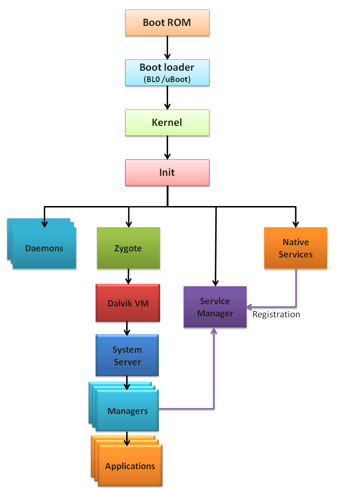
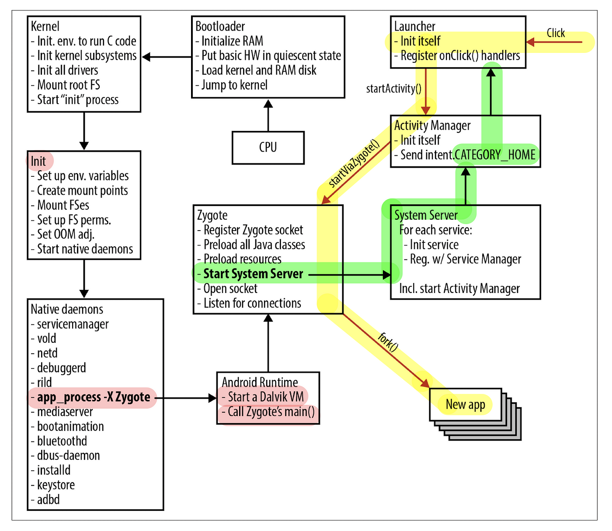
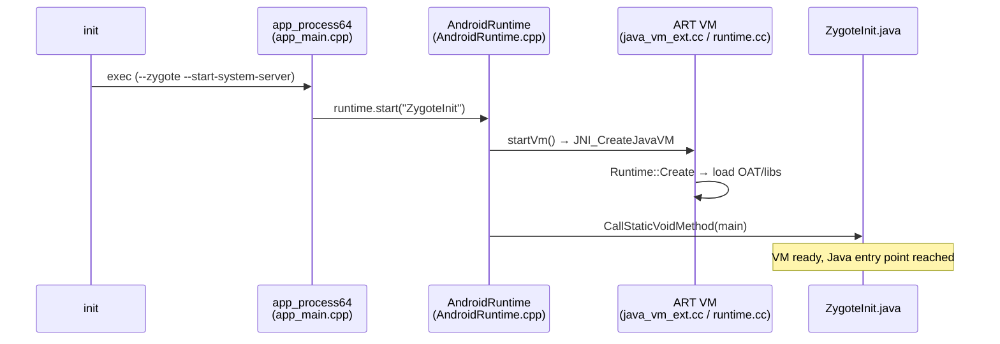
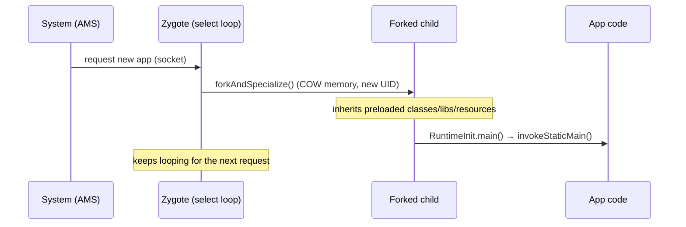
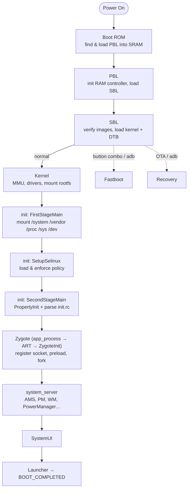

# Android OS Booting Sequence





# Android Boot Sequence — Deep Dive

A stage-by-stage walkthrough of what happens between pressing **power** and seeing the
**Launcher**, with each part's *purpose*, its concrete tasks, pseudo-code, and the real
AOSP code paths (source references are from **AOSP**).

> Companion to the high-level diagram in [README.md §3](README.md#3-how-android-boots).

**The chain at a glance:**


| Stage                                 | Runs from        | Privilege  | One-line purpose                                             |
| ------------------------------------- | ---------------- | ---------- | ------------------------------------------------------------ |
| [Boot ROM](#1-boot-rom)               | on-chip mask ROM | hardware   | Find & load the first bootloader into SRAM                   |
| [Bootloader (PBL/SBL)](#2-bootloader) | SRAM → DRAM      | firmware   | Bring up RAM, verify images, load the kernel, pick boot mode |
| [Kernel](#3-kernel)                   | DRAM             | supervisor | Manage memory/CPU/drivers, mount rootfs, start `init`        |
| [init](#4-init-process)               | user space       | root       | Mount partitions, set SELinux, load properties, start services |
| [Zygote](#5-zygote)                   | user space       | root→app   | Preload ART + framework, fork every app & `system_server`    |

---

## 1. Boot ROM

**Purpose:** the *hardware root of trust* and the very first code the CPU runs. Its only real
job is to locate the first bootloader and jump to it.

The Boot ROM is a small piece of **immutable** code physically burned into the **SoC**. It is
the first thing executed at power-on.

**Why it does so little:** at this instant there is no usable main memory yet. The external
**DRAM** (system RAM) is not initialized — the chip doesn't even know how much DRAM is fitted
or how it's wired. So the Boot ROM can only use a small amount of **on-chip SRAM** to run.

**Tasks:**

1. Initialize the bare minimum: CPU, system **clocks**, power controllers, and on-chip SRAM.
2. **Discover** the boot media in a hardcoded search order (eMMC, NAND flash, SD card…).
3. **Load** the first-stage bootloader (**PBL**) from that non-volatile storage into SRAM.
4. **Jump** to the PBL — execution now continues in the bootloader.

```c
void BootROM_Start() {
    Initialize_CPU();        // set up CPU and system clocks
    Discovery_Bootloader();  // eMMC, NAND flash, SD card
    Load_Bootloader();       // copy the PBL into on-chip SRAM
    Jump_To_Bootloader();    // transfer execution to the bootloader
}
```

> **Root of trust:** because the Boot ROM is immutable, it's the anchor for **Verified Boot**
> — it can cryptographically verify the next stage's signature before trusting it.

---

## 2. Bootloader

**Purpose:** set up memory and hardware far enough to **load the Linux kernel into RAM**, and
decide *which* boot path to take (normal / Fastboot / Recovery). On desktops this role is
played by GRUB; in embedded Linux, often **U-Boot**; on phones, usually a vendor-proprietary
bootloader. It is a separate program from the kernel.

It is typically split into two parts: **Primary (PBL)** and **Secondary (SBL)**.

### 2.1 Primary Bootloader (PBL)

**Purpose:** the minimal loader whose main job is to bring up RAM and load the bigger SBL.

**Tasks:** initialize critical hardware, set up the **memory controller** (so external DRAM
becomes usable), then load and jump to the SBL.

```c
void primary_bootloader_main() {
    init_hardware();              // initialize basic hardware
    setup_memory();              // set up the memory controller (DRAM usable)
    load_secondary_bootloader(); // load the next stage into RAM
    jump_to_secondary_bootloader();
}
```

### 2.2 Secondary Bootloader (SBL)

**Purpose:** the "real" bootloader — richer hardware init, **image verification**, kernel
loading, and the **Fastboot/Recovery** entry points. It may show a splash screen or boot
animation.

**Tasks:**

- **Hardware init & setup** — configure more peripherals (display controller, input, network).
- **Partition verification** — check the integrity of `boot`, `recovery`, `system` partitions
  via cryptographic signatures / hashes (**Verified Boot / AVB**).
- **Kernel loading & init** — load the Linux kernel from the `boot` partition into RAM and
  pass it essential parameters: the **root filesystem** location and the **Device Tree Blob
  (DTB)** describing the hardware.
- **Fastboot & Recovery modes** — provide the alternate boot paths (below).

```c
void secondary_bootloader_main() {
    verify_boot_partition();   // check boot partition integrity (AVB)
    display_splash_screen();   // show a splash screen
    load_kernel_image();       // load the Android kernel into RAM
    setup_Device_Tree();       // hand the DTB to the kernel

    if (Fastboot_Mode_Requested) {
        enter_fastboot_mode(); // flashing/erasing partitions from a host
    } else if (Recovery_Mode_Requested) {
        enter_recovery_mode(); // OTA / factory reset
    } else {
        jump_to_kernel();      // normal boot: transfer control to the kernel
    }
}
```

### 2.3 Fastboot vs Recovery — the two alternate paths

|                   | **Fastboot**                                                 | **Recovery Mode**                                            |
| ----------------- | ------------------------------------------------------------ | ------------------------------------------------------------ |
| **What it is**    | A USB **protocol** in the bootloader for flashing/erasing partitions from a host PC | A **complete but minimal Linux OS** (its own kernel + init + UI) |
| **Runs Android?** | ❌ No OS at all                                               | ⚠️ Boots an OS, but **does not** start the Android container  |
| **Capabilities**  | `fastboot flash`, `erase`, unlock                            | Network stack, mount/unmount volumes, `adb` + shell, apply OTA, factory reset |
| **How to enter**  | Hardware flag (button combo / DIP switch), or `adb reboot bootloader` | `adb reboot recovery`, button combo, or a queued OTA         |
| **AOSP source**   | vendor bootloader                                            | `bootable/recovery/` — build with `make -j8 recoveryimage` → `recovery.img` |

---

## 3. Kernel

**Purpose:** the core of the OS — own and arbitrate **all** system resources (memory, CPU,
devices), then hand off to the first user-space process. Android runs a Linux kernel tuned
for mobile (wakelocks, ashmem, Binder, low-memory killer, etc.).

**Tasks:**

- **Memory management** — set up the **MMU**, virtual memory, paging, and the system memory map.
- **Device driver init** — load drivers for display, audio, network, storage, so software can
  talk to hardware.
- **Mount the root filesystem** — usually an **initramfs** placed in RAM by the bootloader; it
  holds the minimal tools needed to bring up user space.
- **Launch `init`** — start the first user-space process, **PID 1**, from which every other
  process descends.

```c
void start_kernel(void) {
    setup_arch();                    // architecture-specific config
    init_IRQ();                      // interrupt subsystem
    initialize_memory_management();  // virtual memory, MMU
    initialize_device_drivers();     // load & init drivers
    mount_root_filesystem();         // mount initramfs
    start_init_process();            // launch init (PID 1)
}
```

---

## 4. Init Process

**Purpose:** the **"grandmother" of all processes** (PID 1). It builds Android's user space
from scratch: mounts partitions, applies SELinux, brings up the property system, then parses
`*.rc` scripts to start every native service — culminating in **Zygote**.

Its four big responsibilities:

1. **Create folders & mount devices** — mount `/system`, `/data`, `/cache`, `/vendor`, plus
   virtual filesystems, so the rest of the system has its files.
2. **Set up SELinux policies** — load the mandatory-access-control policy and enforce it.
3. **Start the property service** — load **Android properties** (key/value config).
4. **Parse `init.rc` and start Zygote** — plus core daemons (`vold`, `netd`, `servicemanager`).

### 4.1 Android properties (the "lightweight registry")

An **Android property** is a simple **key–value pair stored in a shared-memory region**
(`/dev/__properties__`) that any process can read and privileged processes can write. Every
property lives in **one global namespace** and is reachable system-wide — from native C++,
from the framework, and from the shell — conceptually like a much simpler Windows Registry.
They are the OS's runtime configuration bus: a value written by one process is instantly
visible to every other.

Commands: **`setprop <key> <value>`** (write) and **`getprop <key>`** (read).

```bash
mydevice:/ # getprop ro.product.model      # read one
Pixel 7
mydevice:/ # getprop | grep '^\[ro.build'  # list matching
mydevice:/ # setprop debug.layout true     # write (needs permission)
```

From Java the framework wraps the same store:

```java
String sdk = android.os.SystemProperties.get("ro.build.version.sdk"); // e.g. "31"
```

#### The key distinction — by the property's *prefix*

The **prefix of the name decides its lifetime and mutability.** This is the difference the
init phase cares about:

| Kind                           | Prefix                                                       |             Writable after boot?             |                       Survives reboot?                       | Where it comes from                              |
| ------------------------------ | ------------------------------------------------------------ | :------------------------------------------: | :----------------------------------------------------------: | ------------------------------------------------ |
| **System / build (read-only)** | `ro.`                                                        | ❌ No — set **once** during boot, then frozen |                   n/a (rebuilt each boot)                    | `build.prop`, `default.prop`, product configs    |
| **Runtime (volatile)**         | `persist.`-less, e.g. `sys.`, `debug.`, `dev.`, `service.`, `init.svc.` |         ✅ Yes — changeable any time          |           ❌ No — lost on reboot, live in RAM only            | Set by `init`, services, or `setprop` at runtime |
| **Persistent**                 | `persist.`                                                   |                    ✅ Yes                     | ✅ **Yes** — written to `/data/property/` and reloaded next boot | User/system settings that must stick             |

> **Rule of thumb:** `ro.` = **read-only "system property"** describing *what the device is*
> (fixed identity, set at boot). Everything else is a **"runtime property"** describing
> *what the system is doing right now* (mutable state) — and a `persist.` runtime property is
> one that is also saved to disk so it outlives a reboot.

#### System (read-only, `ro.*`) — *device identity, frozen at boot*

Set once while `init` runs and never change until the next boot. Trying to `setprop` them
after boot fails.

| Property                   | Meaning / example value                 |
| -------------------------- | --------------------------------------- |
| `ro.build.version.sdk`     | Android SDK/API level → `31`            |
| `ro.build.version.release` | User-facing version → `12`              |
| `ro.product.model`         | Device model → `Pixel 7`                |
| `ro.product.manufacturer`  | OEM → `Google`                          |
| `ro.hardware`              | SoC/board name → `qcom`                 |
| `ro.secure`                | 1 = production (adb runs unprivileged)  |
| `ro.debuggable`            | 1 = eng/userdebug build, 0 = user build |
| `ro.zygote`                | Which Zygote to start → `zygote64_32`   |

#### Runtime (volatile) — *live state, changes as the system runs, lost on reboot*

Written by `init` and services as things happen. Reading these tells you the **current
state**; they are recomputed every boot.

| Property               | Meaning / example                                    |
| ---------------------- | ---------------------------------------------------- |
| `sys.boot_completed`   | `0` during boot → flips to `1` when boot finishes    |
| `init.svc.zygote`      | Service state → `running` / `stopped` / `restarting` |
| `init.svc.vold`        | Volume daemon state → `running`                      |
| `sys.usb.state`        | Current USB mode → `mtp,adb`                         |
| `dev.bootcomplete`     | Set once the boot animation is done                  |
| `debug.layout`         | `true` shows layout bounds — a runtime debug toggle  |
| `service.adb.tcp.port` | TCP port `adbd` listens on, if set                   |

These are what init-triggered actions watch. For example an `.rc` action can fire *when* a
runtime property changes:

```bash
on property:sys.boot_completed=1
    start my_late_service      # runs only after boot finishes
```

#### Persistent (`persist.*`) — *runtime, but saved to disk so it survives reboot*

A special class of runtime property: writable like a runtime prop, **but** `init` mirrors it
to `/data/property/` and reloads it on the next boot.

| Property                        | Meaning                                        |
| ------------------------------- | ---------------------------------------------- |
| `persist.sys.timezone`          | Chosen timezone → `Africa/Cairo`               |
| `persist.sys.locale`            | Chosen locale → `en-US`                        |
| `persist.sys.usb.config`        | Default USB config to restore at boot          |
| `persist.adb.tls_server.enable` | Keep wireless-debugging setting across reboots |

```bash
setprop persist.sys.timezone Africa/Cairo   # set now AND remembered next boot
```

#### How they get set at boot (ties back to `PropertyInit`)

`PropertyInit()` builds the shared area, then **layers the values in order** — read-only
build props first, then persistent props restored from `/data`, then whatever services set as
they start:

```
build.prop / default.prop   →  ro.* (frozen)
        ↓
/data/property/*             →  persist.* (restored from last boot)
        ↓
init actions & services      →  sys.*, init.svc.*, dev.* (live runtime state)
```

### 4.2 The three init phases — `main.cpp` dispatch

`init` re-`exec`s itself through **three phases**, each identified by an argv keyword. Source:
`$AOSP/system/core/init/main.cpp`.

```cpp
int main(int argc, char** argv) {
    if (argc > 1) {
        if (!strcmp(argv[1], "selinux_setup"))  return SetupSelinux(argv);
        if (!strcmp(argv[1], "second_stage"))   return SecondStageMain(argc, argv);
    }
    return FirstStageMain(argc, argv);   // default: phase 1
}
```


**Phase 1 — `FirstStageMain()`** (`first_stage_init.cpp`): mount the earliest, low-level
partitions so a minimal environment exists, then hand off to SELinux setup.

```cpp
int FirstStageMain(int argc, char** argv) {
    CHECKCALL(mount("tmpfs", "/dev", "tmpfs", MS_NOSUID, "mode=0755"));
    CHECKCALL(mkdir("/dev/pts", 0755));
    CHECKCALL(mount("devpts", "/dev/pts", "devpts", 0, NULL));
    CHECKCALL(mount("sysfs", "/sys", "sysfs", 0, NULL));
    CHECKCALL(mount("selinuxfs", "/sys/fs/selinux", "selinuxfs", 0, NULL));
    CHECKCALL(mkdir("/mnt/vendor", 0755));   // vendor-specific R/W mounts
    CHECKCALL(mkdir("/mnt/product", 0755));  // product-specific R/W mounts
    // re-exec init for the SELinux phase
    const char* args[] = {"/system/bin/init", "selinux_setup", nullptr};
    execv(args[0], const_cast<char**>(args));
}
```

Partitions/filesystems mounted this early and **why**:

| Mount     | Why it must be early                                         |
| --------- | ------------------------------------------------------------ |
| `/system` | Core OS files, framework, system libs/apps — everything else needs it |
| `/vendor` | Device-specific binaries, drivers, HAL configs for the hardware |
| `/proc`   | Kernel process/info interface                                |
| `/sys`    | Device & kernel object tree (sysfs)                          |
| `/dev`    | Device nodes (drivers)                                       |

**Phase 2 — `SetupSelinux()`** (`selinux.cpp`): load the policy, choose **enforcing** vs
**permissive**, label files/processes with security contexts, then hand off to second stage.

```cpp
int SetupSelinux(char** argv) {
    LoadSelinuxPolicyAndroid();    // load policy from predefined files
    SelinuxSetEnforcement();       // enforcing (prod) or permissive (log-only)
    const char* args[] = {"/system/bin/init", "second_stage", nullptr};
    execv(args[0], const_cast<char**>(args));
}
```

- **Policy** defines which operations each process/user may perform on files, devices, sockets.
- **Enforcing** blocks violations (production); **permissive** only logs them.
- **Labeling** attaches a security context to every file and process to govern interactions.

**Phase 3 — `SecondStageMain()`** (`init.cpp`): the main event — load properties, parse the
`.rc` scripts, and start services.

```cpp
int SecondStageMain(int argc, char** argv) {
    PropertyInit();                              // set up system properties
    ActionManager& am = ActionManager::GetInstance();
    ServiceList&  sm = ServiceList::GetInstance();
    LoadBootScripts(am, sm);                     // parse init.rc & *.rc
    return 0;
}

static void LoadBootScripts(ActionManager& am, ServiceList& sl) {
    Parser parser = CreateParser(am, sl);
    std::string bootscript = GetProperty("ro.boot.init_rc", "");
    parser.ParseConfig(bootscript);
}
```

`PropertyInit()` (`property_service.cpp`) creates the shared property area and loads defaults:

```cpp
void PropertyInit() {
    mkdir("/dev/__properties__", S_IRWXU | S_IXGRP | S_IXOTH);
    CreateSerializedPropertyInfo();
    __system_property_area_init();
    property_info_area.LoadDefaultPath();
    PropertyLoadBootDefaults();
    PropertyLoadDerivedDefaults();
}
```

`SecondStageMain()` responsibilities:

- **Set system properties** (`PropertyInit`) — security settings, hardware config, IDs.
- **Parse & execute `.rc` scripts** (`LoadBootScripts`) — `init.rc`, `init.zygote64.rc`, and
  device-specific `*.rc` define services, properties, and boot actions.
- **Service initialization** — start `vold`, `netd`, `servicemanager`, and **Zygote**.

### 4.3 Android Init Language & `init.rc`

`.rc` files are written in the **Android Init Language**, a declarative DSL with commands like
`service`, `on`, `start`, `mount`, `setprop`. Example (`system/core/rootdir/init.rc`):

```bash
on boot
    setprop ro.bootmode normal          # set an initial property
    mount_all /fstab.$(ro.hardware)     # mount essential filesystems
    start ueventd
    start servicemanager
    start vold
    start zygote
```

`init.rc` mounts filesystems (`/system`, `/data`, `/vendor`), sets key properties, and starts
core services (`vold`, `netd`, `servicemanager`, **zygote**).

---

## 5. Zygote

**Purpose:** the **"mother" of all app processes**. Rather than cold-starting a fresh ART VM
per app, Android boots **one** partially-initialized VM — Zygote — with all common
classes/libraries/resources preloaded, then **forks** it for each new app. The children share
Zygote's memory copy-on-write, so app startup is fast and memory-cheap.

> **Why "Zygote"?** Like the biological zygote — the single cell every other cell descends
> from — this process is the origin from which all app processes are "born". Forking + then
> running a specific class (instead of `exec`) is called **specialization**, mirroring how
> cells specialize.

### 5.1 How Zygote is started

`init` starts Zygote via `.rc`. Which variant(s) start is driven by the `ro.zygote` property
(most modern devices run **two**: 64-bit primary + 32-bit):

```bash
mydevice:/ # getprop | grep ro.zygote
[ro.zygote]: [zygote64_32]
```

`init.rc` imports the matching script:

```bash
# init.rc
import /init.${ro.zygote}.rc
```

`init.zygote64.rc` defines the service:

```bash
service zygote /system/bin/app_process64 -Xzygote /system/bin --zygote --start-system-server
    class main
    priority -20
    user root
    group root readproc
    socket zygote stream 660 root system
    onrestart restart audioserver
    onrestart restart cameraserver
    onrestart restart media
    onrestart restart netd
```

| Directive                   | Meaning                                                      |
| --------------------------- | ------------------------------------------------------------ |
| `/system/bin/app_process64` | The binary that launches Zygote (the "java command" of Android) |
| `-Xzygote`                  | Run as Zygote                                                |
| `--start-system-server`     | Also fork **system_server**                                  |
| `socket zygote`             | Create the stream socket the system uses to request new app forks |
| `onrestart …`               | If Zygote dies, restart it and key media/network services    |

**Start-up call chain** (`app_process` → ART → `ZygoteInit`):



- **`app_main.cpp`** parses args; for Zygote it calls
  `runtime.start("com.android.internal.os.ZygoteInit", args)`.
- **`AndroidRuntime::start`** creates the JVM (`startVm` → `JNI_CreateJavaVM` in
  `java_vm_ext.cc`), which calls `Runtime::Create` (`runtime.cc`) to initialize ART and load
  the system **OAT** files. Then it invokes the Java `main()` of `ZygoteInit`.

### 5.2 What `ZygoteInit.main()` does — three startup tasks

```java
// frameworks/base/core/java/com/android/internal/os/ZygoteInit.java
public static void main(String argv[]) {
    zygoteServer = new ZygoteServer(isPrimaryZygote);   // 1. register socket
    preload();                                          // 2. preload resources
    if (startSystemServer) {
        Runnable r = forkSystemServer(abiList, zygoteSocketName, zygoteServer); // 3.
        if (r != null) { r.run(); return; }             // child == system_server
    }
    caller = zygoteServer.runSelectLoop(abiList);       // loop: wait for fork requests
}
```

1. **Register the server socket** (`registerServerSocket`) — the named `zygote` socket the
   system connects to when it wants a new app.

2. **Preload** classes, resources, and native libraries once, so every fork inherits them:

   ```java
   private static void preload() {
       preloadClasses();          // common Java classes
       preloadResources();        // images, fonts, assets
       preloadOpenGL();
       preloadSharedLibraries();  // libc, libm, …
   }
   ```

   With ART, many preloads are already resident via the system OAT file.

3. **Start System Server** — because `--start-system-server` was set, `system_server` is the
   **first** thing Zygote forks. It hosts ActivityManager, PackageManager, PowerManager, etc.

After these three tasks Zygote enters `runSelectLoop()` and blocks, waiting for fork requests.

### 5.3 Specialization — forking a new app

When a launch request arrives on the socket, Zygote **forks and specializes**:

```java
// ZygoteConnection.java
pid = Zygote.forkAndSpecialize(parsedUid, gid, gids, runtimeFlags, rlimits,
                               mountExternal, seInfo, niceName, fdsToClose,
                               fdsToIgnore, instructionSet, appDataDir);
```

| Argument    | Purpose                                       |
| ----------- | --------------------------------------------- |
| `niceName`  | New process name (usually the app package)    |
| `parsedUid` | Unique **UID** per app — the sandbox boundary |
| `gids`      | Group IDs granting specific permissions       |

The child then runs `RuntimeInit.main()`:

```java
public static void main(String[] args) {
    commonInit();          // logging, exception handlers, system state
    invokeStaticMain(args);// call the target app's main() / Application
}
```

- **`commonInit()`** — set up logging and default exception handling.
- **`invokeStaticMain()`** — jump into the app's entry point. The child is now a real app;
  Zygote goes back to waiting.

### 5.4 Recap — launching one app



1. Zygote receives a launch request over its socket.
2. It **forks** via `forkAndSpecialize()` (new UID, copy-on-write memory).
3. The child **inherits** all preloaded resources — no reloading.
4. The child enters `RuntimeInit` and runs the app-specific code.
5. Zygote keeps running, waiting for the next request.

---

## Full sequence — power to launcher



---

### Source map (AOSP using android code search)

| Component           | Path                                                         |
| ------------------- | ------------------------------------------------------------ |
| init entry / phases | `system/core/init/main.cpp`                                  |
| First stage         | `system/core/init/first_stage_init.cpp`                      |
| SELinux setup       | `system/core/init/selinux.cpp`                               |
| Second stage        | `system/core/init/init.cpp`                                  |
| Property service    | `system/core/init/property_service.cpp`                      |
| Base init scripts   | `system/core/rootdir/init.rc`                                |
| app_process         | `frameworks/base/cmds/app_process/app_main.cpp`              |
| Runtime bring-up    | `frameworks/base/core/jni/AndroidRuntime.cpp`                |
| VM creation         | `art/runtime/jni/java_vm_ext.cc`, `art/runtime/runtime.cc`   |
| Zygote              | `frameworks/base/core/java/com/android/internal/os/ZygoteInit.java` |
| Fork/specialize     | `.../os/ZygoteConnection.java`, `.../os/RuntimeInit.java`    |
| Recovery image      | `bootable/recovery/`                                         |
