# Android Boot Sequence — From Power-On to the Car Launcher

> **Source baseline:** every source path, function name and line number in this chapter was checked
> against **AOSP `android-17.0.0_r1`** (lunch product `aosp_cf_x86_64_auto-userdebug` for Cuttlefish
> `vsoc_x86_64_only`, system image `car_generic`). Where Android 15 (`ap3a`) differs, it is called out as
> **Version-dependent**. Line numbers drift between releases. Use the function name as the stable
> anchor and the line number as a hint.

**Evidence labels used in this chapter**

| Label | Meaning |
|---|---|
| **Verified in source** | Read directly in the AOSP 17 tree |
| **General concept** | Standard Linux / SoC behaviour; the code is *not* in the AOSP tree (vendor firmware, kernel source) |
| **Version-dependent** | Differs between Android releases or between devices |
| **Educational simplified example** | Pseudo-code written to teach; **not** the real implementation |

**Prerequisites:** [Linux vs Android](../01.LinuxVsAndroid/README.md) (kernel, user space, processes), [Android Architecture](../05.AndroidArchitecture/README.md) (ART, framework, system services, Binder).

**After reading this chapter you should be able to:**

1. Name every stage between power-on and the launcher and say which software owns it.
2. Explain why `init` runs in three phases and what each phase does, citing the real functions.
3. Explain how system properties work, who can write them, and when `persist.*` values come back.
4. Read `init.rc` and say in which trigger a given daemon is started.
5. Explain how Zygote starts, why it preloads, and how a new app process is created.
6. Explain how an AAOS build differs: how `CarService` gets started during boot.

---

## Table of Contents

- [0. The big picture](#0-the-big-picture)
- [1. Boot ROM](#1-boot-rom)
- [2. Bootloader](#2-bootloader)
  - [2.3 Verified boot (AVB) in short](#23-verified-boot-avb-in-short)
- [3. Linux kernel](#3-linux-kernel)
- [4. init — the first user-space process](#4-init--the-first-user-space-process)
  - [4.1 One binary, several entry points (`main.cpp`)](#41-one-binary-several-entry-points-maincpp)
  - [4.2 First stage — `FirstStageMain()`](#42-first-stage--firststagemain)
  - [4.3 SELinux stage — `SetupSelinux()`](#43-selinux-stage--setupselinux)
  - [4.4 Second stage — `SecondStageMain()`](#44-second-stage--secondstagemain)
  - [4.5 System properties](#45-system-properties)
  - [4.6 The Android Init Language and the trigger timeline](#46-the-android-init-language-and-the-trigger-timeline)
    - [4.6.1 How init runs triggers (the event queue)](#461-how-init-runs-triggers-the-event-queue)
    - [4.6.2 Every boot trigger, one by one](#462-every-boot-trigger-one-by-one)
- [5. Zygote](#5-zygote)
- [6. system_server, Home and `BOOT_COMPLETED`](#6-system_server-home-and-boot_completed)
- [7. AAOS-specific: how CarService is started](#7-aaos-specific-how-carservice-is-started)
- [8. Full sequence — power to launcher](#8-full-sequence--power-to-launcher)
- [9. Practical automotive scenario](#9-practical-automotive-scenario)
- [10. Common misconceptions](#10-common-misconceptions)
- [11. Observing the boot on Cuttlefish](#11-observing-the-boot-on-cuttlefish)
- [12. Summary and knowledge check](#12-summary-and-knowledge-check)
- [13. Source map](#13-source-map)

---

## 0. The big picture

### What is "booting"?

Booting is the chain of programs that takes a CPU from "power just arrived" to "the user sees a
usable home screen". No single program can do it all. At power-on there is no RAM, no filesystem,
no drivers and no processes. Each stage builds just enough of the environment to load and trust
the next stage, then hands over control.

### Why does Android need so many stages?

Each stage solves a problem the previous one could not:

| Problem | Who solves it |
|---|---|
| DRAM is not initialised yet, so only tiny on-chip SRAM is usable | Boot ROM loads a small first bootloader into SRAM |
| The kernel is large and must be loaded into DRAM and verified | Bootloader |
| Hardware needs drivers, memory management and processes | Linux kernel |
| Partitions must be mounted, SELinux enforced, daemons started | `init` (PID 1) |
| Every app needs a warmed-up Java runtime, and starting one per app is slow | Zygote |
| Framework services (activities, packages, windows, power…) must run somewhere | `system_server` |
| AAOS needs a vehicle-aware service layer | `CarServiceHelperService` → `CarService` |

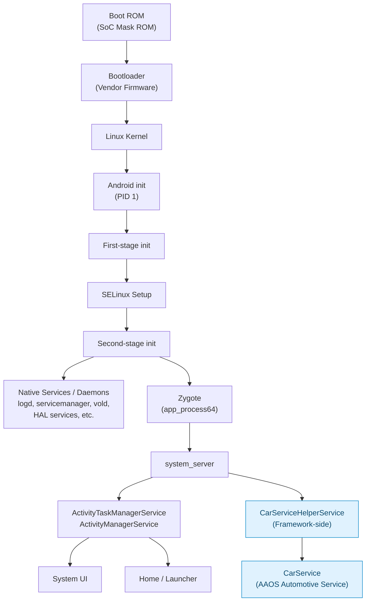

| Stage | Where the code lives | Privilege | Purpose | Evidence |
|---|---|---|---|---|
| [Boot ROM](#1-boot-rom) | SoC mask ROM | hardware | Find and load the first bootloader | General concept |
| [Bootloader](#2-bootloader) | Vendor firmware (not in AOSP) | firmware | Init DRAM, verify and load kernel + ramdisk, choose boot mode | General concept |
| [Kernel](#3-linux-kernel) | `kernel/prebuilts/*` (binary only in these trees) | kernel | Memory, CPU, drivers, then run `/init` | General concept |
| [init](#4-init--the-first-user-space-process) | `system/core/init/` | root | Mount, SELinux, properties, start services | Verified in source |
| [Zygote](#5-zygote) | `frameworks/base/cmds/app_process/`, `.../internal/os/` | root, then app UID | Preload the runtime, fork `system_server` and apps | Verified in source |
| [system_server](#6-system_server-home-and-boot_completed) | `frameworks/base/services/` | `system` UID | Run framework services, launch Home | Verified in source |
| [CarService](#7-aaos-specific-how-carservice-is-started) | `frameworks/opt/car/services/`, `packages/services/Car/` | `system` UID | Automotive services (AAOS only) | Verified in source |

**The same boot, drawn on the architecture layers.** Firmware and the kernel come first (bottom bar).
Then user space starts from the bottom of the stack and works upward, in four numbered steps:

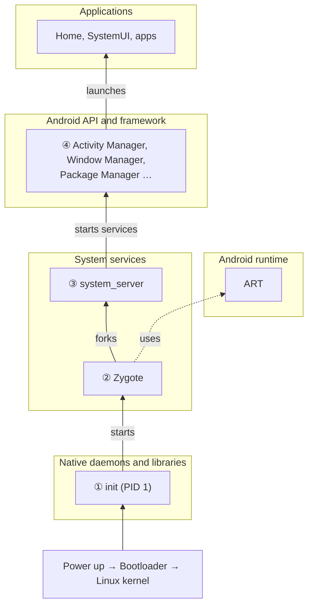

1. The kernel starts **`init`** ([§4](#4-init--the-first-user-space-process)).
2. `init` starts **Zygote**, which loads **ART** and preloads classes ([§5](#5-zygote)).
3. Zygote forks **`system_server`**.
4. `system_server` starts the framework services, which launch SystemUI and Home
   ([§6](#6-system_server-home-and-boot_completed)).

---

## 1. Boot ROM

**Evidence:** General concept. Boot ROM code is part of the SoC (Qualcomm, NXP, Renesas, Broadcom…). It is **not** in AOSP.

**Purpose:** the *hardware root of trust* and the very first code the CPU runs. Its only real job is to locate the first bootloader and jump to it.

The Boot ROM is a small piece of **immutable** code burned into the SoC at manufacture. It is the first instruction the CPU executes after reset.

**Why it does so little:** at this instant external **DRAM** is not initialised. The memory controller has not been programmed, so the chip cannot use it yet. The Boot ROM can only run from a small **on-chip SRAM**.

**Tasks:**

1. **Initialize the bare minimum:** one CPU core, system clocks, power controllers and on-chip SRAM.
2. **Search for the boot media** in a hardcoded order, often selected by fuses or boot pins: eMMC, UFS, SD card, SPI-NOR, USB.
3. **Load** the first-stage bootloader (**PBL**) from that non-volatile storage into SRAM.
4. **Verify** the PBL's signature against a key hash fused into the chip (secure-boot devices only).
5. **Jump** to the PBL. Execution now continues in the bootloader.

```c
// Educational simplified example — not real Boot ROM code (Boot ROMs are closed SoC firmware)
void boot_rom_entry(void) {
    init_cpu_and_clocks();
    media_t m = discover_boot_media();      // e.g. eMMC → SD → USB, order fixed by fuses/pins
    load_first_stage(m, ON_CHIP_SRAM);
    if (secure_boot_enabled() && !verify_signature(ON_CHIP_SRAM)) halt();
    jump_to(ON_CHIP_SRAM);
}
```

> **Root of trust:** because the Boot ROM cannot be modified, it anchors the chain of trust. Each
> later stage is verified by the one before it. Android's piece of that chain is **Android Verified
> Boot (AVB)**, whose tooling and library live in `external/avb/` (for example `avbtool.py`).

> **Raspberry Pi 5 AOSP tree:** the RPi boots through Broadcom/Raspberry Pi EEPROM firmware that is **not** part of AOSP. Your tree only contains scripts that package images (`rpi5-mkimg.sh`).

---

## 2. Bootloader

**Evidence:** General concept. 

The production bootloader is vendor firmware (for example Qualcomm XBL + ABL, or U-Boot). AOSP 17 also contains an in-progress **Generic Bootloader (GBL)** under `bootable/libbootloader/gbl/`. This chapter does not trace it.

**Purpose:** set up memory and hardware far enough to **load the Linux kernel (and its ramdisk)
into RAM**, **verify** what it loads, and decide **which** boot path to take: normal, Fastboot or
Recovery. It is a separate program from the kernel. On desktops this role is played by GRUB, in
embedded Linux often by **U-Boot**, and on phones and cars usually by a vendor-proprietary
bootloader.

The bootloader is typically split into two parts: **Primary (PBL)** and **Secondary (SBL)**. The
split exists because the first part must fit in the tiny on-chip SRAM. Only after it has made DRAM
usable can the larger second part be loaded.

### 2.1 Primary Bootloader (PBL)

**Purpose:** the minimal loader whose main job is to **bring up RAM** and load the bigger SBL.

**Tasks:**

1. **Run from on-chip SRAM:** the Boot ROM loaded it there, because DRAM is still unusable.
2. **Initialize critical hardware:** clocks, power rails (PMIC) and basic timers needed for the
   next steps.
3. **Set up the memory controller:** configure and train the external **DRAM**, so main memory
   becomes usable.
4. **Load the SBL** from boot storage into DRAM. On secure-boot devices it **verifies the SBL's
   signature** first, which continues the chain of trust from the Boot ROM.
5. **Jump to the SBL.**

```c
// Educational simplified example — not real bootloader code
void primary_bootloader_main(void) {
    init_clocks_and_power();         // critical hardware only
    init_dram_controller();          // external DRAM becomes usable
    load_image("sbl", DRAM);         // copy the secondary bootloader into RAM
    if (!verify_signature("sbl")) halt();   // secure boot: continue the chain of trust
    jump_to("sbl");
}
```

### 2.2 Secondary Bootloader (SBL)

**Purpose:** the "real" bootloader. It does the richer hardware init, **image verification
(AVB)**, kernel loading, and provides the **Fastboot/Recovery** entry points. It may show a splash
screen.

**Tasks:**

1. **Hardware init & setup:** configure more peripherals, such as the storage controller, the
   display controller (for the splash screen), USB (for fastboot) and input keys (for button combos).
2. **Choose the boot mode:** normal, Fastboot or Recovery. The choice comes from a key combination,
   a flag written before reboot (`adb reboot bootloader` / `adb reboot recovery`), or a pending OTA.
3. **Partition verification (AVB, Android Verified Boot):** summary in [§2.3](#23-verified-boot-avb-in-short),
   full explanation from zero in [Secure Boot and AVB](SECURE_BOOT_AVB.md).
   - Verify the **`vbmeta`** partition signature with the device's trusted key.
   - Verify the hashes of the images it loads itself: **`boot`** (kernel), **`init_boot`** (generic
     ramdisk, Android 13+ GKI devices) and **`vendor_boot`** (vendor ramdisk), as described in `vbmeta`.
   - Large partitions such as `system` and `vendor` are **not** hashed entirely by the bootloader,
     because that would be too slow. `vbmeta` carries their **hash-tree** descriptors. Each block is
     checked later, at read time, by the kernel's **dm-verity** after first-stage `init` sets it up
     ([§4.2](#42-first-stage--firststagemain)).
   - Apply the lock-state policy: on a **locked** device a verification failure stops the boot. On an
     **unlocked** device it boots with a warning (orange state).
4. **Kernel loading:** load into RAM the **kernel** from `boot`, plus the **ramdisk(s)** from
   `init_boot`/`vendor_boot`. The ramdisk holds first-stage `init`.
5. **Pass the essential parameters to the kernel:**
   - the **Device Tree Blob (DTB)** describing the board hardware;
   - the **kernel command line** and **bootconfig**, which include `androidboot.*` values such as
     `androidboot.hardware`, `androidboot.slot_suffix` and `androidboot.verifiedbootstate`. `init`
     later turns these into `ro.boot.*` properties ([§4.5](#45-system-properties)).
6. **Fastboot & Recovery modes:** provide the alternate boot paths (see the table below).
7. **Jump to the kernel:** normal boot hands over control. The bootloader is no longer running
   after this.

```c
// Educational simplified example — not real bootloader code
void secondary_bootloader_main(void) {
    init_storage_display_usb_keys();           // 1. hardware init & setup
    boot_mode_t mode = read_boot_mode();       // 2. keys / reboot reason / OTA flag

    if (!avb_verify_vbmeta() ||                // 3. AVB: vbmeta signature, then image hashes
        !avb_verify("boot") || !avb_verify("init_boot") || !avb_verify("vendor_boot"))
        handle_verification_failure();         //    locked → stop, unlocked → warn (orange)

    show_splash_screen();

    if (mode == FASTBOOT)  { run_fastboot(); return; }        // 6. flash/erase over USB
    if (mode == RECOVERY)  { boot_recovery(); return; }       // 6. OTA / factory reset

    load_kernel("boot");                       // 4. kernel into RAM
    load_ramdisks("init_boot", "vendor_boot"); // 4. ramdisk with first-stage init
    load_dtb();                                // 5. hardware description
    build_cmdline_and_bootconfig();            // 5. androidboot.* → later ro.boot.*
    jump_to_kernel();                          // 7. control passes to Linux
}
```

### 2.3 Verified boot (AVB) in short

**Purpose:** make sure the car runs **only software the manufacturer built and signed**, and never
an older version with a known security bug.

> **From zero, in detail:** hashes, signatures, `vbmeta`, hash trees, dm-verity, rollback protection,
> the real `vbmeta` of your Cuttlefish build and an automotive attack scenario are in
> **[Secure Boot and AVB](SECURE_BOOT_AVB.md)**.

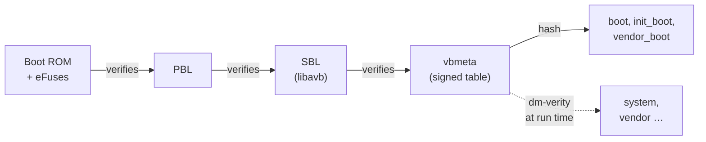

**Steps:**

1. **Root of trust (hardware).** The Boot ROM and a key hash burned into **eFuses** cannot be
   changed. Every later check starts from them.
2. **Secure boot (SoC vendor).** The Boot ROM verifies the PBL's signature, and the PBL verifies the
   SBL's. Each stage checks the next **before** running it.
3. **AVB (the Android part, in the SBL).** Using libavb (`external/avb/libavb/`), the SBL:
   - verifies the signature of **`vbmeta`**, a small signed table of the expected hash of every
     partition;
   - checks the **rollback index**: an image older than the one stored in the device is refused;
   - hashes **`boot`**, **`init_boot`** and **`vendor_boot`**, which it loads itself, and compares
     them with `vbmeta`.
4. **Decide.** On a **locked** device a failure stops the boot. On an **unlocked** (developer) device
   it boots with a warning. The result goes to Android as `androidboot.verifiedbootstate`:
   **green** (locked, OEM key), **yellow** (locked, user key) or **orange** (unlocked).
5. **Large partitions are checked later.** `system`, `vendor`, … are too big to hash at boot. Their
   hash-tree root is in `vbmeta`. First-stage `init` sets up **dm-verity**, and the kernel checks
   every block when it is read ([§4.2](#42-first-stage--firststagemain)).

**Outcome:** the kernel starts only from verified images, and Android knows whether the boot was
verified.

### Images the bootloader loads

**Version-dependent.** On devices that launched with Android 13 or later and use the Generic
Kernel Image (GKI), the generic ramdisk containing first-stage `init` lives in **`init_boot`**,
separate from the kernel in **`boot`**. Your Cuttlefish fstab lists both:

```text
# device/google/cuttlefish/shared/config/fstab.in (lines 2–3)
/dev/block/by-name/boot       /boot       emmc ...
/dev/block/by-name/init_boot  /init_boot  emmc ...
```

### Fastboot vs Recovery

| | **Fastboot** | **Recovery** |
|---|---|---|
| What it is | A USB flashing **protocol** | A minimal Linux + Android user space with its own `init` and UI |
| Where it runs | (a) In the **bootloader**, or (b) as **`fastbootd`** in user space inside recovery (needed to flash *logical* partitions inside `super`) | Booted instead of the normal system |
| Typical use | `fastboot flash`, `erase`, unlock | Apply OTA, factory reset, `adb sideload` |
| Enter with | `adb reboot bootloader` / `adb reboot fastboot` (fastbootd) / key combo | `adb reboot recovery` / key combo |
| AOSP source | Bootloader: vendor. `fastbootd`: `system/core/fastboot/device/` | `bootable/recovery/` |

> **Version-dependent:** on A/B devices with `BOARD_USES_RECOVERY_AS_BOOT`, there is no separate
> recovery partition. The recovery ramdisk is part of the boot image. `system/core/init/Android.bp`
> uses that variable for the first-stage `init` module (`init_first_stage_defaults`).

---

## 3. Linux kernel

**Evidence:** General concept. The three AOSP trees you provided contain **only prebuilt** kernels
(`kernel/prebuilts/6.1`, `6.6`, `6.12`, `6.18`, plus `common-modules/`), not kernel source.
The flow below is standard upstream Linux.

**Purpose:** the core of the OS. It owns and arbitrates **all** system resources (memory, CPU,
devices), then hands off to the first user-space process.

**Tasks:**

1. **Memory management:** enable the **MMU**, build the page tables and the system memory map, and
   discover the RAM layout from the DTB (or ACPI).
2. **Core subsystem init:** interrupts, timers, the scheduler and the VFS (virtual filesystem layer).
3. **Device driver init:** initialize the built-in drivers (storage, display, input…), so software
   can talk to the hardware. Most Android drivers are instead **loadable modules**, loaded later by
   first-stage `init` ([§4.2](#42-first-stage--firststagemain)).
4. **Mount the initial root filesystem:** unpack the **initramfs** (the ramdisk the bootloader
   placed in RAM) as `rootfs`. It holds the minimal tools to bring up user space, including
   first-stage `init`.
5. **Launch `init`:** start the first user-space process, **PID 1**, from which every other
   process descends. In upstream Linux the path is `start_kernel()` → `rest_init()` →
   `kernel_init()`, which runs the ramdisk's **`/init`**.

```c
// Educational simplified example — names follow upstream init/main.c, body heavily trimmed
asmlinkage void start_kernel(void) {
    setup_arch(&command_line);   // MMU, memory map, DTB parsing
    trap_init(); init_IRQ(); sched_init(); time_init();
    vfs_caches_init();
    rest_init();                 // spawns kernel_init as PID 1
}
static int kernel_init(void *unused) {
    // ... driver initcalls, unpack initramfs ...
    run_init_process("/init");   // ramdisk_execute_command, default "/init"
}
```

On Android, that `/init` is **first-stage init**: the `init_first_stage` module, built with
`stem: "init"` and `-DFIRST_STAGE_INIT=1` (`system/core/init/Android.bp`, around lines 416–485 and 543).

> **Android-specific kernel pieces you will meet later:** the Binder driver (IPC), `ashmem`/`memfd`,
> and kernel modules loaded from the ramdisk. `lmkd`, the low-memory killer daemon, runs in **user
> space** and is started by `init` (`init.rc` `on init`, line 461).

---

## 4. init — the first user-space process

### What is it?

`init` is **PID 1**, the ancestor of every user-space process. In Android it is a C++ program in
`system/core/init/`. Unlike desktop `systemd`, Android's `init` also:

- implements the **property service** (the system-wide key/value store);
- parses `.rc` scripts in the **Android Init Language**;
- starts, supervises and restarts native services;
- loads and enforces the **SELinux** policy.

### Why three phases?

Some work must happen **before** `/system` is mounted, and some must happen **before** SELinux is
enforced:

- **First stage** must run from the tiny ramdisk, because `/system` is not mounted yet.
- **SELinux setup** must load the policy while the process is still in the kernel's security
  domain. After that, `init` re-executes itself so it transitions into its own `init` domain.
- **Second stage** is the long-running `init`. It needs the full `/system` (libraries, `.rc` files)
  and an enforced policy.

Each transition is an **`execv()` of `/system/bin/init` with a different first argument**.

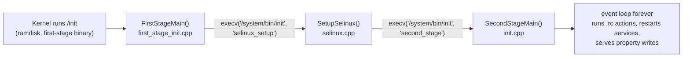

### 4.1 One binary, several entry points (`main.cpp`)

**Verified in source:** `system/core/init/main.cpp`, `main()` (line 53). This is the real dispatch,
with sanitizer setup trimmed:

```cpp
int main(int argc, char** argv) {
    setpriority(PRIO_PROCESS, 0, -20);                      // boost prio during boot
    if (!strcmp(basename(argv[0]), "ueventd")) {
        return ueventd_main(argc, argv);                    // same binary also acts as ueventd
    }
    if (argc > 1) {
        if (!strcmp(argv[1], "subcontext")) { ...; return SubcontextMain(argc, argv, &function_map); }
        if (!strcmp(argv[1], "selinux_setup")) return SetupSelinux(argv);
        if (!strcmp(argv[1], "second_stage"))  return SecondStageMain(argc, argv);
    }
#if defined(FIRST_STAGE_INIT) || defined(RECOVERY)
    return FirstStageMain(argc, argv);
#else
    LOG(FATAL) << "Second-stage init requires an argument to main()";
#endif
}
```

What this teaches:

- **`ueventd`** (creates `/dev` nodes from kernel uevents) is the *same* binary, selected by
  `argv[0]`.
- **`subcontext`** is a helper `init` process. It runs vendor `.rc` commands in a separate,
  less-privileged SELinux context.
- `FirstStageMain` is only compiled into the **first-stage** binary (`FIRST_STAGE_INIT`) or the
  recovery `init`. `/system/bin/init` started with no argument aborts on purpose.

### 4.2 First stage — `FirstStageMain()`

**Verified in source:** `system/core/init/first_stage_init.cpp`, `FirstStageMain()` (line 338).

**Responsibility:** build a minimal environment from the ramdisk, load kernel modules, mount the
real partitions, then hand over to the SELinux stage.

**Step 1: create the basic virtual filesystems.** The `CHECKCALL` macro records failures and
continues, and `init` aborts later if any failed (lines 352–404):

```cpp
CHECKCALL(mount("tmpfs", "/dev", "tmpfs", MS_NOSUID, "mode=0755"));
CHECKCALL(mkdir("/dev/pts", 0755));
CHECKCALL(mkdir("/dev/socket", 0755));      // init will create service sockets here
CHECKCALL(mount("devpts", "/dev/pts", "devpts", 0, NULL));
CHECKCALL(mount("proc", "/proc", "proc", 0, "hidepid=2,gid=" MAKE_STR(AID_READPROC)));
CHECKCALL(mount("sysfs", "/sys", "sysfs", 0, NULL));
CHECKCALL(mount("selinuxfs", "/sys/fs/selinux", "selinuxfs", 0, NULL));
CHECKCALL(mount("tmpfs", "/mnt", "tmpfs", MS_NOEXEC | MS_NOSUID | MS_NODEV, "mode=0755,uid=0,gid=1000"));
CHECKCALL(mkdir("/mnt/vendor", 0755));
CHECKCALL(mkdir("/mnt/product", 0755));
// ... /debug_ramdisk and /second_stage_resources tmpfs mounts ...
```

**Step 2: load kernel modules** from the ramdisk with `LoadKernelModules(...)` (line 456).
`androidboot.load_modules_parallel` in bootconfig can make the loading parallel.

**Step 3: mount the real partitions** with `CreateFirstStageMount()` and then
`fsm->DoFirstStageMount()` → `FirstStageMount::MountPartitions()`
(`system/core/init/first_stage_mount.cpp`, lines 101 and 338). *Which* partitions get mounted
comes from the **first-stage fstab**, specifically the entries flagged `first_stage_mount`. On your
Cuttlefish build (`device/google/cuttlefish/shared/config/fstab.in`) these are `/system`,
`/system_ext`, `/product`, `/vendor`, `/odm`, `/vendor_dlkm`, `/odm_dlkm`, `/system_dlkm` and
`/metadata`. These partitions are mounted with **dm-verity**, using the AVB metadata checked by
`FirstStageMount::InitAvbHandle()`.

**Step 4: free the ramdisk and re-exec into the SELinux stage** (lines 571–589):

```cpp
const char* path = "/system/bin/init";
const char* args[] = {path, "selinux_setup", nullptr};
// stdout/stderr redirected to /dev/kmsg ...
execv(path, const_cast<char**>(args));
PLOG(FATAL) << "execv(\"" << path << "\") failed";   // execv only returns on error
```

> **Correction to the previous version of this chapter:** `FirstStageMain()` does **not** mount
> `/system` or `/vendor` with a hard-coded `mount()` call. They are mounted through
> `FirstStageMount` driven by the fstab. `/data` is mounted **much later**, by `mount_all` in the
> device's `.rc` file during the `fs` trigger.

### 4.3 SELinux stage — `SetupSelinux()`

**Verified in source:** `system/core/init/selinux.cpp`, `SetupSelinux()` (line 785). Core lines:

```cpp
int SetupSelinux(char** argv) {
    SetStdioToDevNull(argv);
    InitKernelLogging(argv);
    ...
    SelinuxSetupKernelLogging();
    bool use_overlays = EarlySetupOverlays();
    if (IsMicrodroid()) LoadSelinuxPolicyMicrodroid();
    else                LoadSelinuxPolicyAndroid();      // line 690: compile/load split policy
    SelinuxSetEnforcement();                             // line 432: enforcing vs permissive
    // We're in the kernel domain and want to transition to the init domain.
    if (selinux_android_restorecon("/system/bin/init", 0) == -1) PLOG(FATAL) << ...;
    ...
    const char* args[] = {"/system/bin/init", "second_stage", nullptr};
    execv(path, const_cast<char**>(args));
}
```

Key ideas:

- **Split policy.** The platform (`/system`) and vendor (`/vendor`) each ship part of the policy.
  `LoadSelinuxPolicyAndroid()` loads the precompiled policy if it matches, or compiles the CIL
  pieces at boot.
- **Enforcing vs permissive.** `SelinuxSetEnforcement()` calls `IsEnforcing()` (line 114). That
  function returns `true` unconditionally unless the build sets `ALLOW_PERMISSIVE_SELINUX`
  (userdebug/eng). Only then is the bootloader-provided `androidboot.selinux` value consulted.
- **Why re-exec?** `restorecon` labels `/system/bin/init`. When `init` `execv`s that file, the
  policy's transition rule moves the process from the `kernel` domain into the `init` domain.

### 4.4 Second stage — `SecondStageMain()`

**Verified in source:** `system/core/init/init.cpp`, `SecondStageMain()` (line 1066). The real
function is about 250 lines. The ordered list below covers the steps that matter for learning;
each is a real call in that function:

| # | Call | What it does |
|---|---|---|
| 1 | `PropertyInit()` | Create the property area and load `ro.*` defaults ([§4.5](#45-system-properties)) |
| 2 | `MountExtraFilesystems()` | Extra tmpfs mounts, such as `/apex` and `/linkerconfig` |
| 3 | `SelinuxRestoreContext()` | Re-label files created before the policy was loaded |
| 4 | `Epoll epoll; epoll.Open()` | Create `init`'s event loop |
| 5 | `InstallSignalFdHandler(&epoll)` | Learn when children die (SIGCHLD) so services can be restarted |
| 6 | `StartPropertyService(&property_fd)` | Start the thread that serves `setprop` requests (line 1551 in `property_service.cpp`) |
| 7 | `SetupMountNamespaces()` | Bootstrap vs default mount namespaces (needed for APEX) |
| 8 | `InitializeSubcontext()` | Start the vendor `subcontext` helper |
| 9 | `LoadBootScripts(am, sm)` | Parse all `.rc` files into actions and services |
| 10 | `am.QueueEventTrigger("early-init")`, `("init")`, then `("late-init")` (or `("charger")` in charger mode) | Queue the boot triggers |
| 11 | `while (true) { ... am.ExecuteOneCommand(); ... epoll.Wait(...) }` | Main loop: run queued commands, restart dead services, handle events |

**Where the `.rc` files come from:** `LoadBootScripts()` (line 347), real code:

```cpp
static void LoadBootScripts(ActionManager& action_manager, ServiceList& service_list) {
    Parser parser = CreateParser(action_manager, service_list);
    std::string bootscript = GetProperty("ro.boot.init_rc", "");
    if (bootscript.empty()) {
        parser.ParseConfig("/system/etc/init/hw/init.rc");
        if (!parser.ParseConfig("/system/etc/init"))  late_import_paths.emplace_back("/system/etc/init");
        parser.ParseConfig("/system_ext/etc/init");
        if (!parser.ParseConfig("/vendor/etc/init"))  late_import_paths.emplace_back("/vendor/etc/init");
        if (!parser.ParseConfig("/odm/etc/init"))     late_import_paths.emplace_back("/odm/etc/init");
        if (!parser.ParseConfig("/product/etc/init")) late_import_paths.emplace_back("/product/etc/init");
    } else {
        parser.ParseConfig(bootscript);
    }
}
```

So in a normal boot `ro.boot.init_rc` is **empty**. The main script is
`/system/etc/init/hw/init.rc`, the on-device copy of `system/core/rootdir/init.rc`. Every module
can then drop its own `.rc` file into `/system/etc/init`, `/vendor/etc/init` and so on. This is how
a HAL or daemon registers itself without editing `init.rc`.

### 4.5 System properties

#### What is a property?

A **system property** is a `name=value` string pair in a system-wide namespace. Every process can
read it, and only processes allowed by SELinux can write it. It is Android's lightweight runtime
configuration and signalling mechanism, loosely similar to a much simpler Windows Registry.

```bash
$ adb shell getprop ro.build.version.sdk      # read  (your AOSP 17 build prints 37)
$ adb shell getprop | grep '^\[ro.build'      # list matching
$ adb shell setprop debug.layout true         # write (subject to SELinux)
```

```java
// Java API — hidden/system API, used by platform code
String sdk = android.os.SystemProperties.get("ro.build.version.sdk");
```

#### How it works internally

- **Reading is cheap.** `init` creates property areas under **`/dev/__properties__/`**, one
  memory-mapped file per SELinux property context. Every process maps them **read-only**, so
  `getprop` does not need IPC.
- **Writing goes through `init`.** A `setprop` sends a message over the Unix domain socket
  **`/dev/socket/property_service`** (`PROP_SERVICE_NAME` = `"property_service"`,
  `bionic/libc/include/sys/system_properties.h:179`). `init`'s property service thread checks
  SELinux (`selinux_check_access(..., "property_service", "set", ...)`, `property_service.cpp:174`),
  writes the value, and fires any `on property:` triggers.

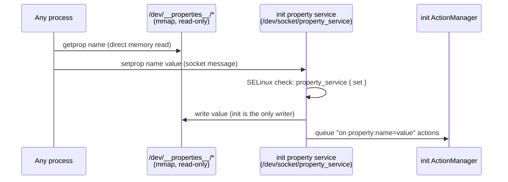

#### Property classes by prefix

| Kind | Prefix | Writable after set? | Survives reboot? | Typical source |
|---|---|:-:|:-:|---|
| Read-only | `ro.` | ❌ Set **once**; later writes are rejected | Rebuilt every boot | `build.prop` files, `ro.boot.*` from the bootloader |
| Runtime | e.g. `sys.`, `dev.`, `debug.`, `init.svc.` | ✅ | ❌ RAM only | `init`, services, `setprop` |
| Persistent | `persist.` | ✅ | ✅ Saved under `/data/property/` | Settings that must stick |

**Examples from your AOSP 17 Cuttlefish build** (from `out/target/product/vsoc_x86_64_only/*/build.prop`):

| Property | Value | Meaning |
|---|---|---|
| `ro.build.version.release` | `17` | User-visible Android version |
| `ro.build.version.sdk` | `37` | API level |
| `ro.build.flavor` | `car_generic-userdebug` | Product and build variant. This value is from `system/build.prop` (the generic car system image); `product/etc/build.prop` has `aosp_cf_x86_64_auto-userdebug`, the lunch product |
| `ro.zygote` | `zygote64` | Which zygote `.rc` to import (64-bit only on this build) |

**Runtime examples, all verified in source:**

| Property | Who sets it | Meaning |
|---|---|---|
| `init.svc.<name>` | `init` | Service state: `running`, `stopped`, `restarting` |
| `sys.boot_completed` | `ActivityManagerService.finishBooting()` (AMS line 5991) | `1` once the framework finished booting |
| `dev.bootcomplete` | Same method, the next line (5992) | Also `1` at boot completion |

**Persistent examples** (each name is used by the file shown, Verified in source):

| Property | Used by | Meaning |
|---|---|---|
| `persist.sys.timezone` | `services/core/java/com/android/server/SystemTimeZone.java` | Chosen time zone, e.g. `Africa/Cairo` |
| `persist.sys.locale` | `services/java/com/android/server/SystemServer.java` | Chosen locale, e.g. `en-US` |
| `persist.sys.usb.config` | `services/usb/java/com/android/server/usb/UsbDeviceManager.java` | Default USB functions restored at boot |
| `persist.adb.tls_server.enable` | `services/core/java/com/android/server/adb/AdbService.java` | Wireless debugging stays on across reboots |

```bash
$ adb shell setprop persist.sys.timezone Africa/Cairo   # applies now and after reboot
```

Trigger on a runtime property (real pattern from `init.rc` line 1237):

```bash
on property:sys.boot_completed=1
    ...
```

#### When does each property class get its value? (corrected order)

**Verified in source:** `PropertyInit()` (`property_service.cpp`, line 1405):

```cpp
void PropertyInit() {
    ...
    mkdir("/dev/__properties__", S_IRWXU | S_IXGRP | S_IXOTH);
    CreateSerializedPropertyInfo();               // property → SELinux context map
    if (__system_property_area_init()) LOG(FATAL) << "Failed to initialize property area";
    if (!property_info_area.LoadDefaultPath()) LOG(FATAL) << ...;
    ProcessKernelDt();          // device tree      → ro.boot.*
    ProcessBootconfig();        // bootconfig       → ro.boot.*
    ProcessKernelCmdline();     // kernel cmdline   → ro.boot.*
    ExportKernelBootProps();    // derive e.g. ro.hardware from ro.boot.hardware
    PropertyLoadBootDefaults(); // /system/etc/build.prop, /vendor/build.prop, /odm/..., /product/...
    PropertyLoadDerivedDefaults();
}
```

`persist.*` values are **not** loaded here, because `/data` is not mounted yet. They are loaded by
the `load_persist_props` built-in command, which `init.rc` runs in **`on post-fs-data`**
(line 722), after `/data` is mounted and decrypted. The command is implemented as
`do_load_persist_props()` in `builtins.cpp:1072`. It sends a message to the property service,
which handles it in `property_service.cpp:1447` and finally sets
`ro.persistent_properties.ready=true`.

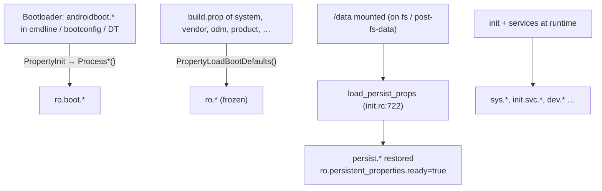

### 4.6 The Android Init Language and the trigger timeline

`.rc` files contain two kinds of sections:

- **`on <trigger>`**: an *action*, meaning a list of commands run when the trigger fires. The
  trigger can be an event (`on boot`) or a property condition (`on property:x=y`).
- **`service <name> <path> <args>`**: a *service* definition with options (`class`, `user`,
  `socket`, `onrestart` …). A service runs when it is started by `start <name>` or by
  `class_start <class>`.

`late-init` is a meta-trigger. Real excerpt from `system/core/rootdir/init.rc` (lines 518–549):

```bash
on late-init
    trigger early-fs
    trigger fs
    trigger post-fs
    trigger late-fs
    trigger post-fs-data
    trigger load-bpf-programs
    # Now we can start zygote.
    trigger zygote-start
    trigger firmware_mounts_complete
    trigger early-boot
    trigger boot
```

**Where core components actually start** (all verified in `system/core/rootdir/init.rc`, AOSP 17):

| Trigger (line) | What starts / happens |
|---|---|
| `on early-init` (15) | `start ueventd` (77), `exec_start apexd-bootstrap` (91) |
| `on init` (116) | `start logd` (454), `start lmkd` (461), `start servicemanager`, `hwservicemanager`, `vndservicemanager` (464–466) |
| `on late-init` (518) | **No real work.** Queues the ten stages below, in order (519–549) |
| `on early-fs` (551) | `start vold` (553) |
| `on fs` (device `.rc`) | `mount_all --early`. On Cuttlefish this is `device/google/cuttlefish/shared/config/init.vendor.rc` (line 52). `mount_all --late` runs in its `on late-fs` (line 73). Together they mount the remaining fstab entries, including `/data` |
| `on post-fs` (555) | Mark a boot attempt for checkpointing, remount `/` read-only, prepare `/cache` and `/metadata` |
| `on late-fs` (635) | `class_start early_hal` (642): HALs needed before `/data` can be unlocked. On AAOS this includes the **Vehicle HAL** |
| `on post-fs-data` (663) | Prepare `/data`, install the encryption key, start `apexd`, **`load_persist_props`** (722), `odsign` |
| `on load-bpf-programs` (module `.rc`) | Load eBPF programs, then `start netd` (`packages/modules/Connectivity/bpf/loader/netbpfload.rc:38–59`) |
| `on zygote-start` (1091) | `start statsd`, **`start zygote`**, `start zygote_secondary` (1093–1095) |
| `on firmware_mounts_complete` (514) | `rm /dev/.booting` (515) |
| `on early-boot` (module `.rc`) | Hook for module `.rc` files, for example `installd.rc:7` |
| `on boot` (1112) | Kernel tuning, then `class_start hal` (1219), `class_start core` (1221) |
| `on nonencrypted` (1227) | `class_start main`, `class_start late_start` (queued by `mount_all`, so it runs **after** `boot`) |
| `on charger` (1234) | Charger mode only, **instead of** `late-init`: `class_start charger` |

> **Correction to the previous version:** the old example `on boot … start ueventd / start
> servicemanager / start vold / start zygote` and `setprop ro.bootmode normal` / `mount_all
> /fstab.$(ro.hardware)` were **not** real `init.rc` content. As the table shows, those daemons
> start in **four different triggers**.

```mermaid
flowchart LR
    EI["early-init<br/>ueventd, apexd-bootstrap"] --> IN["init<br/>logd, lmkd,<br/>servicemanager ×3"]
    IN --> LI["late-init<br/>(queues the stages)"]
    LI --> EF["early-fs<br/>vold"] --> FS["fs<br/>mount_all --early"] --> PF["post-fs"] --> LF["late-fs<br/>early_hal, mount_all --late"]
    LF --> PFD["post-fs-data<br/>/data, apexd, persist props"] --> BPF["load-bpf-programs<br/>bpfloader, netd"] --> ZS["zygote-start<br/>zygote"]
    ZS --> FMC["firmware_mounts_complete"] --> EB["early-boot"] --> BT["boot<br/>class hal, core"] --> NE["nonencrypted<br/>class main, late_start"]
```

Sections [4.6.1](#461-how-init-runs-triggers-the-event-queue) and
[4.6.2](#462-every-boot-trigger-one-by-one) explain how this queue works and what each trigger does.

**Automotive `.rc` example (Verified in source).** `packages/services/Car/car_product/init/init.car.rc` adds car-specific directories:

```bash
on post-fs-data
    mkdir /data/system/car 0700 system system
    mkdir /data/system/car/watchdog 0700 system system
```

#### 4.6.1 How init runs triggers (the event queue)

To read the per-trigger details correctly, you first need four rules about how `init` executes
`.rc` files. All are **Verified in source** (`system/core/init/`).

**Rule 1: `trigger X` does not run X immediately. It appends X to a FIFO queue.**

```cpp
// system/core/init/builtins.cpp:769-771
static Result<void> do_trigger(const BuiltinArguments& args) {
    ActionManager::GetInstance().QueueEventTrigger(args[1]);
    return {};
}

// system/core/init/action_manager.cpp:48-51
void ActionManager::QueueEventTrigger(const std::string& trigger) {
    auto lock = std::lock_guard{event_queue_lock_};
    event_queue_.emplace(trigger);   // push to the back of the queue
}
```

**Rule 2: one trigger can have many `on` blocks, in many files. They all run, in parse order.**
`ExecuteOneCommand()` (`action_manager.cpp:72`) takes the event at the front of the queue and
collects **every** action whose trigger matches it. Files are parsed in this order
(`init.cpp:352–369`):

1. `/system/etc/init/hw/init.rc`
2. `/system/etc/init/`
3. `/system_ext/etc/init/`
4. `/vendor/etc/init/`
5. `/odm/etc/init/`
6. `/product/etc/init/`

So `on post-fs-data` in `init.rc` runs first. Then `on post-fs-data` in `init.car.rc` (AAOS) and
Cuttlefish's `init.vendor.rc` run, and so on. **No file "owns" a trigger.** Any partition can hook
into any stage.

**Rule 3: init executes one command per loop iteration.** Between commands it handles property
changes, child-process deaths and service restarts. Some commands return at once and some block:

| Command | Behaviour |
|---|---|
| `start <svc>` | Asynchronous: forks and execs the service, then continues **without waiting** |
| `exec_start <svc>` / `exec …` | **Blocks** init until that process exits |
| `wait_for_prop <name> <value>` | **Blocks** until the property has that value |
| `class_start <class>` | Starts every service in the class that is **not** `disabled` (`builtins.cpp:167–182`). Skipped entirely if `persist.init.dont_start_class.<class>=1` |

**Rule 4: the initial queue is built in C++, not in `.rc` files.** `SecondStageMain()` queues
the following (`init.cpp:1238–1286`):

| # | Queued item | Kind |
|---|---|---|
| 1 | `SetupCgroups` | built-in C++ action |
| 2 | **`early-init`** | event trigger (`.rc`) |
| 3 | `ConnectEarlyStageSnapuserd` | built-in |
| 4 | `wait_for_coldboot_done` | built-in: waits until `ueventd` has created all `/dev` nodes |
| 5 | `CheckTradeInModeStatus` | built-in (skipped in Microdroid) |
| 6 | `SetMmapRndBits` | built-in (ASLR strength) |
| 7 | `KeychordInit` | built-in |
| 8 | **`init`** | event trigger |
| 9 | `CopyRollbackLogs` | built-in |
| 10 | **`late-init`**, or **`charger`** in charger mode | event trigger |
| 11 | `queue_property_triggers` | built-in: fires every `on property:x=y` whose condition is already true |

**Putting the rules together: the real execution order.** When the `late-init` action runs, its
ten `trigger` commands append ten events **behind** item 11. Then `mount_all --late` (in
Cuttlefish's `on late-fs`) appends `nonencrypted` **behind `boot`**. The result:

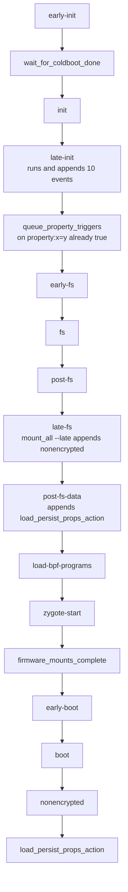

> **Why this matters:** `class_start main` (in `nonencrypted`) runs **after** `class_start hal` and
> `class_start core` (in `boot`), even though no line of `init.rc` says so directly. The order comes
> from the queue mechanics.

#### 4.6.2 Every boot trigger, one by one

Line numbers refer to `system/core/rootdir/init.rc` (AOSP 17) unless another file is named.

##### 1. `on early-init` (lines 15–111)

**Purpose:** prepare the minimum environment any process needs, before `/dev` is fully populated
and before any partition other than the first-stage mounts (`/system`, `/vendor`, …) is available.

**Tasks:**

1. **Start boot charting** (`bootchart start`, 17–18) so the boot can be profiled from this point.
2. **Harden the kernel early:**
   - disable SysRq from the keyboard (`write /proc/sys/kernel/sysrq 0`, 21);
   - disable kernel module autoloading by setting `modprobe` to empty (26). The file comment explains
     why: Android does not need it, and it causes SELinux denials.
3. **Prepare memory cgroups** used by `lmkd`, ActivityManager and Zygote: `/dev/memcg/apps/` and
   `/dev/memcg/system`.
4. **Set resource limits** inherited by every later process:
   - `setrlimit nice 40 40`, so priorities −20…19 are allowed;
   - `nofile 32768 524288`, the open file descriptor limit;
   - `memlock 65536`.
5. **Tune dm-verity** (the AVB runtime check, [Secure Boot and AVB §6](SECURE_BOOT_AVB.md#6-hash-vs-hash-tree-and-what-dm-verity-does)):
   - keep cached hash-tree blocks for 86,400 s (`dm_bufio/max_age_seconds`);
   - disable hash prefetching (`dm_verity/prefetch_cluster 0`).
6. **Bootstrap the dynamic linker configuration:** empty `ld.config.txt` files are bind-mounted
   on `/linkerconfig`, so processes that start early can load libraries.
7. **`start ueventd`** (77). `ueventd` creates the device nodes in `/dev` ("coldboot"). The
   built-in `wait_for_coldboot_done`, queued right after `early-init` (`init.cpp:1243`), blocks
   until it finishes.
8. **Mount `tracefs`** (`/sys/kernel/tracing`) and run `exec_start init_dev_config` (83).
9. **`exec_start apexd-bootstrap`** (91) followed by `perform_apex_config`. This activates the
   **bootstrap APEXes** that provide critical libraries (for example bionic and the runtime).
   These come from `/system` only, because `/data` is not mounted yet. `exec_start` blocks, so
   the libraries exist before the next service starts.
10. **Create base directories:**
    - `/dev/boringssl/selftest` and `/dev/sys/{fs,block}`;
    - `/dev/fscklogs`;
    - a `tmpfs` on `/tmp` for the shell user.

**Device and automotive additions (Verified in source):**
- **Cuttlefish** (`init.vendor.rc:1–9`) starts `metrics_helper` and `vendor.dlkm_loader`. The second
  loads vendor kernel modules in the background.
- **AAOS:** `pilot_carwatchdogd.rc` sets `ro.carwatchdog.*` intervals in
  `on early-init && property:ro.build.type=userdebug`.

##### 2. `on init` (lines 116–473)

**Purpose:** build the kernel-facing infrastructure (cgroups, Binder, sysctls, special filesystems)
and start the first daemons that everything else depends on: **logging, the low-memory killer and
the three Binder service managers.**

**Tasks:**

1. **Set the time zone and seed entropy:**
   - `sysclktz 0`;
   - copy `/proc/cmdline` and `/proc/bootconfig` into `/dev/urandom`, which mixes device-specific
     data into the entropy pool.
2. **Create the CPU cgroup hierarchy:**
   - **`/dev/cpuctl/*`** groups: `foreground`, `background`, `top-app`, `rt`, `system`,
     `system-background`, `dex2oat`, `nnapi-hal`, `camera-daemon`, each with `uclamp` settings;
   - **`/dev/blkio`**, for I/O weight;
   - **`/dev/cpuset/*`** groups: `foreground`, `background`, `system-background`, `restricted`,
     `top-app`, `camera-daemon`.

   These are the groups that ActivityManager later moves processes into
   ([Linux vs Android](../01.LinuxVsAndroid/README.md)). The comments in the file note that the
   device `.rc` must set the real CPU masks.
3. **Mount binderfs** (`mount binder binder /dev/binderfs`, 233) and create the symlinks
   `/dev/binder`, `/dev/hwbinder` and `/dev/vndbinder` (239 onward). The Binder driver nodes
   **must exist before** the service managers start, which happens later in this same trigger.
4. **Mount configfs and fusectl**, then create the `/mnt/*` storage-view directories:
   - `/mnt/runtime/{default,read,write,full}`;
   - `/mnt/user/0`, `/mnt/pass_through`, `/mnt/appfuse`, …

   Storage permissions are implemented with these views.
5. **Apply security and scheduler sysctls:**

   | Setting | Value | Effect |
   |---|---|---|
   | `panic_on_oops` | 1 | Panic on a kernel oops |
   | `randomize_va_space` | 2 (299) | Full ASLR |
   | `kptr_restrict` | 2 | Hide kernel pointers |
   | `mmap_min_addr` | 32768 | Block NULL-page mappings |
   | `sched_*` tunables | — | Scheduler behaviour |
   | ICMP redirects | disabled | Network hardening |
   | fwmark reflection | enabled | Used for per-network routing |

6. **Open up kernel interfaces for the daemons that need them:**
   - make PSI (`/proc/pressure/memory`) usable by `lmkd`;
   - mount the **eBPF** filesystem `/sys/fs/bpf` (411);
   - mount `pstore`, so `last_kmsg`/ramoops from the previous boot can be read.
7. **Give power-related files to their owners:**
   - `/sys/power/state` and `wakeup_count` to `system`;
   - `/sys/power/wake_lock` to `radio:wakelock`.
8. **Start the core daemons, in this order:**
   1. **`start logd`** (454): the comment says it starts "before any other services run to ensure
      we capture all of their logs".
   2. **`start lmkd`** (461): "so that it can register them".
   3. **`start servicemanager`**, **`hwservicemanager`**, **`vndservicemanager`** (464–466): the
      Binder context managers for the framework, HIDL and vendor domains
      ([Architecture §8](../05.AndroidArchitecture/README.md)).
9. **Mount a `tmpfs` on `/mnt/vm`** so early virtual machines (AVF) can run.

**Automotive addition:** `carwatchdogd` sets its remaining properties and then runs
`start carwatchdogd` inside **`on init`** (`pilot_carwatchdogd.rc:55` and `:75`). So the car
watchdog daemon is running before any filesystem stage.

##### 3. `on late-init` (lines 518–549)

**Purpose:** a **meta-trigger**. It does no work itself. It only queues the ten stages, in a fixed
order, that turn a minimal system into a full one: mount filesystems, unlock `/data`, start
Zygote, start the HALs.

**Why a separate trigger?** The same sequence must be startable from **two places**:

- **Normal boot:** `SecondStageMain()` queues `late-init` (`init.cpp:1282`).
- **Leaving charger mode:** when the device was powered on by plugging in the charger and the user
  then holds the power button, `healthd` sets `sys.boot_from_charger_mode=1`. That runs
  `class_stop charger` followed by `trigger late-init` (init.rc:509–511).

**Tasks, in queue order:** `early-fs`, `fs`, `post-fs`, `late-fs`, `post-fs-data`,
`load-bpf-programs`, `zygote-start`, `firmware_mounts_complete`, `early-boot`, `boot`.

**Charger mode:** if the boot mode is charger, `init` queues **`charger`** instead of `late-init`
(`init.cpp:1278–1283`; the comment reads "Don't mount filesystems or start core system services in
charger mode"). `on charger` only runs `class_start charger` (1234–1235): the charging animation
and `healthd`, with no Zygote and no `/data`.

> **Precision about the comments in `late-init`:** the comment "`/system and /vendor must be mounted
> by the end of the fs stage`" dates from before first-stage mount. On your Cuttlefish build,
> `/system`, `/vendor`, `/product` and the other logical partitions are **already mounted by
> first-stage init** ([§4.2](#42-first-stage--firststagemain)). So in practice `fs`/`late-fs`
> mount the **remaining** fstab entries, mainly `/data`.

##### 4. `on early-fs` (lines 551–553)

**Purpose:** start the storage daemon **before** any `mount_all`, because mounting `/data` needs it.

**Tasks:**

1. **`start vold`** (553). The file comment: "Once metadata has been mounted, we'll need vold to deal
   with userdata checkpointing".
   - **vold** (Volume Daemon) manages storage and encryption: metadata encryption, File-Based
     Encryption (FBE) keys and **userdata checkpoints**.
   - A checkpoint lets an OTA roll back if the new build fails to boot. `vold` belongs to class
     `core` (`system/vold/vold.rc:4`) but is started explicitly here, much earlier than
     `class_start core`.

##### 5. `on fs` (device `.rc`; nothing in base `init.rc`)

**Purpose:** let the **device** mount its own fstab. Only the device knows its partitions.

**Tasks on Cuttlefish** (`device/google/cuttlefish/shared/config/init.vendor.rc:48–52`):

1. **`mount_all --early`:** mount every fstab entry **without** the `latemount` flag.
   - In `--early` mode `do_mount_all()` deliberately does **not** queue any event
     (`builtins.cpp:623–625`: `queue_event = false`).
   - It records the time taken in `ro.boottime.init.mount_all.early`.

##### 6. `on post-fs` (lines 555–633)

**Purpose:** with the early filesystems mounted, lock down the root filesystem and prepare
`/cache` and `/metadata`, which `vold`, `apexd` and the OTA system need before `/data`.

**Tasks:**

1. **Mark a boot attempt:** `exec - system system -- /system/bin/vdc checkpoint markBootAttempt`
   (556). This counts boot attempts. If the new build keeps failing, the checkpoint is rolled back.
2. **Make `/` read-only:** `mount rootfs rootfs / remount bind ro nodev` (560).
3. **Bind `/mnt/user/0` onto `/storage`**, so the root mount namespace has default storage.
4. **Fix ownership and labels on `/cache`** (`restorecon_recursive`) and create
   `/cache/recovery`, `/cache/backup*`.
5. **Make diagnostic files readable for bugreports:**
   - `/proc/vmallocinfo`, `slabinfo`, `pagetypeinfo`, `kmsg`, `last_kmsg` to group `log`/`system`;
   - `/sys/fs/selinux/policy` world-readable.
6. **Create the `/metadata` tree:**
   - `/metadata/vold`, `/metadata/ota/snapshots` (Virtual A/B);
   - `/metadata/apex/{sessions,images,config}`, `/metadata/staged-install`;
   - `/metadata/bootstat`, `/metadata/watchdog`, …

##### 7. `on late-fs` (lines 635–651)

**Purpose:** start the HALs that must run **before `/data` can be decrypted**, then finish mounting.

**Tasks:**

1. **Fix tracefs permissions.** The comment says this "does not work correctly if it is called in
   post-fs".
2. **`class_start early_hal`** (642). The file comment: "HALs required before storage encryption
   can get unlocked (FBE)". The FBE key needs **KeyMint** (hardware-backed keys), which is a HAL, so
   it must run before `post-fs-data` calls `installkey /data`.
3. **Set `bootreceiver.enable`** according to the kernel version: disabled on 4.19 and 5.4.
4. **Cuttlefish:** `mount_all --late` (`init.vendor.rc:71–73`) mounts the `latemount` entries.
   - This time `do_mount_all()` **does** queue an event: `queue_fs_event()` sets
     `ro.crypto.state=encrypted` (FBE / metadata encryption) or `unsupported`.
   - Either way it queues **`nonencrypted`** (`builtins.cpp:580–601`).

**Automotive: the Vehicle HAL starts here (Verified in source).** The AAOS daemons that use
`class early_hal` are:

| Service | `.rc` file |
|---|---|
| Reference VHAL `vendor.vehicle-hal-default` (V4) | `hardware/interfaces/automotive/vehicle/aidl/impl/current/vhal/vhal-default-service.rc:2` |
| Cuttlefish VHAL `vendor.vehicle-cf-vsock` / `vendor.vehicle-cf-eth` | `device/google/cuttlefish/guest/hals/vehicle/apex/com.android.hardware.automotive.vehicle.cf.rc:3,14` |
| EVS manager `evsmanagerd` | `packages/services/Car/cpp/evs/manager/aidl/evsmanagerd.rc:2` |
| Car power policy daemon `carpowerpolicyd` | `packages/services/Car/cpp/power/server/carpowerpolicyd.rc:16` |

`vendor.vehicle-cf-eth` is `disabled`, so `class_start` skips it. It is enabled by
`on late-fs && property:android.car.auto_eth_namespace_setup_complete=1` → `enable
vendor.vehicle-cf-eth` (same file, line 26–27).

*Why so early (General concept):* placing the VHAL, EVS and power policy in `early_hal` lets
car-critical native functions run **without waiting for `/data`, Zygote or the Java framework**.
Examples are the rear-view camera, which has regulatory time limits, and power-state handling.
CarService itself (Java) only arrives much later ([§7](#7-aaos-specific-how-carservice-is-started)).

##### 8. `on post-fs-data` (lines 663–1084)

**Purpose:** `/data` is now mounted. Unlock it, create its directory tree, restore persistent
state, activate updatable APEX modules, and verify ART artifacts. **This is the longest stage and a
common source of slow boots.**

**Tasks:**

1. **Start a userdata checkpoint:** `vdc checkpoint prepareCheckpoint` (666), done "before we touch
   data".
2. **Fix `/data` ownership** (`system:system 0771`) and run `restorecon /data`.
3. **`installkey /data`** (675) installs the FBE key ("Make sure we have the device encryption
   key").
4. **Bootchart and entropy:**
   - restart bootchart into `/data/bootchart`;
   - copy `/data/system/entropy.dat` into `/dev/urandom` (683), carrying entropy over from the
     previous boot.
5. **Crash diagnostics:** create `/data/anr` and `/data/tombstones`, then **`start tombstoned`**
   (693), so native crashes during the rest of boot are recorded.
6. **Keystore boot levels:**
   - `setprop keystore.boot_level 30` (709);
   - `vdc keymaster earlyBootEnded` (715). From this point early-boot-only keys can no longer be
     used.
7. **`load_persist_props`** (722) restores `persist.*` properties from `/data/property`
   ([§4.5](#45-system-properties)). Then:
   - `start logd-reinit`;
   - `trigger load_persist_props_action`, kept for older vendor `.rc` files.
8. **Activate updatable APEXes:**
   - create `/data/apex/{active,backup,decompressed,…}`;
   - `setprop apexd.status ""`, then **`restart apexd`** (751).
   - `apexd` now selects the newest version of each module from `/system/apex` and `/data/apex`.
9. **Create the `/data` directory skeleton:** `/data/misc/*` for wifi, bluetooth, keystore, vpn and
   others, plus `/data/system`, `/data/app`, `/data/user_de`, ….
10. **Set up casefolding on `/data/media`:**
    - `start casefolding_remover`;
    - `wait_for_prop ro.casefolding.adjusted 1`.
11. **Mount the `/data_mirror` tmpfs** (966) and bind app CE/DE data and profiles into it. Zygote
    uses it for per-app data isolation.
12. **Wait for APEX activation:**
    - `wait_for_prop apexd.status activated` (1027);
    - wait for `keystore.module_hash.sent`;
    - then `perform_apex_config`.
13. **Start the feature-flag daemons (aconfig):**
    - `start system_aconfigd_socket_service`;
    - `exec_start mainline_aconfigd_init`;
    - `start mainline_aconfigd_socket_service`.
14. **Prepare the system user and the Java environment:**
    - `exec_start derive_sdk` (1040);
    - **`init_user0`** (1042) creates user 0's directories;
    - `restorecon --recursive --skip-ce /data`;
    - **`exec_start derive_classpath`**, then `load_exports /data/system/environ/classpath` (1050).
      This exports `BOOTCLASSPATH`, `SYSTEMSERVERCLASSPATH` and the other classpath variables, which
      Zygote needs.
15. **Verify ART artifacts:**
    - `exec_start art_boot`;
    - **`start odsign`** (1060), the on-device signing daemon, which verifies or regenerates
      compiled boot classpath artifacts;
    - `wait_for_prop odsign.key.done 1`;
    - `setprop keystore.boot_level 1000000000` (1068), which closes the signing window.
16. **Final steps:**
    - `exec_start apexd-snapshotde`;
    - `setprop persist.sys.fuse true`;
    - **`verity_update_state`** (1084) sets the `partition.*.verified` properties from dm-verity
      ([§2.3](#23-verified-boot-avb-in-short)).

**Automotive and device additions:**
- **AAOS:** `init.car.rc` creates `/data/system/car` and `/data/system/car/watchdog`, the example
  shown above.
- **Cuttlefish:** starts `rename_eth0` and `setup_wifi` (`init.vendor.rc:57–65`).

**Related trigger:** when `vold` commits the checkpoint, `on property:vold.checkpoint_committed=1`
fires `post-fs-data-checkpointed` (1086–1087).

##### 9. `on load-bpf-programs` (`packages/modules/Connectivity/bpf/loader/netbpfload.rc:38–59`)

**Purpose:** load the networking **eBPF** programs into the kernel **before** `netd` and before any
app can open a socket. These programs implement traffic accounting, per-UID firewalling and
tethering offload. The file comment says the trigger must come after `/sys/fs/bpf`, APEX and
logging are available, and "before netd".

**Tasks:**

1. Temporarily relax `kptr_restrict` to 1, so the loader can resolve kernel symbols.
2. **`exec_start bpfloader`** (blocking). On success it sets `bpf.progs_loaded=1`.
3. **`wait_for_prop bpf.progs_loaded 1`**. The comment warns "this will hang if bpfloader fails".
4. Restore `kptr_restrict 2`.
5. `exec_start netd1shot`, then **`start netd`**, the network daemon.

##### 10. `on zygote-start` (lines 1091–1095)

**Purpose:** start the process that will create every Java process, including `system_server`.

**Tasks:**

1. **`wait_for_prop odsign.verification.done 1`.** Zygote must not start until the ART boot
   artifacts are verified, because it is about to load them.
2. **`start statsd`**, the metrics daemon, so boot metrics are captured.
3. **`start zygote`** (1094) → `app_process64 … --start-system-server`
   (`init.zygote64.rc:1–2`). Continue at [§5](#5-zygote).
4. **`start zygote_secondary`** (1095), the 32-bit Zygote. On your **`vsoc_x86_64_only`** build
   `ro.zygote=zygote64` (Verified in the build's `build.prop`), so only `init.zygote64.rc` is
   installed (`build/make/target/product/core_64_bit_only.mk:23`). The service does not exist,
   and this line just logs an error.

> **Version-dependent:** in your Android 15 tree, `zygote-start` also ran
> `exec_start update_verifier` (A15 `init.rc:1134`), the A/B check that marks the slot as
> successfully booted. That line is gone from the A17 `init.rc`. The service definition still
> exists (`bootable/recovery/update_verifier/update_verifier.rc`), and `device/google/sdv` still
> starts it explicitly. Where generic A17 devices mark the slot successful was **Not verified**.

> **Recommendation from `init.rc` itself** (comment above line 1091): move "unnecessary data/
> initialization from post-fs-data to start-zygote in device's init.rc to unblock zygote start".
> In other words, every command added to `post-fs-data` delays Zygote and therefore the UI.

##### 11. `on firmware_mounts_complete` (lines 514–515)

**Purpose:** tell the firmware loader that every partition that could contain firmware is now
mounted.

**Tasks:**

1. **`rm /dev/.booting`.** `init` creates this file at startup (`init.cpp:1110`). While it exists,
   `ueventd`'s firmware handler keeps **retrying** firmware that it cannot find yet
   (`firmware_handler.cpp:86`, `:236–246`), because the partition holding it may not be mounted.
   After it is removed, a missing firmware file is a real failure.

##### 12. `on early-boot` (module `.rc` files; nothing in base `init.rc`)

**Purpose:** a hook for modules that need to run just **before** `boot` starts the HAL and core
classes.

**Tasks (examples, Verified in source):**

1. `frameworks/native/cmds/installd/installd.rc:7`: creates the `/config/sdcardfs/extensions/…`
   entries.
2. Other `on early-boot` blocks exist in `init-perfetto.rc`, `mtectrl.rc`, `kcmdlinectrl.rc` and
   `rpmb_dev.wv.system.rc`.

##### 13. `on boot` (lines 1112–1221)

**Purpose:** final kernel tuning and permissions for the framework, then start **all standard HALs
and core native daemons**.

**Tasks:**

1. **Basic networking:**
   - `ifup lo` (1114);
   - `hostname localhost`, `domainname localdomain`;
   - IPsec SA expiry.
2. **Memory policy:**
   - `vm/overcommit_memory 1` (1124);
   - `min_free_order_shift 4`.
3. **Storage tuning:**
   - create `/dev/sys/fs/by-name/userdata` and `/dev/sys/block/by-name/*` symlinks;
   - tune F2FS (`cp_interval 30`, `gc_urgent_sleep_time`, read-ahead);
   - limit discard size to 128 MB to avoid long I/O stalls.
4. **Ownership for `system_server` and daemons:** many `chown`/`chmod` lines on sysfs and proc
   files (CPU frequency, power, …).
5. **`setprop net.tcp_def_init_rwnd 60`** (1216).
6. **`class_start hal`** (1219): every standard binderized HAL that is not `early_hal`. AAOS
   examples in class `hal`: `cardisplayproxyd`, the EVS 1.x managers and `evs_app`.
7. **`class_start core`** (1221). Examples:
   - `servicemanager` is in class `core animation`;
   - `vold` (already running);
   - `cartelemetryd_service`, `carbugreportd`, `packagemanagerproxyd` on AAOS.

**Conditional `boot` blocks:**
- `on boot && property:ro.config.low_ram=true` (1097): more aggressive dirty-page writeback.
- `on boot && property:suspend.disable_sync_on_suspend=true` (1109).
- `on boot && property:ro.debuggable=1` (1223): F2FS iostat.

> **Note:** Zygote was already started in `zygote-start`, so `system_server` may already be
> starting while `class_start hal` runs. This is safe because `system_server` and CarService look
> up HALs through `servicemanager`, which waits for or lazily starts them. They do not assume a
> fixed order.

##### 14. `on nonencrypted` (lines 1227–1229)

**Purpose:** start the remaining framework-level native services once storage is usable.

**Tasks:**

1. **`class_start main`**:
   - `zygote` and `zygote_secondary` are in class `main`, but they are already running, so this is
     a no-op for them;
   - `installd`;
   - `computepipe_router_service` (AAOS);
   - … and other daemons.
2. **`class_start late_start`**: services that should come last.

**Who queues it:** nothing in a `.rc` file. `mount_all` (not in `--early` mode) calls
`queue_fs_event()` (`builtins.cpp:580–601`), which queues `nonencrypted` for both an unencrypted
and an encrypted (FBE/metadata) `/data`. The comment there says: "Although encrypted, vold has
already set the device up, so we do not need to do anything different from the nonencrypted case."
Because it is queued during `late-fs`, after `late-init` has already queued `boot`, it runs **after
`boot`** ([§4.6.1](#461-how-init-runs-triggers-the-event-queue)).

> **Version-dependent (Official documentation):** the name dates from **Full-Disk Encryption
> (FDE)**. With FDE an encrypted device first booted a minimal framework to ask for the password,
> and `nonencrypted` was held back. FDE is no longer supported on modern Android (new devices must
> use FBE), so today `nonencrypted` effectively always fires.

##### 15. After the timeline: property triggers

Once the framework runs, more actions fire on **property changes** rather than on boot stages.
The most important is **`on property:sys.boot_completed=1`** (1237), set by `system_server` when
boot finishes. It does the following:

1. `bootchart stop`;
2. reset `/data/per_boot`;
3. let other `.rc` files react to boot completion. For example, Cuttlefish's `init.vendor.rc:93–94`
   fires its own `sys-boot-completed-set` trigger to set up zram.

---

## 5. Zygote

### What is it, and why does it exist?

**Zygote** is a process that starts the Android Runtime (ART) **once**, preloads the framework
classes and resources every app needs, and then **forks** a copy of itself for each new app and for
`system_server`. After `fork()` the child shares the parent's memory pages **copy-on-write**. Every
app therefore gets an already warmed-up runtime almost instantly, and the read-only preloaded
memory is physically shared between all apps.

Without Zygote, every app launch would create a new VM, load thousands of classes and parse
framework resources from scratch. That would cost seconds of CPU time and many MB of duplicated
RAM per app.

> **Why the name:** a biological zygote is the single cell from which all other cells descend.
> All Android app processes descend from this process, and each fork is then *specialized* (UID,
> SELinux context, mount namespace) for one app.

### 5.1 How `init` starts Zygote

`init.rc` imports the script selected by `ro.zygote` (line 12):

```bash
import /system/etc/init/hw/init.${ro.zygote}.rc
```

**Version-dependent / device-dependent:** `build/make/target/product/core_64_bit.mk` sets
`ro.zygote=zygote64_32` (a 64-bit and a 32-bit zygote), and `core_64_bit_only.mk` sets
`ro.zygote=zygote64`. **Your Cuttlefish AOSP 17 build uses `zygote64`.**

Real `system/core/rootdir/init.zygote64.rc` (AOSP 17, identical in A15):

```bash
service zygote /system/bin/app_process64 -Xzygote /system/bin --zygote --start-system-server --socket-name=zygote
    class main
    priority -20
    user root
    group root readproc reserved_disk
    socket zygote stream 660 root system
    socket usap_pool_primary stream 660 root system
    onrestart exec_background - system system -- /system/bin/vdc volume abort_fuse
    onrestart write /sys/power/state on
    onrestart write /sys/power/wake_lock zygote_kwl
    onrestart restart audioserver
    onrestart restart cameraserver
    onrestart restart media
    onrestart restart --only-if-running media.tuner
    onrestart restart netd
    onrestart restart wificond
    task_profiles ProcessCapacityHigh MaxPerformance
    critical window=${zygote.critical_window.minute:-off} target=zygote-fatal
```

| Directive | Meaning |
|---|---|
| `app_process64` | Native launcher that boots ART and calls a Java `main()` |
| `-Xzygote` | VM option: this runtime is a zygote |
| `--zygote --start-system-server` | Arguments for `ZygoteInit`: run as zygote and fork `system_server` |
| `socket zygote stream 660 root system` | **`init`** creates `/dev/socket/zygote` and passes its file descriptor to the process in the environment variable `ANDROID_SOCKET_zygote` |
| `socket usap_pool_primary` | Socket for the pre-forked "unspecialized app process" pool |
| `onrestart restart …` | If zygote dies, these dependent services are restarted too |
| `critical window=… target=zygote-fatal` | Per `system/core/init/README.md`: if the service exits more than four times within the window (or before boot completes), `init` reboots into the target. Here the window defaults to `off` unless `zygote.critical_window.minute` is set |

### 5.2 From `app_process` to Java: verified call chain

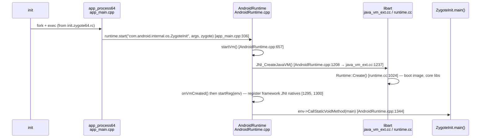

`app_main.cpp:338` shows the other mode: without `--zygote`, `app_process` starts
`com.android.internal.os.RuntimeInit` and runs an arbitrary Java class
(`Usage: app_process [java-options] cmd-dir start-class-name [options]`, `app_main.cpp:31`).
Command-line Java tools use this mode.

### 5.3 What `ZygoteInit.main()` really does

**Verified in source:** `frameworks/base/core/java/com/android/internal/os/ZygoteInit.java`,
`main()` (line 824). Real order, condensed:

```java
public static void main(String[] argv) {
    ZygoteServer zygoteServer = null;
    ...
    // parse argv: startSystemServer, enableLazyPreload, --socket-name=..., --abi-list=...
    if (!enableLazyPreload) {
        preload(bootTimingsTraceLog);                 // 1. preload (before the socket is opened)
    }
    gcAndFinalize();                                  // 2. clean heap so children start lean
    Zygote.initNativeState(isPrimaryZygote);          // 3. initialise native zygote state
    zygoteServer = new ZygoteServer(isPrimaryZygote); // 4. wrap the socket that init created
    if (startSystemServer) {
        Runnable r = forkSystemServer(abiList, zygoteSocketName, zygoteServer); // 5.
        if (r != null) { r.run(); return; }          //    child: becomes system_server
    }
    caller = zygoteServer.runSelectLoop(abiList);     // 6. parent: serve fork requests forever
    if (caller != null) caller.run();                 //    in a forked app child: run its main()
}
```

**`preload()`** (line 128). The real sub-steps are:

| Step | What is preloaded |
|---|---|
| `preloadClasses()` | Classes listed in `/system/etc/preloaded-classes` (`PRELOADED_CLASSES`, line 112) |
| `Resources.preloadResources()` | Framework drawables and color state lists listed in `R.array.preloaded_drawables` / `preloaded_color_state_lists` |
| `maybePreloadGraphicsDriver()` | GPU driver (skipped if `ro.zygote.disable_gl_preload`; Cuttlefish sets this from `init_graphics.vendor.rc`) |
| `preloadSharedLibraries()` (line 197) | `System.loadLibrary("android")`, `"jnigraphics"`, and conditionally `"compiler_rt"`, `"perfetto_framework_jni"` |
| `preloadTextResources()` | `Hyphenator.init()` and `TextView.preloadFontCache()` |
| `preloadCompatConfig()` | App-compat change configuration |
| `WebViewFactory.prepareWebViewInZygote()` | WebView preparation |

### 5.4 Forking `system_server`

`forkSystemServer()` (`ZygoteInit.java:699`) builds a fixed argument list. The list includes
`--setuid=1000` (the `system` UID, line 730), GIDs, `--capabilities=…` (line 734) and the class name
**`com.android.server.SystemServer`** (line 738). It then calls `Zygote.forkSystemServer(...)` (line 787). In the child,
`handleSystemServerProcess()` (line 492) runs, and that path ends in `SystemServer.main()`.

### 5.5 Forking an app process: the real path

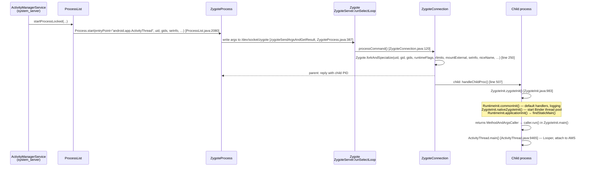

What *specialization* means in `Zygote.forkAndSpecialize()` (`Zygote.java:376`): after `fork()`,
the child gets its own **UID/GID** (the app sandbox), **SELinux context** (`seInfo`),
**mount namespace and storage view** (`mountExternal`, app data bind mounts), **rlimits**, and
**process name** (`niceName`). The parent goes back to `runSelectLoop()`.

> **Correction:** the previous version said the child runs `RuntimeInit.main()` →
> `invokeStaticMain()`. In current AOSP the app child path is `handleChildProc()` →
> `ZygoteInit.zygoteInit()` → `RuntimeInit.applicationInit()` → `findStaticMain()`, which returns a
> `MethodAndArgsCaller` `Runnable`. That design unwinds the stack back to `ZygoteInit.main()`
> before calling `ActivityThread.main()`. `RuntimeInit.main()` is used only for the non-zygote
> `app_process` mode. `invokeStaticMain` no longer exists.

---

## 6. system_server, Home and `BOOT_COMPLETED`

**Verified in source:** `frameworks/base/services/java/com/android/server/SystemServer.java`.

1. `SystemServer.main()` (line 726) → `new SystemServer().run()` (line 852).
2. `run()` starts services in four groups (lines 1047–1050):
   `startBootstrapServices(t)` (ActivityManager, PackageManager, PowerManager…),
   `startCoreServices(t)`, `startOtherServices(t)` (WindowManager, input, and most others),
   `startApexServices(t)`.
3. At the end of `startOtherServices`, `mActivityManagerService.systemReady(() -> { ... })`
   (line 3394) runs. Inside it:
   - `startSystemUi(context, windowManagerF)` (line 3657) starts **SystemUI**. On AAOS this is the
     car flavour of SystemUI.
   - AMS `systemReady` calls `mAtmInternal.startHomeOnAllDisplays(...)`
     (`ActivityManagerService.java:9841`) to launch the **Home** activity. On AAOS this is
     `CarLauncher`, which is present in your build's `system/priv-app/`.
4. `ActivityManagerService.finishBooting()` (line 5910) sets `sys.boot_completed=1` and
   `dev.bootcomplete=1` (lines 5991–5992). It is reached from `bootAnimationComplete()` (line 6089)
   and from `ensureBootCompleted()` (line 6186).
5. Separately, for each user that finishes unlocking, `UserController.finishUserUnlockedCompleted()`
   (line 1030) builds and sends `Intent.ACTION_BOOT_COMPLETED` (line 1094).

> SystemUI and Home are both started from the `systemReady` path. They are **not** a strict chain
> "SystemUI → Launcher → BOOT_COMPLETED". The `BOOT_COMPLETED` broadcast is per user and is tied to
> that user's unlock.

---

## 7. AAOS-specific: how CarService is started

**What changes in an automotive build?** The kernel, `init`, Zygote and `system_server` are the same
as on a phone. The difference begins inside `system_server`.

**Verified in source (AOSP 17):**

1. `SystemServer.startOtherServices()` computes
   `boolean isAutomotive = RoSystemFeatures.hasFeatureAutomotive(context);` (line 1584). The feature
   is `android.hardware.type.automotive` (`PackageManager.FEATURE_AUTOMOTIVE`).
2. If it is automotive, the service starts `"com.android.internal.car.CarServiceHelperService"`
   (line 3432, `CAR_SERVICE_HELPER_SERVICE_CLASS` at line 397).
   - Source: `frameworks/opt/car/services/builtInServices/src/com/android/internal/car/CarServiceHelperService.java`.
     It runs **inside `system_server`**.
3. `CarServiceHelperService.onStart()` (line 377) delegates to its updatable part,
   `CarServiceHelperServiceUpdatableImpl.onStart()` (line 207), which calls `bindToCarService()`
   (line 352):

```java
// frameworks/opt/car/services/updatableServices/src/com/android/internal/car/updatable/
//     CarServiceHelperServiceUpdatableImpl.java
private void bindToCarService() {
    Intent intent = new Intent(CAR_SERVICE_INTERFACE).setPackage(CAR_SERVICE_PACKAGE); // "android.car.ICar", "com.android.car"
    Context userContext = mContext.createContextAsUser(UserHandle.SYSTEM, /* flags= */ 0);
    mHandler.postDelayed(mCallbackForCarServiceNoConnection, CAR_SERVICE_BINDER_CALL_TIMEOUT_MS);
    if (!userContext.bindService(intent, Context.BIND_AUTO_CREATE, this, mCarServiceConnection)) {
        Slogf.wtf(TAG, "cannot start car service");
    }
}
```

4. `BIND_AUTO_CREATE` makes AMS start the **CarService** APK (`system/priv-app/CarService` in your
   build output) in **its own process**, forked from Zygote exactly as in [§5.5](#55-forking-an-app-process-the-real-path).
   When the connection arrives, the helper keeps an `ICar` Binder proxy
   (`ICar.Stub.asInterface(iBinder)`) and forwards user-lifecycle events to CarService.
5. If CarService does not connect within the timeout, the helper dumps stacks and schedules a rebind
   (see the `mCallbackForCarServiceNoConnection` handling in the same file).

> **Version-dependent:** in Android 15 the check is `mPackageManager.hasSystemFeature(...)`
> instead of `RoSystemFeatures.hasFeatureAutomotive(...)`. The overall flow is the same.
>
> **Not covered here:** how CarService then connects to the **Vehicle HAL**. That belongs in the
> VHAL chapter and will be traced there.

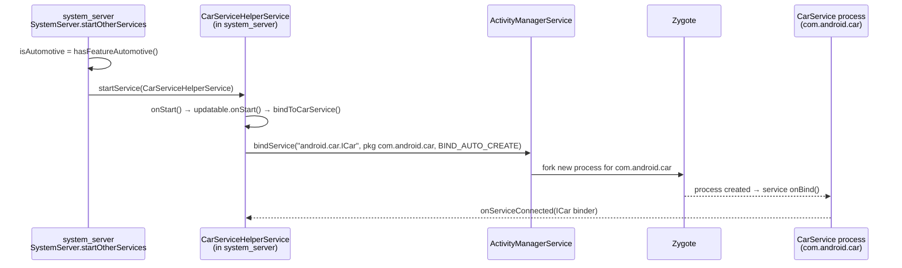

**Early automotive services before Zygote.** `init.rc` runs `class_start early_hal` in `late-fs`
(line 642), well before `zygote-start`. AAOS's EVS (Exterior View System) declares its services in
that class. Examples are `packages/services/Car/cpp/evs/manager/aidl/evsmanagerd.rc` and
`.../v4l2_hal/aidl/android.hardware.automotive.evs-v4l2.rc`, both `class early_hal`. The sample
files also mark them `disabled`, so a product must start them explicitly. The design goal is that
a camera path can come up without waiting for the Java framework.

---

## 8. Full sequence — power to launcher

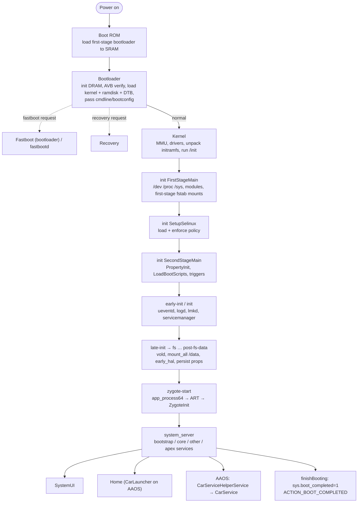

---

## 9. Practical automotive scenario

> **Illustrative scenario.** It combines real mechanisms from this chapter. Timing numbers are
> **not** from AOSP.

**"The driver opens the door and immediately shifts into reverse."**

1. The vehicle's body controller wakes the infotainment SoC. Boot ROM → bootloader → kernel run
   ([§1](#1-boot-rom)–[§3](#3-linux-kernel)).
2. First-stage `init` mounts `/system` and `/vendor` and loads modules ([§4.2](#42-first-stage--firststagemain)).
3. In `late-fs`, `class_start early_hal` lets an OEM start camera services (EVS) **before** Zygote
   and long before `system_server` ([§7](#7-aaos-specific-how-carservice-is-started)). This is why
   AAOS has an `early_hal` class: a rear-view camera image must not wait for the Java framework.
4. Zygote starts, `system_server` starts, and on an automotive build `CarServiceHelperService` binds
   `CarService` ([§7](#7-aaos-specific-how-carservice-is-started)).
5. `CarLauncher` appears ([§6](#6-system_server-home-and-boot_completed)). The driver already had
   a camera image from step 3.

Many OEMs also use **suspend-to-RAM** or hibernation instead of a cold boot, so the full chain above
does not run on every key-on. The `init.car.rc` hibernation swap triggers
(`on property:sys.hibernate=1 …`) are one example in the source.

---

## 10. Common misconceptions

| Misconception | Correct interpretation |
|---|---|
| "The bootloader starts Android's `init`." | The bootloader starts the **kernel**. The kernel runs `/init` from the ramdisk as PID 1. |
| "`init.rc` starts everything in `on boot`." | Core daemons start across `early-init`, `init`, `early-fs`, `zygote-start` and `boot` ([§4.6](#46-the-android-init-language-and-the-trigger-timeline)). |
| "Properties live in one shared memory block that anyone can write." | Reads use mmapped files under `/dev/__properties__/`. **Only `init` writes**, after a SELinux-checked request over `/dev/socket/property_service`. |
| "`persist.*` properties are loaded together with `build.prop`." | They are loaded only after `/data` is mounted (`load_persist_props` in `post-fs-data`). |
| "Zygote creates its socket in Java with `registerServerSocket()`." | `init` creates the socket. Zygote inherits its file descriptor via `ANDROID_SOCKET_zygote`. |
| "Each app gets a fresh VM." | Each app is a **fork** of Zygote that shares preloaded memory copy-on-write. |
| "`system_server` is a native daemon." | It is a **Java** process forked from Zygote. Native daemons (`servicemanager`, `vold`, HALs) are started directly by `init`. |
| "CarService runs inside `system_server`." | Only **`CarServiceHelperService`** runs in `system_server`. **CarService** (`com.android.car`) is a separate app process that the helper binds to. |
| "Every 64-bit device runs two zygotes." | It depends on `ro.zygote`. Your Cuttlefish AOSP 17 build is `zygote64` only. |

---

## 11. Observing the boot on Cuttlefish

These are practical commands. Run them against your own Cuttlefish build (`aosp_cf_x86_64_auto`):

```bash
adb shell getprop ro.zygote                      # zygote64 on your build
adb shell getprop | grep init.svc.               # state of every init service
adb shell getprop sys.boot_completed             # 1 when boot finished
adb shell dmesg | grep -E "init: (init first stage|Loaded .* kernel modules)"  # first-stage messages
adb logcat -b events -d | grep boot_progress     # framework boot milestones
adb shell ps -A -o PID,PPID,USER,NAME | grep -E " (zygote64|system_server|com.android.car)$"
```

The `boot_progress_*` event tags are real. For example `boot_progress_start` (3000),
`boot_progress_preload_start` (3020) and `boot_progress_preload_end` (3030) are defined in
`system/logging/logcat/event.logtags`. `boot_progress_system_run` (3010) is in
`frameworks/base/services/core/java/com/android/server/EventLogTags.logtags`, and
`boot_progress_ams_ready` (3040) and `boot_progress_enable_screen` (3050) are in
`.../server/am/EventLogTags.logtags`.

In the `ps` output, the **PPID** of `system_server` and of `com.android.car` is the PID of
`zygote64`. This is direct proof of [§5](#5-zygote) and [§7](#7-aaos-specific-how-carservice-is-started).

---

## 12. Summary and knowledge check

**Key takeaways**

- Boot is a chain of trust and capability: Boot ROM → bootloader → kernel → `init` → Zygote →
  `system_server` → SystemUI/Home. AAOS adds CarServiceHelperService → CarService.
- `init` runs in three `execv` phases (first stage, `selinux_setup`, `second_stage`). Its
  second stage stays alive forever as a service supervisor and property server.
- Daemons are started by **triggers** in `.rc` files. `late-init` expands into the fs → data →
  zygote → boot sequence.
- `persist.*` properties appear only after `/data` is mounted.
- `init` creates Zygote's socket. Zygote preloads, forks `system_server`, then forks every app
  through `forkAndSpecialize()`.
- On AAOS, CarService is an app-like privileged process that is bound by a helper inside
  `system_server`.

**Terminology:** PID 1, ramdisk/initramfs, `init_boot`, first-stage mount, fstab, dm-verity, AVB,
SELinux domain transition, property service, `.rc` trigger, service class, Zygote, copy-on-write,
specialization, `system_server`, `systemReady`, CarServiceHelperService.

**Questions**

1. Why can `FirstStageMain()` not simply be part of `SecondStageMain()`? Give two reasons.
2. A vendor daemon reads `persist.vendor.foo` in `on early-fs` and always gets the default value.
   Why?
3. Name the file and function where Zygote's listening socket is obtained, and say who created the
   socket.
4. In which process does `CarServiceHelperService` run, and in which process does `CarService` run?
   How would you prove it with `adb`?
5. What would break if `onrestart restart audioserver` were removed from `init.zygote64.rc`, and why
   is it there?

**Investigation tasks (AOSP 17 tree)**

1. Open `system/core/rootdir/init.rc` and find every `start` and `class_start` command. Build your
   own table of trigger → services and compare it with [§4.6](#46-the-android-init-language-and-the-trigger-timeline).
2. In `ZygoteInit.java`, follow `forkSystemServer()` → `handleSystemServerProcess()` and find where
   the class name `com.android.server.SystemServer` becomes a call to `SystemServer.main()`.
3. On Cuttlefish, run `adb shell ls /dev/__properties__/` and relate the file names to
   `property_contexts` labels.
4. Use `grep -rn "class early_hal" packages/services/Car device/google/cuttlefish` to find which
   automotive HALs your product starts before Zygote.

**Further reading (official):** [source.android.com — Android init](https://android.googlesource.com/platform/system/core/+/main/init/README.md),
[Generic boot partition (`init_boot`)](https://source.android.com/docs/core/architecture/partitions/generic-boot),
[Android Verified Boot](https://source.android.com/docs/security/features/verifiedboot),
[System properties](https://source.android.com/docs/core/architecture/configuration/add-system-properties).

**Next chapter:** CarService and the Vehicle HAL (planned). Previous:
[AAOS Architecture](../06.AndroidAutomotiveArchitecture/README.md).

---

## 13. Source map

All paths are relative to the AOSP root. Line numbers are for **`android-17.0.0_r1`**.

| Component | Path | Key symbols (line) |
|---|---|---|
| init dispatch | `system/core/init/main.cpp` | `main()` (53) |
| First stage | `system/core/init/first_stage_init.cpp` | `FirstStageMain()` (338), `LoadKernelModules` call (456), `execv` (589) |
| First-stage mount | `system/core/init/first_stage_mount.cpp` | `DoFirstStageMount()` (101), `MountPartitions()` (338), `InitAvbHandle()` (538) |
| First-stage build | `system/core/init/Android.bp` | `init_first_stage` (543), `-DFIRST_STAGE_INIT=1` (485) |
| SELinux stage | `system/core/init/selinux.cpp` | `SetupSelinux()` (785), `SelinuxSetEnforcement()` (432), `LoadSelinuxPolicyAndroid()` (690) |
| Second stage | `system/core/init/init.cpp` | `SecondStageMain()` (1066), `LoadBootScripts()` (347) |
| Properties | `system/core/init/property_service.cpp` | `PropertyInit()` (1405), `StartPropertyService()` (1551) |
| Persist props | `system/core/init/builtins.cpp`, `persistent_properties.cpp` | `do_load_persist_props()` (1072) |
| Base rc | `system/core/rootdir/init.rc` | `late-init` (518), `zygote-start` (1091) |
| Zygote rc | `system/core/rootdir/init.zygote64.rc`, `init.zygote64_32.rc` | `service zygote` |
| Cuttlefish fstab | `device/google/cuttlefish/shared/config/fstab.in` | `first_stage_mount` entries |
| Car rc | `packages/services/Car/car_product/init/init.car.rc` | `on post-fs-data` |
| app_process | `frameworks/base/cmds/app_process/app_main.cpp` | `runtime.start(...)` (336, 338) |
| Runtime bring-up | `frameworks/base/core/jni/AndroidRuntime.cpp` | `start()` (1235), `startVm()` (657) |
| VM creation | `art/runtime/jni/java_vm_ext.cc`, `art/runtime/runtime.cc` | `JNI_CreateJavaVM` (1237), `Runtime::Create` (1024) |
| Zygote main | `frameworks/base/core/java/com/android/internal/os/ZygoteInit.java` | `main()` (824), `preload()` (128), `forkSystemServer()` (699), `zygoteInit()` (983) |
| Zygote socket | `.../internal/os/ZygoteServer.java`, `Zygote.java` | `ZygoteServer(...)` (152), `runSelectLoop()` (394), `createManagedSocketFromInitSocket()` (1151), `forkAndSpecialize()` (376) |
| Fork request | `.../internal/os/ZygoteConnection.java` | `processCommand()` (120), `handleChildProc()` (507) |
| Child init | `.../internal/os/RuntimeInit.java` | `commonInit()` (234), `findStaticMain()` (313), `applicationInit()` (372) |
| Client side | `frameworks/base/core/java/android/os/ZygoteProcess.java`, `services/core/java/com/android/server/am/ProcessList.java` | `zygoteSendArgsAndGetResult()` (387), `entryPoint` (2080) |
| system_server | `frameworks/base/services/java/com/android/server/SystemServer.java` | `main()` (726), `run()` (852), `isAutomotive` (1584), `systemReady` (3394) |
| Boot complete | `frameworks/base/services/core/java/com/android/server/am/ActivityManagerService.java` | `finishBooting()` (5910), `bootAnimationComplete()` (6089) |
| BOOT_COMPLETED | `frameworks/base/services/core/java/com/android/server/am/UserController.java` | `finishUserUnlockedCompleted()` (1030) |
| Car helper | `frameworks/opt/car/services/builtInServices/src/com/android/internal/car/CarServiceHelperService.java` | `onStart()` (377) |
| Car helper (updatable) | `frameworks/opt/car/services/updatableServices/src/com/android/internal/car/updatable/CarServiceHelperServiceUpdatableImpl.java` | `onStart()` (207), `bindToCarService()` (352) |
| EVS early HAL | `packages/services/Car/cpp/evs/manager/aidl/evsmanagerd.rc` | `class early_hal` |
| Recovery | `bootable/recovery/` | — |
| fastbootd | `system/core/fastboot/device/` | — |
| AVB | `external/avb/` | `avbtool.py` |

**Previous:** [AAOS Architecture](../06.AndroidAutomotiveArchitecture/README.md) ·
**Next:** [Build System](../08.AndroidBuildSystem/README.md)
