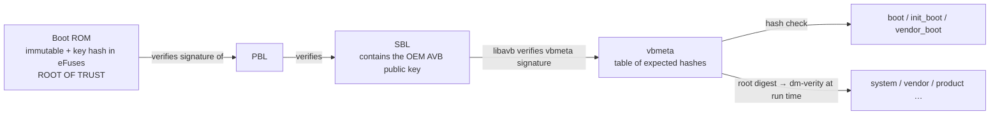
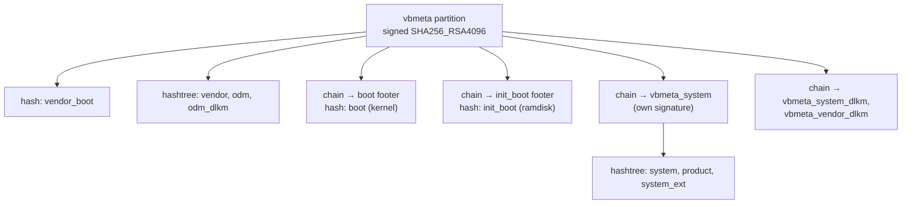
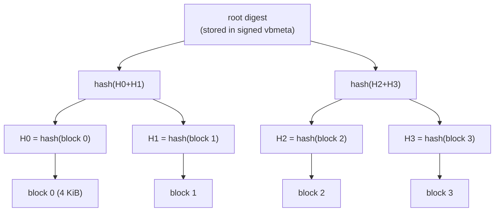

# Secure Boot and Android Verified Boot (AVB) — From Zero

> **Source baseline:** AOSP `android-17.0.0_r1`, Cuttlefish `aosp_cf_x86_64_auto` build
> (`vsoc_x86_64_only`). Real `avbtool` output is from that build.

| Label | Meaning |
|---|---|
| **Verified in source** | Read in the A17 tree or build output; path and line given |
| **Official documentation** | source.android.com |
| **General concept** | Standard security / SoC knowledge, not AOSP code |
| **Version-dependent** | Differs between Android releases |
| **Illustrative** | Teaching scenario, not real code |

**Where this fits in the boot:** the short version is [Boot sequence §2.3](README.md#23-verified-boot-avb-in-short).
This file explains every idea behind it from zero. Each idea fixes a weakness of the one before it:
**hash → signature → root of trust → vbmeta → hash tree and dm-verity → rollback protection → lock
state**.

**Prerequisites:** none. Read [Boot sequence §1–§2](README.md#1-boot-rom) first if you want to know
where the Boot ROM and the bootloaders run.

**After this file you should be able to:**

1. Explain why a hash alone is not enough, and what a signature and a root of trust add.
2. Read the real `vbmeta` of your build and say what each descriptor protects.
3. Explain why `system` is checked by dm-verity at run time and not by the bootloader.
4. Explain how rollback protection stops a correctly signed but old image.
5. Say what green, yellow and orange boot states mean, and why test keys must never ship.

## Table of Contents

- [1. The problem](#1-the-problem-how-does-the-car-know-its-software-was-not-modified)
- [2. Hash](#2-building-block-1--hash-also-called-digest)
- [3. Digital signature](#3-building-block-2--digital-signature-public-key--private-key)
- [4. Root of trust and chain of trust](#4-building-block-3--root-of-trust-and-chain-of-trust)
- [5. What is vbmeta?](#5-what-is-vbmeta)
- [6. Hash tree and dm-verity](#6-hash-vs-hash-tree-and-what-dm-verity-does)
- [7. How libavb verifies](#7-how-libavb-verifies-step-by-step-verified-in-source)
- [8. Rollback protection](#8-rollback-protection)
- [9. Locked vs unlocked, boot state colours](#9-locked-vs-unlocked-and-the-boot-state-colours)
- [10. Test keys](#10-your-build-uses-test-keys-why-that-matters)
- [11. Automotive scenario](#11-practical-automotive-scenario-illustrative)
- [12. Common misconceptions](#12-common-misconceptions)
- [13. Try it yourself](#13-try-it-yourself)
- [14. Glossary](#14-glossary)
- [15. After the bootloader: protections that build on verified boot](#15-after-the-bootloader-protections-that-build-on-verified-boot)

---

## 1. The problem: how does the car know its software was not modified?

The bootloader is about to run a kernel from the `boot` partition. Later, the kernel will run
programs from `system` and `vendor`. These are just bytes on flash storage, and bytes can be
changed:

- a thief or an attacker with physical access re-flashes the storage chip;
- malware that gained root writes into a partition so that it survives a reboot;
- a "tuning" tool replaces `vendor` to disable a safety check;
- a flash cell degrades and a byte silently flips.

Without verification, the device runs whatever it finds. **Verified Boot** means: *before using any
piece of software, prove it is exactly what the manufacturer built, and refuse (or warn) if not.*

To prove that, we need three building blocks: **hashes**, **signatures** and a **root of trust**.

## 2. Building block 1 — Hash (also called digest)

**What is it?** A **hash function** (AVB uses SHA-256, SHA-512 or BLAKE2b) takes input of any size
(1 byte or 1 GB) and produces a short, fixed-size output. For SHA-256 the output is 32 bytes,
usually printed as 64 hex characters. It works like a **fingerprint of the data**.

**Properties that matter:**

1. **Deterministic:** the same input always gives the same hash.
2. **Avalanche effect:** changing even one bit of the input gives a completely different hash.
3. **One-way, collision resistant:** you cannot practically create *different* data with the same
   hash. An attacker cannot modify `boot.img` and keep its hash.

You can try this on your PC (real output):

```bash
$ printf 'speed=50' | sha256sum
b8f2a7dbec11c758e4efb72ddab89ed90846e88e21dfc43d183e096cf1bcee1d  -
$ printf 'speed=51' | sha256sum      # one character changed
838bb8d20216b26d382e0e56ae31023b9b128bbe06707fff301a210c2f0a684a  -
```

**How a hash is used for verification:** at build time, compute the hash of `boot.img` and store it
as the "expected hash". At boot, compute the hash of what is actually in the `boot` partition. If
the two hashes are equal, the image is unchanged.

**Why a hash alone is NOT enough:** where do we store the expected hash? If it is on the same flash,
an attacker who can change `boot.img` can also replace the expected hash with the hash of the
malicious image. We need a way to make the expected hash itself **unforgeable**.

> **Salt:** AVB mixes a random value (the *salt*) into the data before hashing:
> `hash = SHA256(salt + image)`. The salt is stored next to the digest. This prevents an attacker from
> reusing precomputed hash tables.

## 3. Building block 2 — Digital signature (public key / private key)

**What is it?** Asymmetric cryptography (AVB uses RSA 2048/4096/8192, and ML-DSA in newer libavb)
uses a **key pair**:

| Key | Who has it | Used for |
|---|---|---|
| **Private key** | Only the OEM, kept secret on a signing server or in an HSM (hardware security module) | **Signing:** creating the signature |
| **Public key** | Everybody. A copy is placed inside the device | **Verifying:** checking a signature |

**How it works:**

1. **Sign (at the factory or build server):** compute `H = hash(data)`, then use the **private key**
   to turn `H` into a **signature**, a blob of bytes (512 bytes for RSA-4096).
2. **Verify (on the device):** compute `H'` = hash of the data found on flash. Use the **public key**
   to check that the signature matches `H'`.

**Why this solves the problem:** only the holder of the **private key** can produce a signature that
the public key accepts. An attacker can change the data and recompute its hash, but cannot produce a
matching signature without the private key. The hash plus signature make the data **tamper-evident
and authentic**: it is unchanged **and** it came from the OEM.

> **Analogy:** the hash is a fingerprint of a document. The signature is a notary's stamp on that
> fingerprint. Anyone can check the stamp against the notary's public sample, but only the notary
> owns the stamp.

> **Important:** signing does **not** encrypt or hide the data. `boot.img` stays readable. AVB
> provides **integrity and authenticity**, not confidentiality. Data confidentiality is a different
> feature: file-based encryption of `/data`.

## 4. Building block 3 — Root of trust and chain of trust

**The remaining question:** the device verifies signatures with a public key, but why trust *that*
public key? If an attacker can replace the public key on flash with their own, they can sign
anything.

**Answer: root of trust.** Something in the device must be trusted **without** being verified,
because it physically cannot be changed:

- The **Boot ROM** is burned into the SoC ([Boot sequence §1](README.md#1-boot-rom)).
- The hash of the OEM's first key is written into one-time-programmable **eFuses** in the SoC.

**Chain of trust:** each stage verifies the next stage **before** running it, using a key that was
itself verified:



If any link fails, every later stage is untrusted. The chain is only as strong as its root, which
is why the root is in hardware.

> AVB is the **Android part** of the chain, from the SBL onwards. Steps before it (Boot ROM → PBL →
> SBL) are SoC-vendor secure boot (General concept, not in AOSP). AVB's code is
> `external/avb/libavb/` (Verified in source). The bootloader links this library.

## 5. What is `vbmeta`?

**Problem it solves:** a device has about 10 partitions. Signing each one separately would need 10
signatures and 10 verification steps, and updating keys would be messy.

**Solution:** **vbmeta** (*Verified Boot metadata*) is **one small signed table** that lists the
**expected hash of every partition**. The bootloader verifies **one signature** (the vbmeta
signature). After that, every hash inside vbmeta is trusted, and each partition only needs a cheap
hash comparison.

**Structure** (Verified in source, `external/avb/libavb/avb_vbmeta_image.h`, `AvbVBMetaImageHeader`):

| Block | Contents |
|---|---|
| **Header** (256 bytes) | `magic` = `"AVB0"`, `algorithm_type` (e.g. `SHA256_RSA4096`), `rollback_index`, `flags`, and offsets/sizes of everything below |
| **Authentication data** | The **hash** of header + auxiliary block, and the **signature** over it |
| **Auxiliary data** | The **public key** that signed it, plus a list of **descriptors** (one per partition) |

**Descriptor types** (`avb_descriptor.h`):

| Descriptor | Used for | Why |
|---|---|---|
| **Hash descriptor** | Small images the bootloader loads fully (`vendor_boot`; `boot` via its own footer) | It reads the whole image anyway, so it hashes it all at once |
| **Hashtree descriptor** | Large filesystems (`system`, `vendor`, `product`, `odm`…) | Too big to hash at boot. It stores a **root digest** of a hash tree instead (see [§6](#6-hash-vs-hash-tree-and-what-dm-verity-does)) |
| **Chain partition descriptor** | Delegates to another vbmeta (`vbmeta_system`) or to a footer at the end of a partition (`boot`, `init_boot`) with **its own key** | Different teams can sign and update parts independently, for example Google signing the GKI `boot` image |
| **Property / kernel cmdline descriptor** | Key-value metadata (build fingerprints), extra kernel parameters | Information that must also be authentic |

**Real example from your Cuttlefish AOSP 17 build** (output of
`python3 external/avb/avbtool.py info_image --image out/target/product/vsoc_x86_64_only/vbmeta.img`,
trimmed):

```text
Header Block:             256 bytes
Authentication Block:     576 bytes
Auxiliary Block:          8768 bytes
Public key (sha1):        2597c218aae470a130f61162feaae70afd97f011
Algorithm:                SHA256_RSA4096
Rollback Index:           1780617600
Descriptors:
    Chain Partition descriptor:  boot              (Rollback Index Location: 2)
    Chain Partition descriptor:  init_boot         (Rollback Index Location: 3)
    Chain Partition descriptor:  vbmeta_system     (Rollback Index Location: 1)
    Chain Partition descriptor:  vbmeta_system_dlkm
    Chain Partition descriptor:  vbmeta_vendor_dlkm
    Hash descriptor:      vendor_boot   sha256  Digest: deb7886c973e1edc...
    Hashtree descriptor:  vendor        sha256  Root Digest: ...
    Hashtree descriptor:  odm           sha256  Root Digest: 5f68e6c5c61ed550...
    Hashtree descriptor:  odm_dlkm      sha256  Root Digest: df9bc8a1712d9eb3...
    Prop: com.android.build.vendor.fingerprint -> 'generic/aosp_cf_x86_64_auto/...:userdebug/test-keys'
```

And `vbmeta_system.img`, reached through the chain descriptor, holds the hashtree descriptors for
**`system`** (1,074,151,424 bytes, sha256), **`product`** (sha256) and **`system_ext`**
(blake2b-256).

The resulting tree for your build:



`boot.img` has a **footer**: its last bytes contain its own small vbmeta. In your build,
`Original image size: 22904832`, `VBMeta offset: 22904832`, and a hash descriptor for `boot`. That is
why `vbmeta` reaches `boot` through a *chain* descriptor.

## 6. Hash vs hash tree, and what dm-verity does

**Problem:** your `system` image is about 1 GB. Hashing 1 GB in the bootloader would add seconds
to every boot. It would also only prove the data was good **at boot time**. If an attacker modified
the flash **while the system runs**, nobody would notice.

**Solution: a hash tree (Merkle tree), checked lazily by dm-verity.**

1. **At build time**, split `system.img` into 4096-byte **blocks** and hash each block. Then hash
   groups of those hashes, then hash those, until a single **root digest** is left. The tree is
   stored after the filesystem data (`Tree Offset` / `Tree Size` in the descriptor). Only the **root
   digest** goes into the signed vbmeta.
2. **At boot**, the bootloader only needs vbmeta's signature to be valid. The root digest is then
   trusted. No reading of the 1 GB is required.
3. **At run time**, first-stage `init` sets up **dm-verity** (a Linux device-mapper target) on
   top of the partition. **Every time a block is read**, the kernel hashes it and checks it against
   the tree, up to the trusted root. A modified block is detected at the moment it is used, even
   long after boot.



Reading block 2 needs only H2, H3, hash(H2+H3) and the root, which is a few hashes instead of 1 GB.

**Where this happens (Verified in source):**

- `FirstStageMount` (`system/core/init/first_stage_mount.cpp`, lines 492–504) calls
  `AvbHandle::SetUpAvbHashtree(fstab_entry, …)`.
- `SetUpAvbHashtree()` is in `system/fs/fs_mgr/libfs_avb/fs_avb.cpp` (line 549). It calls
  `LoadAvbHashtreeToEnableVerity(...)` to create the dm-verity device.
- The behaviour on corruption follows `androidboot.veritymode`. `system/fs/fs_mgr/libfs_avb/avb_util.cpp`
  (lines 50–60) maps `enforcing` → `restart_on_corruption`, `panicking` → `panic_on_corruption`,
  `logging` → `ignore_corruption`, and defaults to `eio` (the read fails with an I/O error).

> **Version-dependent:** in Android 15 the same library is at `system/core/fs_mgr/libfs_avb/`.
> AOSP 17 moved `fs_mgr` to `system/fs/fs_mgr/`.

## 7. How libavb verifies, step by step (Verified in source)

The bootloader calls `avb_slot_verify()` (`external/avb/libavb/avb_slot_verify.c:1417`). The
bootloader supplies an `AvbOps` structure (`avb_ops.h`) of callbacks for things only it can do:
read partitions, answer "is this key trusted?", read stored rollback indexes, and report whether
the device is unlocked.

| Step | Function (file:line) | What happens |
|---|---|---|
| 1 | `load_and_verify_vbmeta()` (`avb_slot_verify.c:564`) | Read the `vbmeta` partition |
| 2 | `avb_vbmeta_image_verify()` (`avb_vbmeta_image.c:104`) | Check `magic == "AVB0"`, compute SHA over header + auxiliary block, compare with the stored hash, verify the signature (`avb_rsa_verify`, or ML-DSA) with the embedded public key |
| 3 | `ops->validate_vbmeta_public_key(...)` (`avb_slot_verify.c:895`) | Ask the **bootloader** whether the embedded public key is the trusted OEM key. If not, the result is `AVB_SLOT_VERIFY_RESULT_ERROR_PUBLIC_KEY_REJECTED` (line 915) |
| 4 | `ops->read_rollback_index(...)` (line 924) | If `vbmeta_header.rollback_index < stored_rollback_index` (line 935), the result is `ERROR_ROLLBACK_INDEX` (line 939) |
| 5 | Walk the descriptors | Chain descriptors recurse into `vbmeta_system` and the `boot`/`init_boot` footers |
| 6 | `load_and_verify_hash_partition()` (line 273) | Compute `SHA256(salt + image)` and compare with the descriptor's digest |
| 7 | Hashtree descriptors | Not checked by the bootloader. The bootloader passes the digest of all vbmeta images it verified in bootconfig as `androidboot.vbmeta.digest` (+ `androidboot.vbmeta.hash_alg`) |

**Hand-over to Android (Verified in source).** First-stage `init` does not receive the root digests
directly. It runs libavb **again** inside Android: `avb_slot_verify()` is called from
`system/fs/fs_mgr/libfs_avb/avb_ops.cpp` (line 270) and reads the vbmeta images from disk. Then
`AvbVerifier::VerifyVbmetaImages()` (`fs_avb.cpp`, line 153) checks that their combined digest equals
the `androidboot.vbmeta.digest` the trusted bootloader passed (read at `fs_avb.cpp` lines 124 and 138).
If they match, the root digests `init` just read are the ones the bootloader verified, and it can
safely set up dm-verity with them.

Real excerpt of step 6:

```c
// external/avb/libavb/avb_slot_verify.c, load_and_verify_hash_partition()
if (avb_strcmp((const char*)hash_desc.hash_algorithm, "sha256") == 0) {
    avb_sha256_init(&sha256_ctx);
    avb_sha256_update(&sha256_ctx, desc_salt, hash_desc.salt_len);   // salt first
    avb_sha256_update(&sha256_ctx, image_buf, image_size_to_hash);   // then the image
    digest = avb_sha256_final(&sha256_ctx);
    ...
}
...
if (avb_safe_memcmp(digest, expected_digest, digest_len) != 0) {    // line 169
    avb_error(part_name, ": Hash of data does not match digest in descriptor.\n");
    ret = AVB_SLOT_VERIFY_RESULT_ERROR_VERIFICATION;
    ...
}
```

`avb_safe_memcmp` compares in constant time, so an attacker cannot learn how many bytes matched by
measuring how long the comparison took.

## 8. Rollback protection

**Problem:** suppose software version 1 has a known security bug, fixed in version 2. Version 1 is
still **correctly signed** by the OEM. An attacker could flash version 1 back (a *downgrade*) and
exploit the old bug, and the signature check would pass.

**Solution:**

- Each vbmeta has a **`rollback_index`** number. The OEM increases it when a security fix must not
  be undone.
- The device stores the highest accepted value, **`stored_rollback_index`**, in **tamper-evident
  storage** that the attacker cannot rewrite (for example eMMC RPMB or a secure element). This is
  device-specific and reached through `ops->read_rollback_index`.
- If an image's index is **lower** than the stored one, boot is refused (step 4 of [§7](#7-how-libavb-verifies-step-by-step-verified-in-source)).

**In my build:** the rollback index `1780617600` is a Unix timestamp, `2026-06-05 00:00 UTC`,
which is the security patch date. Cuttlefish sets this on purpose:
`BOARD_AVB_BOOT_ROLLBACK_INDEX := $(PLATFORM_SECURITY_PATCH_TIMESTAMP)`
(`device/google/cuttlefish/shared/BoardConfig.mk`, line 240, and similar lines 234–260). Every
newer security patch therefore automatically forbids going back to an older one. Each chained
partition has its own **rollback index location** (slot 1 = `vbmeta_system`, 2 = `boot`, 3 =
`init_boot` in the dump above), so they are tracked separately.

## 9. Locked vs unlocked, and the boot state colours

- **Locked** (normal for customer devices): verification errors stop the boot.
- **Unlocked** (`fastboot flashing unlock`, for developers): the bootloader lets you flash your own
  images. It still runs AVB but boots despite failures and shows a warning. Unlocking normally
  **wipes user data**, so an attacker cannot unlock a stolen device to read the owner's data.

The bootloader reports the result to Android in `androidboot.verifiedbootstate` (Verified in source,
`external/avb/README.md`, around line 1118):

| State | Meaning |
|---|---|
| **green** | Locked, verified with the OEM's key |
| **yellow** | Locked, verified with a key the **user** installed |
| **orange** | **Unlocked**: integrity not enforced |

(Official Android documentation also defines **red**: verification failed on a locked device.)
`init` turns the value into `ro.boot.verifiedbootstate`, and Keymint/attestation can report it to
servers.

## 10. Your build uses *test keys*. Why that matters

`device/google/cuttlefish/shared/BoardConfig.mk` (lines 227–228):

```make
BOARD_AVB_ALGORITHM := SHA256_RSA4096
BOARD_AVB_KEY_PATH := external/avb/test/data/testkey_rsa4096.pem
```

That **private** key is published in AOSP, so anyone can sign images with it. This is fine for an
emulator, and the fingerprint ends in `test-keys`. A production car must sign with the OEM's own
private key, kept in an HSM. The matching public key is built into the bootloader, and the
bootloader is itself secured by the SoC's eFuses.

## 11. Practical automotive scenario (illustrative)

A workshop tool re-flashes the `vendor` partition with a modified HAL that disables a speed-limit
warning:

1. The SBL verifies `vbmeta`. Its signature is still valid, because the attacker did not change
   `vbmeta`.
2. `vbmeta` contains the **original** root digest for `vendor`.
3. First-stage `init` sets up dm-verity for `/vendor` with that root digest.
4. When the modified HAL file is read, its blocks do not match the tree, and dm-verity reports
   corruption. In `enforcing` mode the device restarts (`restart_on_corruption`).
5. If the attacker also modifies `vbmeta` to contain the new digest, the **signature** check in
   step 1 fails, because they do not have the OEM private key.
6. If they flash an **older, correctly signed** vendor + vbmeta, **rollback protection** refuses it.

## 12. Common misconceptions

| Misconception | Correct interpretation |
|---|---|
| "The hash is a kind of encryption." | A hash is a one-way fingerprint. Nothing is hidden. AVB does not encrypt partitions. |
| "The bootloader hashes `system` on every boot." | No. It verifies only the signed root digest. dm-verity checks each block **when it is read**. |
| "A valid signature means the software is bug-free." | It only proves the software is unmodified and came from the key owner. Rollback protection handles known-buggy old versions. |
| "The public key must be kept secret." | Only the **private** key is secret. The public key is meant to be shared. What matters is that the device's copy cannot be **replaced**. |
| "`vbmeta` contains the partitions." | It contains only **metadata**: hashes, root digests, keys and descriptors. It is about 10 KB. |

## 13. Try it yourself

```bash
cd ~/aosp17                     # your AOSP 17 Cuttlefish tree
O=out/target/product/vsoc_x86_64_only
python3 external/avb/avbtool.py info_image --image $O/vbmeta.img          # the table
python3 external/avb/avbtool.py info_image --image $O/vbmeta_system.img   # chained table
python3 external/avb/avbtool.py info_image --image $O/boot.img            # footer at end of boot
adb shell getprop ro.boot.verifiedbootstate                               # on the running device
adb shell getprop ro.boot.veritymode
```

## 14. Glossary

| Term | One-line definition |
|---|---|
| Hash / digest | Fixed-size fingerprint of data; any change gives a different value |
| Salt | Random bytes mixed into the data before hashing |
| Private key | Secret key held by the OEM, used to **create** signatures |
| Public key | Shareable key on the device, used to **check** signatures |
| Signature | Proof, made with the private key, that a specific hash was approved by the key owner |
| Root of trust | Immutable hardware (Boot ROM + eFuses) trusted without verification |
| Chain of trust | Each stage verifies the next before running it |
| vbmeta | Small signed table of expected hashes/root digests for all partitions |
| Descriptor | One entry in vbmeta: hash, hashtree, chain, property, or cmdline |
| Footer | vbmeta stored at the end of a partition such as `boot` |
| Hash tree / root digest | Tree of block hashes; the single top hash represents the whole partition |
| dm-verity | Kernel device-mapper target that checks each block against the hash tree on read |
| Rollback index | Version counter that prevents flashing older, vulnerable images |

## 15. After the bootloader: protections that build on verified boot

Verified boot proves the software is genuine. Later boot stages add protections that rely on it:

| Protection | What it does | When | Where it is explained |
|---|---|---|---|
| **dm-verity** | Checks every block of `system`, `vendor`, … when it is read | From first-stage `init` onwards | [§6](#6-hash-vs-hash-tree-and-what-dm-verity-does), [Boot §4.2](README.md#42-first-stage--firststagemain) |
| **SELinux (enforcing)** | Limits what every process may access, even root | Loaded by `init` before any service starts | [Boot §4.3](README.md#43-selinux-stage--setupselinux) |
| **File-based encryption (FBE) + KeyMint** | Keeps `/data` encrypted. The keys live in hardware-backed KeyMint, so KeyMint starts early (`early_hal`) | Before `/data` is unlocked | [Boot §4.6](README.md#46-the-android-init-language-and-the-trigger-timeline) |
| **Key attestation** | KeyMint can prove to a server that the device booted locked and verified (`ro.boot.verifiedbootstate`) | At run time, on request (Official documentation) | [§9](#9-locked-vs-unlocked-and-the-boot-state-colours) |

**Official documentation:** [Verified Boot](https://source.android.com/docs/security/features/verifiedboot),
[AVB README](https://android.googlesource.com/platform/external/avb/+/main/README.md),
[dm-verity](https://source.android.com/docs/security/features/verifiedboot/dm-verity).

---

**Back to:** [Boot sequence §2.3](README.md#23-verified-boot-avb-in-short)
