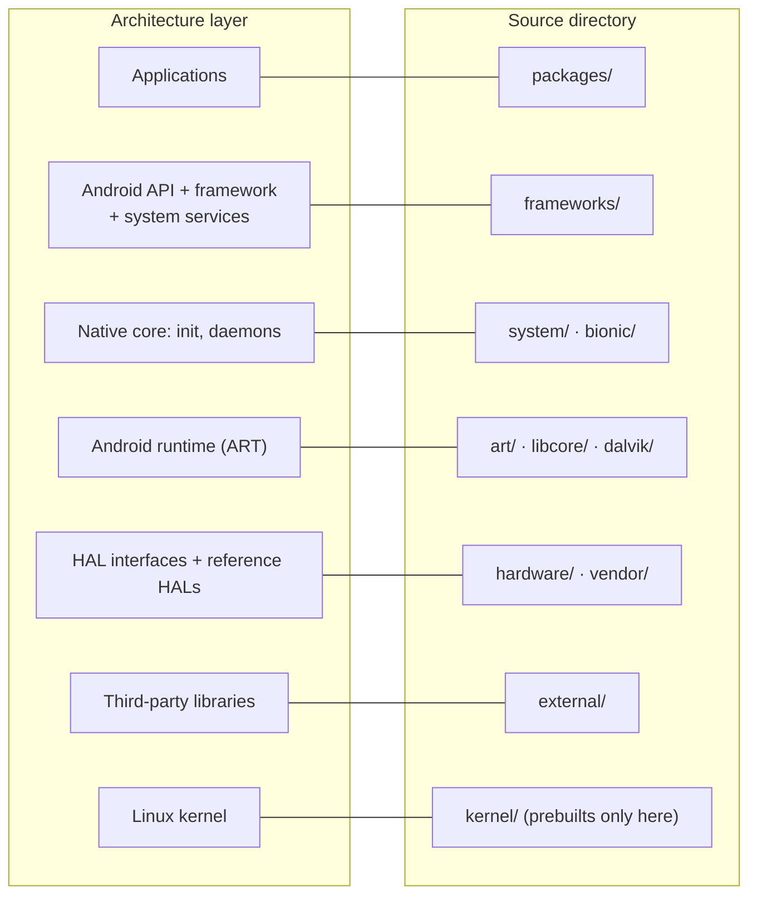
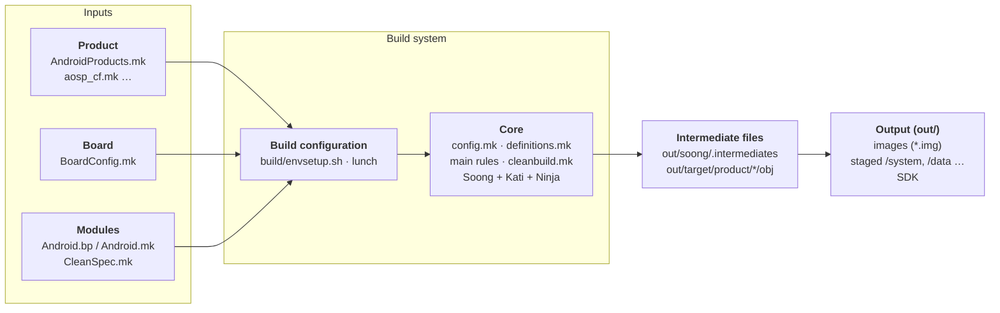
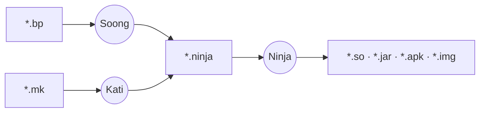
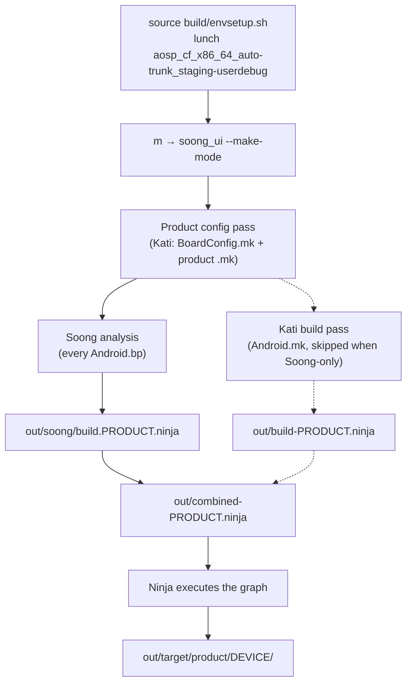

# AOSP Build System — From Source Tree to Flashable Images

> **Source baseline:** paths, commands and file names were checked against **AOSP
> `android-17.0.0_r1`** and its build output for **`aosp_cf_x86_64_auto`** (Cuttlefish automotive).
> Android 15 differences are marked **Version-dependent**.

| Label | Meaning |
|---|---|
| **Verified in source** | Read in the AOSP 17 tree or in its `out/` directory |
| **Official documentation** | source.android.com |
| **General concept** | Standard build-system knowledge |
| **Version-dependent** | Changed between releases |
| **Illustrative** | Teaching example, not real AOSP code |

**Prerequisites:** [Android Architecture](../05.AndroidArchitecture/README.md) (what AOSP contains,
partitions and Treble).
**Next:** [Build & Run AAOS](../09.BuildAndRunAAOS/README.md) (download, build and boot a real
image).

**After this chapter you should be able to:**

1. Map each architecture layer to the AOSP source directories that implement it.
2. Name the three inputs of a build (product, board, modules) and the outputs (images).
3. Explain what **Soong**, **Kati** and **Ninja** each do, and why AOSP needs more than one tool.
4. Read a `lunch` target such as `aosp_cf_x86_64_auto-trunk_staging-userdebug`.
5. Find a module's intermediate and final files in `out/`, and tell which build stage failed.

---

## Table of Contents

- [1. The AOSP source tree](#1-the-aosp-source-tree)
- [2. The mental model: inputs → build system → outputs](#2-the-mental-model-inputs--build-system--outputs)
- [3. The real pipeline: Soong and Kati → Ninja](#3-the-real-pipeline-soong-and-kati--ninja)
- [4. The three inputs](#4-the-three-inputs)
- [5. Configuring the build: `envsetup.sh` and `lunch`](#5-configuring-the-build-envsetupsh-and-lunch)
- [6. Why three tools?](#6-why-three-tools)
- [7. The core build files](#7-the-core-build-files)
- [8. From command to graph to output](#8-from-command-to-graph-to-output)
- [9. Intermediate files](#9-intermediate-files)
- [10. Final outputs and images](#10-final-outputs-and-images)
- [11. Worked example: one app, two lanes](#11-worked-example-one-app-two-lanes)
- [12. Daily commands](#12-daily-commands)
- [13. Incremental builds](#13-incremental-builds)
- [14. When a build fails](#14-when-a-build-fails)
- [15. Where the build system is going](#15-where-the-build-system-is-going)
- [16. Common misconceptions](#16-common-misconceptions)
- [17. Source map](#17-source-map)

---

## 1. The AOSP source tree

**Purpose:** know where each part of Android lives before building it.

The top-level directories map almost one-to-one onto the architecture layers
([Android Architecture §1](../05.AndroidArchitecture/README.md#1-the-stack-layers-vs-processes)):



Top-level directories in your A17 tree (Verified: `ls` of the tree root): `art bionic bootable build
cts dalvik developers development device external frameworks hardware kernel libcore libnativehelper
out packages pdk platform_testing prebuilts sdk system test toolchain tools trusty`.

| Directory | Contains | Ends up |
|---|---|---|
| `art/` | Android Runtime | ART APEX (`/apex/com.android.art`) |
| `libcore/`, `libnativehelper/` | Java core libraries, JNI helpers | ART APEX |
| `bionic/` | C library and dynamic linker | Runtime APEX (`com.android.runtime`) |
| `frameworks/` | Android framework **and** system services (`frameworks/base/services/`) | `/system` |
| `system/` | Native core: `init`, `vold`, `logd`, `libbase`, sepolicy… | `/system` and the first-stage ramdisk |
| `hardware/` | HAL interface definitions and reference HALs | Mostly `/vendor` |
| `packages/` | System apps, services (e.g. `packages/services/Car/`), modules | `/system`, `/system_ext`, `/product`, APEXes |
| `external/` | Third-party projects (SQLite, BoringSSL, Skia…) | Wherever a module installs them |
| `device/` | Product and board configuration ([§4](#4-the-three-inputs)) | Not copied; it **steers** the build |
| `vendor/` | Vendor-specific code (often empty in pure AOSP) | `/vendor`, `/odm` |
| `kernel/` | Prebuilt kernels in these trees (`kernel/prebuilts/`) | `boot.img`, `*_dlkm` images |
| `bootable/` | Recovery and bootloader-related user-space code | Recovery ramdisk |
| `build/` | The build system itself (`build/make/`, `build/soong/`, `build/release/`) | Host only |
| `prebuilts/` | Compilers, SDKs, prebuilt tools | Host only |
| `cts/`, `platform_testing/`, `test/` | Tests | Host / test devices |
| `development/`, `sdk/`, `tools/` | Developer tools | Host only |
| `trusty/` | Trusty TEE (trusted OS) | Secure firmware |
| `out/` | **Everything the build produces** | Host only |

> **Note:** "system services" live in `frameworks/`, not in `system/`. The `system/` directory is
> the **native** core of the OS.

---

## 2. The mental model: inputs → build system → outputs

**Purpose:** see the build as one box with three inputs and a set of images coming out.



Read it as three columns:

- **Inputs:** *what* to build (product), *for which hardware* (board), and *the pieces* (modules).
- **Build system:** first the environment is configured (`envsetup.sh`, `lunch`), then the core
  turns definitions into concrete build steps.
- **Outputs:** intermediate files, then the flashable images under
  `out/target/product/<device>/`.

---

## 3. The real pipeline: Soong and Kati → Ninja

**Purpose:** see what actually runs inside the "core" box.



1. `Android.bp` files are read by **Soong**.
2. `Android.mk` files (and the product/board makefiles) are read by **Kati**, a fast GNU-Make clone.
3. Both write **Ninja** files: flat lists of commands with their inputs and outputs.
4. **Ninja** runs those commands in dependency order.

The left half is **analysis** (decide what to build). The right half is **execution** (run
compilers). Almost every build question comes down to "which half broke?"

> **Version-dependent: Soong-only builds (Verified in source).** In A17, a product can set
> `PRODUCT_SOONG_ONLY`, and then "the main kati invocation will not be run"
> (`build/make/core/product.mk`, lines 505–507). Your **`aosp_cf_x86_64_auto`** build does this:
> `device/google/cuttlefish/vsoc_x86_64_only/auto/aosp_cf.mk` (lines 73–74) sets
> `PRODUCT_SOONG_ONLY := $(RELEASE_SOONG_ONLY_CUTTLEFISH)`, which is `true` in `trunk_staging`.
> That is why your `out/` has **no** Kati `build-*.ninja` file ([§8](#8-from-command-to-graph-to-output)).
> Kati is still used for the **product configuration** pass.

**How the classic diagram and the pipeline fit together:**

- "Core = `config.mk` + `definitions.mk`" was literally true in the pure-Make era. Today those files
  still set global configuration and macros, but most rules are generated by **Soong**.
- "Intermediate files" = the Ninja graph files **plus** objects, jars and staging under `out/`.
- The **inputs are unchanged**: product, board and module definitions are still what you edit.

---

## 4. The three inputs

### 4.1 Product configuration: "what should I build?"

**Purpose:** choose the **contents** of the image.

A product is a makefile that sets `PRODUCT_*` variables: which packages to install, which properties
to set, which other products to **inherit**. Products are registered in an `AndroidProducts.mk`.

Real example, the Cuttlefish products file (Verified: `device/google/cuttlefish/AndroidProducts.mk`):

```make
PRODUCT_MAKEFILES := \
    ...
    aosp_cf_arm64_auto:$(LOCAL_DIR)/vsoc_arm64_only/auto/aosp_cf.mk \
    ...
COMMON_LUNCH_CHOICES := \
    ...
    aosp_cf_x86_64_auto-trunk_staging-userdebug \
    ...
```

Typical product variables (Illustrative):

```make
PRODUCT_NAME := my_car
PRODUCT_DEVICE := my_board
PRODUCT_PACKAGES += CarLauncher CarSettings MyVehicleApp
$(call inherit-product, device/google/cuttlefish/vsoc_x86_64_only/auto/aosp_cf.mk)
```

Inheritance is how products are layered. For example, Trout's product **inherits** the Cuttlefish
automotive product (Verified: `device/google/trout/aosp_trout_x86_64.mk`, line 17,
[Build & Run §2](../09.BuildAndRunAAOS/README.md)).

### 4.2 Board configuration: "for which hardware?"

**Purpose:** describe the **hardware platform**: CPU architecture, kernel, boot image format,
partition sizes and filesystem types.

Location: `device/<vendor>/<device>/BoardConfig.mk`. Real examples in your trees:
`device/google/cuttlefish/vsoc_x86_64_only/BoardConfig.mk` (which includes
`device/google/cuttlefish/shared/BoardConfig.mk`) and `device/brcm/rpi5/BoardConfig.mk`.

Typical variables (Illustrative values):

```make
TARGET_ARCH := arm64
BOARD_KERNEL_CMDLINE := console=ttyAMA0
BOARD_BOOTIMAGE_PARTITION_SIZE := 67108864
BOARD_SUPER_PARTITION_SIZE := 8589934592
```

A board can even replace how an image is made. The Raspberry Pi 5 sets
`BOARD_CUSTOM_BOOTIMG := true` and builds `boot.img` as a **FAT32** filesystem
(Verified: `device/brcm/rpi5/BoardConfig.mk`, lines 26–27, and `mkbootimg.mk`;
[Build & Run §7](../09.BuildAndRunAAOS/README.md)).

> `BoardConfig.mk` and product makefiles are **not** module definitions, and Soong does not read
> them directly. Kati evaluates them first in a separate **product-configuration pass** and hands the
> resulting variables to Soong. That is why a wrong `lunch` target produces errors that look
> unrelated to the mistake.

### 4.3 Module definitions: "the individual pieces"

**Purpose:** describe one buildable unit (app, library, executable, HAL, prebuilt): its sources,
dependencies, type and install location.

Modern, **Soong** (`Android.bp`, a declarative format with no `if` and no functions):

```bp
cc_binary {
    name: "my_daemon",
    srcs: ["main.cpp"],
    shared_libs: ["libbinder_ndk", "liblog"],
    init_rc: ["my_daemon.rc"],
    vendor: true,                 // install to /vendor/bin instead of /system/bin
}
```

Legacy, **Make** (`Android.mk`):

```make
LOCAL_PATH := $(call my-dir)
include $(CLEAR_VARS)
LOCAL_PACKAGE_NAME := CarDemo
LOCAL_SRC_FILES := $(call all-java-files-under, src)
LOCAL_PRIVATE_PLATFORM_APIS := true
LOCAL_CERTIFICATE := platform
include $(BUILD_PACKAGE)
```

- A package (app) module is named by `LOCAL_PACKAGE_NAME`. The build stops with "Package modules
  must define LOCAL_PACKAGE_NAME" otherwise, and package modules may not set
  `LOCAL_MODULE_SUFFIX` / `LOCAL_MODULE_STEM` (Verified: `build/make/core/package_internal.mk`,
  lines 30–39).
- New code should use `Android.bp`. Many products restrict or ignore `Android.mk` files
  (`PRODUCT_IGNORE_ALL_ANDROIDMK`, `PRODUCT_ANDROIDMK_ALLOWLIST_FILE`), and in a Soong-only build
  they are not built at all ([§3](#3-the-real-pipeline-soong-and-kati--ninja)).

**Where the module installs** is part of its definition: `vendor: true`, `system_ext_specific: true`,
`product_specific: true`, or the default `/system`. That is how the partitions of
[Android Architecture §3](../05.AndroidArchitecture/README.md#project-treble-partitions-and-their-owners)
get filled.

---

## 5. Configuring the build: `envsetup.sh` and `lunch`

```bash
source build/envsetup.sh
lunch aosp_cf_x86_64_auto-trunk_staging-userdebug
```

**`source build/envsetup.sh`** defines shell functions in your **current** shell: `lunch`, `m`,
`mm`, `mmm`, `croot`, `hmm` (help)… It must be **sourced**, not executed. Executing it would define
the functions in a child shell that exits immediately.

**`lunch`** selects **product + release + variant** and exports variables such as `TARGET_PRODUCT`,
`TARGET_RELEASE`, `TARGET_BUILD_VARIANT` and `ANDROID_PRODUCT_OUT`.

```text
aosp_cf_x86_64_auto  -  trunk_staging  -  userdebug
        │                     │              │
     product          release config    build variant
```

| Part | Meaning |
|---|---|
| Product | The product makefile to use ([§4.1](#41-product-configuration-what-should-i-build)) |
| **Release config** | A named set of **build flags** (feature flags, which mainline module versions…), defined under `build/release/`. `trunk_staging` is the development configuration; release branches add configs such as `ap3a`, `ap4a` (A15) or `bp1a` |
| Variant | `eng`, `userdebug` or `user` |

> **Version-dependent (Verified in source):** the old two-part form `lunch aosp_x86_64-eng` is
> **rejected** in A17: "Valid combos must be of the form `<product>-<release>-<variant>`"
> (`build/make/envsetup.sh`, lines 555–560). A17 also accepts the new space-separated form
> `lunch <product> [<release> [<variant>]]`, defaulting to `trunk_staging` and `eng`. Products such
> as `aosp_car_x86_64` and `sdk_phone_x86` no longer exist.

| Variant | Purpose | Root / debugging |
|---|---|---|
| `eng` | Platform development | Root, all debug tools, least optimized |
| `userdebug` | Production-like, but debuggable | `adb root` allowed, most tools |
| `user` | Shipping devices | Locked down |

**Lunch targets you actually use:**

| Device | Target |
|---|---|
| Cuttlefish automotive | `aosp_cf_x86_64_auto-trunk_staging-userdebug` |
| Trout (on Cuttlefish) | `aosp_trout_x86_64-trunk_staging-userdebug` |
| Raspberry Pi 5 car | `aosp_rpi5_car-trunk_staging-userdebug` |

---

## 6. Why three tools?

| Tool | Job | Input → output |
|---|---|---|
| **Soong** (`soong_build`, written in Go) | Reads declarative modules, computes **variants** (arch, SDK, APEX, product…), emits rules | `Android.bp` → Ninja files |
| **Kati** (`ckati`) | Evaluates GNU-Make syntax, but **translates** rules into Ninja instead of running them | `*.mk` → Ninja files |
| **Ninja** | Executes a flat graph of commands as fast as possible | Ninja files → outputs |

**Why not just Make?** AOSP outgrew it. Make re-evaluates every makefile on every run, and AOSP has
tens of thousands of modules; a no-op build spent minutes deciding there was nothing to do. Make also
mixes "describe the graph" and "run the graph", so the description cannot be cached.

**Why not just Ninja?** Ninja is deliberately simple: no real variables, no conditionals, no way to
say "build this for arm64 and x86 and the host". A Ninja file is a flat list of concrete commands,
which nobody can write by hand for hundreds of thousands of targets. Ninja is a **compiler target**,
not a language for humans.

**Then why two generators?** History. **Soong** is the target design: declarative and statically
analysable, so it can compute variants mechanically. **Kati** is a bridge that let the huge body of
existing `Android.mk` keep working without a big-bang rewrite. The bridge is shrinking: Soong-only
products skip Kati's main pass entirely.

**The payoff:** humans write declarative modules; analysis is cached under `out/soong/`; an
incremental build costs roughly "check the tree" plus the real compiles.

---

## 7. The core build files

These live in `build/make/core/` (Verified: all four files exist). This is the "Core" box of
[§2](#2-the-mental-model-inputs--build-system--outputs).

| File | Role |
|---|---|
| `config.mk` | Global configuration: paths, toolchains, and the `BUILD_*` module-type variables such as `BUILD_PACKAGE` |
| `definitions.mk` | Reusable **macros** for makefiles, e.g. `all-java-files-under` (line 247) |
| `Makefile` | Assembles the **images**: `build-systemimage-target` (line 3796), `build-vendorimage-target` (4198), `build-superimage-target` (7642)… |
| `main.mk` | The top-level Make entry point |
| `cleanbuild.mk` + each project's `CleanSpec.mk` | Clean rules: `m installclean`, and forced cleanups when a change needs one |

> **Correction:** image-assembly macros are in `build/make/core/Makefile`, **not** in
> `definitions.mk` (there is no `build-image` macro).

---

## 8. From command to graph to output

1. You run `m` (or `m <module>`).
2. `m` runs **`build/soong/soong_ui.bash --make-mode`** (Verified: `get_make_command()` in
   `build/make/envsetup.sh`). `soong_ui` orchestrates everything below.
3. **Product configuration:** Kati reads `BoardConfig.mk` and the product makefiles.
4. **Soong analysis:** reads every `Android.bp`, resolves dependencies and variants, writes Ninja.
5. **Kati build pass** (skipped in Soong-only builds): reads `Android.mk`, writes Ninja.
6. **Ninja** executes the combined graph.
7. Artifacts land in `out/target/product/<device>/`.



**The Ninja files in your A17 output** (Verified: `ls out/*.ninja out/soong/*.ninja`):

| File | Written by | Contents |
|---|---|---|
| `out/combined-aosp_cf_x86_64_auto.ninja` | `soong_ui` | The file Ninja is pointed at; it `subninja`s the others |
| `out/soong/build.aosp_cf_x86_64_auto.ninja` | Soong | The Soong graph, split into `build.aosp_cf_x86_64_auto.0.ninja`, `.1.ninja`, … plus `.phony` and `.dist` parts |
| `out/soong/bootstrap.ninja` | Soong bootstrap | How to build Soong itself |
| `out/build-<product>.ninja`, `out/build-<product>-package.ninja` | Kati | Only in builds that run Kati (`KatiBuildNinjaFile()`, `build/soong/ui/build/config.go`, line 1927) |

File names drift between releases, so check `ls out/*.ninja out/soong/*.ninja` in your own tree.

---

## 9. Intermediate files

**Purpose:** the build's workspace between source and final artifact: objects, generated sources,
dependency files, unstripped binaries, packaging steps.

```text
main.cpp ──(compile)──► main.o ──(link)──► servicemanager (unstripped) ──(strip)──► installed binary
```

Soong puts each module's intermediates under the module's **source path** and **variant**. Real
example (Verified):

```text
out/soong/.intermediates/frameworks/native/cmds/servicemanager/servicemanager/
└── android_x86_64_silvermont/          ← variant: target, arch, CPU
    ├── obj/                            ← object files
    ├── unstripped/                     ← binary with symbols
    ├── servicemanager                  ← linked binary
    └── servicemanager.d                ← dependency file
```

Make-built (Kati) intermediates go under `out/target/product/<device>/obj/`.

---

## 10. Final outputs and images

**Location:** `out/target/product/<device>/`. For your Cuttlefish build the device directory is
`vsoc_x86_64_only`.

**Images in your A17 Cuttlefish output** (Verified, selection):

| Image | Contents |
|---|---|
| `boot.img` | The **kernel** (GKI) |
| `init_boot.img` | The **generic ramdisk** with first-stage `init` (devices launching with Android 13+) |
| `vendor_boot.img` | Vendor ramdisk, vendor kernel modules, boot configuration |
| `super.img` | **Dynamic partitions** container holding `system`, `system_ext`, `product`, `vendor`, `odm`… |
| `system.img`, `system_ext.img`, `product.img`, `vendor.img`, `odm.img` | The partitions, also built separately |
| `system_dlkm.img`, `vendor_dlkm.img`, `odm_dlkm.img` | Loadable kernel modules |
| `vbmeta*.img` | Verified Boot metadata ([Secure Boot and AVB](../07.AndroidBootingSequence/SECURE_BOOT_AVB.md)) |
| `userdata.img` | The initial `/data` |

> **Version-dependent:** older material says "`boot.img` = kernel + ramdisk". That is true for
> older devices. With GKI and boot header v4, the generic ramdisk moved to `init_boot.img` and the
> vendor ramdisk to `vendor_boot.img`. A board can also replace the format completely, as the
> Raspberry Pi does ([§4.2](#42-board-configuration-for-which-hardware)).

**Staging directories** next to the images mirror the device file system: `system/`, `system_ext/`,
`product/`, `vendor/`, `odm/`, `ramdisk/`, `root/`. `installed-files-*.txt` lists what went into each
image, and `module-info.json` maps module names to paths (Verified).

What goes where on the device:

```text
/system      framework (framework.jar, services.jar), priv-app/, app/, bin/, lib64/, etc/
/system_ext  framework extensions, more priv-apps
/product     product apps and overlays
/vendor      HAL implementations (bin/hw/), vendor libraries, firmware, vintf/ manifests
```

---

## 11. Worked example: one app, two lanes

**Goal (Illustrative):** an app `CarDemo` (`Android.mk`) depends on a native library `libcarhelper`
and a Java library `car-utils` (`Android.bp`).

```bp
cc_library_shared {
    name: "libcarhelper",
    srcs: ["car_helper.cpp"],
    shared_libs: ["liblog"],
}

java_library {
    name: "car-utils",
    srcs: ["src/**/*.java"],
}
```

1. **Graph generation.** Soong reads the `.bp`, computes variants (arch, SDK), and writes rules to
   compile C++ and Java. Kati reads the `.mk` and writes the app's packaging and signing rules. Both
   go into Ninja files.
2. **Execution.** Ninja compiles `car_helper.cpp` → `.o` → `libcarhelper.so`, compiles Java → `.jar`
   → `car-utils.jar`, then builds resources, DEX and signature → `CarDemo.apk`.
3. **Incremental rebuild.** Change one `.cpp` file, and Ninja rebuilds only that object, the library
   and what depends on it.

> On a **Soong-only** product, the `Android.mk` half would not build. Converting `CarDemo` to an
> `android_app` in `Android.bp` is the fix.

---

## 12. Daily commands

```bash
source build/envsetup.sh
lunch <product>-<release>-<variant>
m                     # build the whole product
m CarService          # build one module (and what it needs)
mm                    # build the modules in the current directory
mmm packages/apps/Car/Launcher   # build the modules in a given directory
croot                 # cd to the top of the tree
m installclean        # remove installed/staged files, keep intermediates
m clean               # remove out/ completely (next build is a full build)
```

| Where to look in `out/` | What it tells you |
|---|---|
| `out/soong/` | Soong's Ninja files and module intermediates |
| `out/target/product/<device>/system/` (and `vendor/`…) | What will be inside each partition |
| `out/target/product/<device>/obj/` | Make-built intermediates |
| `out/target/product/<device>/*.img` | Flashable images |
| `out/host/linux-x86/bin/` | Host tools built with the tree (e.g. `launch_cvd`, [Build & Run §5](../09.BuildAndRunAAOS/README.md)) |

---

## 13. Incremental builds

Ninja rebuilds a target when any of three things changed:

1. **Timestamps:** an input is newer than the output.
2. **The command line:** Ninja records each command in `out/.ninja_log` (Verified:
   `ninjaLogFileName = ".ninja_log"`, `build/soong/ui/build/ninja.go`, line 34). Changing a compiler
   flag rebuilds even if no source changed.
3. **Discovered dependencies:** the compiler writes a depfile listing every header it included.
   Ninja stores these, so touching a `.h` rebuilds everything that included it.

| You edit | What rebuilds |
|---|---|
| One C++ file | That object, then the library/binary and its dependents |
| One Java file | The affected jar/apk steps |
| An `Android.bp` / `Android.mk` | First Soong/Kati **re-run** to regenerate the graph, then affected targets |

The last row matters: the Ninja graph is itself an output whose inputs are your `.bp`/`.mk` files.
Editing one `Android.bp` therefore costs a Soong re-analysis before anything compiles.

---

## 14. When a build fails

| Bucket | Typical cause | Where it shows up |
|---|---|---|
| **Configuration** | Wrong `lunch` target, product/board variable errors | Before any compiler runs |
| **Graph (analysis)** | Unknown module, duplicate module name, missing dependency, visibility rules | Soong/Kati phase |
| **Compile** | C/C++/Java/Kotlin errors, hidden-API use | A compiler command is shown |
| **Link / package** | Missing symbols, resource merge, manifest, signing | Linker / packaging step |
| **Policy checks** | SELinux `neverallow`, VINTF compatibility (`check_vintf`), API checks | Late in the build |
| **Variant mismatch** | Module built for the wrong arch, SDK or partition | Analysis or link |

**Quick triage:** if the error appears **before** a compiler command, suspect configuration or the
graph. If a compiler command is printed above it, fix the source or toolchain issue.

---

## 15. Where the build system is going

- **Soong is the target.** New modules use `Android.bp`; products move to Soong-only builds.
- **`Android.mk` is legacy.** It still appears in older vendor trees, but products increasingly
  ignore it or allow-list specific files.
- **Release configurations** (`build/release/`) control feature flags, so one source tree can build
  several releases.
- **Bazel:** around 2021 Google started migrating the platform build to Bazel ("Roboleaf",
  `bp2build`). That effort was wound down (General concept, external reporting). Ignore blog posts
  that teach `bp2build` for platform builds.

**Automotive notes:** you will often build mixed framework + vendor + device trees, vendor HAL modules
may still use `Android.mk`, a wrong `lunch` target gives misleading errors, and `m <module>` plus
`adb sync` saves a lot of time during bring-up.

---

## 16. Common misconceptions

| Misconception | Correct interpretation |
|---|---|
| "`lunch aosp_x86_64-eng` selects a product." | A17 requires `<product>-<release>-<variant>`; the two-part form is rejected. |
| "`m` is `make`." | `m` runs `soong_ui.bash --make-mode`, which drives Kati, Soong and Ninja. |
| "Soong runs the compilers." | Soong and Kati only **generate** the graph. Ninja runs every command. |
| "Every build runs Kati on all `Android.mk` files." | Soong-only products (your Cuttlefish auto build) skip the main Kati pass. |
| "`definitions.mk` builds the images." | Image rules are in `build/make/core/Makefile`. `definitions.mk` holds helper macros. |
| "`boot.img` holds the kernel and the ramdisk." | On GKI devices the generic ramdisk is in `init_boot.img` and the vendor ramdisk in `vendor_boot.img`. |
| "`system.img` and `vendor.img` are flashed as separate partitions." | On dynamic-partition devices they live inside `super.img`. |
| "Intermediates are in `out/.../intermediates/<module>`." | Soong uses `out/soong/.intermediates/<source path>/<module>/<variant>/`. |

---

## 17. Source map

| Topic | Path (AOSP 17) | Key symbols (line) |
|---|---|---|
| Shell setup | `build/make/envsetup.sh` | `lunch` format check (555–560), `get_make_command` (1016) |
| Soong UI | `build/soong/ui/build/config.go`, `ninja.go` | `KatiBuildNinjaFile` (1927), `.ninja_log` (34) |
| Soong-only switch | `build/make/core/product.mk` | `PRODUCT_SOONG_ONLY` (505–507) |
| Core makefiles | `build/make/core/{config.mk,definitions.mk,Makefile,main.mk,cleanbuild.mk}` | `all-java-files-under` (247), `build-systemimage-target` (3796) |
| Package rules | `build/make/core/package_internal.mk` | (30–39) |
| Release configs | `build/release/` | `flag_values/trunk_staging/` |
| Cuttlefish products | `device/google/cuttlefish/AndroidProducts.mk`, `vsoc_x86_64_only/auto/aosp_cf.mk` | `PRODUCT_SOONG_ONLY` (73–74) |
| Trout product | `device/google/trout/aosp_trout_x86_64.mk` | inherits Cuttlefish auto (17) |
| RPi5 board | `device/brcm/rpi5/BoardConfig.mk`, `mkbootimg.mk` (A17-RPI tree) | `BOARD_CUSTOM_BOOTIMG` (26) |

**Further reading (official):** [Build overview](https://source.android.com/docs/setup/build),
[Soong](https://source.android.com/docs/setup/reference/androidbp),
[Partitions](https://source.android.com/docs/core/architecture/partitions).

**Previous:** [Boot Sequence](../07.AndroidBootingSequence/README.md) ·
**Next:** [Build & Run AAOS](../09.BuildAndRunAAOS/README.md)
