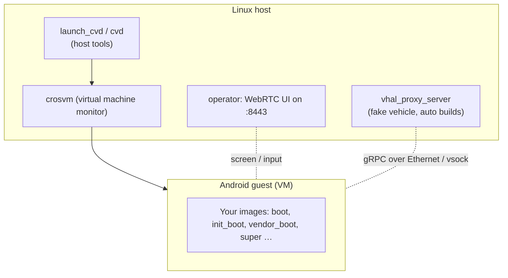
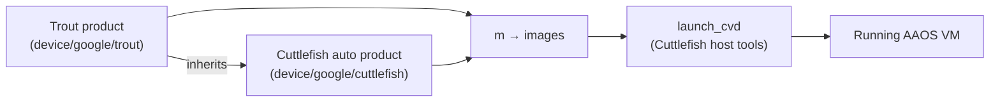
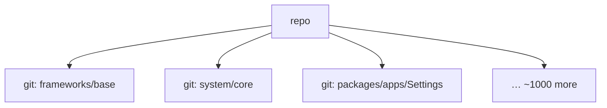
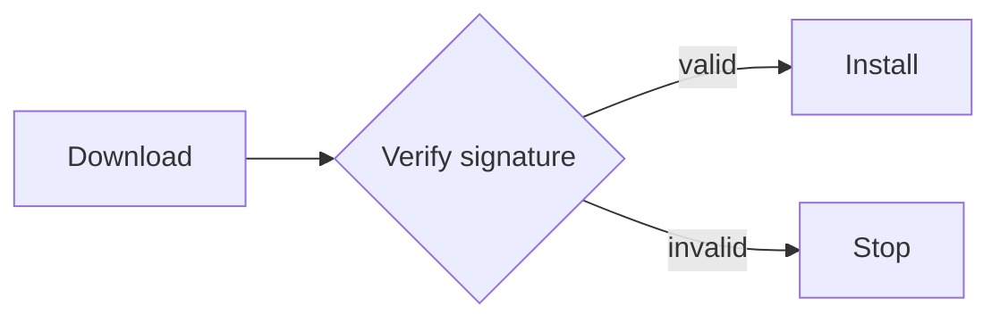
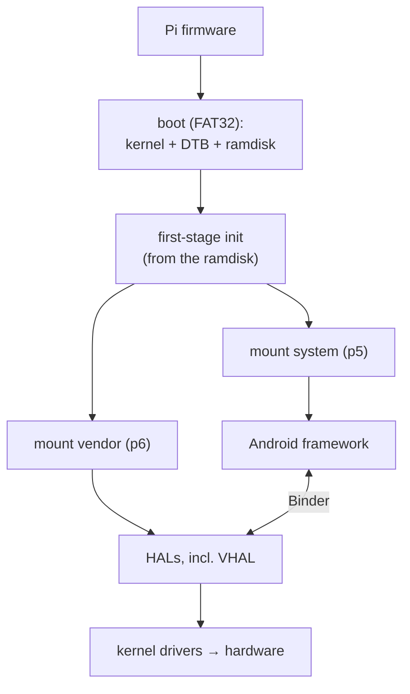

# Build & Run AAOS — Cuttlefish (and Trout) and Raspberry Pi 5

> **Source baseline:** commands, targets and file names were checked against two
> **AOSP `android-17.0.0_r1`** trees: a Cuttlefish tree (`~/aosp17`, built as
> `aosp_cf_x86_64_auto`) and a Raspberry Pi 5 tree (`~/aosp17-rpi`, Raspberry Vanilla,
> `aosp_rpi5_car`), plus the Cuttlefish Debian packages installed on the build host
> (`cuttlefish-base` / `cuttlefish-user` 1.58.0). Android 15 differences are marked **Version-dependent**.

| Label | Meaning |
|---|---|
| **Verified in source** | Read in the A17 trees, their `out/`, or the installed packages |
| **Official documentation** | source.android.com, the android-cuttlefish README |
| **General concept** | Standard Linux / tooling knowledge |
| **Version-dependent** | Changed between releases |

**Prerequisites:** [Build System](../08.AndroidBuildSystem/README.md) (`lunch`, `m`, images).
**Related:** [AAOS §6](../06.AndroidAutomotiveArchitecture/README.md#6-my-two-builds-cuttlefish-vs-raspberry-pi-5)
explains how the **VHAL** differs between these two builds.

**After this chapter you should be able to:**

1. Explain what `repo` and a manifest are, and why a Raspberry Pi build needs a **local manifest**.
2. Explain the difference between **Cuttlefish** (virtual hardware) and **Trout** (a product), and
   how Trout builds on Cuttlefish.
3. Download, build and boot AAOS on Cuttlefish, and on a Raspberry Pi 5.
4. Explain every command you type, and what each output image contains.

---

## Table of Contents

- [1. Two targets at a glance](#1-two-targets-at-a-glance)
- [2. Cuttlefish and Trout](#2-cuttlefish-and-trout)
- [3. `repo` and manifests](#3-repo-and-manifests)
- [4. Before you start: host, shell conventions, dependencies](#4-before-you-start-host-shell-conventions-dependencies)
- [5. Cuttlefish: build and run](#5-cuttlefish-build-and-run)
- [6. Raspberry Pi 5: build](#6-raspberry-pi-5-build)
- [7. Raspberry Pi 5: what is inside the SD card image](#7-raspberry-pi-5-what-is-inside-the-sd-card-image)
- [8. Troubleshooting](#8-troubleshooting)
- [9. Common misconceptions](#9-common-misconceptions)
- [10. Source map](#10-source-map)

---

## 1. Two targets at a glance

| | **Cuttlefish auto** | **Raspberry Pi 5 car** |
|---|---|---|
| What it is | A virtual device (VM) on your Linux PC | A real board booting from an SD card |
| Lunch target | `aosp_cf_x86_64_auto-trunk_staging-userdebug` (or Trout: `aosp_trout_x86_64-…`) | `aosp_rpi5_car-trunk_staging-userdebug` |
| Source | Plain AOSP manifest | AOSP manifest **+ Raspberry Vanilla local manifest** |
| Build command | `m` | `make bootimage systemimage vendorimage` |
| Run | `launch_cvd` | `./rpi5-mkimg.sh`, flash the image, power on |
| Vehicle data | VHAL forwards over gRPC to a host-side fake vehicle | VHAL with an in-memory fake vehicle |

---

## 2. Cuttlefish and Trout

### 2.1 What is Cuttlefish?

**Purpose:** a **virtual Android device** for platform development and testing, with no physical
hardware.

Cuttlefish creates a complete virtual device on a Linux host (x86_64 or arm64), locally or in the
cloud. Unlike the classic Android emulator (Goldfish), it is built to behave like a real device for
platform work: it runs your own kernel, HALs and full system images.

| Virtual component | Purpose |
|---|---|
| vCPUs (KVM) | Run Android at near-native speed using hardware virtualization |
| RAM | Memory for the guest |
| GPU (`gfxstream` or software) | Graphics |
| Displays | One or more displays (automotive: center stack, cluster, passenger) |
| Network | Ethernet / Wi-Fi for the guest |
| Audio, input | Speakers, microphones, touch, keyboard |
| Disks | The Android images, combined into virtual disks |

**Why use it:** no hardware needed, near-native speed (KVM), closer to real hardware than the
emulator, automatable for CI, many instances in parallel, multi-display, and support for custom
kernels and HALs.

**Architecture:**



**Key insight:** Cuttlefish does **not** contain Android. It provides the virtual hardware and host
tools. The Android images come from **your** AOSP build.

**How `launch_cvd` boots a device:**

1. **Create the virtual hardware:** CPUs, RAM, GPU, displays, network, audio.
2. **Assemble the disks:** the images from `ANDROID_PRODUCT_OUT` (`boot.img`, `init_boot.img`,
   `vendor_boot.img`, `super.img`, `vbmeta*.img`, `userdata.img`…) are combined into virtual disks.
   `system`, `vendor`, `product` live **inside `super.img`** as dynamic partitions.
3. **Start the kernel:** `boot.img` holds the kernel, `init_boot.img` the generic ramdisk
   ([Build System §10](../08.AndroidBuildSystem/README.md#10-final-outputs-and-images)).
4. **Boot Android:** `init` → mounts → services → Zygote → `system_server` → CarService → the car UI
   ([Boot Sequence](../07.AndroidBootingSequence/README.md)).

### 2.2 What is Trout?

**Purpose:** Google's AAOS reference **product** for running Android Automotive as a **guest VM under
a hypervisor**, with hardware owned by something outside the Android VM.

**Trout is a product configuration, not an emulator and not virtual hardware.** And it is not
independent of Cuttlefish: its product **inherits** the Cuttlefish automotive product.

Verified in your A17 tree (`device/google/trout/aosp_trout_x86_64.mk`):

```make
$(call inherit-product, device/google/cuttlefish/vsoc_x86_64_only/auto/aosp_cf.mk)   # line 17
...
LOCAL_AUDIOCONTROL_PROPERTIES ?= \
    ro.vendor.audiocontrol.server.cid=3 \
    ro.vendor.audiocontrol.server.port=9410 \
ENABLE_VHAL_FAKE_GRPC_SERVER ?= true
include device/google/trout/aosp_trout_common.mk
DEVICE_MANIFEST_FILE += device/google/trout/trout_x86_64/manifest.xml
PRODUCT_NAME := aosp_trout_x86_64
PRODUCT_DEVICE := trout_x86_64
```

So **Trout = Cuttlefish auto + Trout's own HALs** (`device/google/trout/hal/`: `audio`,
`audiocontrol`, `gnss`, `sensors`, `vehicle`, `dumpstate`). Those HALs act as **clients of a
server outside the Android VM**, reached over **vsock** (see the audiocontrol `cid`/`port` above).
That is the real-car design: the hypervisor host or another VM owns the vehicle hardware, and Android
only talks to it through these HALs.

**Real top-level layout of `device/google/trout/`** (Verified):

```text
device/google/trout/
├── AndroidProducts.mk           lunch targets (aosp_trout_x86_64, aosp_trout_arm64, …)
├── aosp_trout_x86_64.mk         product (inherits Cuttlefish auto)
├── aosp_trout_arm64.mk
├── aosp_trout_common.mk
├── trout_x86_64/ trout_arm64/   per-architecture BoardConfig.mk, manifest.xml
├── shared/BoardConfig.mk        common board settings
├── hal/                         Trout HALs (audio, audiocontrol, gnss, sensors, vehicle…)
├── sepolicy/                    SELinux policy
├── rro_overlays/                runtime resource overlays (UI customization)
├── product_files/               files copied into the image
├── manifest.xml, compatibility_matrix.xml, framework_compatibility_matrix.xml   VINTF
└── tools/, tests/
```

### 2.3 How they fit together



| | Cuttlefish | Trout |
|---|---|---|
| What it is | Virtual hardware platform **and** a family of products (`aosp_cf_*`) | A product built on top of Cuttlefish auto |
| Lives in | `device/google/cuttlefish/` + host packages from github.com/google/android-cuttlefish | `device/google/trout/` |
| Analogy | The test bench | The vehicle specification for a virtualized car |

> **Which one to use?** For learning AAOS, `aosp_cf_x86_64_auto` is simpler and is what your A17
> build uses. Use Trout when you study the **hypervisor / vsock** model.

---

## 3. `repo` and manifests

### 3.1 Why not just Git?

Git manages **one** repository well. AOSP is **over a thousand separate Git repositories**
(`frameworks/base`, `system/core`, `packages/apps/Settings`, `hardware/interfaces`, `external/…`),
each with its own history, owners, branches and tags. Cloning them by hand, at the right path and the
right revision, and keeping them in sync, is impractical.

**Repo** is Google's tool **on top of** Git. It does not replace Git; it coordinates many Git
repositories at once:



### 3.2 What is a manifest?

A **manifest** is an XML file that lists the repositories of a project: which ones, where to put
them, which revision. It contains no source code; it is the blueprint of the tree.

```xml
<manifest>
  <remote name="aosp" fetch=".." />
  <default revision="refs/tags/android-17.0.0_r1" remote="aosp" />
  <project name="platform/frameworks/base" path="frameworks/base" />
  <project name="platform/system/core"     path="system/core" />
</manifest>
```

| Field | Meaning |
|---|---|
| `name` | The repository on the server (`platform/frameworks/base`) |
| `path` | Where it goes in your tree (`frameworks/base/`) |
| `revision` | Branch, tag or commit (often set once in `<default>`) |
| `remote` | Which server to fetch from |

### 3.3 What `repo init` and `repo sync` do

```bash
repo init -u https://android.googlesource.com/platform/manifest -b android-17.0.0_r1
repo sync
```

- **`repo init`** downloads **only the manifest repository** into `.repo/manifests/` and creates
  `.repo/`. No source code yet.
- **`repo sync`** reads the manifest and clones (first time) or fetches (later) every listed
  repository into its path, at its revision.

Your A17 trees are at exactly this tag (Verified: `.repo/manifests` points at
`m/android-17.0.0_r1`).

**Useful `repo init` options:**

| Option | Purpose | How often |
|---|---|---|
| `-u <url>` | Manifest repository URL | Always |
| `-b <branch/tag>` | Manifest branch or tag (the Android release) | Always |
| `-m <file.xml>` | Use a manifest file other than `default.xml` | Sometimes |
| `--depth=1` | **Shallow clone**: only the latest commit. Much smaller and faster, but no history (`git log`, `git bisect` limited) | Common |
| `--partial-clone` (+ `--clone-filter=blob:none`) | Download file contents only when needed | Sometimes |
| `--git-lfs` | Enable Git LFS for repositories that use it | Rare |
| `--mirror` | Create a mirror for serving other machines | Rare |

### 3.4 Local manifests

The AOSP manifest only lists repositories Google hosts. Board support for the Raspberry Pi (device
configuration, the Broadcom kernel, firmware, HALs, image scripts) lives on GitHub. A **local
manifest** in `.repo/local_manifests/` adds those projects; repo merges it with the main manifest
before syncing.

Your A17 RPi tree has exactly one (Verified: `.repo/local_manifests/manifest_brcm_rpi.xml`, remote
`fetch="https://github.com/"`, `revision="android-17.0"`). It also creates the helper links
`rpi5-mkimg.sh` → `device/brcm/rpi5/mkimg.sh` at the tree root (`<linkfile>` lines 11–12).

---

## 4. Before you start: host, shell conventions, dependencies

### 4.1 Host requirements

| Requirement | Why |
|---|---|
| Ubuntu LTS (or another supported Linux) | Google develops and tests the AOSP build on Ubuntu |
| CPU with virtualization (KVM) | Cuttlefish needs it. Check with `grep -c -E 'vmx|svm' /proc/cpuinfo` |
| **≥ 400 GB free disk** | Source + build output (Official documentation; the full tree plus `out/` easily exceeds 300 GB) |
| **64 GB RAM recommended** | Less RAM means swapping and very long builds (Official documentation) |
| A fast network | `repo sync` downloads tens of GB |

> **Time:** the first full build takes hours. Later incremental builds are much faster
> ([Build System §13](../08.AndroidBuildSystem/README.md#13-incremental-builds)).

### 4.2 Shell conventions used below

| Token | Meaning |
|---|---|
| `sudo` | Run as root (needed to write `/usr`, `/etc`, `/var`) |
| `apt` / `apt-get` | Ubuntu's package manager (`apt` is friendlier, `apt-get` is stable for scripts) |
| `-y` | Answer "yes" to prompts |
| `./script.sh` | Run a script from the current directory (not searched in `PATH`) |
| `${HOME}` | Your home directory |
| `$(cmd)` | Command substitution: `$(nproc)` becomes the number of CPU cores |
| `a \| b` | Pipe: the output of `a` is the input of `b` |
| `a && b` | Run `b` only if `a` **succeeded** |
| `a \|\| b` | Run `b` only if `a` **failed** |
| `-` as a file name | Read from standard input |
| `\` at end of line | The command continues on the next line |

**Why the guides verify downloads with GPG.** A publisher signs a file with a **private** key; you
check it with their **public** key. A valid signature proves **authenticity** (they published it)
and **integrity** (nobody changed it):



### 4.3 Build dependencies

```bash
sudo apt-get install git-core gnupg flex bison build-essential zip curl \
  zlib1g-dev libc6-dev-i386 x11proto-core-dev libx11-dev lib32z1-dev \
  libgl1-mesa-dev libxml2-utils xsltproc unzip fontconfig -y
```

| Group | Packages | Why |
|---|---|---|
| Source and download | `git-core`, `curl`, `gnupg` | `repo` drives Git; `curl` fetches `repo`; `gnupg` verifies its signature |
| Compilers and generators | `build-essential`, `flex`, `bison` | Host tools; lexer and parser generators used by some tools |
| Libraries | `zlib1g-dev`, `libc6-dev-i386`, `lib32z1-dev`, `libgl1-mesa-dev`, `x11proto-core-dev`, `libx11-dev`, `fontconfig` | Compression, 32-bit host compatibility, OpenGL/X11 headers, fonts |
| Archives and XML | `zip`, `unzip`, `libxml2-utils`, `xsltproc` | Packaging, extracting, validating and transforming XML |

> Most compilers the platform uses (clang, Java, Go) come from `prebuilts/`, not from the host. The
> host packages are mainly for helper tools.

### 4.4 Install `repo`

```bash
mkdir -p ${HOME}/bin
export REPO=$(mktemp /tmp/repo.XXXXXXXXX)
curl -o ${REPO} https://storage.googleapis.com/git-repo-downloads/repo
gpg --recv-keys 8BB9AD793E8E6153AF0F9A4416530D5E920F5C65
curl -s https://storage.googleapis.com/git-repo-downloads/repo.asc | \
  gpg --verify - ${REPO} && install -m 755 ${REPO} ${HOME}/bin/repo
export PATH="${HOME}/bin:$PATH"
```

| Part | Meaning |
|---|---|
| `mkdir -p ${HOME}/bin` | Create the folder (`-p`: no error if it exists, create parents) |
| `mktemp /tmp/repo.XXXXXXXXX` | Create a **unique** temporary file (each `X` becomes a random character), so the unverified download lands somewhere harmless |
| `curl -o ${REPO} <url>` | Download `repo` into that file |
| `gpg --recv-keys 8BB9…5C65` | Fetch Google's repo signing key by its **fingerprint** |
| `curl -s …/repo.asc \| gpg --verify - ${REPO}` | Download the detached signature (silently) and verify `${REPO}` against it; `-` reads the signature from the pipe |
| `&& install -m 755 SRC DEST` | **Only if** verification passed: copy and set permissions `rwxr-xr-x` in one step |
| `export PATH="${HOME}/bin:$PATH"` | Put `~/bin` **first** in the command search path. Keep `:$PATH`, or every other command disappears. Add the line to `~/.bashrc` to keep it |

---

## 5. Cuttlefish: build and run

### 5.1 Download the source

```bash
mkdir -p ${HOME}/aosp17 && cd ${HOME}/aosp17
repo init -u https://android.googlesource.com/platform/manifest -b android-17.0.0_r1
repo sync -c -j$(nproc)
```

Run `repo init` **inside** the folder you want: it creates `.repo/` in the current directory.
`-c` syncs only the current branch, which saves time and space.

### 5.2 Build the images

```bash
source build/envsetup.sh
lunch aosp_cf_x86_64_auto-trunk_staging-userdebug     # or: aosp_trout_x86_64-trunk_staging-userdebug
m
```

- `source build/envsetup.sh` defines `lunch`, `m`… in your current shell
  ([Build System §5](../08.AndroidBuildSystem/README.md#5-configuring-the-build-envsetupsh-and-lunch)).
- `lunch` sets `TARGET_PRODUCT`, `TARGET_RELEASE`, `TARGET_BUILD_VARIANT`, `ANDROID_PRODUCT_OUT`,
  `ANDROID_HOST_OUT` and adds the host tools to `PATH`. It compiles nothing.
- `m` builds everything, in parallel, and also builds the host tools `launch_cvd`, `cvd`,
  `stop_cvd`, `crosvm` (Verified: `out/host/linux-x86/bin/`).
- Match the guest architecture to the host (`x86_64` on an x86 PC, `arm64` on an ARM host) so KVM
  can run the guest natively.

> **Version-dependent:** the Android 15 version of this guide used
> `repo init -b android-15.0.0_r1` and `lunch aosp_trout_x86_64-trunk_staging-eng`. Both still work
> on an A15 tree (an A15 tree also has `trunk_staging`, `ap3a`, `ap4a` release
> configs).

### 5.3 Install the Cuttlefish host packages

The host packages set up the **host side** (network bridges, permissions, web UI). They come from
github.com/google/android-cuttlefish. Its README (your clone, September 2026) offers two ways.

**Option A: install prebuilt packages from Google's apt repository** (simplest):

```bash
sudo curl -fsSL https://us-apt.pkg.dev/doc/repo-signing-key.gpg \
    -o /etc/apt/trusted.gpg.d/artifact-registry.asc
sudo chmod a+r /etc/apt/trusted.gpg.d/artifact-registry.asc
echo "deb https://us-apt.pkg.dev/projects/android-cuttlefish-artifacts android-cuttlefish main" \
    | sudo tee -a /etc/apt/sources.list.d/artifact-registry.list
sudo apt update
sudo apt install cuttlefish-base cuttlefish-user
```

| Part | Meaning |
|---|---|
| `curl -fsSL … -o /etc/apt/trusted.gpg.d/…` | Download the repository's **public signing key** into apt's trusted keys (`-f` fail on HTTP errors, `-s` silent, `-S` still show errors, `-L` follow redirects) |
| `chmod a+r` | Let apt read the key |
| `echo "deb …" \| sudo tee -a …list` | Add the repository to apt's sources (`tee -a` appends, and runs as root through `sudo`) |
| `apt update` then `apt install` | Refresh package lists, then install; apt verifies every package against the key |

> Older guides use `curl … | sudo apt-key add -`. `apt-key` is **deprecated**; keys now go into
> `/etc/apt/trusted.gpg.d/` or `/etc/apt/keyrings/` (with `signed-by=`), as above.

**Option B: build the packages yourself:**

```bash
sudo apt install -y git devscripts equivs config-package-dev debhelper-compat golang curl
cd ${HOME}
git clone https://github.com/google/android-cuttlefish
cd android-cuttlefish
tools/buildutils/build_packages.sh
sudo apt install ./cuttlefish-base_*.deb ./cuttlefish-user_*.deb
```

| Package | What it is | Why |
|---|---|---|
| `devscripts`, `equivs`, `config-package-dev`, `debhelper-compat` | Debian packaging tools | The host software is delivered as `.deb` packages |
| `golang` | Go toolchain | Several host tools are written in Go |
| `git`, `curl` | Clone and download | — |

> The build steps in that repository change often (Bazel setup, script names). If a command fails,
> follow the repository's current README.

**What the two packages contain** (Verified with `dpkg -L` on this machine, version 1.58.0):

| Package | Contents |
|---|---|
| `cuttlefish-base` | The `cuttlefish-host-resources` service (network bridges, kernel modules, limits, NetworkManager config), the `/usr/bin/cvd` tool, and support binaries in `/usr/lib/cuttlefish-common/bin/` |
| `cuttlefish-user` | The **operator** (`cuttlefish-operator` service): the WebRTC web UI you open in a browser |

**`apt install ./file.deb` vs `dpkg -i`:** with a `./` path, `apt` installs a local `.deb` **and**
fetches its dependencies. Older guides use `sudo dpkg -i ./cuttlefish-base_*_*64.deb || sudo apt-get
install -f`: `dpkg` installs the file but stops on missing dependencies, and `apt-get install -f`
("fix broken") then downloads them and finishes the job. Both reach the same result.

**If Git refuses the clone folder** with `fatal: detected dubious ownership`, mark it trusted:
`git config --global --add safe.directory ${HOME}/android-cuttlefish`.

### 5.4 Group membership, then reboot

```bash
sudo usermod -aG kvm,cvdnetwork,render $USER
sudo reboot
```

| Part | Meaning |
|---|---|
| `-aG` | **Append** to these groups. Without `-a`, `-G` **replaces** all your supplementary groups |
| `kvm` | Access to `/dev/kvm` (hardware virtualization) |
| `cvdnetwork` | Access to Cuttlefish's virtual network devices |
| `render` | Access to GPU render nodes (`/dev/dri/renderD*`) |

Group changes apply at the next login; rebooting is the reliable way. Check with `groups`.

### 5.5 Launch the virtual device

In a **new** shell (after the reboot), set up the environment again, then launch:

```bash
cd ${HOME}/aosp17
source build/envsetup.sh
lunch aosp_cf_x86_64_auto-trunk_staging-userdebug
launch_cvd \
  --display0=width=1920,height=720,dpi=160 \
  --display1=width=400,height=600,dpi=120 \
  --gpu_mode=gfxstream
```

`launch_cvd` finds your images through `ANDROID_PRODUCT_OUT` and its own binaries through
`ANDROID_HOST_OUT`, both set by `lunch`. A fresh shell has neither, which is why you `lunch` again.

| Flag | Meaning |
|---|---|
| `--display0=…` | Main display: wide, low-DPI, like a center stack |
| `--display1=…` | A second display (passenger / cluster). Multi-display is central to AAOS |
| `--gpu_mode=gfxstream` | Forward guest graphics to the host GPU (much faster than software rendering) |

**Debugging SELinux:** to make SELinux log denials instead of blocking them, add
`--extra_bootconfig_args="androidboot.selinux=permissive"`. Since Android 12 `androidboot.*`
parameters are passed through **bootconfig**, and A17's `launch_cvd` has both
`--extra_bootconfig_args` and `--extra_kernel_cmdline` (Verified:
`device/google/cuttlefish/host/commands/assemble_cvd/flags.cc`, lines 132–134). Only on
`userdebug`/`eng` builds, never for a shipping image: the real fix for a denial is a policy rule.

Run `launch_cvd --help` for all options (CPUs, memory, number of instances…). Stop the device with
`stop_cvd`.

### 5.6 Use the device

- **Browser:** `https://localhost:8443/` (the operator; instance *N* uses port `8443 + N − 1`,
  Verified: `flags.cc` line 2232).
- **adb:** the device behaves like real hardware:

```bash
adb devices
adb shell
adb logcat
adb shell dumpsys car_service get-property-value PERF_VEHICLE_SPEED 0
```

The last command reads the vehicle speed from the fake vehicle on the host
([AAOS §4.6](../06.AndroidAutomotiveArchitecture/README.md#46-inspecting-properties-from-the-shell)).

---

## 6. Raspberry Pi 5: build

### 6.1 Extra host packages

```bash
sudo apt-get install dosfstools e2fsprogs fdisk kpartx mtools rsync
```

These are needed because the image scripts **create partitions and filesystems themselves**:

| Package | Provides | Used for |
|---|---|---|
| `dosfstools` | `mkfs.fat` | The Pi's **boot partition is FAT32**: the Pi firmware can only read FAT ([§7](#7-raspberry-pi-5-what-is-inside-the-sd-card-image)) |
| `mtools` | `mcopy` | Copy files into a FAT image **without mounting it** (how `boot.img` is filled) |
| `e2fsprogs` | `mkfs.ext4`, `e2fsck`, `resize2fs` | Format `userdata` and `metadata` |
| `fdisk` | Partition editor | Create the SD card's partition table |
| `kpartx` | Device-mapper entries for partitions **inside an image file** | Write each partition of the `.img` separately |
| `rsync` | Efficient copying that keeps permissions, timestamps, links | Copying build outputs |

### 6.2 Download

```bash
mkdir -p ${HOME}/aosp17-rpi && cd ${HOME}/aosp17-rpi
repo init -u https://android.googlesource.com/platform/manifest -b android-17.0.0_r1 --depth=1
curl -o .repo/local_manifests/manifest_brcm_rpi.xml -L \
  https://raw.githubusercontent.com/raspberry-vanilla/android_local_manifest/android-17.0/manifest_brcm_rpi.xml \
  --create-dirs
repo sync -c -j$(nproc)
```

| Part | Meaning |
|---|---|
| `--depth=1` | Shallow clone ([§3.3](#33-what-repo-init-and-repo-sync-do)) |
| `curl -o <file> -L <url> --create-dirs` | Save the local manifest to `<file>`, follow redirects (`-L`), and create `.repo/local_manifests/` if missing |
| `android-17.0` in the URL | The Raspberry Vanilla branch that matches the AOSP release |

### 6.3 Build

```bash
. build/envsetup.sh
lunch aosp_rpi5_car-trunk_staging-userdebug
make bootimage systemimage vendorimage -j$(nproc)
```

- `.` is the same as `source`: run the script **in the current shell** so its functions and
  variables stay defined.
- The RPi5 products are `aosp_rpi5`, `aosp_rpi5_car` and `aosp_rpi5_tv` (Verified:
  `device/brcm/rpi5/AndroidProducts.mk`, `COMMON_LUNCH_CHOICES`).
- Only the three images the SD card needs are built: `boot.img`, `system.img`, `vendor.img`.

> **Version-dependent:** the Android 15 version of this guide used `android-15.0.0_r32`, the
> `android-15.0` local manifest, and `lunch aosp_rpi4-bp1a-userdebug`. `bp1a` there is a **release
> configuration**, the same role `trunk_staging` plays here, not a "platform codename".

### 6.4 Create the SD card image

```bash
./rpi5-mkimg.sh
```

The script (`device/brcm/rpi5/mkimg.sh`) first checks that you ran `lunch` and built
`boot`/`system`/`vendor`. Then it:

1. creates a 15 GB image file named like `RaspberryVanillaAOSP17-<date>-rpi5_car.img`;
2. writes an MBR partition table with `fdisk`;
3. maps the partitions with `kpartx` and **`dd`s** `boot.img`, `system.img` and `vendor.img` into
   them;
4. formats `metadata` and `userdata` with `mkfs.ext4`.

Flash the result to an SD card with your usual tool (or the `rpi5-wrimg.sh` helper), and boot the
Pi.

---

## 7. Raspberry Pi 5: what is inside the SD card image

**Partition layout** (Verified: `device/brcm/rpi5/mkimg.sh`):

| Partition | Size | Filesystem | Contents |
|---|---|---|---|
| p1 `boot` | 128 MB | **FAT32** | `boot.img` (below) |
| p2 | — | extended | Container for p5–p7 |
| p5 `system` | 3072 MB | from `system.img` | Android framework, system apps, libraries |
| p6 `vendor` | 384 MB | from `vendor.img` | RPi HALs (including the VHAL), vendor libraries, firmware |
| p7 `metadata` | 16 MB | ext4 | Encryption metadata |
| p3 `userdata` | rest | ext4 | `/data` |

**On the Raspberry Pi, `boot.img` is not an Android boot image.** The board sets
`BOARD_CUSTOM_BOOTIMG := true` and builds `boot.img` as a 128 MB **FAT32 filesystem** (Verified:
`device/brcm/rpi5/mkbootimg.mk`):

```make
$(INSTALLED_BOOTIMAGE_TARGET): $(RPI_BOOT_OUT)
	dd if=/dev/zero of=$@ bs=1M count=128
	mkfs.fat -F 32 -n "boot" $@
	mcopy -s -i $@ $(RPI_BOOT_OUT)/* ::
```

`RPI_BOOT_OUT` is filled with:

| File | Purpose |
|---|---|
| `device/brcm/rpi5/boot/*` | Pi firmware configuration (e.g. `config.txt`) |
| `Image` | The Linux kernel |
| `bcm2712*-rpi-*.dtb` + `overlays/` | Device trees describing the board |
| `ramdisk.img` | Android's ramdisk with first-stage `init` |
| `cmdline.txt` | The kernel command line (`BOARD_KERNEL_CMDLINE`) |

The Pi's own boot firmware reads this FAT partition, loads the kernel, device tree and ramdisk, and
starts Linux. That replaces the bootloader stage of a phone
([Boot §2](../07.AndroidBootingSequence/README.md#2-bootloader)).

**How the images work together:**



| Image | Hardware-specific? | Main job |
|---|---|---|
| `boot.img` | Yes (firmware, kernel, DTBs for this board) | Start the kernel and Android's `init` |
| `system.img` | Mostly no | The Android OS and framework |
| `vendor.img` | Yes | HALs and libraries for this board |

---

## 8. Troubleshooting

| Symptom | Action |
|---|---|
| The first build "hangs" | It doesn't. A full build takes hours |
| `lunch: Invalid lunch combo` | Use the three-part form `<product>-<release>-<variant>` |
| `launch_cvd: command not found` or images not found | You did not `source build/envsetup.sh` and `lunch` in this shell |
| `/dev/kvm` permission denied | Group membership not active yet: reboot, check `groups` |
| `dpkg` dependency errors | Expected: `sudo apt-get install -f` |
| `fatal: detected dubious ownership` | `git config --global --add safe.directory <path>` |
| Cuttlefish package build fails strangely | Follow the current android-cuttlefish README; clear its build cache |
| `rpi5-mkimg.sh`: "Run lunch first" / "Partition image not found" | `lunch` in this shell, and build `bootimage systemimage vendorimage` |
| A denial blocks your new service | Read it with `adb logcat \| grep avc`; for a quick test use permissive via bootconfig ([§5.5](#55-launch-the-virtual-device)), then write the policy |

---

## 9. Common misconceptions

| Misconception | Correct interpretation |
|---|---|
| "Trout and Cuttlefish are unrelated: Trout builds, Cuttlefish runs." | Trout's product **inherits** Cuttlefish auto. Both are products you build; Cuttlefish also supplies the host tools that run them. |
| "Trout's folder has `BoardConfig.mk`, `device.mk`, `product.mk`, `fstab` at the top." | See the real layout in [§2.2](#22-what-is-trout). |
| "`launch_cvd` comes from the `cuttlefish-user` package." | It is built with your AOSP tree (`out/host/linux-x86/bin/`). `cuttlefish-user` is the web operator. |
| "`repo init` downloads Android." | It downloads only the manifest. `repo sync` downloads the source. |
| "Android boot partitions are FAT." | Only on boards like the Raspberry Pi, whose firmware needs FAT. Phones and Cuttlefish use Android boot images. |
| "`bp1a` is an Android 15 platform codename." | It is a release configuration name. |
| "200 GB of disk is enough." | Plan for at least 400 GB. |

---

## 10. Source map

| Topic | Path | Key lines |
|---|---|---|
| Cuttlefish products | `device/google/cuttlefish/AndroidProducts.mk` | `aosp_cf_x86_64_auto` |
| Cuttlefish launch flags | `device/google/cuttlefish/host/commands/assemble_cvd/flags.cc` | `extra_kernel_cmdline` (132), `extra_bootconfig_args` (134), web port (2232) |
| Host tools | `out/host/linux-x86/bin/` | `launch_cvd`, `cvd`, `stop_cvd`, `crosvm` |
| Trout product | `device/google/trout/aosp_trout_x86_64.mk` | inherit (17) |
| Trout HALs | `device/google/trout/hal/` | `audiocontrol`, `vehicle`, … |
| RPi local manifest | `.repo/local_manifests/manifest_brcm_rpi.xml` (A17-RPI) | `revision="android-17.0"`, linkfiles (11–12) |
| RPi products | `device/brcm/rpi5/AndroidProducts.mk` | `COMMON_LUNCH_CHOICES` |
| RPi boot image | `device/brcm/rpi5/BoardConfig.mk`, `mkbootimg.mk` | `BOARD_CUSTOM_BOOTIMG` (26) |
| RPi SD image | `device/brcm/rpi5/mkimg.sh` | partitions, `kpartx`, `dd` |

**Further reading (official):** [Cuttlefish](https://source.android.com/docs/devices/cuttlefish),
[Downloading the source](https://source.android.com/docs/setup/download),
[Hardware requirements](https://source.android.com/docs/setup/start/requirements).

**Previous:** [Build System](../08.AndroidBuildSystem/README.md) ·
**Next:** [Binder IPC and AIDL](../10.AIDLHandsOn/README.md)
