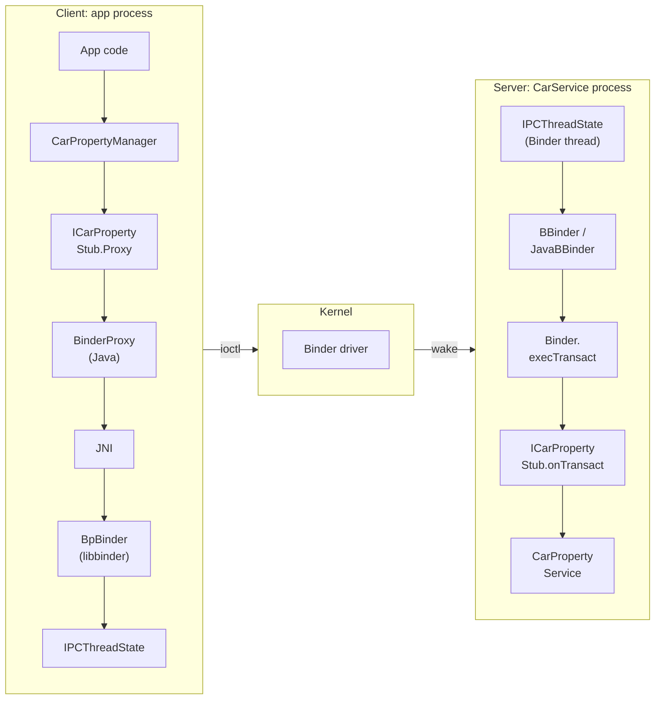
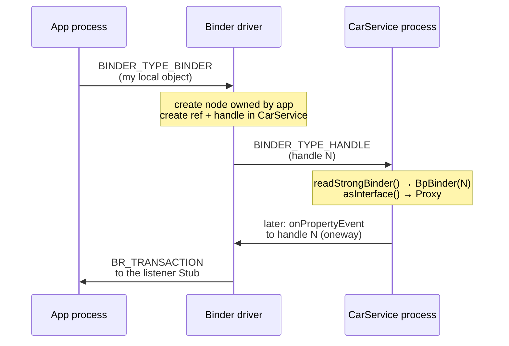
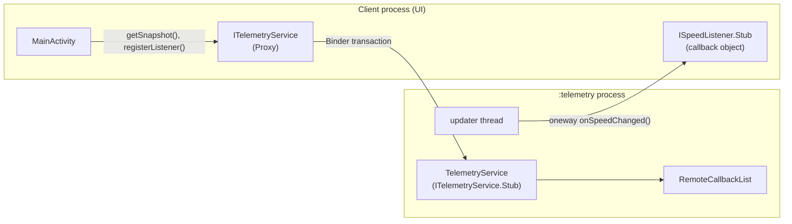
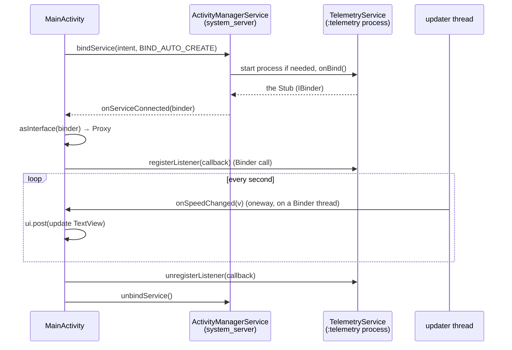
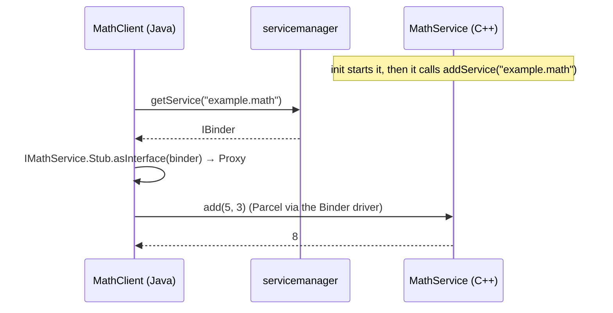
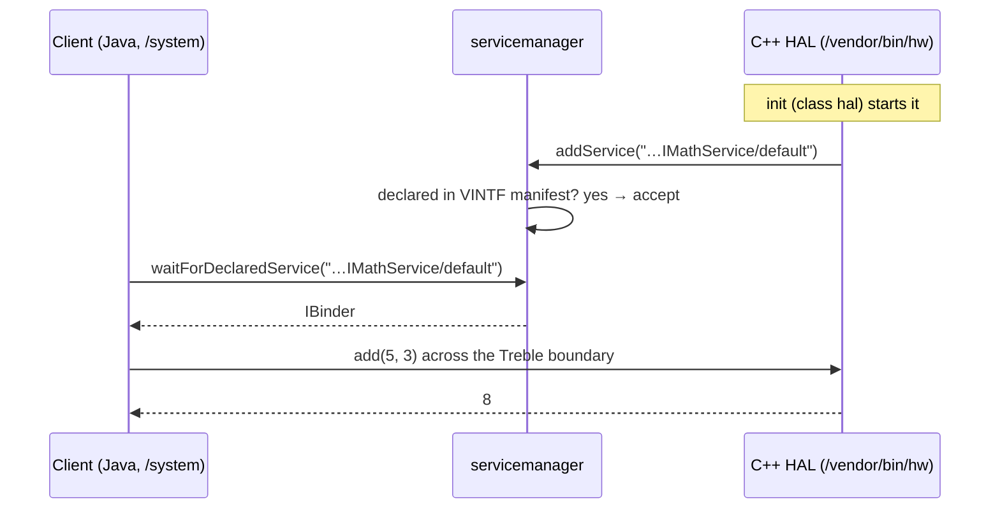

# Binder IPC and AIDL — In Depth and Hands-on

> **Source baseline:** build properties, APIs and SELinux attributes used here were checked against
> **AOSP `android-17.0.0_r1`**. Example A was compiled with the SDK `aidl` tool
> (`build-tools/36.0.0`). Examples B1 and B2 are **templates**: their build files and APIs match the
> A17 tree, but they were not built and flashed as a whole. Test them on Cuttlefish
> ([Build & Run §5](../09.BuildAndRunAAOS/README.md#5-cuttlefish-build-and-run)).

| Label | Meaning |
|---|---|
| **Verified in source** | Checked in the A17 tree |
| **Compiled** | Built with the real tool |
| **Template** | Correct shape, but adapt and test it on your device |
| **General concept** | Binder kernel driver behaviour (upstream Linux, not in the A17 trees) |

**Prerequisites:** [Android Architecture §7](../05.AndroidArchitecture/README.md#7-binder-ipc-and-servicemanager)
(Binder, Proxy/Stub, Parcel, ServiceManager) and §3 (Treble, VINTF);
[Build System](../08.AndroidBuildSystem/README.md) (`Android.bp`, `m`).

**After this chapter you should be able to:**

1. Follow one Binder call through every layer (Proxy → Parcel → JNI → libbinder → kernel driver →
   Binder thread → Stub → service) and say what each layer does.
2. Read a Parcel byte by byte, and explain how Binder objects, callbacks and file descriptors cross
   processes.
3. Explain `oneway`, the Binder thread pool, caller identity, the SELinux checks and the common
   Binder exceptions.
4. Write an AIDL interface with a `Parcelable` and a `oneway` callback, and use it between two
   processes in a normal app.
5. Write a **C++ Binder service** in the platform and call it from Java.
6. Turn that service into a **VINTF stable AIDL HAL** on `/vendor`, and explain exactly what changes.

| | **Example A** | **Example B1** | **Example B2** |
|---|---|---|---|
| Scenario | App ↔ bound service | Java client ↔ native C++ service | Java client ↔ vendor **HAL** |
| Who writes it | App developer (public SDK) | Platform engineer | Vendor / platform engineer |
| Server runs in | Another process of the app (or another app) | A `/system_ext` native daemon | A `/vendor` HAL daemon |
| Built with | Android Studio / Gradle | `Android.bp` in the AOSP tree | `Android.bp` in the AOSP tree |
| Lookup | `bindService()` | `ServiceManager.getService()` | `ServiceManager.waitForDeclaredService()` |
| Stability | None (one owner) | None (`unstable`) | **`stability: "vintf"`** + VINTF manifest |

---

## Table of Contents

- [Part 1 — Binder IPC in depth](#part-1--binder-ipc-in-depth)
  - [1.1 The layers at a glance](#11-the-layers-at-a-glance)
  - [1.2 Before the first call: setup and registration](#12-before-the-first-call-setup-and-registration)
  - [1.3 The driver protocol: one ioctl, many commands](#13-the-driver-protocol-one-ioctl-many-commands)
  - [1.4 The Parcel on the wire, byte by byte](#14-the-parcel-on-the-wire-byte-by-byte)
  - [1.5 Passing objects: callbacks and file descriptors](#15-passing-objects-callbacks-and-file-descriptors)
  - [1.6 Synchronous vs `oneway` calls](#16-synchronous-vs-oneway-calls)
  - [1.7 Threads and caller identity](#17-threads-and-caller-identity)
  - [1.8 Security on every hop](#18-security-on-every-hop)
  - [1.9 Four language backends, one wire format](#19-four-language-backends-one-wire-format)
  - [1.10 Errors and what they really mean](#110-errors-and-what-they-really-mean)
  - [1.11 Watching Binder on a real device](#111-watching-binder-on-a-real-device)
  - [1.12 Summary: the full life cycle of one call](#112-summary-the-full-life-cycle-of-one-call)
- [Part 2 — Hands-on examples](#part-2--hands-on-examples)
- [Example A — App ↔ bound service (Java)](#example-a--app--bound-service-java)
- [Example B1 — Java client ↔ C++ platform service](#example-b1--java-client--c-platform-service)
- [Example B2 — Promote it to a VINTF stable AIDL HAL](#example-b2--promote-it-to-a-vintf-stable-aidl-hal)
- [Comparison](#comparison)
- [Common mistakes](#common-mistakes)

---

## Part 1 — Binder IPC in depth

[Android Architecture §7](../05.AndroidArchitecture/README.md#7-binder-ipc-and-servicemanager) explains
**why** Android uses Binder, what a Proxy, a Stub and a Parcel are, and shows the generated code. This
part follows **one real call through every layer**, from the app's Java code, down into the kernel and
up into the service, and says what each layer does.

**The example used throughout:** an app reads the vehicle speed.

```java
// App code. PERF_VEHICLE_SPEED = 291504647 = 0x11600207 (VehiclePropertyIds.java:514)
CarPropertyValue<Float> v = carPropertyManager.getProperty(VehiclePropertyIds.PERF_VEHICLE_SPEED, 0);
```

The app process is the **client**. The CarService process (`com.android.car`), where
`CarPropertyService` lives, is the **server**
([AAOS §4.1](../06.AndroidAutomotiveArchitecture/README.md#41-reading-a-property-get)).

> All user-space steps below are **Verified in source** (A17 file and line). The Binder **kernel
> driver** source (`drivers/android/binder.c`) is not in your trees (they contain prebuilt kernels
> only). Its behaviour is described as **General concept (upstream Linux kernel)**, and only its
> user-visible interface, `bionic/libc/kernel/uapi/linux/android/binder.h`, is verified.

### 1.1 The layers at a glance



Read each column top to bottom: the client column, then the kernel, then the server column. The
reply goes back the same way in reverse.

| # | Layer | Process | Language | Written by |
|---|---|---|---|---|
| 1 | App code, `CarPropertyManager` | client | Java | You / the Car API |
| 2 | `ICarProperty.Stub.Proxy` | client | Java | **Generated** by the AIDL compiler |
| 3 | `android.os.BinderProxy` | client | Java | Framework |
| 4 | JNI (`android_util_Binder.cpp`) | client | C++ | Framework |
| 5 | `BpBinder`, `IPCThreadState`, `ProcessState`, `Parcel` | client | C++ | libbinder |
| 6 | Binder driver | kernel | C | Linux kernel |
| 7 | `IPCThreadState` on a Binder thread | server | C++ | libbinder |
| 8 | `BBinder` / `JavaBBinder` | server | C++ | libbinder / framework JNI |
| 9 | `Binder.execTransact()` | server | Java | Framework |
| 10 | `ICarProperty.Stub.onTransact()` | server | Java | **Generated** |
| 11 | `CarPropertyService.getProperty()` | server | Java | CarService (the real work) |

The job of each layer, in the order a call passes through it:

**1. App code and the manager (`CarPropertyManager`)**

**Purpose:** give the app an easy, typed API that hides Binder completely.

**Tasks:**

1. Validate the arguments in the app's own process (cheap, no IPC needed).
2. Call the remote interface: `mService.getProperty(propertyId, areaId)`
   (`car-lib/.../CarPropertyManager.java:2901`, inside `getProperty()` at line 2879). `mService` is an
   `ICarProperty`, which is really a Proxy.
3. Turn Binder errors into API errors (for example, `RemoteException` when CarService has died).

**2. The generated Proxy (`ICarProperty.Stub.Proxy`)**

**Purpose:** make a remote method look like a local method.

**Tasks:**

1. Get two `Parcel`s: `_data` (request) and `_reply`.
2. **Marshal**: write the interface token, then each argument in order
   ([§1.4](#14-the-parcel-on-the-wire-byte-by-byte)).
3. Call `mRemote.transact(TRANSACTION_getProperty, _data, _reply, 0)`. `TRANSACTION_getProperty` is
   `FIRST_CALL_TRANSACTION + 3`, a number that identifies the method. The call **blocks**.
4. **Unmarshal**: `_reply.readException()` re-throws any exception the server sent back, then
   `_reply.readTypedObject(CarPropertyValue.CREATOR)` rebuilds the result.

The real generated code is in [05 §7.5](../05.AndroidArchitecture/README.md#75-aidl-proxy-and-stub-real-generated-code).

**3. `BinderProxy` (Java) and 4. JNI**

**Purpose:** move the call from Java into native libbinder.

**Tasks:**

1. `BinderProxy.transact()` (`frameworks/base/core/java/android/os/BinderProxy.java:568`) does
   bookkeeping (tracing, transaction listeners) and calls the native method `transactNative()` (line 626).
2. `android_os_BinderProxy_transact()` (`frameworks/base/core/jni/android_util_Binder.cpp:1644`) finds
   the native `BpBinder` that this Java object wraps, and the native `Parcel` behind each Java `Parcel`.
3. It calls `target->transact(code, *data, reply, flags)` (line 1671).
4. When the call returns an error, it converts the native error code into a Java exception (`signalExceptionForError()`, line 1092, see [§1.10](#110-errors-and-what-they-really-mean)).

**5. libbinder on the client (`BpBinder`, `IPCThreadState`, `ProcessState`)**

**Purpose:** speak the Binder driver's protocol.

**Tasks:**

1. `BpBinder` is the native proxy for **one remote object**. It knows only the object's **handle**, a
   small number valid in this process. `BpBinder::transact()` calls
   `IPCThreadState::self()->transact(binderHandle(), code, data, reply, flags)`
   (`frameworks/native/libs/binder/BpBinder.cpp:430`).
2. `IPCThreadState` (one per thread) builds the command `BC_TRANSACTION` with a
   `binder_transaction_data` describing the Parcel (`IPCThreadState.cpp:941`, filled in
   `writeTransactionData()` at line 1365).
3. `talkWithDriver()` (line 1246) passes the commands to the kernel with
   `ioctl(fd, BINDER_WRITE_READ, &bwr)` (line 1304), and receives the driver's answers in the same call.
4. `waitForResponse()` (line 1153) loops until it gets `BR_REPLY` (or an error) and points the reply
   Parcel at the received data (line 1215).
5. `ProcessState` (one per process) opened `/dev/binder` and mapped the receive buffer at start-up
   ([§1.2](#12-before-the-first-call-setup-and-registration)).

**6. The Binder driver (kernel)**

**Purpose:** carry the transaction to the right process, safely.

**Tasks** (General concept, upstream kernel):

1. Translate the **handle** into the target object and its owning process.
2. Check SELinux: may the caller's domain `call` the target's domain?
3. Allocate space in the **target's** receive buffer and copy the data there **once**.
4. **Translate objects** inside the Parcel (Binder objects ↔ handles, file descriptors).
5. Stamp the caller's **PID and effective UID** on the transaction. The caller cannot fake these.
6. Queue the work and wake a Binder thread in the target process. Put the client thread to sleep.
7. Do the same in reverse for the reply.

**7. libbinder on the server (`IPCThreadState` on a Binder thread)**

**Purpose:** receive transactions and dispatch them to the right object.

**Tasks:**

1. Binder threads sit in `joinThreadPool()` (`IPCThreadState.cpp:841`), blocked in the driver.
2. `executeCommand()` handles `BR_TRANSACTION` (line 1489). It saves the caller's PID and UID
   (`mCallingPid`/`mCallingUid`, lines 1529–1531). This is what `Binder.getCallingUid()` returns later.
3. It finds the local object: the driver gives back the `cookie` that the server put there when it
   first sent the object, which is the `BBinder*` pointer (line 1556).
4. It calls `BBinder::transact()`. If the call is not `oneway`, it sends the reply with `sendReply()`
   → `BC_REPLY` (line 1585, `sendReply()` at line 1143).
5. When the request Parcel is destroyed, it tells the driver to free the buffer with `BC_FREE_BUFFER`
   (`freeBuffer()`, line 1853).

**8. `BBinder` / `JavaBBinder`, 9. `Binder.execTransact()`**

**Purpose:** cross from native code back into Java on the server.

**Tasks:**

1. `BBinder::transact()` (`libs/binder/Binder.cpp:490`) calls the virtual `onTransact()` (line 541).
2. For a Java service, that object is a `JavaBBinder`. Its `onTransact()` calls the Java method
   `Binder.execTransact()` through JNI (`android_util_Binder.cpp:431`).
3. `execTransact()` (`Binder.java:1304`) calls the Stub's `onTransact()` (line 1364).
4. If the implementation throws a `RuntimeException` (such as `SecurityException`), it catches it and
   writes it into the reply with `reply.writeException(e)` (line 1393). For a `oneway` call there is
   nobody to reply to, so it only logs it.

**10. The generated Stub (`ICarProperty.Stub.onTransact()`)**

**Purpose:** turn a transaction code and a Parcel back into a method call.

**Tasks:**

1. Check the interface token with `data.enforceInterface(DESCRIPTOR)`. A Parcel meant for another
   interface is rejected.
2. `switch (code)`: pick the method (`TRANSACTION_getProperty`).
3. **Unmarshal** the arguments in the same order the Proxy wrote them.
4. Call `this.getProperty(...)`, the real implementation.
5. **Marshal** the result: `reply.writeNoException()`, then the return value.

**11. The implementation (`CarPropertyService`)**

**Purpose:** do the actual work.

**Tasks:**

1. `CarPropertyService extends ICarProperty.Stub` (`CarPropertyService.java:109`), so it **is** the
   Binder object.
2. `getProperty()` (line 913) checks the parameters and the **caller's permission**
   (`validateGetParameters()` → `assertReadPermissionGranted()`, line 1514). The permission check uses
   the UID the driver stamped in step 6.
3. It reads the value from the Vehicle HAL, which is itself another Binder call
   ([AAOS §4.1](../06.AndroidAutomotiveArchitecture/README.md#41-reading-a-property-get)).

### 1.2 Before the first call: setup and registration

Three things must already have happened before the app can call `getProperty()`.

**1. Every process opens the driver (`ProcessState`).**

1. `init` mounts **binderfs** and creates the device links `/dev/binder`, `/dev/hwbinder` and
   `/dev/vndbinder` (`system/core/rootdir/init.rc:231–241`).
2. The first time a process uses Binder, `ProcessState` runs
   (`frameworks/native/libs/binder/ProcessState.cpp`):
   - `open("/dev/binder", O_RDWR | O_CLOEXEC)` (line 573);
   - `ioctl(BINDER_VERSION)` to check that kernel and user space agree (line 579);
   - `ioctl(BINDER_SET_MAX_THREADS)`, default 15 (line 592);
   - `mmap(..., BINDER_VM_SIZE, PROT_READ, ...)` (line 625): the **receive buffer**, 1 MB minus 2 pages.
     It is **read-only** for the process. Only the kernel writes into it.
3. Server processes start Binder threads. Each tells the driver it is ready with `BC_ENTER_LOOPER` or
   `BC_REGISTER_LOOPER` (`IPCThreadState.cpp:847`), then waits for work.

**2. CarService registers its Binder with servicemanager.**

1. `CarServiceImpl` calls `ServiceManagerHelper.addService("car_service", mICarImpl)`
   (`packages/services/Car/service/src/com/android/car/CarServiceImpl.java:82`).
2. This is itself a Binder call to **handle 0**, the context manager, servicemanager
   ([05 §7.4](../05.AndroidArchitecture/README.md#74-servicemanager-the-name-registry)).
3. `mICarImpl` is a local Java Binder object. The Parcel carries it as a `flat_binder_object` of type
   `BINDER_TYPE_BINDER` ([§1.5](#15-passing-objects-callbacks-and-file-descriptors)).
4. The driver creates a **node** for the object (owned by CarService) and a **reference** to it in
   servicemanager, with a new handle number. servicemanager stores "car_service" → that handle.

**3. The app gets its own handle.**

1. `Car.createCar()` asks servicemanager for "car_service" (`car-lib/src/android/car/Car.java:2355`). The reply carries the object as
   `BINDER_TYPE_HANDLE`. The driver gives the **app** its own new reference and handle for the same
   node.
2. In the app, that handle becomes a `BpBinder`, wrapped in a Java `BinderProxy`, wrapped by
   `ICar.Stub.asInterface()` in a Proxy. `ICar.getCarService("property")` then returns the
   `ICarProperty` Binder in the same way ([AAOS §2.2](../06.AndroidAutomotiveArchitecture/README.md#22-car-api-androidcar-library)).

> **Handles are per process.** The same CarService object may be handle 7 in one app and handle 12
> in another. Only the driver knows that both refer to the same node. A process cannot invent a
> handle for an object it was never given.

### 1.3 The driver protocol: one ioctl, many commands

User space talks to the driver almost only through **one ioctl**, `BINDER_WRITE_READ`. Its argument
(`binder.h:78`) holds two buffers:

```c
struct binder_write_read {
  binder_size_t write_size;      // commands from user space to the driver (BC_*)
  binder_size_t write_consumed;
  binder_uintptr_t write_buffer;
  binder_size_t read_size;       // room for answers from the driver (BR_*)
  binder_size_t read_consumed;
  binder_uintptr_t read_buffer;
};
```

One ioctl can therefore **send** commands and **block until** the driver has something to return.

| Command | Direction | Meaning |
|---|---|---|
| `BC_TRANSACTION` | user → driver | "Send this call to handle N" |
| `BR_TRANSACTION_COMPLETE` | driver → sender | "I accepted your transaction" (a `oneway` caller stops here) |
| `BR_TRANSACTION` | driver → receiver | "Here is an incoming call" |
| `BC_REPLY` | receiver → driver | "Here is the result" |
| `BR_REPLY` | driver → caller | "Here is your result" |
| `BC_FREE_BUFFER` | user → driver | "I have finished reading this buffer, reuse it" |
| `BR_DEAD_REPLY` / `BR_FAILED_REPLY` | driver → caller | Target died / transaction failed |
| `BC_ENTER_LOOPER` / `BC_REGISTER_LOOPER` | user → driver | "This thread is a Binder thread" |
| `BR_SPAWN_LOOPER` | driver → process | "All your Binder threads are busy, start another" |
| `BR_DEAD_BINDER` | driver → process | Death notification ([05 §7.7](../05.AndroidArchitecture/README.md#77-when-the-remote-process-dies)) |

Each transaction is described by a `binder_transaction_data` (`binder.h:152`):

| Field | Filled by | Meaning |
|---|---|---|
| `target.handle` | sender | Which remote object (the handle) |
| `target.ptr`, `cookie` | driver, on delivery | Which **local** object, in the receiver's own pointers |
| `code` | sender | Which method (`TRANSACTION_getProperty`) |
| `flags` | sender | `TF_ONE_WAY` (`binder.h:145`) and others |
| `sender_pid`, `sender_euid` | **driver** | Who called. The sender sets 0 (`IPCThreadState.cpp:1375–1376`) |
| `data_size`, `data.ptr.buffer` | sender | The Parcel's bytes |
| `offsets_size`, `data.ptr.offsets` | sender | Where in the bytes the **objects** are, so the driver can translate them |

### 1.4 The Parcel on the wire, byte by byte

For `getProperty(0x11600207, 0)`, the Proxy writes this request Parcel
(Verified in source: `Parcel.cpp:1133` `writeInterfaceToken()`, `Parcel.cpp:1669` `writeString16()`):

| Offset | Bytes | Value | Written by |
|---|---|---|---|
| 0 | 4 | StrictMode policy of the calling thread | `writeInterfaceToken()` |
| 4 | 4 | Work source UID, `-1` = not set (`IPCThreadState.h:214`) | `writeInterfaceToken()` |
| 8 | 4 | Header `'SYST'` | `writeInterfaceToken()` (`Parcel.cpp:1115`) |
| 12 | 4 | `42` = length of the descriptor | `writeString16()` |
| 16 | 88 | `"android.car.hardware.property.ICarProperty"` in UTF-16 + a 0 terminator (86 bytes), padded to 4 | `writeString16()` |
| 104 | 4 | `0x11600207` (`prop`) | `_data.writeInt(prop)` |
| 108 | 4 | `0x00000000` (`zone`) | `_data.writeInt(zone)` |

Total: **112 bytes, no objects** (the offsets array is empty). Every value is 4-byte aligned.

The header shows which libbinder built the Parcel: `'SYST'` for system, `'VNDR'` for vendor builds,
`'RECO'` for recovery (`Parcel.cpp:1111–1115`). `enforceInterface()` rejects a mismatch (line 1227),
so Parcels from two different libbinder builds are never mixed by accident ([§1.9](#19-four-language-backends-one-wire-format)).

The reply Parcel is:

| Value | Written by |
|---|---|
| `0` = no exception | `reply.writeNoException()` |
| `1` = "an object follows" (0 would mean `null`) | `writeTypedObject()` |
| The `CarPropertyValue` fields: property ID, area ID, status, timestamp, value… | `CarPropertyValue.writeToParcel()` |

If the server threw a `SecurityException`, the reply instead starts with an exception code and the
message, and the Proxy's `readException()` throws it in the app.

### 1.5 Passing objects: callbacks and file descriptors

A Parcel can carry **live objects**, not only data. They are written as a `flat_binder_object`
(`binder.h:42`), and the offsets array tells the driver where each one is.

**A callback (Binder object).** When the app subscribes to property changes, the Proxy writes the
listener with `_data.writeStrongInterface(callback)` (generated `ICarProperty.java`, in
`registerListener`). The listener is an `ICarPropertyEventListener.Stub`, a local object in the app.



1. `Parcel::flattenBinder()` (`Parcel.cpp:252`) writes a **local** object as `BINDER_TYPE_BINDER`, with
   `binder` = its weak-reference pointer and `cookie` = the `BBinder*` (lines 328–330). It writes a
   **remote** object (a proxy) as `BINDER_TYPE_HANDLE` with its handle (lines 303–306).
2. The driver translates (General concept): a `BINDER` object becomes a `HANDLE` in the receiver.
   A `HANDLE` becomes a `BINDER` again if it goes back to the process that owns the object, otherwise
   a new handle in the receiver.
3. The server's Stub calls `ICarPropertyEventListener.Stub.asInterface(data.readStrongBinder())`. In
   CarService the listener is now a Proxy, and calling it is an ordinary Binder call **back** into the
   app. This is why "callbacks are just Binder objects".

**A file descriptor.** A Parcel can also carry an fd (`BINDER_TYPE_FD`, written at `Parcel.cpp:1774`).
The driver opens the **same file** in the receiver, under a new fd number. This is how large data
moves without copying it through Binder: send an fd to shared memory (`SharedMemory`, memfd, DMA-BUF),
not the data itself.

### 1.6 Synchronous vs `oneway` calls

| | Normal (synchronous) | `oneway` |
|---|---|---|
| Declared as | `CarPropertyValue getProperty(...)` | `oneway void onPropertyEvent(...)` |
| Flag | none | `TF_ONE_WAY` |
| Caller waits for | `BR_REPLY` | only `BR_TRANSACTION_COMPLETE` (`IPCThreadState.cpp:992`, `1179`) |
| Return value / exceptions | Yes | No. Server exceptions are only logged (`Binder.java:1378`) |
| Order | — | Calls to **the same object** are delivered one at a time, in order (General concept) |

Use `oneway` for **notifications to a client** you do not trust to answer quickly. A slow or frozen
app must never block CarService. That is why listener callbacks such as `ICarPropertyEventListener`
and `IVehicleCallback` are `oneway`.

> **Not free.** `oneway` calls still need space in the **receiver's** buffer. A process flooded with
> `oneway` calls fills its async space. The driver then warns the sender (`BR_ONEWAY_SPAM_SUSPECT`,
> handled at `IPCThreadState.cpp:1174`) and eventually fails the calls.

### 1.7 Threads and caller identity

**The Binder thread pool.**

1. Incoming calls run on **Binder threads**, never on the app's main thread. Several calls can run
   **at the same time**, so the implementation must be thread-safe.
2. When all Binder threads are busy, the driver sends `BR_SPAWN_LOOPER` and libbinder starts another
   one (`IPCThreadState.cpp:1679`), up to the maximum (default 15, `ProcessState.cpp:49`).
3. If **all** threads are blocked (for example, each waiting on a lock or on another slow Binder call),
   new callers wait. In logs this looks like "binder thread pool starvation", and in an app it can
   cause an ANR.

**Who is calling? (`getCallingUid()`).**

1. The driver stamps `sender_euid` and `sender_pid` on every transaction.
2. `executeCommand()` stores them as `mCallingUid` and `mCallingPid` for the duration of the call
   (`IPCThreadState.cpp:1529–1531`), and restores the previous values afterwards.
3. `Binder.getCallingUid()` returns that UID. **Every permission check in a service is based on it.**

**`clearCallingIdentity()`.** When a service, while handling a call, calls **another** service on its
own behalf, it must not pass on the original caller's identity:

```java
// packages/services/Car/service/src/com/android/car/CarInputService.java:703 (Verified in source)
long token = Binder.clearCallingIdentity();   // from now on, "the caller" is CarService itself
try {
    onKeyEvent(event, targetDisplayType);
} finally {
    Binder.restoreCallingIdentity(token);     // always restore, or later checks are wrong
}
```

### 1.8 Security on every hop

| Hop | Check | Where |
|---|---|---|
| Find or register a name | SELinux `service_manager { find add list }` | servicemanager `Access.cpp` ([05 §7.4](../05.AndroidArchitecture/README.md#74-servicemanager-the-name-registry)) |
| Make a call | SELinux `binder { call }` between the two domains | Kernel (SELinux hook in the driver) |
| Pass a Binder object | SELinux `binder { transfer }` | Kernel |
| Become servicemanager | SELinux `binder { set_context_mgr }` | Kernel |
| Use the method | Android permission, based on `getCallingUid()` | The service (`assertReadPermissionGranted()`) |

The SELinux class `binder` has exactly four permissions: `impersonate`, `call`, `set_context_mgr`,
`transfer` (`system/sepolicy/private/access_vectors:520`). Policy files grant them with the
`binder_call(client, server)` macro (`system/sepolicy/public/te_macros:435`), which allows
`{ call transfer }` one way and `transfer` back.

So an app needs **both**: SELinux must allow its domain to call the server's domain, **and** the
service must accept its UID's permissions. Either one alone is not enough.

### 1.9 Four language backends, one wire format

One `.aidl` file can generate code for four languages. Soong names them `java`, `cpp`, `ndk` and
`rust` (`system/tools/aidl/build/aidl_interface.go:41–44`). All four produce the same Parcel layout,
so a Java client can call a C++ or Rust server ([Example B1](#example-b1--java-client--c-platform-service)).

| Backend | Proxy / Stub names | Library | Typical users |
|---|---|---|---|
| `java` | `IFoo.Stub.Proxy` / `IFoo.Stub` | `android.os.Binder` | Apps, `system_server`, CarService |
| `cpp` | `BpFoo` / `BnFoo` | `libbinder` | Platform native daemons on `/system` |
| `ndk` | `aidl::...::BpFoo` / `BnFoo` | `libbinder_ndk` (`AIBinder`) | **Vendor HALs**, APEX modules |
| `rust` | `BpFoo` / `BnFoo` | `binder` crate | Newer platform and vendor code |

**Why vendor HALs use `ndk`, not `cpp`.**

1. In a vendor build, `libbinder` is compiled with `__ANDROID_VNDK__`. Its default driver is
   `/dev/vndbinder` (`ProcessState.cpp:57`) and its Parcels carry the `'VNDR'` header
   (`Parcel.cpp:1111`). It is meant for **vendor ↔ vendor** calls only.
2. `libbinder_ndk` is an **LL-NDK** library (`libs/binder/ndk/Android.bp:83`). It has a stable ABI,
   and vendor processes load the **system's** copy, which uses `/dev/binder` and `'SYST'`. So a
   vendor HAL built with the `ndk` backend can talk to system processes.
3. The AIDL build rules also never create a `product` variant of the `cpp` backend
   (`aidl_interface_backends.go:131–142`).

This is why [Example B2](#example-b2--promote-it-to-a-vintf-stable-aidl-hal) uses the NDK backend.

### 1.10 Errors and what they really mean

When a native call fails, `signalExceptionForError()` (`android_util_Binder.cpp:1092`)
chooses the Java exception:

| What you see in Java | Native cause | Usual reason |
|---|---|---|
| `DeadObjectException` | `DEAD_OBJECT` | The server process died. Re-connect, or use `linkToDeath` |
| `TransactionTooLargeException` | `FAILED_TRANSACTION` **and** Parcel > 200 KB (line 1156) | Too much data in one call. Send an fd instead |
| `DeadObjectException` with "Transaction failed on small parcel" | `FAILED_TRANSACTION` and a small Parcel | Server died mid-call, **or** the server's receive buffer is full |
| `SecurityException` from your call | Thrown by the service, carried back in the reply | Missing permission ([§1.8](#18-security-on-every-hop)) |
| `RuntimeException: Unknown transaction code` | `UNKNOWN_TRANSACTION` | Client and server built from **different versions** of the `.aidl` |

The 1 MB buffer is shared by **all** calls arriving at that process at the same moment. A single call
of a few hundred KB can therefore fail if many other calls are in flight.

### 1.11 Watching Binder on a real device

| Command | What it shows |
|---|---|
| `adb shell service list` | Every name registered with servicemanager |
| `adb shell service check car_service` | Whether a name is registered |
| `adb shell service call <name> <code> i32 <n> s16 <text>` | Sends a raw transaction with code `<code>` and prints the reply Parcel (`frameworks/native/cmds/service/service.cpp`) |
| `adb shell dumpsys <name>` | Sends the special **dump** transaction to a service |
| `adb shell cat /dev/binderfs/binder_logs/state` | Driver state: processes, threads, nodes, references (root) |
| `.../binder_logs/transactions`, `failed_transaction_log` | Calls in flight, and recent failures. `dumpstate` collects these files into a bug report (`dumpstate.cpp:1886–1897`) |
| Perfetto / `atrace binder_driver` | Every transaction on a timeline, with the sending and receiving threads (`atrace.cpp:229`) |

> **Careful with `service call`.** You choose the transaction code and the argument layout by hand.
> A wrong code calls a **different method**. Use it only on a test device.

### 1.12 Summary: the full life cycle of one call

| Step | Where | What happens |
|---|---|---|
| 0 | Both | Processes have opened `/dev/binder` and mmapped their buffers. CarService registered "car_service", and the app holds a handle to it |
| 1 | App, Java | `CarPropertyManager.getProperty()` calls the Proxy |
| 2 | App, Java (generated) | Proxy marshals: token, `prop`, `zone` → 112-byte Parcel |
| 3 | App, Java → JNI → C++ | `BinderProxy.transact()` → `BpBinder::transact()` → `IPCThreadState::transact()` |
| 4 | App → kernel | `BC_TRANSACTION` via `ioctl(BINDER_WRITE_READ)`. The thread sleeps |
| 5 | Kernel | Find the target, SELinux `call`, copy once into CarService's buffer, translate objects, stamp PID/UID |
| 6 | Kernel → CarService | Wake a Binder thread with `BR_TRANSACTION` |
| 7 | CarService, C++ → Java | `executeCommand()` → `BBinder::transact()` → `JavaBBinder` → `Binder.execTransact()` |
| 8 | CarService, Java (generated) | `Stub.onTransact()`: check token, unmarshal, call `getProperty()` |
| 9 | CarService, Java | Permission check on `getCallingUid()`, read from the VHAL, return a value |
| 10 | CarService → kernel → app | Stub marshals the reply. `BC_REPLY` → driver → `BR_REPLY` wakes the app thread |
| 11 | App | Proxy unmarshals the `CarPropertyValue` or re-throws the exception. Both sides free their buffers with `BC_FREE_BUFFER` |

## Part 2 — Hands-on examples

The three examples below put Part 1 into practice. For each call they make, the layers in
[§1.1](#11-the-layers-at-a-glance) are the same.

## Example A — App ↔ bound service (Java)

**Goal:** a mock **vehicle telemetry** service, written with the public SDK only. It shows three
things at once:

1. a primitive call (`int getSpeedKmh()`);
2. a **Parcelable** crossing the boundary (`VehicleSnapshot`);
3. a **`oneway` callback** from service to client (`ISpeedListener`). Incoming calls arrive on a
   **Binder thread**, so the code must be thread-safe and must post to the UI thread before touching
   views.



### A.1 The AIDL contract (3 files)

In an Android Studio project these go under **`src/main/aidl/`**, mirroring the package.

> 📁 `app/src/main/aidl/com/example/telemetry/VehicleSnapshot.aidl`
```java
package com.example.telemetry;

// Declares that VehicleSnapshot is a Parcelable implemented in Java (A.2).
parcelable VehicleSnapshot;
```

> 📁 `app/src/main/aidl/com/example/telemetry/ISpeedListener.aidl`
```java
package com.example.telemetry;

/** Callback the CLIENT implements and passes to the service (server → client). */
interface ISpeedListener {
    // oneway = fire-and-forget: the service does not wait for the client.
    oneway void onSpeedChanged(int speedKmh);
}
```

> 📁 `app/src/main/aidl/com/example/telemetry/ITelemetryService.aidl`
```java
package com.example.telemetry;

// Every non-primitive type must be imported, even from the same package.
import com.example.telemetry.VehicleSnapshot;
import com.example.telemetry.ISpeedListener;

interface ITelemetryService {
    int getSpeedKmh();
    VehicleSnapshot getSnapshot();
    void registerListener(ISpeedListener listener);    // a Binder object passed INTO the service
    void unregisterListener(ISpeedListener listener);
}
```

### A.2 The Parcelable

The write order **must** match the read order ([Parcel](../05.AndroidArchitecture/README.md#75-aidl-proxy-and-stub-real-generated-code)).

> 📁 `app/src/main/java/com/example/telemetry/VehicleSnapshot.java`
```java
package com.example.telemetry;

import android.os.Parcel;
import android.os.Parcelable;

public final class VehicleSnapshot implements Parcelable {
    public int speedKmh;
    public int rpm;
    public String gear;

    public VehicleSnapshot() { }

    public VehicleSnapshot(int speedKmh, int rpm, String gear) {
        this.speedKmh = speedKmh;
        this.rpm = rpm;
        this.gear = gear;
    }

    protected VehicleSnapshot(Parcel in) {      // read in the SAME order as writeToParcel
        speedKmh = in.readInt();
        rpm = in.readInt();
        gear = in.readString();
    }

    @Override
    public void writeToParcel(Parcel out, int flags) {
        out.writeInt(speedKmh);
        out.writeInt(rpm);
        out.writeString(gear);
    }

    @Override
    public int describeContents() { return 0; }

    /** Generated code uses CREATOR to rebuild the object on the other side. */
    public static final Creator<VehicleSnapshot> CREATOR = new Creator<VehicleSnapshot>() {
        @Override public VehicleSnapshot createFromParcel(Parcel in) { return new VehicleSnapshot(in); }
        @Override public VehicleSnapshot[] newArray(int size) { return new VehicleSnapshot[size]; }
    };

    @Override
    public String toString() {
        return "VehicleSnapshot{" + speedKmh + " km/h, " + rpm + " rpm, gear=" + gear + "}";
    }
}
```

### A.3 The service (the Stub)

Binder calls arrive on **pool threads**, at the same time as the updater thread runs. So shared
state is atomic, and listeners are kept in a **`RemoteCallbackList`** (thread-safe, and it removes
clients whose process died).

> 📁 `app/src/main/java/com/example/telemetry/TelemetryService.java`
```java
package com.example.telemetry;

import android.app.Service;
import android.content.Intent;
import android.os.Handler;
import android.os.HandlerThread;
import android.os.IBinder;
import android.os.RemoteCallbackList;
import android.os.RemoteException;
import android.util.Log;

import java.util.concurrent.atomic.AtomicInteger;

public class TelemetryService extends Service {
    private static final String TAG = "TelemetryService";

    private final AtomicInteger speedKmh = new AtomicInteger(0);
    private final AtomicInteger rpm = new AtomicInteger(800);
    private final RemoteCallbackList<ISpeedListener> listeners = new RemoteCallbackList<>();

    private HandlerThread updaterThread;
    private Handler updater;
    private boolean accelerating = true;

    /** The Binder returned to clients: this IS the Stub. */
    private final ITelemetryService.Stub binder = new ITelemetryService.Stub() {
        @Override public int getSpeedKmh() { return speedKmh.get(); }

        @Override public VehicleSnapshot getSnapshot() {
            String gear = speedKmh.get() == 0 ? "P" : "D";
            return new VehicleSnapshot(speedKmh.get(), rpm.get(), gear);
        }

        @Override public void registerListener(ISpeedListener l) {
            if (l != null) listeners.register(l);
        }
        @Override public void unregisterListener(ISpeedListener l) {
            if (l != null) listeners.unregister(l);
        }
    };

    @Override
    public void onCreate() {
        super.onCreate();
        updaterThread = new HandlerThread("telemetry-updater");
        updaterThread.start();
        updater = new Handler(updaterThread.getLooper());
        updater.post(tick);
    }

    /** Simulates a moving car and pushes the speed to every client once a second. */
    private final Runnable tick = new Runnable() {
        @Override public void run() {
            int s = speedKmh.get();
            if (accelerating) { s += 5; if (s >= 120) accelerating = false; }
            else              { s -= 5; if (s <= 0)   accelerating = true; }
            speedKmh.set(s);
            rpm.set(800 + s * 45);

            final int n = listeners.beginBroadcast();        // required iteration pattern
            for (int i = 0; i < n; i++) {
                try {
                    listeners.getBroadcastItem(i).onSpeedChanged(s);
                } catch (RemoteException e) {
                    // client died; RemoteCallbackList drops it
                }
            }
            listeners.finishBroadcast();

            updater.postDelayed(this, 1000);
        }
    };

    @Override
    public IBinder onBind(Intent intent) {
        Log.i(TAG, "onBind: returning the Stub");
        return binder;   // what the client receives in onServiceConnected()
    }

    @Override
    public void onDestroy() {
        listeners.kill();
        if (updaterThread != null) updaterThread.quitSafely();
        super.onDestroy();
    }
}
```

### A.4 The client (the Proxy) and the threading rule

`ITelemetryService.Stub.asInterface(binder)` returns the **Stub itself** if the service is in the
same process, or a generated **Proxy** if it is in another process.

> 📁 `app/src/main/java/com/example/telemetry/MainActivity.java`
```java
package com.example.telemetry;

import android.app.Activity;
import android.content.ComponentName;
import android.content.Context;
import android.content.Intent;
import android.content.ServiceConnection;
import android.os.Bundle;
import android.os.Handler;
import android.os.IBinder;
import android.os.Looper;
import android.os.RemoteException;
import android.util.Log;
import android.widget.TextView;

public class MainActivity extends Activity {
    private static final String TAG = "TelemetryClient";

    private ITelemetryService service;
    private boolean bound = false;
    private final Handler ui = new Handler(Looper.getMainLooper());
    private TextView status;

    private final ServiceConnection connection = new ServiceConnection() {
        @Override public void onServiceConnected(ComponentName name, IBinder b) {
            service = ITelemetryService.Stub.asInterface(b);   // Stub in-process, Proxy otherwise
            bound = true;
            try {
                service.registerListener(listener);
                status.setText("Bound. Speed: " + service.getSpeedKmh() + " km/h");
            } catch (RemoteException e) {
                Log.e(TAG, "register failed", e);                // always handle RemoteException
            }
        }
        @Override public void onServiceDisconnected(ComponentName name) {
            service = null; bound = false;
        }
    };

    private final ISpeedListener listener = new ISpeedListener.Stub() {
        @Override public void onSpeedChanged(int speedKmh) {
            // Runs on a Binder thread: post to the UI thread before touching views.
            ui.post(() -> status.setText("Speed: " + speedKmh + " km/h"));
        }
    };

    @Override protected void onCreate(Bundle s) {
        super.onCreate(s);
        status = new TextView(this);
        status.setText("Not bound.");
        setContentView(status);
    }

    @Override protected void onStart() {
        super.onStart();
        // Topology 1 (one app): bind by explicit class.
        Intent intent = new Intent(this, TelemetryService.class);
        // Topology 2 (two apps): bind by action + package instead.
        // Intent intent = new Intent("com.example.telemetry.BIND");
        // intent.setPackage("com.example.telemetryservice");
        bindService(intent, connection, Context.BIND_AUTO_CREATE);
    }

    @Override protected void onStop() {
        super.onStop();
        if (bound) {
            try { service.unregisterListener(listener); } catch (RemoteException ignored) { }
            unbindService(connection);
            bound = false;
        }
    }
}
```

### A.5 Topology 1: one app, two processes

The service runs in a **`:telemetry`** process, so every call is a real cross-process Binder call,
but it is **not exported**, so only this app can bind.

> 📁 `app/src/main/AndroidManifest.xml`
```xml
<manifest xmlns:android="http://schemas.android.com/apk/res/android"
    package="com.example.telemetry">
    <application android:label="AIDL Telemetry (single app)">
        <activity android:name=".MainActivity" android:exported="true">
            <intent-filter>
                <action android:name="android.intent.action.MAIN"/>
                <category android:name="android.intent.category.LAUNCHER"/>
            </intent-filter>
        </activity>
        <service
            android:name=".TelemetryService"
            android:process=":telemetry"
            android:exported="false"/>
    </application>
</manifest>
```

### A.6 Topology 2: two separate apps

This is the main reason AIDL exists for app developers: clients from **other apps** using your
service. The 3 `.aidl` files and `VehicleSnapshot.java` are copied into **both** apps, under the
same package name `com.example.telemetry`.

> 📁 Service app: `serviceapp/src/main/AndroidManifest.xml`
```xml
<manifest xmlns:android="http://schemas.android.com/apk/res/android"
    package="com.example.telemetryservice">

    <!-- Clients must hold this permission to bind. "signature" = only apps signed
         with the same key as this app get it. -->
    <permission
        android:name="com.example.telemetry.permission.BIND_TELEMETRY"
        android:protectionLevel="signature"/>

    <application android:label="AIDL Telemetry Service">
        <service
            android:name=".TelemetryService"
            android:exported="true"
            android:permission="com.example.telemetry.permission.BIND_TELEMETRY">
            <intent-filter>
                <action android:name="com.example.telemetry.BIND"/>
            </intent-filter>
        </service>
    </application>
</manifest>
```

> 📁 Client app: `clientapp/src/main/AndroidManifest.xml`
```xml
<manifest xmlns:android="http://schemas.android.com/apk/res/android"
    package="com.example.telemetryclient">

    <uses-permission android:name="com.example.telemetry.permission.BIND_TELEMETRY"/>

    <!-- Android 11+ package visibility: declare the app we want to reach. -->
    <queries>
        <package android:name="com.example.telemetryservice"/>
    </queries>

    <application android:label="AIDL Telemetry Client">
        <activity android:name=".MainActivity" android:exported="true">
            <intent-filter>
                <action android:name="android.intent.action.MAIN"/>
                <category android:name="android.intent.category.LAUNCHER"/>
            </intent-filter>
        </activity>
    </application>
</manifest>
```

> **Why `signature` and not `normal`?** A `normal` permission is granted to **any** app that asks
> for it, so it protects nothing. `signature` limits binding to your own apps.

| | Topology 1 | Topology 2 |
|---|---|---|
| `.aidl` files | One project | Copied into both, same package |
| Service `exported` | `false` | `true` + a permission |
| How the client binds | `new Intent(this, TelemetryService.class)` | Action + `setPackage(...)` |
| Client manifest | — | `<uses-permission>` + `<queries>` |
| Cross-process | Yes (`:telemetry`) | Yes (different UID) |

### A.7 What happens at run time

`bindService()` goes to **ActivityManagerService**, not straight to the service. AMS starts the
service process if needed, calls `onBind()`, and delivers the returned Binder to the client:



### A.8 Build and run

```bash
./gradlew installDebug
adb shell am start -n com.example.telemetry/.MainActivity
adb logcat -s TelemetryService TelemetryClient
```

**Compiled:** the three `.aidl` files were compiled with `~/Android/Sdk/build-tools/36.0.0/aidl`.
They generate `ITelemetryService.java` (with `Stub` and `asInterface`) and `ISpeedListener.java`,
and the `VehicleSnapshot` import resolves.

---

## Example B1 — Java client ↔ C++ platform service

**Goal:** the same Proxy/Stub idea, but the **server is C++** inside the platform, and the client is
a Java system app. The interface is trivial so that the plumbing is the lesson:

```java
interface IMathService {
    int add(int a, int b);
    String describe();
}
```

A device-specific daemon on the system side belongs in **`/system_ext`**, not `/system`: `/system`
should stay generic ([Android Architecture §3](../05.AndroidArchitecture/README.md#project-treble-partitions-and-their-owners)).

**Files (Template; put them in your own directory, e.g. `device/<vendor>/<product>/math/`):**

```text
math_service/
├── aidl/com/example/math/IMathService.aidl
├── MathService.h
├── MathService.cpp
├── main.cpp
├── mathservice.rc
└── Android.bp
sepolicy/system_ext/private/      ← system-side policy (see below)
MathClient/                       ← the Java system app
├── src/com/example/mathclient/MathClient.java
└── Android.bp
```

> 📁 `math_service/aidl/com/example/math/IMathService.aidl`
```java
package com.example.math;

interface IMathService {
    int add(int a, int b);
    String describe();
}
```

> 📁 `math_service/Android.bp`
```bp
// unstable: platform-internal, unversioned. Fine when both sides are built together.
// Generated libraries: com.example.math-ndk (C++), com.example.math-java (Java).
aidl_interface {
    name: "com.example.math",
    unstable: true,
    srcs: ["aidl/com/example/math/IMathService.aidl"],
    backend: {
        ndk: { enabled: true },
        java: { enabled: true, platform_apis: true },
        cpp: { enabled: false },
    },
}

cc_binary {
    name: "com.example.math-service",
    system_ext_specific: true,            // → /system_ext/bin
    srcs: ["main.cpp", "MathService.cpp"],
    init_rc: ["mathservice.rc"],
    shared_libs: [
        "libbinder_ndk",
        "libbase",
        "liblog",
        "com.example.math-ndk",
    ],
}
```

> 📁 `math_service/MathService.h`
```cpp
#pragma once
#include <aidl/com/example/math/BnMathService.h>

namespace math {

// BnMathService is the generated C++ Stub base class ("Bn" = Binder native).
class MathService : public aidl::com::example::math::BnMathService {
public:
    ndk::ScopedAStatus add(int32_t a, int32_t b, int32_t* _aidl_return) override;
    ndk::ScopedAStatus describe(std::string* _aidl_return) override;
};

}  // namespace math
```

> 📁 `math_service/MathService.cpp`
```cpp
#include "MathService.h"
#include <android-base/logging.h>

namespace math {

// NDK-backend methods return ScopedAStatus; results go through output pointers.
ndk::ScopedAStatus MathService::add(int32_t a, int32_t b, int32_t* _aidl_return) {
    *_aidl_return = a + b;
    LOG(INFO) << "add(" << a << ", " << b << ") = " << *_aidl_return;
    return ndk::ScopedAStatus::ok();
}

ndk::ScopedAStatus MathService::describe(std::string* _aidl_return) {
    *_aidl_return = "MathService (C++ NDK backend)";
    return ndk::ScopedAStatus::ok();
}

}  // namespace math
```

> 📁 `math_service/main.cpp`
```cpp
#include "MathService.h"
#include <android/binder_manager.h>
#include <android/binder_process.h>
#include <android-base/logging.h>

int main() {
    ABinderProcess_setThreadPoolMaxThreadCount(4);               // Binder thread pool

    auto service = ndk::SharedRefBase::make<math::MathService>();

    // Register a plain name in servicemanager.
    binder_status_t status =
            AServiceManager_addService(service->asBinder().get(), "example.math");
    CHECK_EQ(status, STATUS_OK);
    LOG(INFO) << "MathService registered as 'example.math'";

    ABinderProcess_joinThreadPool();                              // never returns
    return EXIT_FAILURE;
}
```

> 📁 `math_service/mathservice.rc`
```bash
service example_math /system_ext/bin/com.example.math-service
    class main
    user system
    group system
```

**SELinux (Template).** System-side domains must be `coredomain`, and their policy goes into the
**system_ext** policy directories (add the folder with `SYSTEM_EXT_PRIVATE_SEPOLICY_DIRS` in your
product). Vendor policy directories are for `/vendor` code only.

> 📁 `sepolicy/system_ext/private/file_contexts`
```text
/(system_ext|system/system_ext)/bin/com\.example\.math-service   u:object_r:example_math_exec:s0
```

> 📁 `sepolicy/system_ext/private/service_contexts`
```text
example.math   u:object_r:example_math_service:s0
```

> 📁 `sepolicy/system_ext/private/example_math.te`
```text
type example_math, domain, coredomain;
type example_math_exec, system_file_type, exec_type, file_type;
init_daemon_domain(example_math)
binder_use(example_math)

type example_math_service, service_manager_type;
add_service(example_math, example_math_service)

# The client (a platform-signed app) may look the service up and call it.
allow platform_app example_math_service:service_manager find;
binder_call(platform_app, example_math)
```

> Build the policy with `m selinux_policy` and read any `neverallow` errors carefully. Exact
> attributes change between releases; test on the device with `adb logcat | grep avc`.

**Java client.** `ServiceManager` is a hidden (`@hide`) API, so the client must be a
**platform-signed system app**.

> 📁 `MathClient/src/com/example/mathclient/MathClient.java`
```java
package com.example.mathclient;

import android.os.IBinder;
import android.os.RemoteException;
import android.os.ServiceManager;      // @hide → platform build, system app
import android.util.Log;

import com.example.math.IMathService;

public final class MathClient {
    private static final String TAG = "MathClient";

    public void run() {
        IBinder binder = ServiceManager.getService("example.math");
        if (binder == null) { Log.e(TAG, "example.math not found"); return; }

        IMathService math = IMathService.Stub.asInterface(binder);   // Java Proxy
        try {
            Log.i(TAG, "add(5,3) = " + math.add(5, 3) + "  (" + math.describe() + ")");
        } catch (RemoteException e) {
            Log.e(TAG, "call failed", e);
        }
    }
}
```

> 📁 `MathClient/Android.bp`
```bp
android_app {
    name: "MathClient",
    srcs: ["src/**/*.java"],
    static_libs: ["com.example.math-java"],   // generated Java Proxy/Stub
    platform_apis: true,                       // needs @hide ServiceManager
    certificate: "platform",
    privileged: true,
}
```

**Install both** by adding them to your product: `PRODUCT_PACKAGES += com.example.math-service
MathClient` ([Build System §4.1](../08.AndroidBuildSystem/README.md#41-product-configuration-what-should-i-build)).

**B1 flow** (the Java side holds a normal Java Proxy; the C++ side is a `BnMathService` Stub; the
Binder wire format is the same for both languages):



---

## Example B2 — Promote it to a VINTF stable AIDL HAL

**Goal:** the **same interface**, now as a Treble HAL on `/vendor`. This is what
[Android Architecture §3](../05.AndroidArchitecture/README.md#3-hardware-abstraction-layer-hal)
describes: frozen, versioned, declared, and split across the system/vendor boundary.

**The five changes from B1:**

| # | B1 (platform service) | B2 (VINTF HAL) |
|---|---|---|
| 1 | `unstable: true` | `stability: "vintf"`, `vendor_available: true`, frozen `versions_with_info` |
| 2 | `system_ext_specific: true` → `/system_ext/bin` | `vendor: true`, `relative_install_path: "hw"` → `/vendor/bin/hw` |
| 3 | `.rc` in class `main` | `.rc` in class `hal`, plus a **VINTF manifest fragment** (`vintf_fragments`) |
| 4 | Registered as `"example.math"` | Registered as `<descriptor>/default` and **declared** in the VINTF manifest |
| 5 | Client: `getService()` | Client: `waitForDeclaredService()`; the framework **compatibility matrix** lists the HAL |

> 📁 `math_hal/Android.bp`
```bp
// Change 1: VINTF-stable, usable from vendor, versioned.
// First build without versions_with_info, then freeze version 1 with:
//     m com.example.math-update-api      (creates aidl_api/com.example.math/current)
//     m com.example.math-freeze-api      (creates aidl_api/com.example.math/1 and adds the version)
aidl_interface {
    name: "com.example.math",
    owner: "example",
    vendor_available: true,
    srcs: ["aidl/com/example/math/IMathService.aidl"],
    stability: "vintf",
    frozen: true,
    versions_with_info: [
        { version: "1", imports: [] },
    ],
    backend: {
        ndk: { enabled: true },
        java: { platform_apis: true },
        cpp: { enabled: false },
    },
}

// Changes 2 + 3: vendor binary in /vendor/bin/hw, with an init script and a VINTF fragment.
cc_binary {
    name: "com.example.math-service",
    vendor: true,
    relative_install_path: "hw",
    init_rc: ["com.example.math-service.rc"],
    vintf_fragments: ["com.example.math.xml"],
    srcs: ["main.cpp", "MathService.cpp"],
    shared_libs: [
        "libbinder_ndk",
        "libbase",
        "liblog",
        "com.example.math-V1-ndk",          // the frozen version's library
    ],
}
```

(Verified: `stability`, `frozen`, `versions_with_info`, `owner` and `vendor_available` are
`aidl_interface` properties in `system/tools/aidl/build/aidl_interface.go`; `<module>-freeze-api`
is the generated freeze target.)

`MathService.h` / `.cpp` are the same as in B1. **`main.cpp` changes only the name** (change 4):

> 📁 `math_hal/main.cpp` (difference from B1)
```cpp
    // Register as a DECLARED instance: "<descriptor>/default".
    const std::string instance = std::string(math::MathService::descriptor) + "/default";
    binder_status_t status =
            AServiceManager_addService(service->asBinder().get(), instance.c_str());
    CHECK_EQ(status, STATUS_OK);
    // instance == "com.example.math.IMathService/default"
```

> 📁 `math_hal/com.example.math.xml` (VINTF **device manifest** fragment, same shape as the VHAL's
> `vhal-default-service.xml`)
```xml
<manifest version="1.0" type="device">
    <hal format="aidl">
        <name>com.example.math</name>
        <version>1</version>
        <fqname>IMathService/default</fqname>
    </hal>
</manifest>
```

> 📁 `math_hal/framework_compatibility_matrix.xml` (the framework side says "I can use this HAL")
```xml
<compatibility-matrix version="1.0" type="framework">
    <hal format="aidl" optional="true">
        <name>com.example.math</name>
        <version>1</version>
        <interface>
            <name>IMathService</name>
            <instance>default</instance>
        </interface>
    </hal>
</compatibility-matrix>
```

Add it to the device with `DEVICE_FRAMEWORK_COMPATIBILITY_MATRIX_FILE` in the product makefile,
the same way Trout adds its own (Verified: `device/google/trout/aosp_trout_x86_64.mk`).

> **When is this checked?** Not by `init` at boot. `check_vintf` fails the **build** if the device
> manifest and the matrices disagree; the check runs again before an **OTA** and in **VTS**. At run
> time, **`servicemanager` refuses `addService()`** for a VINTF-stable Binder whose name is not in
> the device manifest (Verified: `ServiceManager.cpp`, `meetsDeclarationRequirements()`, line 537).

> 📁 `math_hal/com.example.math-service.rc` (change 3)
```bash
service vendor.math-default /vendor/bin/hw/com.example.math-service
    class hal
    user system
    group system
```

**Vendor SELinux (Template):**

> 📁 `sepolicy/vendor/hal_math_default.te`
```text
type hal_math_default, domain;
type hal_math_default_exec, exec_type, vendor_file_type, file_type;
init_daemon_domain(hal_math_default)
binder_use(hal_math_default)

type hal_math_service, service_manager_type, hal_service_type;
add_service(hal_math_default, hal_math_service)
```

> 📁 `sepolicy/vendor/service_contexts` and `file_contexts`
```text
com.example.math.IMathService/default        u:object_r:hal_math_service:s0
/vendor/bin/hw/com\.example\.math-service    u:object_r:hal_math_default_exec:s0
```

> **The hard part is the client side.** Treble policy restricts which system (`coredomain`)
> processes may call into vendor processes over Binder. AOSP HALs solve this with the
> `hal_attribute()` / `hal_client_domain()` / `hal_server_domain()` macros
> (`system/sepolicy/public/te_macros`), as the VHAL does for CarService
> ([AAOS §7](../06.AndroidAutomotiveArchitecture/README.md#7-security-permissions-and-selinux)).
> For a vendor-defined HAL, expect to iterate on `m selinux_policy` `neverallow` errors and on
> `avc` denials in `logcat`.

**Java client (change 5):** a declared VINTF service is fetched with `waitForDeclaredService()`, which
blocks until the declared instance is up (Verified: `ServiceManager.java`, line 316).

```java
// B1 was: ServiceManager.getService("example.math");
IBinder binder = ServiceManager.waitForDeclaredService("com.example.math.IMathService/default");
IMathService math = IMathService.Stub.asInterface(binder);
```



### What VINTF and stable AIDL actually add

| Guarantee | Where it shows up in B2 |
|---|---|
| **Frozen interface** | `stability: "vintf"`, `versions_with_info`, the `aidl_api/` snapshot |
| **Declared, discoverable instance** | The VINTF fragment + `waitForDeclaredService()` |
| **Compatibility check** | Device manifest vs framework matrix at build/OTA/VTS; `servicemanager` at run time |
| **Partition split** | Server on `/vendor` (`vendor: true`), client on the system side |
| **Independent updates** | `/system` and `/vendor` can be updated separately as long as V1 of `IMathService` keeps working |

---

## Comparison

| | **A: app ↔ service** | **B1: platform service** | **B2: VINTF HAL** |
|---|---|---|---|
| Interface file | `src/main/aidl/...` | `aidl/...` in the tree, `unstable` | `aidl/...` in the tree, `vintf` + versions |
| Server language / base class | Java / `Stub` | C++ / `BnMathService` | C++ / `BnMathService` (V1) |
| Server process | `:telemetry` (app) | `/system_ext/bin` daemon (`class main`) | `/vendor/bin/hw` daemon (`class hal`) |
| Registration | `onBind()` returns the Stub | `AServiceManager_addService("example.math")` | `AServiceManager_addService(descriptor + "/default")` |
| Client lookup | `bindService()` + `asInterface` | `ServiceManager.getService()` | `ServiceManager.waitForDeclaredService()` |
| Client | Any app (with the permission) | Platform-signed system app | Platform-signed system app |
| Stability | None | None | **VINTF** (frozen + declared) |
| Build | Gradle | `m` / `mm` | `m` / `mm` |

**Where this fits in the course:** Example A makes the Proxy/Stub/Parcel and Binder-thread rules of
[Android Architecture §7](../05.AndroidArchitecture/README.md#7-binder-ipc-and-servicemanager) concrete.
B1 shows Java ↔ C++ Binder and servicemanager. B2 shows Treble, stable AIDL and VINTF from
[§3](../05.AndroidArchitecture/README.md#3-hardware-abstraction-layer-hal), the same pattern the
Vehicle HAL uses ([AAOS §2.6](../06.AndroidAutomotiveArchitecture/README.md#26-vehicle-hal-vhal)).

---

## Common mistakes

| Mistake | Fix |
|---|---|
| Touching views inside a Binder callback | Post to the main thread (`Handler(Looper.getMainLooper())`) |
| Different read and write order in a Parcelable | Read fields in exactly the order `writeToParcel` wrote them |
| Exported service with a `normal` bind permission | Use `signature` (or no export at all) |
| Ignoring `RemoteException` / `DeadObjectException` | Always catch; consider `linkToDeath()` ([Arch §7.7](../05.AndroidArchitecture/README.md#77-when-the-remote-process-dies)) |
| Device-specific daemon in `/system` | Use `system_ext_specific: true` (system side) or `vendor: true` (HAL) |
| Expecting VINTF to be checked at every boot | It is checked at build/OTA/VTS, and by `servicemanager` per registration |
| Using `getService()` for a HAL | Use `waitForDeclaredService()` / `AServiceManager_waitForService()` for declared HALs |

**Further reading (official):** [AIDL for apps](https://developer.android.com/develop/background-work/services/aidl),
[Stable AIDL](https://source.android.com/docs/core/architecture/aidl/stable-aidl),
[AIDL HALs](https://source.android.com/docs/core/architecture/aidl/aidl-hals),
[VINTF](https://source.android.com/docs/core/architecture/vintf).

**Previous:** [Build & Run AAOS](../09.BuildAndRunAAOS/README.md)
